# PlaceCampus — Master Implementation Plan

**Unified University Placement & Student Readiness Platform**

Official project: **P06 — Placement Skill Matcher and Readiness Analyser** · Technology track: **Track J — Next.js + NestJS + MongoDB**

| Item | Value |
|---|---|
| Document | `PLACECAMPUS_MASTER_IMPLEMENTATION_PLAN.md` (repository root) |
| Version | 1.1 — planning baseline with DEC-21 resolved (greenfield) |
| Date | 31 October 2026 |
| Stage | **Planning only.** No application code exists in the workspace and none was written while producing this plan. |
| Status | Draft for team and supervisor review. Items marked **[APPROVAL]** must be signed off before the code that depends on them is written (consolidated in §42). |
| Primary readers | Claude Opus / Sonnet coding agents; the PlaceCampus student team (Group 3); faculty supervisors |
| Source authority | P06 Official Specification → PlaceCampus product decisions → Keshav's implementation plan → existing repository (implementation status only) |

---

## 0. Document Control and How to Use This Plan

### 0.1 Conventions

| Convention | Meaning |
|---|---|
| **MUST / MUST NOT** | Non-negotiable requirement. Violating it is a defect. |
| **SHOULD / SHOULD NOT** | Strong default. Deviation needs a recorded reason (ADR or PR note). |
| **MAY** | Optional; implement only if time allows or a later decision enables it. |
| `[MANDATORY-P06]` | Required by the official P06 specification. Never remove. |
| `[ENHANCEMENT]` | PlaceCampus product decision that goes beyond P06. |
| `[OPTIONAL]` | Future or nice-to-have capability. Not part of the committed scope. |
| `[APPROVAL]` | Recommended decision that needs explicit sign-off (§42). Build behind configuration where possible. |
| `[ASSUMPTION]` | Something this plan assumes because sources are silent. Re-check during M0. |
| `[PROPOSED TARGET]` | A performance or quality number the team intends to meet. It is not a measured result until a test report says `[PROVEN]`. |
| `REQ-P06-nn` | Mandatory requirement IDs (§4.1). |
| `ENH-nn`, `OPT-nn` | Enhancement and optional capability IDs (§4.2, §4.3). |
| `DEC-nn` | Decision IDs (§42). |
| `ADR-nnn` | Architecture Decision Records to be created under `docs/adr/` during implementation. |
| `RISK-nn` | Risk register IDs (§40). |
| `STU-nn`, `FAC-nn`, `OFF-nn`, `HEAD-nn`, `REC-nn`, `ADM-nn`, `PUB-nn`, `AUTH-nn` | Page IDs used in §27 (routes) and §31 (UI inventory). |

### 0.2 Golden rules (system invariants)

These rules apply to every module, every pull request and every agent task. If a task seems to require breaking one, stop and raise it as a decision.

1. **Eligibility, general readiness and drive match are three separate computations** with separate storage, separate APIs and separate UI elements. They are never merged into one score, one badge or one sort key. `[MANDATORY-P06]`
2. **Missing or unverified data is never silently treated as zero or false.** It produces explicit states such as `PENDING_VERIFICATION`, `INSUFFICIENT_EVIDENCE` or `NOT_YET_EVIDENCED`, and the UI explains what is missing.
3. **Students cannot verify their own evidence** and cannot edit institution-controlled academic values. `[MANDATORY-P06]`
4. **AI output is advisory.** AI never sets `VERIFIED` or `REJECTED`. Verification comes from a human reviewer or an authoritative deterministic source. The human verification step is permanent. `[MANDATORY-P06]`
5. **All authorization happens on the server**, in the dedicated authorization module, before data is read or returned. Frontend route protection is a convenience only. `[MANDATORY-P06]`
6. **Recruiter scope is fixed:** approved company → approved, active, unexpired grant → that drive → confirmed registrations → released fields only. There is no recruiter export endpoint. Every recruiter request is logged, whether allowed or denied. `[MANDATORY-P06]`
7. **Every business record is institution-scoped** (`institutionId`), and every uniqueness constraint includes `institutionId`.
8. **Every computed result records what it was computed from**: taxonomy version, configuration version, algorithm version, input versions and an inputs hash.
9. **Demo and synthetic data is flagged** (`isDemoData: true`) and visibly labelled in the UI. It is never presented as real university data.
10. **No secrets in Git and no API keys in frontend code.**
11. **The public website never invents** student counts, placement rates, partner universities, company logos, testimonials or official statistics.
12. **Dashboard numbers come from real API responses** or from fixtures that are clearly labelled as development fixtures.
13. **Long-running work runs in BullMQ workers** (scanning, OCR, AI analysis, imports, batch readiness, notifications). HTTP requests never wait for it.
14. **State changes follow the documented state machines.** Each transition has an authorized actor, a mandatory reason where specified, and an audit-log entry.
15. **Brand assets are used unmodified.** The logo and the hero image are not redrawn, recoloured or distorted.

### 0.3 How a coding agent should use this document

1. Read §0, §1 and §4 once per session to load the invariants and decisions.
2. For a task, read the module section (§8 to §23), then the matching database (§24), API (§25), backend (§26), frontend (§27) and UI inventory (§31) entries.
3. Check §42 for any `[APPROVAL]` item the task depends on. If it is still open, build behind a configuration flag using the recommended default and note it in the pull request.
4. Follow §43 (agent instructions) and the Definition of Done in §39.
5. If code and plan disagree after implementation starts, update the plan through a pull request. The plan is the shared source of truth.

### 0.4 Note on the planning brief

The planning brief pasted for this task was cut off at roughly 50,000 characters, inside section 34 ("Testing strategy", at "Integration testing … Skill profile → Ma…"). Sections 34 onwards of this plan (testing, DevOps, deployment, roadmap, acceptance, risks, documentation, approvals and agent guidance) are completed from the P06 specification (§13 to §22 of P06), the presentation and the requirements stated earlier in the brief. `[ASSUMPTION]` If the missing part of the brief contained further requirements, add them to §4 and re-check §36 to §43.

### 0.5 Table of contents

- [1. Executive Summary](#1-executive-summary)
- [2. Source Documents and Inspection Log](#2-source-documents-and-inspection-log)
- [3. Repository Audit and Implementation Status](#3-repository-audit-and-implementation-status)
- [4. Requirements Reconciliation](#4-requirements-reconciliation)
- [5. Product Vision Scope and Glossary](#5-product-vision-scope-and-glossary)
- [6. Platform Architecture](#6-platform-architecture)
- [7. Technology Stack Decisions](#7-technology-stack-decisions)
- [8. Accounts Identity and User Management](#8-accounts-identity-and-user-management)
- [9. Academic Data Ownership and Provenance](#9-academic-data-ownership-and-provenance)
- [10. Six Role Workflows](#10-six-role-workflows)
- [11. Skill Taxonomy M1](#11-skill-taxonomy-m1)
- [12. Evidence Ingestion and Verification M2 M3](#12-evidence-ingestion-and-verification-m2-m3)
- [13. Student Skill Profile M4](#13-student-skill-profile-m4)
- [14. Assessments and Mock Interviews M5](#14-assessments-and-mock-interviews-m5)
- [15. Readiness Engine M6](#15-readiness-engine-m6)
- [16. Eligibility Engine M7](#16-eligibility-engine-m7)
- [17. Skill Matching Engine M8](#17-skill-matching-engine-m8)
- [18. Gap Analysis Engine M8](#18-gap-analysis-engine-m8)
- [19. Preparation Planner M9](#19-preparation-planner-m9)
- [20. Placement Drive Management M7](#20-placement-drive-management-m7)
- [21. Recruiter Security Architecture M10](#21-recruiter-security-architecture-m10)
- [22. Institutional Analytics M10](#22-institutional-analytics-m10)
- [23. Notifications and Communication](#23-notifications-and-communication)
- [24. MongoDB Database Design](#24-mongodb-database-design)
- [25. REST API Specification](#25-rest-api-specification)
- [26. Backend Architecture NestJS](#26-backend-architecture-nestjs)
- [27. Frontend Architecture Nextjs](#27-frontend-architecture-nextjs)
- [28. UI UX Design System and Branding](#28-ui-ux-design-system-and-branding)
- [29. UI UX Pro Max Skill Usage](#29-ui-ux-pro-max-skill-usage)
- [30. Animation Interaction and Search UX](#30-animation-interaction-and-search-ux)
- [31. Complete UI Inventory](#31-complete-ui-inventory)
- [32. Security Privacy and Governance](#32-security-privacy-and-governance)
- [33. Performance and Scalability](#33-performance-and-scalability)
- [34. Search Architecture](#34-search-architecture)
- [35. External Integrations](#35-external-integrations)
- [36. Testing Strategy](#36-testing-strategy)
- [37. DevOps Environments and Deployment](#37-devops-environments-and-deployment)
- [38. Delivery Roadmap and Milestones](#38-delivery-roadmap-and-milestones)
- [39. Acceptance Criteria and Definition of Done](#39-acceptance-criteria-and-definition-of-done)
- [40. Risk Register](#40-risk-register)
- [41. Documentation Deliverables](#41-documentation-deliverables)
- [42. Decisions Requiring Approval](#42-decisions-requiring-approval)
- [43. Instructions for Claude Coding Agents](#43-instructions-for-claude-coding-agents)
- [Appendix A. Enumerations](#appendix-a-enumerations)
- [Appendix B. Permission Catalogue](#appendix-b-permission-catalogue)
- [Appendix C. Bulk Import Template Dictionary](#appendix-c-bulk-import-template-dictionary)
- [Appendix D. Synthetic Data Specification](#appendix-d-synthetic-data-specification)
- [Appendix E. Requirements Traceability Matrix](#appendix-e-requirements-traceability-matrix)

---

## 1. Executive Summary

### 1.1 What PlaceCampus is

PlaceCampus is an evidence-based placement intelligence platform for a university. It answers two different questions for every student and every recruitment drive:

- **Is the student eligible?** Academic and administrative rules set per drive (CGPA, backlogs, programme, batch and similar).
- **Is the student ready?** What the student can demonstrably do, built from verified evidence, assessments and mock interviews, compared with what a role or a specific drive requires.

P06 states the core design rule directly: "eligibility and readiness are separate. A student may be eligible and unready, or ready and ineligible. The data model must keep these as independent computations, and the interface must never conflate them." Everything in this plan is organised around that rule.

The platform serves six roles in one integrated system: Student, Faculty, Placement Officer, Placement Head, Recruiter (external, restricted) and Administrator. It has a public website, a shared platform foundation and six tailored portals.

### 1.2 The value chain

```text
Student evidence ─► Verification ─► Verified skill profile ─► General readiness (4 dimensions)
                                              │
Company drive requirements ─► Eligibility (academic rules) ─┐
                              Skill matching (taxonomy) ────┴─► Ranked gap analysis ─► Dated preparation plan
                                                                          │
                                              Re-assessment ─► Measurable improvement ─► Recruitment outcomes
                                                                          │
                                         Institutional analytics: skill supply vs drive demand, funnels, training effect
```

### 1.3 Current state of the workspace

The workspace at `D:\projects\PlaceCampus` is a **greenfield project**. It contains the three reference documents, four brand and reference images, and the installed UI UX Pro Max design skill. There is no `package.json`, no `apps/` folder, no frontend or backend code, no tests, no Docker or CI files, and the folder is not a Git repository. The project owner has confirmed that PlaceCampus is being developed **completely from scratch**: there is no existing frontend, backend, monorepo, authentication system or application code to migrate, so earlier reports of such work do not apply (DEC-21, resolved; §3.5). PlaceCampus is a greenfield implementation of the approved Track J architecture.

### 1.4 Architecture in brief

- **Monorepo** with pnpm workspaces: `apps/web` (Next.js App Router: public site and six portals), `apps/api` (NestJS HTTP API plus a separate BullMQ worker process from the same codebase), and shared packages for contracts, enums and the pure scoring engines.
- **MongoDB** (Atlas in staging and production; a local single-node replica set in development) with Mongoose; **Redis + BullMQ** for background jobs; **private S3-compatible object storage** for documents; **ClamAV** for malware scanning; a **provider-agnostic AI document-analysis adapter** (default implementation: Claude through the official Anthropic TypeScript SDK) plus local text extraction and OCR.
- **Security**: HTTP-only cookie sessions with short-lived ES256 access tokens and rotating refresh tokens; explicit permission-based RBAC plus attribute-based policies in one authorization module; a separately configured recruiter portal with its own session policy, edge rate limits, field-level release control and full access logging.
- **Deterministic, explainable engines** in a framework-free package: skill-profile aggregation, readiness, eligibility (three-valued logic), taxonomy-expanded matching, gap prioritisation and preparation scheduling.

### 1.5 Key design decisions

| # | Decision | Section |
|---|---|---|
| 1 | Readiness uses the four P06 dimensions (Technical, Aptitude, Communication, Project Depth). The presentation's five categories become evidence sources feeding one skill profile, so nothing is counted twice. | §15 |
| 2 | Readiness is reported as **demonstrated readiness plus evidence coverage**, with an explicit "potential" range, so missing evidence never reads as a silent zero. | §15 |
| 3 | CGPA is an eligibility input, not a readiness input. Course-level academic results may contribute capped skill evidence. `[APPROVAL]` | §9, §15 |
| 4 | Two readiness views: **general readiness** (against the student's target role) and **drive match** (P06's "readiness and specific gaps per drive"). Both stay separate from eligibility. | §15, §17 |
| 5 | Eligibility uses a safe JSON rule tree evaluated with three-valued logic: Eligible, Ineligible or Pending verification, with a per-clause explanation. | §16 |
| 6 | AI extracts, classifies and suggests. Automatic verification is allowed only from authoritative sources (institution records, internal assessments, allow-listed issuer verification). Everything else goes to faculty review. `[APPROVAL]` | §12 |
| 7 | Accounts are provisioned only by Administrators, individually or by role-specific bulk import, with invitation-based activation. No public sign-up. | §8 |
| 8 | Academic values carry provenance (source, verification state, history). Students request corrections; they never overwrite official values. | §9 |
| 9 | Recruiters see candidates through opaque per-registration references, a two-layer scope-and-projection design, rate limits, a daily view cap and an append-only access log. | §21 |
| 10 | Search uses a provider abstraction: MongoDB indexes locally, Atlas Search with taxonomy synonym mappings for skill and candidate search in staging and production (P06 Track J). Meilisearch is not adopted. `[APPROVAL]` | §34 |

### 1.6 Delivery outline

P06 defines seven milestones over 21 weeks: M0 discovery and taxonomy workshop (2 weeks), M1 taxonomy, evidence and verification (4), M2 profile and assessments (3), M3 readiness and gap analysis (4), M4 drives and preparation planning (3), M5 recruiter portal and analytics (3), M6 UAT, security review and production (2). §38 maps every module to these milestones. P06 suggests a team of five; the presentation lists four Group 3 members, so §38 doubles up roles and keeps one owner for authorization.

### 1.7 Approvals needed first

The full list is in §42. These eight block early work:

1. Readiness model (four dimensions, CGPA excluded, demonstrated score plus coverage): DEC-01, DEC-02.
2. AI verification policy (no AI-only verification or rejection) and consent to send student documents to an external AI provider: DEC-04, DEC-05.
3. Next.js 15 (as briefed) versus the current stable major: DEC-12.
4. Atlas tier for Atlas Search, and the hosting choice: DEC-13, DEC-14.
5. Default set of fields released to recruiters: DEC-07.
6. Logo variants for small sizes and the favicon: DEC-16.
7. Obtaining the CES document that P06 cites for deliverables, testing, deployment and documentation: DEC-20.
8. Local development tooling on Windows (Docker Desktop or a native Redis alternative): DEC-15.

### 1.8 Top risks

| Risk | Mitigation (summary) |
|---|---|
| Scope is large (P06 estimates 1,200 to 1,600 hours) for a team of four | Strict vertical slices, milestone gates, optional items deferred (§38, RISK-01) |
| Recruiter data leakage | Two independent enforcement layers, named negative test suite, access logs (§21, §36) |
| No real university data | Synthetic data generator, labelled demo mode, import workflows proven on synthetic files (§9.10, Appendix D) |
| AI extraction errors or privacy concerns | Permanent human review, local-only mode, evaluation set before enabling, recorded consent (§12.9) |
| Readiness numbers misread as placement predictions | Explainable scores, coverage display, explicit "not a prediction" copy (§15) |

---

## 2. Source Documents and Inspection Log

### 2.1 Inventory

**Source hierarchy** (brief §2.1): Level 1 — the P06 Official Specification (university requirements; never removed for convenience); Level 2 — PlaceCampus product decisions (brand, six-role workflows, central provisioning, data ownership, AI-assisted verification, UI references); Level 3 — Keshav's implementation plan (technical reference, not mandatory); Level 4 — the existing repository (authority for implementation status only). Conflicts are reconciled explicitly in §4.4.

None of the source documents or assets were modified during planning.

| # | Path | Format and size | How it was inspected | Authority |
|---|---|---|---|---|
| 1 | `docs/references/P06_Official_Specification.pdf` | PDF, 365,911 bytes, 3 pages: pages 24 to 26 of 75 of "EduRev Project List — Dual Stack — P01–P20", School of Computer Science & Engineering | Text extracted with `pdftotext` (bundled with Git for Windows) in layout mode and in reading-order mode; the module table was cross-checked between both | Level 1 |
| 2 | `docs/references/PlaceCampus_Presentation_finalf.pptx` | PPTX, 121,526 bytes, 18 slides, 16:9 | All 18 slides read in presentation order with a read-only Python standard-library script (ZIP + XML): text, tables, chart data, image alt text and speaker notes (none present). `python-pptx` was not installed and deliberately not added. | Level 2 (product decisions) |
| 3 | `docs/references/keshav pc ip.md` | Markdown, 40,499 bytes, 1,963 lines | Read in full | Level 3 |
| 4 | `PlaceCampus_Logo.png` | PNG RGBA, 2137×736, 471,003 bytes, transparent background | Viewed; colours sampled and alpha bounding box measured with Pillow | Brand asset |
| 5 | `Young_Professional_with_Laptop.png` | PNG RGBA, 1270×1239, 1,372,649 bytes, transparent cut-out | Viewed; alpha bounding box and bottom-edge coverage measured | Brand asset (hero) |
| 6 | `website_ui_reference_1_main.jpeg` | JPEG, 1211×617, 103,926 bytes | Viewed | Primary layout reference |
| 7 | `website_ui_reference_2.jpeg.jpeg` | JPEG, 527×647, 75,268 bytes (the filename has a double extension) | Viewed | Secondary style reference |
| 8 | `.claude/skills/ui-ux-pro-max/` | Installed skill: `SKILL.md`, `references/quick-reference.md`, `references/pro-rules.md`, `data/*.csv`, `scripts/search.py` | The three Markdown files were read in full; the search script was run with a normal (non-isolated) Python invocation; no files were persisted | Design intelligence (advisory) |

### 2.2 P06 Official Specification (Level 1)

Contents relied on throughout this plan:

- **Title and problem.** "Evidence-Based Placement Readiness and Skill-Gap Platform." Preparation today is driven by CGPA and generic training; students can be eligible yet unprepared.
- **Critical design distinction.** Eligibility and readiness are separate computations and must never be conflated in the interface.
- **Objectives (7)** and **key features**: taxonomy with levels and equivalences; multi-source evidence; verified versus unverified evidence; mock-interview and assessment capture; readiness by dimension (technical, aptitude, communication, project depth); drive and eligibility management; per-drive gap analysis; preparation planner with schedule; recruiter portal with scoped visibility; batch readiness dashboards.
- **Modules M1 to M10** and their dependencies (reproduced in §6.3).
- **Role permissions**: Student (own data, cannot self-verify); Faculty (mock-interview evaluations, verify project and skill claims for own students); Placement Officer (drives, criteria, shortlists, batch reports, student detail); Placement Head ("all of the above plus recruiter access control and institutional analytics"); Recruiter (only students registered for their own approved drive, only released fields, rate-limited, fully logged, no bulk export); Administrator (skill framework, evidence rules, scoring configuration).
- **Track J notes**: NestJS for domain complexity; Meilisearch or Atlas Search for skill and candidate search; the recruiter portal is a separate Next.js route group with its own session policy and stricter rate limits; taxonomy expansion at query time through the search index; guard clauses in a dedicated authorisation module.
- **Technical deltas**: radar visualisation; gap list ordered by impact; preparation plan as a calendar; faceted recruiter search; debounced readiness recomputation on new evidence; batch readiness for 5,000 students as a background job; taxonomy-expanded matching ("React" matches "frontend framework").
- **Data model (18 entities)**: Skill, SkillSynonym, SkillCluster, Student, EvidenceItem, Verification, Assessment, MockInterview, SkillProfile, ReadinessSnapshot, Drive, DriveRequirement, EligibilityRule, Registration, GapAnalysis, PreparationPlan, RecruiterAccessGrant, AccessLog.
- **API paths**: `/skills/*`, `/students/:id/profile`, `/students/:id/readiness`, `/drives/*`, `/drives/:id/match`, `/preparation-plans`, `/recruiter/*`.
- **Security**: time-boxed grants, per-drive scoping, field-level release control, full access logging, no export endpoint, and an explicit negative test proving a recruiter cannot reach an unregistered student.
- **Admin dashboard (§9)**: taxonomy editor with merge and synonym tools; evidence source configuration and weights; readiness model settings; drive management; recruiter grant management with expiry; verification queue; access-log review.
- **Reporting (§10)**: batch readiness distribution; skill supply against drive demand ("the single most valuable report"); gap frequency; verification coverage; funnel from eligible to registered to shortlisted to selected; training effectiveness; department comparison.
- **Notifications (§11)**, **integrations (§12)**, **deliverables (§13)**: populated taxonomy for at least three roles — **software development, data, testing**.
- **Milestones (§14)**, **testing (§15)**: a dedicated recruiter authorisation test suite is a named deliverable; the end-to-end flow is evidence added → verified → profile updated → drive published → gap analysis → preparation plan → recruiter views shortlist.
- **Deployment (§16)**: recruiter portal deployed as a separate route group with independent rate limiting at the edge. **Documentation (§17)**: a data-release policy stating exactly which student fields a recruiter may see.
- **Team (§20, §21)**: large project, 1,200 to 1,600 hours, two semesters for five students or three parallel module teams (M1 to M3, M4 to M6, M7 to M10); suggested roles: tech lead, two backend developers (one owning authorisation), frontend and visualisation, QA and documentation.
- **Acceptance criteria (§22)**: eight criteria, mapped in §39.
- **AI/ML**: language-model skill extraction under human verification; selection-probability modelling only once two or more years of outcomes exist; preparation-resource recommendation; "keep the human verification step permanently".

**Limitation.** The PDF is a three-page excerpt. It refers five times to "CES" (for deliverables, testing, deployment and documentation), which is not included. CES requirements are therefore unknown (DEC-20).

### 2.3 PlaceCampus presentation (Level 2)

Slides were read in the order defined by the presentation (the internal slide file names are not sequential; for example, the 11th slide is stored as `slide17.xml`).

| Slide | Title | Decisions and content used by this plan |
|---|---|---|
| 1 | PlaceCampus — University Placement Readiness Platform | AI-assisted readiness for universities with 5,000+ students; Next.js + NestJS, MongoDB, AI verification, role-based access; Group 3 with four listed members |
| 2 | Placement Readiness, At University Scale | Problems (manual verification does not scale, faculty time, scattered spreadsheets, no honest readiness view); promises: verify at scale, unify operations, explainable readiness, six tailored roles |
| 3 | Technology Stack | Frontend, backend and data/infra lists (match §4 of the brief) |
| 4 | System Architecture | Web → API → MongoDB; Redis + BullMQ so AI never blocks uploads; provider-agnostic OCR + document-analysis service; non-public object storage; AI + deterministic rules → VERIFIED / REJECTED / NEEDS_REVIEW; uncertain cases to faculty |
| 5 | Modular Monorepo | `apps/web`, `apps/api/src` feature modules, `packages/shared-types`, `packages/eslint-config`, `docker-compose.yml`, `pnpm-workspace.yaml`, CI |
| 6 | Six Roles, Backend-Enforced RBAC | Role summaries; "Frontend hiding is never sufficient" |
| 7 | Core Platform Modules | Nine modules |
| 8 | Evidence Verification Workflow | Upload → queue → OCR → AI analysis → rule engine → decision; "AI is a co-pilot, not an authority"; structured output fields `documentType, issuer, claimedSkill, skillRelevant, possibleDuplicate, decision, reasons, modelVersion` |
| 9 | Faculty Review Dashboard | Filters, side-by-side AI data and document, approve / reject with mandatory reason / request resubmission; `GET/PATCH /faculty/reviews/:id/{approve,reject,request-resubmission}`. The student names on this slide are mock-up content, not data. |
| 10 | Skills & Explainable Readiness Score | "Documented, configurable factors"; doughnut chart titled "Illustrative Weighting"; gap snapshot (DSA, System Design, Communication, SQL) |
| 11 | How the Readiness Score Is Calculated | Readiness = Σ Wᵢ·Sᵢ with W = 0.32, 0.24, 0.18, 0.16, 0.10 for Verified Skills, Assessments, Academics, Projects, Interviews; worked example S = 80, 70, 75, 60, 65 gives 72.0 |
| 12 | Readiness vs Eligibility | Eligibility is a binary gate per drive, enforced server-side; readiness is a continuous 0–100 score, "same for the student everywhere — not tied to one drive" |
| 13 | Placement Drive Lifecycle | Create → eligibility computed → apply (eligible only, by default) → shortlisting (officer and recruiter) → selection; guardrail: exceptions only if the university enables them |
| 14 | Assessments & Mock Interviews | Configurable assessment model, question banks per skill or role; booked or scheduled interviews with structured faculty feedback |
| 15 | Interactive Dashboards | Per-role live metrics through TanStack Query; no hard-coded dashboard numbers; loading, empty and error states |
| 16 | Security & Scalability | Hashing, JWT/session handling, RBAC + resource-level authorization, validation, rate limits, upload restrictions, private documents, audit logs, CORS; indexes, pagination, background AI, idempotent retryable jobs, files outside MongoDB |
| 17 | Build Approach & Deployment | Eight build steps; Dockerfiles + Compose, `.env.example`, CI, index scripts, health check, README, separate dev / test / prod environments |
| 18 | Closing | "A real, maintainable placement platform — not a prototype." |

### 2.4 Keshav's implementation plan (Level 3)

**Used as technical reference:** taxonomy tree examples, evidence and verification flow, the matching flow with the React → Frontend Framework expansion example, the gap table example, the recruiter security layer sequence and ten security principles, the data model and API sketches, the testing list including the recruiter suite, the five-phase AI roadmap and the worked example use case.

**Quality issues found (do not copy blindly):**

1. The phrase "preparation plan" appears to have been stripped out across the document (for example "Generating a time-bound." in its section 1, "M9ning" in its section 31, "M4 Drivesning" in its section 37, "personalizeds" in its section 48, and empty boxes in two diagrams). M9 content in this plan therefore comes from P06.
2. Hierarchical RBAC (`ADMIN > PLACEMENT_HEAD > PLACEMENT_OFFICER > FACULTY > STUDENT`) conflicts with the explicit-permission decision (§4.4, row 8).
3. A public `(auth)/register` page and a "Student Registers" workflow step conflict with administrator provisioning (§4.4, row 9).
4. Generic diagrams mention Celery and PostgreSQL; Track J uses BullMQ and MongoDB.
5. A single `JWT_SECRET`, port 5000, and a `level` field on `Skill` are replaced by better designs (§4.4).

### 2.5 Brand assets and visual references

**Logo (`PlaceCampus_Logo.png`).** A navy "P" monogram with an orange mortarboard, a rising orange arrow and orange bars; the wordmark "Place" in navy and "Campus" in orange; the tagline "UNIFIED UNIVERSITY PLACEMENT & STUDENT READINESS PLATFORM" in black capitals beneath. The visible content occupies x 58–2091 and y 121–576 of the 2137×736 canvas, so roughly 16% (top) and 22% (bottom) of the height is transparent margin. Measured colours: orange ≈ `#FC4600`, navy ≈ `#001E46`, tagline black `#000000`. The tagline is part of the bitmap and becomes illegible at navigation sizes (§28.2).

**Hero image (`Young_Professional_with_Laptop.png`).** A smiling young man in a navy suit (≈ `#202E5D`), white shirt and navy tie, carrying a black backpack and holding an open silver laptop. Background fully transparent. No badges or logos on the clothing. The figure is cut off at mid-thigh: opaque pixels touch the bottom edge of the image between x = 388 and x = 1008, so the image must sit on a bottom edge or shape (§28.6).

**Reference 1 (`website_ui_reference_1_main.jpeg`, "Hope LMS") — primary layout reference.** Clean top navigation (logo left; links and a solid login button right); a strong two-column hero with a large two-line headline (accent word in colour), a short subtitle, one primary button; a smiling student cut-out on the right over a soft warm radial glow; three floating info chips around the student; generous white space.

**Reference 2 (`website_ui_reference_2.jpeg.jpeg`, "Grow Your Skills") — secondary style reference.** Warm orange, peach and cream palette on white; orange accent word in the hero headline; a search field with an orange button; a row of icon-plus-label feature points; a cut-out person on a softly blurred, peach-tinted background; a partner-logo strip; an "About us" section with circular photo frames ringed in orange; pill-shaped filter tabs and course cards.

What PlaceCampus takes from them, and what it must not take, is specified in §28.

### 2.6 Other skills consulted

| Skill | Used for |
|---|---|
| `claude-api` (bundled reference) | Current Claude model identifiers, structured outputs, PDF and image input, refusal handling, sampling-parameter removal, batches and caching, typed errors. Feeds §12.6. |
| `dataviz` (bundled reference) | Chart-form choices and a palette validator that was run on PlaceCampus colours. Feeds §28.9. |
| `pptx` (bundled reference) | Reading method for the presentation (its script needs `python-pptx`, which is not installed, so a standard-library reader was used instead). |

---

## 3. Repository Audit and Implementation Status

### 3.1 Root inventory (31 October 2026)

```text
D:\projects\PlaceCampus
├── .claude\skills\ui-ux-pro-max\      (installed design skill: SKILL.md, data\, references\, scripts\)
├── docs\references\
│   ├── keshav pc ip.md
│   ├── P06_Official_Specification.pdf
│   └── PlaceCampus_Presentation_finalf.pptx
├── PlaceCampus_Logo.png
├── website_ui_reference_1_main.jpeg
├── website_ui_reference_2.jpeg.jpeg
└── Young_Professional_with_Laptop.png
```

### 3.2 Checks performed

| Item checked | Result |
|---|---|
| `package.json`, `pnpm-workspace.yaml`, lock files | Absent |
| `apps/`, `packages/`, frontend, backend | Absent |
| Authentication, user, student models, APIs, database schemas | Absent |
| Dashboards, components, styling, Tailwind or shadcn configuration | Absent |
| Tests of any kind | Absent |
| Dockerfiles, Compose files, GitHub Actions workflows | Absent |
| `.env`, `.env.example` and other environment files | Absent (no secrets to protect yet) |
| `README.md`, `CLAUDE.md`, project-level Claude settings | Absent; only the installed skill under `.claude/skills/` |
| Git repository, branches, history | Not a Git repository |
| Installed design skill | Present and working (search ran successfully, §29) |

### 3.3 Development machine toolchain (measured)

| Tool | Version found | Relevance |
|---|---|---|
| Node.js | 24.13.0 | Runtime for web, API and worker. Pin with `.nvmrc` and `engines`. |
| npm | 11.6.2 | Not used for the workspace (pnpm is) |
| pnpm | 12.9.1 | Workspace package manager (`packageManager` field pins it) |
| Python | 3.12.4 | Needed only for the UI UX Pro Max skill scripts |
| Git | 2.54.0 (Windows) | Version control; the repository still has to be initialised |
| MongoDB server | 8.2.6 (`mongod` on PATH) | Can run a local single-node replica set for development |
| mongosh | 2.8.2 | Index scripts, replica-set initiation |
| `pdftotext` | Bundled with Git for Windows | Not a project dependency |
| Docker | Not found on PATH | Compose-based local stack is unavailable until installed (DEC-15) |
| Redis / Memurai / Valkey | Not found | BullMQ needs a Redis-compatible server (DEC-15) |
| WSL distributions | None reported | Alternative route to Redis on Windows (DEC-15) |

### 3.4 Implementation status by feature

Status labels: **Implemented and verified**, **Implemented, needs improvement**, **Partially implemented**, **Not implemented**, **Unable to verify**.

| Area | Status | Evidence |
|---|---|---|
| Monorepo scaffolding (pnpm workspaces, apps, packages) | Not implemented | No workspace files exist |
| Authentication (login, JWT, refresh, sessions) | Not implemented (greenfield, DEC-21) | No code present |
| User, student and role models | Not implemented | — |
| Student profile APIs | Not implemented (greenfield, DEC-21) | — |
| Role dashboards | Not implemented (greenfield, DEC-21) | — |
| Account provisioning and bulk import | Not implemented | — |
| Skill taxonomy (M1) | Not implemented | — |
| Evidence ingestion and verification (M2, M3) | Not implemented | — |
| Skill profile (M4) | Not implemented | — |
| Assessments and mock interviews (M5) | Not implemented | — |
| Readiness engine (M6) | Not implemented | — |
| Drives and eligibility (M7) | Not implemented | — |
| Matching and gap analysis (M8) | Not implemented | — |
| Preparation planning (M9) | Not implemented | — |
| Recruiter portal and reporting (M10) | Not implemented | — |
| Notifications, audit, analytics | Not implemented | — |
| Public website | Not implemented | — |
| Tests, CI, Docker, environments | Not implemented | — |
| Brand assets | Supplied (not yet placed in an app) | Root folder |
| UI UX Pro Max skill | Installed and verified working | Search output in §29 |
| Reference documents | Present | `docs/references/` |

### 3.5 Reconciling earlier progress reports

Earlier reports described work on a Next.js/NestJS monorepo, authentication, JWT sessions, student profile APIs and dashboards. None of it exists in `D:\projects\PlaceCampus`, and there is no Git history to inspect. **Resolved (DEC-21, 31 Oct 2026):** the project owner confirmed that PlaceCampus is being developed completely from scratch. There is no existing frontend, backend, monorepo, authentication system or application code anywhere to locate, merge or migrate. Every feature in §3.4 is not implemented, and M0 builds the foundations new as a greenfield implementation of the approved Track J architecture (§1.4, §38.4). Coding agents MUST NOT assume any of it exists.

### 3.6 Consequences for the plan

- M0 includes real scaffolding work (§38): repository initialisation, workspace layout, CI, environments, design tokens and the authentication skeleton.
- There is no legacy data or schema to migrate, so the data model can be designed cleanly from the start.
- There is no real university data; every workflow is first proven with synthetic data (Appendix D) and import templates.

---

## 4. Requirements Reconciliation

### 4.1 Mandatory P06 requirements

Every row is `[MANDATORY-P06]`. Appendix E traces each one to tests.

| ID | Requirement (P06 section) | Addressed in |
|---|---|---|
| REQ-P06-01 | Institutional skill taxonomy with skills, levels, synonyms, clusters, role mappings and equivalences (§3, §4, §5 M1) | §11 |
| REQ-P06-02 | Populated taxonomy for at least three target roles: **software development, data, testing** (§13) | §11.7 |
| REQ-P06-03 | Multi-source evidence ingestion: academic, project, certification, assessment, external (§5 M2) | §12 |
| REQ-P06-04 | Faculty verification workflow with verified and unverified flags (§5 M3) | §12 |
| REQ-P06-05 | Students cannot self-verify evidence (§6) | §12.8, §32 |
| REQ-P06-06 | Skill profile aggregated from evidence into levelled claims; at least four evidence types with verification status visible (§5 M4, §22) | §13 |
| REQ-P06-07 | Rubric-based assessment and mock-interview capture with history (§5 M5) | §14 |
| REQ-P06-08 | Dimension-wise readiness — technical, aptitude, communication, project depth — with explanation (§4, §5 M6) | §15 |
| REQ-P06-09 | Radar visualisation of readiness dimensions (§8) | §15.9, §28.9 |
| REQ-P06-10 | Readiness recomputation triggered by new evidence, debounced (§8) | §15.10 |
| REQ-P06-11 | Batch readiness for a 5,000-student cohort as a background job in under 15 minutes (§8, §22) | §15.11, §33 |
| REQ-P06-12 | Eligibility and readiness computed and displayed independently, never conflated (§2, §22) | §15, §16, §28 |
| REQ-P06-13 | Drives, roles, criteria, registration and shortlists (§5 M7) | §20 |
| REQ-P06-14 | Eligibility computed with explanations; "eligibility met or missed with reason" (§3, §11) | §16 |
| REQ-P06-15 | Profile-against-requirement comparison using taxonomy expansion ("React" matches "frontend framework") (§5 M8, §8) | §17 |
| REQ-P06-16 | Ranked, specific, actionable gaps for any student against any drive; gap list ordered by impact (§8, §22) | §18 |
| REQ-P06-17 | Time-bound preparation plan with resources and dated checkpoints, shown as a calendar (§5 M9, §8, §22) | §19 |
| REQ-P06-18 | Recruiter sees only students registered for the recruiter's own approved drive, only released fields; rate-limited; fully logged; no bulk export (§6) | §21 |
| REQ-P06-19 | Time-boxed grants, per-drive scoping, field-level release control, no export endpoint (§8) | §21 |
| REQ-P06-20 | Explicit negative test proving a recruiter cannot reach an unregistered student; dedicated recruiter authorisation test suite as a named deliverable (§8, §15, §22) | §36.6 |
| REQ-P06-21 | Recruiter portal as a separate Next.js route group with its own session policy and stricter rate limits; deployed with independent rate limiting at the edge (§7, §16) | §21.8, §27.2, §37.6 |
| REQ-P06-22 | Recruiter search with faceting (§8) | §21.7, §34 |
| REQ-P06-23 | Meilisearch or Atlas Search for skill and candidate search; taxonomy expansion at query time through the search index (§7, §8 Track J) | §34 |
| REQ-P06-24 | Authorisation guard clauses in a dedicated module, not scattered through controllers (§8 Track J) | §26.5 |
| REQ-P06-25 | Batch and cohort readiness analytics; batch-level readiness view before a drive opens (§2, §3) | §22 |
| REQ-P06-26 | Reports: readiness distribution, skill supply against drive demand (produced for a real drive), gap frequency, verification coverage, eligible → registered → shortlisted → selected funnel, training effectiveness, department comparison (§10, §22) | §22 |
| REQ-P06-27 | Admin dashboard capabilities: taxonomy editor with merge and synonym tools, evidence source configuration and weights, readiness model settings, drive management, recruiter grant management with expiry, verification queue, access-log review (§9) | §10.6, §31.4–§31.7 (distributed by role, §4.4 row 7) |
| REQ-P06-28 | Notifications: new drive matching profile; eligibility met or missed with reason; verification requested and completed; preparation checkpoint due; shortlist result; low-readiness nudge to student and mentor (§11) | §23 |
| REQ-P06-29 | Integration design for ERP/SIS, LMS, coding-assessment platforms (API or import), certification verification, email, SMS, SSO (§12) | §35 |
| REQ-P06-30 | Data model covering the 18 named entities (§8) | §24.2 |
| REQ-P06-31 | API surface including `/skills/*`, `/students/:id/profile`, `/students/:id/readiness`, `/drives/*`, `/drives/:id/match`, `/preparation-plans`, `/recruiter/*` (§8) | §25 |
| REQ-P06-32 | Documented data-release policy stating exactly which student fields a recruiter may see (§17) | §21.5, §41 |
| REQ-P06-33 | All recruiter access logged and reviewable (§22) | §21.9 |
| REQ-P06-34 | End-to-end test: evidence added → verified → profile updated → drive published → gap analysis → preparation plan → recruiter views shortlist (§15) | §36.5 |
| REQ-P06-35 | Role permissions as listed in P06 §6 | §10, §32.4, Appendix B |
| REQ-P06-36 | Track J technology: Node.js, NestJS, MongoDB, Next.js (§1, §7) | §7 |
| REQ-P06-37 | Milestones M0 to M6 (§14) | §38 |
| REQ-P06-38 | Deliverables, testing, deployment and documentation "per CES" (§13, §15, §16, §17) | §36, §37, §41 (CES pending, DEC-20) |
| REQ-P06-39 | AI skill extraction only under human verification, permanently (AI/ML note) | §12.6, §12.9 |

### 4.2 PlaceCampus enhancements

| ID | Enhancement `[ENHANCEMENT]` | Addressed in |
|---|---|---|
| ENH-01 | Six distinct role portals with tailored dashboards, plus a public website | §10, §27, §28, §31 |
| ENH-02 | Administrator-only provisioning: individual creation and role-specific bulk import; invitation activation; no public sign-up; two-person rule for new administrators | §8 |
| ENH-03 | Academic data provenance, three academic data sources, correction requests | §9 |
| ENH-04 | Text extraction, OCR and AI-assisted analysis of evidence, with deterministic rules and duplicate detection | §12 |
| ENH-05 | In-platform assessment delivery (question banks, timed attempts, scoring) | §14 |
| ENH-06 | Preparation calendar with week, month and agenda views and a personal ICS feed | §19 |
| ENH-07 | Eligibility rule builder with cohort impact preview and an exception workflow | §16 |
| ENH-08 | Opaque candidate references, daily candidate-view caps, per-candidate resume access | §21 |
| ENH-09 | Email and SMS adapters, notification preferences and digests | §23 |
| ENH-10 | GSAP, AOS and Swiper interactions on the public site; restrained, meaningful dashboard motion | §30 |
| ENH-11 | Drive view of eligibility × readiness quadrants before a drive opens | §22.9 |
| ENH-12 | TOTP multi-factor authentication for Administrator and Placement Head accounts `[APPROVAL]` | §32.2 |
| ENH-13 | Hash-chained audit log for tamper evidence | §32.11 |
| ENH-14 | Training programme records to support training-effectiveness analysis | §22.8 |
| ENH-15 | Synthetic data generator and labelled demo mode | §9.10, Appendix D |
| ENH-16 | Staff-curated learning resource library | §19.5 |

### 4.3 Optional and future capabilities

| ID | Capability `[OPTIONAL]` | Condition for adoption |
|---|---|---|
| OPT-01 | Selection-probability modelling | P06: only after two or more years of drive outcomes exist |
| OPT-02 | Meilisearch | Only if Atlas Search proves insufficient (§34.4) |
| OPT-03 | Single sign-on with the university identity provider (OIDC or SAML) | University provides IdP access |
| OPT-04 | Live ERP/SIS integration | University grants API access and a data-sharing agreement |
| OPT-05 | LMS integration for assessment results | As above |
| OPT-06 | Coding-platform API integration (HackerRank or Codility class) | File import ships first (§35.4) |
| OPT-07 | Certification verification through P12 or issuer APIs | P12 interface available |
| OPT-08 | Real-time push notifications (Server-Sent Events) | Polling proves insufficient |
| OPT-09 | Dark mode | After light-mode tokens are stable; palette must be re-validated (§28.9) |
| OPT-10 | Installable PWA or native mobile app | After v1 |
| OPT-11 | Paid SMS provider | Budget approved; console/log adapter is the default |
| OPT-12 | AI-generated resource recommendations | After the curated library exists; human-curated items stay primary |
| OPT-13 | Multi-institution SaaS operation | Data model already institution-aware |
| OPT-14 | Proctoring integrations | Policy and budget |
| OPT-15 | Resume watermarking for recruiter views | After v1 |
| OPT-16 | Bull Board queue UI | Development only, behind admin authentication |

### 4.4 Conflict reconciliation

| # | Source A | Source B | Conflict | Recommended decision | Reason | Approval? |
|---|---|---|---|---|---|---|
| 1 | P06 §13: taxonomy for "software development, data, testing" | Brief §9: "Software Development, Data Science, Analytics" | Testing is mandatory in P06 but missing from the brief | Populate four role profiles: Software Development, Data Science, Data Analytics (both satisfy "data") and Software Testing / QA | P06 is Level 1; adding Testing costs little | No (P06 governs) |
| 2 | P06: four readiness dimensions | Presentation slide 11: five weighted categories (32/24/18/16/10) | Different conceptual layers; the categories overlap and would double count | Dimensions are the scoring structure. The five categories become evidence-source groups feeding one skill profile and appear in explanations. The presentation weights (labelled "Illustrative Weighting") are retired as score weights. | P06 requires dimensions; one aggregation path removes double counting | **Yes (DEC-01)** |
| 3 | Presentation: "Academics: CGPA" = 18% of readiness | P06: eligibility and readiness must be independent | CGPA is the main eligibility input; reusing it in readiness blurs the distinction P06 calls critical | Exclude CGPA from readiness. Course-level results, where imported, may add capped skill evidence. | Keeps the critical distinction; P06's problem statement is that CGPA dominates today | **Yes (DEC-02)** |
| 4 | P06 §2: "computes readiness and specific gaps per drive" | Presentation slide 12: readiness is "same for the student everywhere — not tied to one drive" | Drive-specific versus general readiness | Provide both, clearly named: **general readiness** (M6, against the student's target role) and **drive match** (M8, per drive, P06's per-drive readiness). Both are separate from eligibility. | Satisfies both sources without mixing them | No (confirm wording, DEC-03) |
| 5 | Presentation slides 4 and 8: AI + rules can output VERIFIED and update the profile automatically | P06: human verification permanent; brief: AI must not establish authenticity | Automatic verification from AI judgement | Auto-verify only from authoritative deterministic sources (institution imports, internal assessments, allow-listed issuer verification). AI-only analysis routes to faculty with pre-filled findings. | Safety and P06 compliance while keeping most of the time saving | **Yes (DEC-04)** |
| 6 | Presentation slide 8: automatic REJECTED with reasons | Brief: faculty decisions with reasons | Automatic rejection | No automatic rejection. Deterministic file problems (unreadable, unsupported, infected) produce NEEDS_RESUBMISSION or PROCESSING_FAILED with reasons; REJECTED is a human decision. | Rejection affects students and must be accountable | **Yes (DEC-04)** |
| 7 | P06 §9 "Admin Dashboard" lists drive management, recruiter grant management, verification queue and access-log review | P06 §6 role permissions and the brief: Admin is not an unrestricted superuser; the Placement Head controls recruiter access | Whether the Administrator role performs placement business actions | Treat P06 §9 as the institution's back-office capability set, distributed by role: taxonomy, evidence rules and scoring configuration → Administrator; drive management → Placement Officer; grant approval and expiry → Placement Head (Admin configures grant policy and can perform an audited emergency revoke); verification decisions → Faculty (Admin sees queue health without document content); access-log review → Placement Head and Admin as auditor | Matches P06 §6 and least privilege | **Yes (DEC-06)** |
| 8 | Keshav §20: hierarchical RBAC (Admin > Head > Officer > Faculty > Student) | Brief §30: no automatic inheritance by seniority | Inheritance model | Explicit permission sets per role. P06's "Placement Head: all of the above" is implemented by explicitly listing every Placement Officer permission in the Head's set. | Least privilege; reviewable | No |
| 9 | Keshav: `(auth)/register` page; "Student Registers" step | Brief §6: Administrator provisioning, no public role registration | Self-registration | No public sign-up. Invitation activation only. | Confirmed product decision | No |
| 10 | P06 Track J: Meilisearch or Atlas Search for skill and candidate search, taxonomy expansion through the search index | Brief §4.5, §32: Meilisearch only if justified; indexes may suffice | How much search infrastructure | Search provider abstraction. Atlas Search with synonym mappings generated from the taxonomy for skill and candidate search in staging and production (meets P06); MongoDB index provider for local development and tests; no Meilisearch | Meets P06 with the least new infrastructure | **Yes (DEC-13)** |
| 11 | Presentation slide 9: `GET/PATCH /faculty/reviews/:id/{approve,reject,request-resubmission}` | REST convention for commands | HTTP verbs | `GET /faculty/reviews/:reviewId` for detail; `POST /faculty/reviews/:reviewId/{approve,reject,request-resubmission}` for decisions | Commands are not idempotent partial updates | No |
| 12 | Presentation slide 13: "Officer & recruiter review applications" | P06 §6: recruiter strictly limited | Recruiter role in shortlisting | Recruiters may record round decisions for candidates in their grant when the grant includes that permission. The Placement Officer reviews and publishes results to students. | Keeps the institution in control of what students see | **Yes (DEC-08)** |
| 13 | Brief §4.1: Next.js 15 | Current stable Next.js major is 16.x (the skill's stack data, verified 13 Aug 2026, targets 16.2) | Framework version | Use the latest patched 15.x as briefed if it still receives security fixes at scaffold time; otherwise adopt the current stable major. Concepts in this plan apply to both (16 renames `middleware.ts` to `proxy.ts` and makes Turbopack the default). | Security support matters more than the version label | **Yes (DEC-12)** |
| 14 | Brief §26.2: orange ≈ `#F97316` | Logo bitmap measures orange ≈ `#FC4600` | Two oranges side by side | Keep `#F97316` for UI tokens as briefed; leave the logo untouched; review a side-by-side mock in M0 | The brief confirmed the palette; the logo must not be recoloured | Yes, low priority (DEC-17) |
| 15 | Presentation slide 10: "configurable factors" | Presentation slide 11: "fixed, documented weights" | Fixed or configurable | Versioned configuration: fixed within a published version; changed only by publishing a new approved version; every snapshot records its version | Reconciles both statements and keeps history explainable | No |
| 16 | Keshav: Celery in generic diagrams | Track J | Job runner | BullMQ + Redis | Track J | No |
| 17 | Keshav: API port 5000, single `JWT_SECRET`, `level` field on Skill | Security and modelling practice | Details | API on port 4000; ES256 key pair with separate recruiter audience; levels live on claims, observations and requirements, not on skills | Avoids macOS port clash; key separation; correct modelling | No |
| 18 | P06 §21: team of five with fixed roles | Presentation slide 1: four members | Capacity | Role-doubling plan with a single authorization owner (§38.3) | Realistic staffing | Yes (team, DEC-19) |
| 19 | P06: deliverables, testing, deployment, documentation "per CES" | CES not supplied | Unknown obligations | Plan standard deliverables now (§36, §37, §41) and reconcile when CES arrives | Avoid blocking | **Yes (DEC-20)** |
| 20 | P06 entity names (Registration, Verification, GapAnalysis…) | Brief collection list (Applications, VerificationRecords, GapAnalyses…) | Naming | P06 names for domain entities and collections; brief names as UI labels where friendlier (a Registration is shown to students as an "Application"). Mapping in §24.2. | One vocabulary in code | No |
| 21 | Presentation slide 6: Placement Head does "drive approvals" | P06 §6: Officer owns drives and criteria | Who approves publication | Officer creates and configures; Head approves publication (institution setting `drive.requiresHeadApproval`, default on) | Matches both | Yes (DEC-09) |
| 22 | Brief §13: readiness thresholds only if justified | P06 §11: low-readiness nudge | Need for a threshold | One configurable low-readiness threshold (needed for the nudge) and display bands for distributions, all provisional until calibrated | The nudge requires a threshold | Yes (DEC-10) |
| 23 | P06: no export endpoint | Placement cell needs lists to coordinate with companies | Export | Recruiters: no export at all. Staff: audited, permission-gated exports of operational lists (officer and head only), with purpose recorded | P06's rule is about recruiters | Yes (DEC-11) |
| 24 | Presentation slide 13: eligibility computed from "CGPA, department, batch, skills, backlogs" | P06: eligibility and readiness independent | Skills inside eligibility | Skills are never eligibility conditions. Skill requirements live in drive requirements and matching (M8). | Keeps the separation | No |
| 25 | Presentation slide 12: eligibility is a "binary yes/no gate" | Brief §7.4, §14: three outcomes | Missing data | Three outcomes: Eligible, Ineligible, Pending verification | Missing data must not become rejection | No |
| 26 | Presentation slide 15: "live" dashboards | Architecture | Freshness | Near-real-time: TanStack Query refetch (30 to 60 s) plus invalidation after the user's own actions; Server-Sent Events optional (OPT-08) | Simple and sufficient | No |
| 27 | Brief §26.4: hero student on the right "replacing" the reference student | Reference 1 has floating stat chips with numbers | Invented numbers | Keep the chip pattern but use feature labels with icons, never numbers | Golden rule 11 | No |
| 28 | Presentation slide 4: "Verification Decision → VERIFIED / REJECTED / NEEDS_REVIEW" | Brief §10.5 status list | Status vocabulary | Use the brief's list plus DRAFT, WITHDRAWN and REVOKED (§12.8); "Pending Review" replaces NEEDS_REVIEW | Fuller lifecycle | No |

### 4.5 Scope assumptions caused by the truncated brief

- `[ASSUMPTION]` The missing portion of the brief covered the remainder of testing (integration and E2E lists), DevOps and CI/CD, deployment, roadmap, risks and final output requirements. This plan covers those topics from P06 and established practice.
- `[ASSUMPTION]` The deliverable remains a single Markdown file in the repository root, used by coding agents as the primary reference.

---

## 5. Product Vision Scope and Glossary

### 5.1 Vision

Give every student an honest, evidence-based picture of how ready they are and exactly what to do next; give faculty a fast, trustworthy way to verify evidence; give the placement cell a defensible readiness picture weeks before each drive; and give recruiters precisely the verified information they are entitled to — nothing more.

### 5.2 The ten questions and how they are answered

| # | Question | Answered by | Output | Primary audience |
|---|---|---|---|---|
| 1 | What skills does each student possess? | M4 skill profile | Per-skill claimed, evaluated and verified levels | Student, faculty, officer |
| 2 | What evidence supports those skills? | M2, M4 | Evidence trail per skill (observations with sources) | Student, faculty |
| 3 | Which skills are verified? | M3, M4 | Verification status and method per skill | All internal roles; recruiters see verified skills only |
| 4 | How prepared is the student overall? | M6 | Four dimension scores, coverage, explanation | Student, mentor, placement cell |
| 5 | Is the student academically eligible for a company? | M7 eligibility | Eligible / Ineligible / Pending verification with clause-level reasons | Student, officer |
| 6 | How closely does the student match a job role? | M8 matching | Drive match score, requirement-level status | Student, officer |
| 7 | Which competencies are missing? | M8 gap analysis | Ranked gaps with severity and impact | Student, mentor |
| 8 | What should the student do to improve? | M9 planner | Dated plan with tasks, resources and checkpoints | Student, mentor |
| 9 | Which skill gaps are common across departments? | M10 analytics | Gap frequency, supply versus demand, training needs | Placement head, officer |
| 10 | How can recruiters see appropriate candidates safely? | M10 recruiter portal | Scoped, field-filtered, logged candidate access | Recruiter, placement head |

### 5.3 Scope

**In scope for v1:** everything marked `[MANDATORY-P06]` and `[ENHANCEMENT]` in §4; one institution per deployment; English user interface with Indian locale formatting; light theme; responsive web for desktop, tablet and mobile.

**Out of scope for v1:** all `[OPTIONAL]` items; payment features; chat or messaging between recruiters and students; storing sensitive personal attributes (caste, religion, disability, health) — PlaceCampus does not collect them in v1; any claim that a readiness score predicts selection.

### 5.4 Personas

| Persona | Context | Primary needs |
|---|---|---|
| Final-year student | Uses a phone most of the day and a laptop for assessments; anxious about upcoming drives | Know where they stand, which drives fit, what to do this week, application status |
| Faculty mentor | Teaches full-time; mentors 20 to 40 students; reviews evidence in short sessions | A fast review queue with everything on one screen; interview scheduling; mentee watchlist |
| Placement officer | Runs several drives at once; coordinates with company HR teams | Drive setup, eligibility lists, registrations, shortlists, deadlines |
| Placement head | Accountable for outcomes; reports to university leadership | Cohort readiness, supply versus demand, approvals, recruiter access control |
| Recruiter | External HR or hiring manager; visits for a specific drive | Candidate list for the drive, verified skills, shortlisting, nothing else |
| Administrator | Platform owner in IT or the placement cell | Accounts, imports, taxonomy, configuration, health, audit |

### 5.5 Product measures (to be measured, not claimed)

These are instrumented from day one. Values come only from real usage; none are targets for marketing copy.

| Measure | Definition |
|---|---|
| Verification turnaround | Median hours from SUBMITTED to a final decision |
| Verification coverage | Share of skill claims supported by at least one verified observation |
| Profile completeness | Share of active students with readiness state PROVISIONAL or COMPLETE |
| Plan adherence | Share of checkpoints completed by their due date |
| Gap closure | Share of drive gaps closed (verified) before the drive's first round |
| Funnel conversion | Eligible → registered → shortlisted → selected, per drive |

### 5.6 Glossary

| Term | Definition |
|---|---|
| Institution | The university running the deployment. Every record carries `institutionId`. |
| Department, Programme, Section | Organisational units (for example, Department of CSE; programme B.Tech CSE). |
| Batch | A graduation cohort, such as "Batch 2027". P06's "batch readiness" means cohort readiness. |
| Batch run | A background job processing many students (for example, batch readiness). Not to be confused with Batch. |
| Evidence item | Something a student submits or the system records as proof: certificate, project, internship letter, achievement, coding profile, marksheet. |
| Observation | A normalised statement "this source supports skill S at level L", with source type, verification state and date. Every evidence type, assessment and rubric criterion produces observations. The skill profile is computed only from observations. |
| Skill claim | A student's self-declared skill and level. Never used for scoring on its own. |
| Claimed level | The level the student declares. |
| Evaluated level | The highest level supported by all observations, including those still pending verification. Shows the potential gain from pending reviews. |
| Verified level | The level established by verified observations under the aggregation rules (§13.4). Used for readiness, matching and recruiters. |
| General readiness | M6 output: four dimension scores against the student's target role profile, with coverage. Not tied to a drive. |
| Dimension | Technical, Aptitude, Communication or Project Depth. Each taxonomy cluster maps to exactly one dimension. |
| Coverage | The share (by importance) of baseline skills that have at least one verified observation. |
| Demonstrated readiness | The readiness score computed from verified evidence only; skills without evidence contribute nothing. Always shown with coverage. |
| Potential readiness | The maximum the score could reach if every baseline skill without evidence were verified at its expected level. Shown as a range end, never as the score. |
| Role profile | A target role baseline (for example, "Software Developer — entry level") listing skills, expected levels and importance. |
| Drive | A recruitment event by one company, with one or more job roles. |
| Job role | A position within a drive, with its own skill requirements. |
| Requirement | A skill (or abstract skill) with a required level, importance (1–5) and mandatory flag. |
| Eligibility rule | A versioned rule tree over academic and administrative fields. |
| Eligibility result | Eligible, Ineligible or Pending verification, with per-clause explanation. |
| Registration | A student's application to a drive. Shown in the UI as "Application". |
| Round | A stage of the drive (test, technical interview, HR interview…). |
| Shortlist | A published set of round outcomes for a drive. |
| Offer | A selection record with offer details and student response. |
| Drive match | M8 output for one student and one drive: requirement-by-requirement comparison, match score and readiness class. P06's "readiness per drive". |
| Gap | A requirement whose required level exceeds the student's effective verified level. |
| Impact | The deterministic priority value used to order gaps (§18.3). |
| Preparation plan | A dated schedule of tasks and checkpoints derived from gaps. |
| Checkpoint | A dated plan item whose completion requires an evaluation (assessment, mock interview or review). |
| Taxonomy release | A published, versioned snapshot of the taxonomy. |
| Synonym | An alternative name for one skill ("JS" → JavaScript). |
| Abstract skill | A category node that requirements may reference but students cannot claim ("Frontend Framework"). |
| Equivalence | An approved relationship letting one skill partly satisfy another, with a level penalty. |
| Grant | A recruiter access grant for one drive, with a time window, permissions and released fields. |
| Released field | A student field a grant allows the recruiter to see. |
| Release field set | The fields a drive declares (and students see) before they register; grants cannot exceed it. |
| Access log | Append-only record of every recruiter request, allowed or denied. |
| Audit log | Append-only record of significant actions by all users. |
| Import batch | One uploaded bulk-import file and its processing results. |
| Demo data | Synthetic records flagged `isDemoData: true` and labelled in the UI. |

---

## 6. Platform Architecture

### 6.1 System context

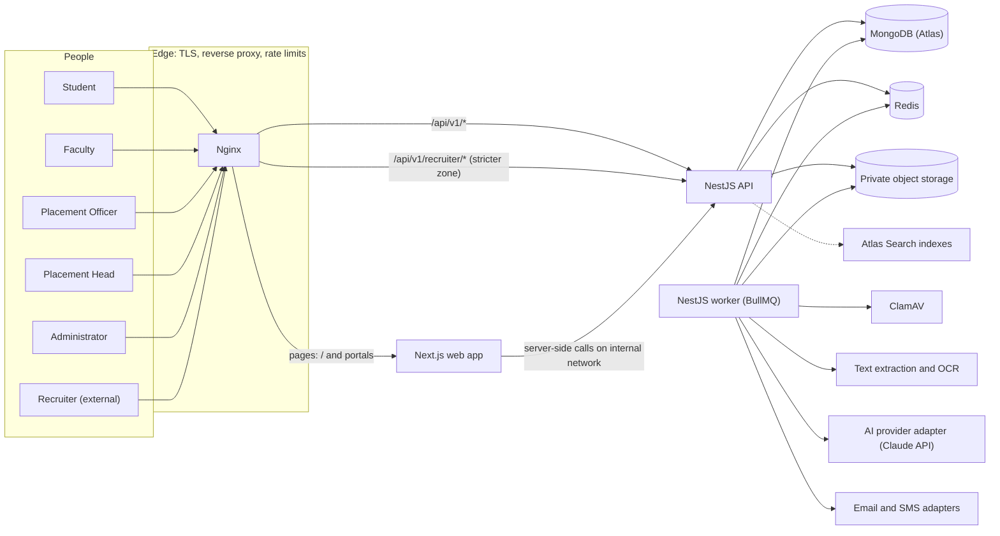

### 6.2 Runtime components

| Component | Responsibility | Scaling unit |
|---|---|---|
| Edge proxy (Nginx) | TLS termination, routing `/api/v1/*` to the API and everything else to the web app, security headers, request size limits, **edge rate limiting with a separate, stricter zone for recruiter paths** | One instance (pilot) |
| Web (Next.js) | Public site, authentication pages and six portals; rendering only, no business logic, no database access | Stateless; horizontal |
| API (NestJS, HTTP) | REST API, authentication, authorization, validation, synchronous business logic, enqueueing jobs | Stateless; horizontal |
| Worker (NestJS application context, no HTTP) | BullMQ processors: scanning, extraction, OCR, AI analysis, rules, imports, recomputation, batch jobs, notifications, schedulers, outbox relay | Horizontal, per-queue concurrency |
| MongoDB | System of record (replica set; transactions require it) | Atlas tier |
| Redis | BullMQ queues, rate-limit counters, session revocation cache, idempotency keys, short-lived caches | Single managed instance |
| Object storage | Uploaded documents, generated reports, import files (S3-compatible: AWS S3, Cloudflare R2 or MinIO locally) | Managed |
| ClamAV (`clamd`) | Malware scanning before any processing or viewing | One container |
| External services | AI provider, SMTP, SMS provider; all optional in local development | — |

The API and the worker are two entry points of the **same NestJS codebase** (`apps/api/src/main.ts` and `apps/api/src/worker.ts`), built into one image and started with different commands. CPU-heavy work (OCR, PDF parsing, batch scoring) never runs in the HTTP process.

### 6.3 Functional modules (P06) and platform modules

| Module | Function (P06) | Depends on (P06) | Build team (P06 §20) |
|---|---|---|---|
| M1 Skill Taxonomy | Skills, levels, synonyms, clusters, role mappings | Independent — build first | Team A |
| M2 Evidence Ingestion | Academic, project, certification, assessment and external evidence | Independent | Team A |
| M3 Evidence Verification | Faculty verification workflow; verified and unverified flags | M2 | Team A |
| M4 Student Skill Profile | Aggregates evidence into levelled skill claims | M1, M2, M3 | Team B |
| M5 Assessment & Mock Interview | Rubric-based evaluation capture and history | Independent | Team B |
| M6 Readiness Engine | Dimension-wise readiness with explanation | M4, M5 | Team B |
| M7 Drive & Eligibility Management | Drives, roles, criteria, registration, shortlists | Independent | Team C |
| M8 Match & Gap Analysis | Profile against drive requirement comparison | M4, M7 | Team C |
| M9 Preparation Planning | Gap to time-bound plan with resources and checkpoints | M8 | Team C |
| M10 Recruiter Portal & Batch Reporting | Scoped recruiter search; institutional analytics | M7 | Team C |

Platform modules (PlaceCampus foundation, built in M0 and M1): **Identity & Access** (authentication, sessions, the authorization module), **Organisation** (institution, departments, programmes, batches), **Accounts & Imports**, **People** (student, staff and recruiter profiles, faculty assignments, consents), **Academic Data**, **Files**, **Notifications**, **Audit**, **Configuration**, **Search**, **Jobs & Outbox**, **Analytics snapshots**.

### 6.4 Module dependency diagram

Arrows point from a module to what it depends on. Dashed arrows are event subscriptions (no compile-time import).

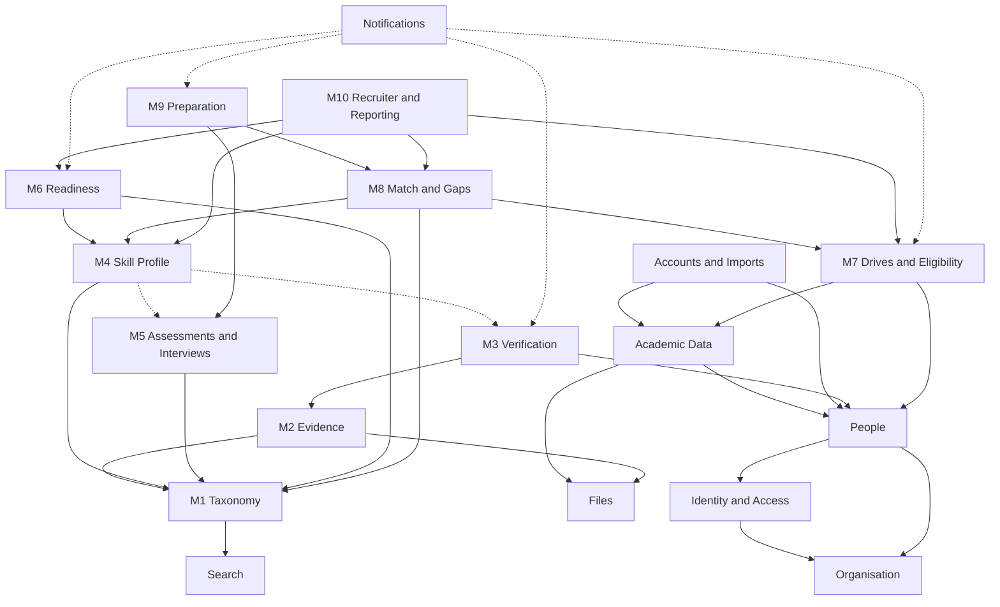

### 6.5 Ownership and integration boundaries

Each module owns its collections. Other modules read them only through the owning module's service interface or through published events — never by importing another module's Mongoose model.

| Module | Owns (collections, §24) | Exposes | Consumes | Must never |
|---|---|---|---|---|
| Identity & Access | `users`, `auth_credentials`, `role_assignments`, `sessions`, `auth_tokens` | Login, sessions, current principal, `AuthorizationService` and policies | Organisation | Contain other modules' business rules |
| Organisation | `institutions`, `departments`, `programmes`, `batches` | Lookups, validation of codes | — | — |
| People | `students`, `staff_profiles`, `recruiter_profiles`, `faculty_assignments`, `consents` | Profile reads and student-managed updates | Identity | Let students edit institution-controlled fields |
| Academic Data | `academic_records`, `academic_correction_requests`, `course_results` | Provenanced values, change history, `AcademicRecordChanged` events | Files, People | Accept an official value without provenance |
| Accounts & Imports | `import_batches`, `import_rows` | Individual and bulk provisioning | Identity, People, Academic Data, Notifications | Create Administrator roles from a spreadsheet |
| Files | `files` | Upload, scan status, short-lived download URLs | Object storage, ClamAV | Produce public URLs |
| M1 Taxonomy | `skills`, `skill_clusters`, `skill_synonyms`, `skill_equivalences`, `taxonomy_releases`, `role_profiles` | Skill lookup, `resolve(text)`, expansion graph per release | Search | Change published releases in place |
| M2 Evidence | `evidence_items`, `evidence_events`, `document_extractions`, `ai_analyses` | Evidence lifecycle, processing pipeline | Files, M1, AI adapter | Set VERIFIED or REJECTED |
| M3 Verification | `verification_reviews` | Review queue, decisions, routing | M2, People (assignments) | Allow a reviewer to decide their own evidence |
| M4 Skill Profile | `skill_claims`, `skill_observations`, `skill_profiles` | Profile reads, recompute | M1; events from M3, M5 | Count unverified observations in verified levels |
| M5 Assessments | `question_banks`, `questions`, `assessments`, `assessment_attempts`, `interview_rubrics`, `mock_interviews`, `interview_evaluations` | Test delivery, evaluations, observation events | M1 | Reveal answer keys to students |
| M6 Readiness | `readiness_configs`, `readiness_snapshots`, `batch_runs` | Readiness reads, recompute, batch runs | M4, M1 | Read CGPA or eligibility |
| M7 Drives & Eligibility | `companies`, `drives`, `eligibility_rules`, `eligibility_results`, `eligibility_exceptions`, `registrations`, `shortlists`, `offers` | Drive lifecycle, eligibility, registration | Academic Data, People | Use skills or readiness as eligibility conditions |
| M8 Match & Gaps | `gap_analyses` | Drive match and gaps | M4, M7, M1 | Change eligibility outcomes |
| M9 Preparation | `preparation_plans`, `learning_resources` | Plans, calendar, checkpoints | M8, M5 | Change verified levels |
| M10 Recruiter & Reporting | `recruiter_access_grants`, `data_release_policies`, `access_logs`, `analytics_snapshots`, `training_programs` | Recruiter APIs, analytics | M7, M4, M6, M8 | Return a field outside the release set |
| Notifications | `notifications`, `notification_templates` | Dispatch, preferences | Events | Send to recipients outside the rule |
| Audit | `audit_logs` | Append-only writer, query | All | Be bypassed or edited |
| Configuration | `system_configurations` | Typed, versioned settings | — | Hold secrets |
| Jobs & Outbox | `outbox_events`, `job_failures` | Reliable event publication | All | Drop events silently |

### 6.6 Domain events

Events are written to `outbox_events` inside the same MongoDB transaction as the state change, then relayed to BullMQ by the worker (§26.8). Consumers are idempotent.

| Event | Producer | Consumers and effect |
|---|---|---|
| `evidence.submitted` | M2 | Start the processing pipeline; confirmation notification |
| `evidence.processing_completed` | M2 | Routing decision (M3) |
| `review.requested` | M3 | Notify assigned faculty ("verification requested") |
| `evidence.verified`, `evidence.rejected`, `evidence.resubmission_requested`, `evidence.verification_revoked` | M3 | M4 writes or invalidates observations; student notified ("verification completed") |
| `observation.recorded`, `observation.invalidated` | M4 (from M3, M5, Academic Data) | Debounced skill-profile recompute |
| `assessment.attempt_graded` | M5 | Observations for mapped skills |
| `interview.evaluation_submitted` | M5 | Observations; student notified |
| `skill_profile.updated` | M4 | Debounced readiness recompute (M6); match recompute for the student's open drives (M8); plan progress refresh (M9) |
| `readiness.recomputed` | M6 | Low-readiness nudge to student and mentor (deduplicated); analytics invalidation |
| `academic_record.changed` | Academic Data | Re-evaluate eligibility for open drives; notify on outcome change |
| `drive.published`, `drive.updated`, `drive.closed`, `drive.cancelled` | M7 | Eligibility evaluation; "new drive matching your profile" notifications; cohort match batch |
| `eligibility.changed` | M7 | Notify "eligibility met or missed, with reason" |
| `registration.created`, `registration.withdrawn`, `registration.status_changed` | M7 | Notifications; recruiter scope cache invalidation |
| `shortlist.published` | M7 | Notify shortlisted and non-shortlisted students ("shortlist result") |
| `grant.approved`, `grant.revoked`, `grant.expired`, `grant.suspended` | M10 | Recruiter session cache invalidation; notify recruiter and officer |
| `taxonomy.release_published` | M1 | Batch recompute of profiles, readiness and open matches; search synonym sync |
| `readiness_config.activated` | M6 | Batch readiness run |
| `plan.checkpoint_due` | M9 scheduler | Reminder notification |
| `import.batch_committed` | Imports | Send invitations; eligibility re-evaluation if academic data changed |

### 6.7 Key request flows

**Evidence submission (student).**

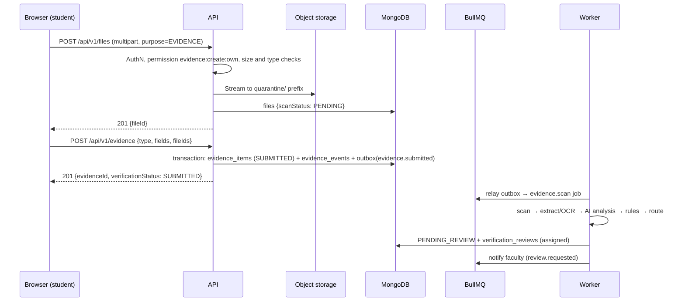

**Recruiter candidate view.**

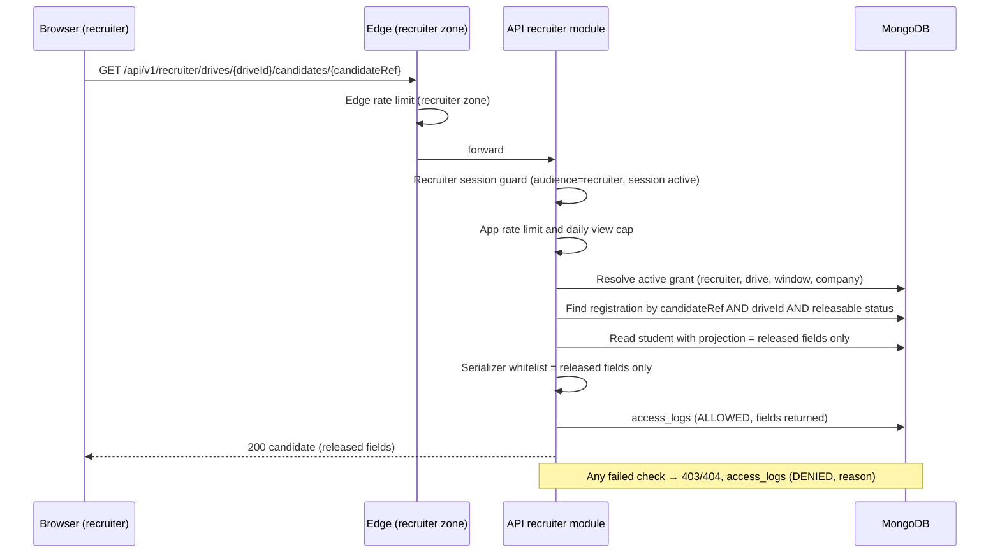

### 6.8 Portal separation and session policies

| Surface | URL space | Session cookie | Access token TTL | Refresh policy | Rate limits |
|---|---|---|---|---|---|
| Public website | `/`, `/about`, `/platform`, `/how-it-works`, `/contact`, legal pages | None | — | — | Edge default zone |
| Campus portals (student, faculty, officer, head, admin) | `/student`, `/faculty`, `/placement`, `/placement-head`, `/admin` | `pc_at` (access), `pc_rt` (refresh) | 15 minutes | Rotating; 7-day idle limit; 30-day absolute limit | Edge default + per-user application limits |
| Recruiter portal | `/recruiter/*` (separate route group and layout) | `pc_rat`, `pc_rrt` | 10 minutes | Rotating; 12-hour absolute limit; re-login daily | **Edge recruiter zone** + stricter per-recruiter limits + daily candidate-view cap |

Campus tokens carry `aud: "pc-campus"`; recruiter tokens carry `aud: "pc-recruiter"`. Each guard accepts only its own audience, so a token from one surface is useless on the other. A recruiter identity cannot hold campus roles (§8.12).

### 6.9 Repository layout (target)

```text
PlaceCampus/
├── apps/
│   ├── web/                      Next.js App Router (public site, auth, six portals)
│   └── api/                      NestJS: src/main.ts (HTTP) and src/worker.ts (BullMQ)
├── packages/
│   ├── shared/                   Enums, permission keys, constants, formatters, Zod form schemas
│   ├── scoring/                  Pure TypeScript engines: profile aggregation, readiness,
│   │                             eligibility evaluator, matching, gap ranking, planner
│   ├── api-client/               Types generated from the OpenAPI document + typed fetch client
│   ├── eslint-config/            Shared lint rules
│   └── tsconfig/                 Shared TypeScript bases
├── infra/
│   ├── docker/                   Dockerfiles (web, api)
│   ├── compose/                  docker-compose.yml for local and CI end-to-end runs
│   ├── nginx/                    Edge config: routing, headers, recruiter rate-limit zone
│   └── mongo/                    Replica-set init, index verification scripts
├── tools/
│   ├── seed/                     Deterministic synthetic data generator (Appendix D)
│   ├── import-templates/         XLSX/CSV template generator (Appendix C)
│   └── load/                     Batch-readiness timing harness, k6 scripts
├── docs/
│   ├── references/               Source documents (read-only)
│   ├── adr/                      Architecture Decision Records
│   ├── api/                      Committed OpenAPI snapshot
│   ├── policies/                 data-release-policy.md, privacy notice, retention policy
│   └── runbooks/                 Operations procedures
├── assets/brand/                 Original logo and hero image (copied, unmodified) [after DEC-16]
├── .github/workflows/            CI and deployment workflows
├── PLACECAMPUS_MASTER_IMPLEMENTATION_PLAN.md
├── README.md, package.json, pnpm-workspace.yaml, .nvmrc, .editorconfig, .gitignore
└── .env.example files per app (placeholders only)
```

The root-level brand files stay where they are until the team approves moving them (DEC-16); the coding stage copies them, byte-identical, into `apps/web/public/brand/`.

---

## 7. Technology Stack Decisions

### 7.1 Version policy

- Pin exact versions in `pnpm-lock.yaml`; record chosen majors in `ADR-001`. At scaffold time, verify each package's current stable major and its security-support status rather than relying on this document.
- Node.js 24 LTS (installed: 24.13.0). pnpm pinned through the `packageManager` field (installed: 12.9.1).
- Upgrades go through a pull request with the full test suite; no unpinned ranges for runtime dependencies.

### 7.2 Frontend

| Technology | Status | Why | Used by | Where | Interactions and notes |
|---|---|---|---|---|---|
| Next.js App Router | Mandatory (brief; Track J) | Routing, layouts, route groups for portal separation, server rendering for the public site | All UI | `apps/web/app` | Version per DEC-12. No Server Actions or database access: all business operations call the NestJS API. |
| React | Mandatory | UI library | All UI | `apps/web` | Version bundled with the chosen Next.js |
| TypeScript (strict) | Mandatory | Type safety shared with the backend | All | Monorepo | `strict: true`, `noUncheckedIndexedAccess: true` |
| Tailwind CSS | Mandatory | Utility styling with design tokens as CSS variables | All UI | `apps/web/app/globals.css` | Tokens from §28 via `@theme` |
| shadcn/ui | Mandatory | Accessible, copy-in components (Radix primitives) that we own and theme | All UI | `apps/web/components/ui` | Use the CLI's current major; components are source code, not a dependency |
| React Hook Form | Mandatory | Performant forms | Every form | Feature components | With `@hookform/resolvers` |
| Zod | Mandatory | Client validation schemas, shared field rules | Forms, env validation | `packages/shared` | Backend remains authoritative (class-validator) |
| TanStack Query | Mandatory | Server state, caching, retries, refetch, optimistic updates | All data views | `apps/web/lib/query` | Query keys per resource; invalidation after mutations |
| TanStack Table | Proposed | Headless sorting, pagination and selection for the many staff tables | Staff portals | `components/data-table` | Used by shadcn's data-table pattern; server-side pagination |
| Recharts | Mandatory | Charts (radar, bar, line, area, composed) | Dashboards, analytics | `components/charts` | Colour tokens from §28.9; table fallback for every chart |
| lucide-react | Mandatory | Icon set | All UI | — | One icon family only |
| GSAP (+ `@gsap/react`) | Mandatory (brief) | Controlled hero and section choreography | Public site; selected dashboard moments | `components/motion` | Respect reduced motion; review GSAP licence terms at adoption |
| AOS | Mandatory (brief) | Simple scroll reveals where GSAP is unnecessary | Public site only | `components/motion` | Never on content needed above the fold |
| Swiper | Mandatory (brief) | Carousels | Public site (role benefits, feature walkthrough) | `components/marketing` | Pause/stop controls; no autoplay under reduced motion |
| `jose` | Proposed | Verify ES256 access tokens in Next.js middleware for redirects | `apps/web/middleware.ts` | — | Public key only; the API remains the authority |
| `openapi-typescript` + `openapi-fetch` | Proposed | Types generated from the API's OpenAPI document; avoids drift | API client | `packages/api-client` | CI fails if the snapshot is stale |
| `pdfjs-dist` | Proposed | In-app PDF viewer for faculty review | FAC-05 | `components/document-viewer` | Rendered from short-lived signed URLs |
| `date-fns` | Proposed | Date maths for calendars and schedules | Planner, drives | — | Display in `Asia/Kolkata` with `Intl` |
| `sonner` | Proposed | Toasts (shadcn default) | All UI | — | `aria-live="polite"` |

### 7.3 Backend

| Technology | Status | Why | Used by | Notes |
|---|---|---|---|---|
| NestJS (`@nestjs/core`, `common`, `platform-express`) | Mandatory | Modular backend for domain complexity (P06) | API and worker | Feature modules (§26) |
| Mongoose + `@nestjs/mongoose` | Mandatory | ODM, schemas, validation, middleware | All modules | `optimisticConcurrency` on human-edited documents |
| class-validator + class-transformer | Mandatory | DTO validation and whitelisting | All controllers | Global `ValidationPipe({ whitelist: true, forbidNonWhitelisted: true, transform: true })` |
| `@nestjs/swagger` | Mandatory | OpenAPI document and Swagger UI | API | UI disabled in production unless behind admin auth |
| JWT (ES256) via `jose` | Mandatory (JWT) | Signed short-lived access tokens | Identity | Key pair with `kid`; public key shared with the web app |
| `argon2` | Proposed | Password hashing (argon2id) | Identity | Parameters in §32.2 |
| `@nestjs/throttler` + Redis storage | Proposed | Application rate limits per route and per user | All, stricter for recruiter | Distributed counters across instances |
| `@nestjs/bullmq` + `bullmq` + `ioredis` | Mandatory | Queues, retries, schedulers | Worker | Worker connections need `maxRetriesPerRequest: null` |
| `@nestjs/terminus` | Proposed | Health checks | Ops | `/health/live`, `/health/ready` |
| `nestjs-pino` + `pino` | Proposed | Structured JSON logs with request IDs | All | PII redaction paths configured |
| `helmet`, `cookie-parser` | Proposed | Security headers, cookies | API | CSP mostly set at the edge and in Next.js |
| `@aws-sdk/client-s3` + `@aws-sdk/s3-request-presigner` | Proposed | S3-compatible storage (S3, R2, MinIO) | Files | Private bucket; presigned GET only after authorization |
| `file-type` | Proposed | Magic-number content sniffing | Files | Never trust the client MIME type |
| `sharp` | Proposed | Image normalisation (orientation, resize, greyscale) and perceptual hashing | Evidence pipeline | Worker only |
| `pdfjs-dist` (Node) | Proposed | PDF text-layer extraction and page counting | Evidence pipeline | Worker only |
| `tesseract.js` | Proposed | OCR for images and scanned pages (English) | Evidence pipeline | Worker only; CPU heavy |
| ClamAV client (`clamscan` or a direct `clamd` TCP client) | Proposed | Malware scanning | Files | `SCANNER_DRIVER` = `clamav` or `noop` (noop only in local dev, shown in health) |
| `@anthropic-ai/sdk` | Proposed (AI adapter default) | Document classification and structured extraction | Evidence pipeline | Behind `DocumentAnalyzer` interface (§12.6) |
| `exceljs` | Proposed | Generate XLSX templates with validation lists; read uploaded workbooks | Imports | Preferred over the npm `xlsx` package, whose registry releases are outdated |
| `csv-parse` | Proposed | CSV imports | Imports | Streaming parser |
| `libphonenumber-js` | Proposed | Phone normalisation (+91 default) | People, imports | — |
| `nodemailer` | Proposed | SMTP email adapter | Notifications | Mailpit locally |
| `otplib` | Optional (DEC-18) | TOTP MFA for Admin and Placement Head | Identity | — |

### 7.4 Data and infrastructure

| Technology | Status | Why | Notes |
|---|---|---|---|
| MongoDB Atlas | Mandatory | Managed database with backups and Atlas Search | Tier per DEC-13; transactions need a replica set (Atlas always is) |
| Local MongoDB 8.2 single-node replica set | Proposed (development) | Transactions and change history work locally | `mongod --replSet rs0` then `rs.initiate()` (§37.3) |
| `mongodb-memory-server` (`MongoMemoryReplSet`) | Proposed (tests) | Fast integration tests without Docker, including on Windows | Used by `apps/api` tests |
| Redis 7 (or Valkey 8, a compatible open-source fork) | Mandatory (Redis per brief) | BullMQ, rate limits, caches | Managed in production; DEC-15 for local |
| Private object storage (S3 / R2; MinIO locally) | Mandatory | Documents outside MongoDB | Versioning on; lifecycle rules for quarantine |
| ClamAV | Proposed | Malware scanning | Container; signature updates via `freshclam` |
| OCR and document extraction | Mandatory (brief) | Text for duplicate checks and AI-independent rules | `pdfjs-dist` text layer first, `tesseract.js` fallback |
| AI API | Mandatory (brief) | Assisted extraction and classification | Provider-agnostic adapter; can be disabled per institution |
| Docker + Compose | Mandatory (brief) | Reproducible local stack, CI end-to-end, deployment images | Multi-stage builds, non-root users |
| Nginx | Proposed | Edge routing and independent recruiter rate limits (P06 §16) | `limit_req_zone` per surface |
| GitHub Actions | Mandatory (brief) | CI and deployment | §37.5 |
| Mailpit | Proposed (development) | Captures outgoing email locally | No real email in dev |

### 7.5 Testing and quality tooling

| Tool | Purpose |
|---|---|
| Jest (with `@swc/jest`) | Unit and integration tests across the monorepo (Nest default; `next/jest` for the web app) |
| `@nestjs/testing` + `supertest` | API integration tests |
| React Testing Library | Component tests |
| Playwright + `@axe-core/playwright` | End-to-end and accessibility tests |
| k6 (external binary) | HTTP load tests (optional; batch timing uses a Node harness) |
| ESLint (flat config) + `typescript-eslint` + `eslint-plugin-jsx-a11y` + Prettier | Linting and formatting |
| gitleaks | Secret scanning in CI |

### 7.6 Deliberately not added

| Not added | Reason |
|---|---|
| Meilisearch | Atlas Search satisfies P06 without another service (§34) |
| Passport | Small custom guards are clearer for two audiences and cookie tokens |
| Prisma / TypeORM | Mongoose is mandated |
| Redux, Zustand | TanStack Query + React state cover server and local state |
| Axios, Lodash, Moment | Native `fetch`, native JavaScript and `date-fns` suffice |
| Framer Motion and other animation libraries | GSAP, AOS and Swiper are already mandated; CSS transitions cover the rest |
| Additional chart libraries (Chart.js, ECharts, D3 bundles) | Recharts only; custom SVG for the few shapes it lacks |
| Socket.IO | Polling first; Server-Sent Events only if needed (OPT-08) |
| Joi | Zod and class-validator already cover validation |
| A full calendar library | A small calendar built on shadcn primitives and `date-fns` covers week, month and agenda views (§19.8); revisit only if it proves insufficient |

---

## 8. Accounts Identity and User Management

`[ENHANCEMENT]` ENH-02. Confirmed product decision: the Administrator is the central account-provisioning authority. There is no public role registration.

### 8.1 Principles

1. Accounts are created only by Administrators, individually or through role-specific bulk imports.
2. Activation happens through a secure, expiring, single-use invitation. Passwords never appear in templates, emails or logs.
3. One human has one user identity. Roles are attached through role assignments with scopes.
4. Identity, credentials, role assignments, institution membership, account status and permissions are stored separately.
5. Recruiter authentication and recruiter drive access are separate: an active recruiter account sees nothing until a drive grant is approved (§21).
6. Imports never blindly overwrite academic values; every academic change is visible in a preview, attributed and reversible (§8.9, §9).
7. Every provisioning action is audit-logged.

### 8.2 Identity model

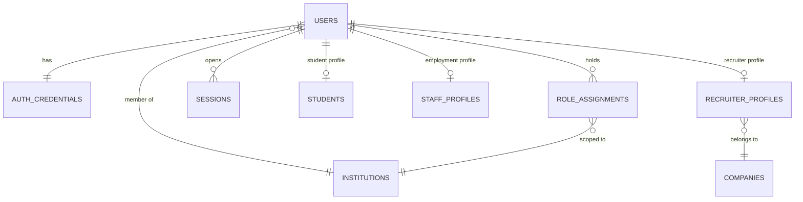

| Concern | Stored in | Notes |
|---|---|---|
| Identity (who) | `users` | Name, normalised email, phone, status, `institutionId` |
| Credentials (how they prove it) | `auth_credentials` | Separate collection; never returned by any API; `select: false` defaults |
| Role assignments (what they may do, where) | `role_assignments` | Role, scope, validity window, status, granted by, reason |
| Institution membership | `users.institutionId`, `role_assignments.institutionId` | One institution per deployment in v1; the model supports more |
| Account status | `users.status` | §8.4 |
| Permissions | Code-defined role → permission map (Appendix B) | Reviewed through pull requests; not editable at runtime in v1 |

### 8.3 Roles, scopes and permission bundles

| Role | Scope attributes | Typical effective scope |
|---|---|---|
| `STUDENT` | `studentId` (self) | Own records only |
| `FACULTY` | `departmentIds[]`; assignments in `faculty_assignments` with purposes `MENTOR`, `EVIDENCE_REVIEWER`, `INTERVIEWER`, `PROJECT_GUIDE` | Assigned students; department-level aggregates |
| `PLACEMENT_OFFICER` | `operationalScope`: `ALL` or lists of `departmentIds`, `programmeIds`, `batchIds` | Students and drives within scope |
| `PLACEMENT_HEAD` | Institution-wide | Institution |
| `RECRUITER` | `companyId` | Own company; drives only through approved grants |
| `ADMINISTRATOR` | Institution platform functions | Accounts, configuration, taxonomy, health, audit; no student evidence content by default |

Assignable **permission bundles** extend a staff member's role without inventing new roles:

| Bundle | Grants | Typical holder |
|---|---|---|
| `ACADEMIC_DATA_STEWARD` | Verify student-submitted academic values; decide correction requests; manual academic edits with reason | Exam cell staff or a nominated placement officer |
| `REVIEW_COORDINATOR` | Reassign reviews, handle escalations, see queue health with content access for escalated items | Senior faculty |
| `AUDITOR` | Read audit logs and access logs | Placement Head, a nominated administrator |

### 8.4 Account status lifecycle

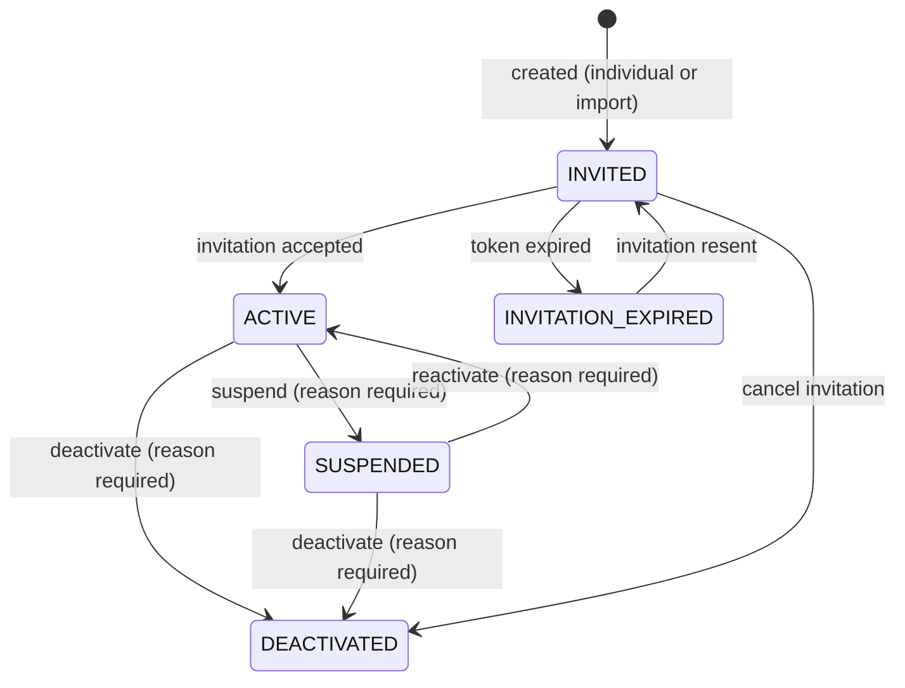

| Transition | Actor | Effects |
|---|---|---|
| Create | Administrator (or import commit) | Invitation token issued; audit entry |
| Accept invitation | The invited person | Password set; consents recorded; session created |
| Suspend | Administrator; Placement Head for recruiter accounts | All sessions revoked within seconds (Redis revocation + DB); recruiter grants move to `SUSPENDED` |
| Reactivate | Administrator | Login possible again; grants stay suspended until a Placement Head reactivates them |
| Deactivate | Administrator | Login permanently blocked; data retained per retention policy (§32.15); open registrations of a deactivated student are withdrawn with reason `ACCOUNT_DEACTIVATED` |

Temporary lockout after failed logins is a separate flag (`auth_credentials.lockedUntil`), not a status.

### 8.5 Individual account creation

The "Create account" page (ADM-04) starts with a role picker and shows a role-specific form. All forms validate on blur and on submit (client: Zod; server: class-validator). Duplicate detection runs before submit (`POST /admin/users/check-duplicates`) and again on the server.

| Role | Fields (required *) | Server rules |
|---|---|---|
| Student | Official name*, registration number*, institutional email*, phone, programme*, department* (derived from programme, editable only if the programme spans departments), section, graduation batch*, current semester* | Email domain must be in the institution's allowed domains; registration number unique; optional academic values entered here are stored as `ADMIN_ENTERED` + `UNVERIFIED` (§9.3) |
| Faculty | Employee ID*, name*, official email*, phone, department*, designation*, assigned scope (departments), employment status* | Employee ID and email unique; mentor assignments are managed afterwards (§10.2) |
| Placement Officer | Employee ID*, name*, official email*, phone, placement unit*, designation*, operational scope*, employment status* | Scope must reference existing departments, programmes or batches |
| Placement Head | Employee ID*, name*, official email*, designation*, responsibility scope*, employment status* | Warn if another active Placement Head exists (allowed, but explicit) |
| Recruiter | Company* (select existing or create), recruiter name*, business email*, phone, designation*, company website | Warn when the email domain differs from the company website domain or is a free-mail domain; company association starts as `PENDING_VERIFICATION`; **no drive grant is created** |
| Administrator | Not on this form — see §8.6 | — |

On success: user (`INVITED`), credentials placeholder (no password), profile document, role assignment, invitation token, `user.created` audit entry, invitation email queued (or held if "send later" is chosen).

### 8.6 Additional Administrators (two-person rule)

1. Administrator A opens ADM-05 and submits name, email and a written justification. The request is `PENDING_APPROVAL`.
2. A different, active Administrator B approves or rejects (reason required). A cannot approve their own request; the server checks `approverId ≠ requesterId`.
3. On approval, an invitation is sent. Activation requires MFA enrolment when DEC-18 is approved.
4. The `ADMINISTRATOR` role assignment becomes `ACTIVE` only when the invitation is accepted.
5. Bulk templates have no role or privilege column; the import service rejects any attempt to create an Administrator.
6. **Bootstrap:** the very first Administrator is created by an operator command (`pnpm --filter api cli admin:bootstrap --email … --name …`) that refuses to run when any Administrator already exists. The command's use is audit-logged.

### 8.7 User management dashboard (ADM-01, ADM-02)

- **KPI row (stat tiles):** total accounts; accounts by role (six tiles in a compact group); active; pending invitations; invitation expired; suspended; deactivated. Each tile links to the filtered list.
- **Tabs:** Users · Invitations · Imports · Roles and bundles.
- **Filters:** role, status, department, programme, batch, created date range, last login range; search across name, email, registration number and employee ID (debounced 300 ms, synchronised to the URL).
- **Row actions:** view; resend invitation; suspend; reactivate; deactivate; manage role assignments; revoke sessions; reset MFA (two-person rule for Administrator accounts).
- **Bulk actions:** resend invitations (up to 200 selected); export the current filtered list of accounts (Administrator only; audited; no academic values).
- **Primary actions:** "Create account" and "Bulk import".

### 8.8 Role-specific bulk import templates

Full column dictionary: Appendix C. Design rules for every template:

- Delivered as **XLSX** (primary) and **CSV** (one file per worksheet). The XLSX includes an `Instructions` sheet first and a `Lookups` sheet last (valid department, programme, batch and designation codes), with dropdown validation on coded columns.
- Row 1 holds machine-readable column keys (`registration_number`); required keys end with `*`. Header comments carry human-readable labels and examples.
- The workbook carries custom properties `pcTemplate` (role) and `pcTemplateVersion`. The server rejects a mismatched template type or an unsupported version with a clear message.
- **No password columns. No role, privilege or permission columns.** There is no Administrator template.
- Empty optional cells mean "unknown, no change"; the literal `NA` means "not applicable"; `0` means zero (§9.8).

| Template | Worksheets | Natural key |
|---|---|---|
| Students | 1 `Students` (identity and enrolment) · 2 `Academic Summary` (10th, 12th, diploma, CGPA, backlogs) · 3 `Semester Results` (one row per student per semester) | `registration_number` (joins the sheets) |
| Faculty | `Faculty` | `employee_id` |
| Placement Officers | `Placement Officers` | `employee_id` |
| Placement Heads | `Placement Heads` | `employee_id` |
| Recruiters | `Recruiters` | `business_email` (company matched by `company_id` or created from `company_name` after confirmation) |

### 8.9 Bulk-import lifecycle

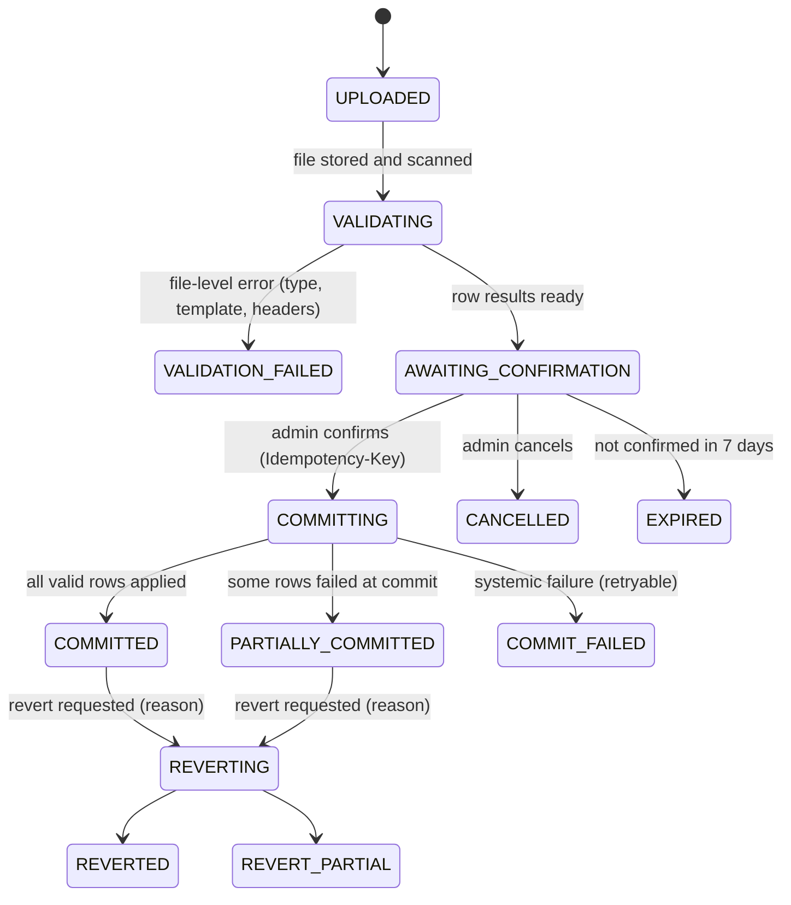

**Step by step**

1. **Select role and mode; download the matching template** (ADM-09). Modes:
   - `CREATE_ONLY` (default): create new accounts; existing matches are skipped and reported.
   - `CREATE_AND_UPDATE_PROFILE`: also update institution-controlled, non-academic fields of existing accounts (section, semester, designation). Never blanks out an existing value.
   - `ACADEMIC_UPDATE` (Students template only): update academic summary and semester results of existing students. A reason is mandatory and the commit needs the explicit diff confirmation below.
2. **Upload** (ADM-06): XLSX or CSV, at most 10 MB and 10,000 data rows per sheet `[PROPOSED TARGET]`. Stored privately under `imports/`; SHA-256 computed; malware scan; `import_batches` record created.
3. **File validation:** extension and magic number agree (XLSX is a ZIP container with workbook parts; CSV is UTF-8 text, BOM tolerated); not password-protected; macro-enabled formats (`.xlsm`) rejected; template type and version match.
4. **Header validation:** all required keys present; duplicate headers rejected; unknown headers reported as warnings and ignored.
5. **Field validation per row:** types, formats, enumerations against `Lookups`, ranges (percentages 0–100; CGPA within its declared scale; semester 1–12), dates (`YYYY-MM-DD` or `DD-MM-YYYY`), email format and allowed domains, phone normalisation to E.164 (+91 default), trimming and Unicode NFC normalisation. Cells starting with `=`, `+`, `-` or `@` are treated as text (formula-injection protection); generated error reports prefix such cells with an apostrophe.
6. **Duplicate detection:**
   - Within the file: the same natural key twice → `DUPLICATE_IN_FILE` on both rows (identical rows: the second becomes `SKIPPED_IDENTICAL`).
   - Against the database: match by normalised email, registration number or employee ID → `EXISTING_MATCH` (with which key matched).
   - Conflicting identity (email matches user A, registration number matches user B) → `CONFLICT`; the row is blocked.
7. **Institution and department matching:** codes resolve through the `Lookups` values; unknown codes produce an error with the three closest valid codes (edit distance).
8. **Preview** (ADM-07): counts for total, will create, will update, unchanged, invalid, duplicates, conflicts and skipped; sample rows; for updates, a field-level diff (old → new, with the old value's provenance).
9. **Error report:** downloadable XLSX or CSV with the original row plus `error_field`, `error_code`, `error_message` columns.
10. **Explicit confirmation:** a dialog restates the counts; the Administrator types the number of rows to be applied. For `ACADEMIC_UPDATE`, every changed official value is listed and must be acknowledged; a reason is required. Only valid rows are ever committed.
11. **Commit** (worker, queue `imports`): rows processed in chunks of 200, each chunk in a MongoDB transaction. Row-level idempotency uses `(batchId, rowNumber, rowHash)` plus natural-key uniqueness, so retries never create duplicates. Academic values are written with provenance `INSTITUTION_IMPORTED` and `sourceRef = importBatchId`; previous values go to `academic_record_history`.
12. **Invitations:** created for new accounts; sent immediately (rate-limited email) or held until the Administrator clicks "Send invitations".
13. **History** (ADM-08): every batch with role, mode, file name, file hash, counts, actor, timestamps, state, reports and the audit trail.

**Protection and recovery**

| Concern | Rule |
|---|---|
| Re-import protection | The same file hash, role and mode within 30 days is blocked unless the Administrator ticks "I intend to re-import this file" and gives a reason |
| Idempotent confirmation | `POST …/commit` requires an `Idempotency-Key`; a batch can enter `COMMITTING` only once; repeated clicks return the same job |
| Partial import | Rows that fail during commit (for example, a concurrent manual creation) are marked `FAILED` with a reason; the batch becomes `PARTIALLY_COMMITTED`; a "re-import failed rows" action generates a new batch from them |
| Revert (reconciliation) | Within 14 days (configurable), with a reason. Accounts created by the batch and never activated are deactivated and their invitations revoked. Activated accounts are listed for manual review, never auto-removed. Academic updates are restored from history only where the field has not changed since; otherwise the conflict is listed. Reverting an `ACADEMIC_UPDATE` batch requires a second approver holding `ACADEMIC_DATA_STEWARD` or the Placement Head. |
| Audit | Upload, validation, confirmation, commit, revert and report downloads are audit-logged |

### 8.10 Account activation

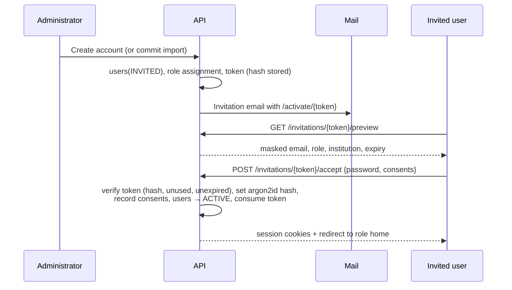

- Token: 32 random bytes, base64url; only its SHA-256 hash is stored; single use; expires after 7 days (72 hours for recruiters); resending invalidates the previous token.
- Possession of the token sent to the address verifies the email.
- The activation page (AUTH-03) shows the masked email, role and institution, the password rules, and links to the privacy notice and terms. Consent records are written to `consents` (§32.14).
- Recruiters land on onboarding (REC-02). They see no drive data until their company association is `VERIFIED` and a Placement Head approves a grant (§21.3).

### 8.11 Login, lockout and recovery

| Concern | Rule |
|---|---|
| Login | Email + password. The error message is always "Email or password is incorrect". Campus and recruiter logins are separate pages and endpoints. |
| Rate limiting | Per IP and per account (§32.6) |
| Lockout | 5 consecutive failures → locked 15 minutes, doubling per repeat up to 24 hours; the owner is emailed |
| Password policy | 12 to 128 characters; no composition rules; rejected if it appears in a bundled list of common and breached passwords; paste and password managers allowed (WCAG 2.2 accessible authentication) |
| Forgot password | Always returns the same confirmation; token valid 30 minutes, single use; success revokes all sessions |
| Change password | Requires the current password; revokes other sessions |
| Account recovery | If email access is lost, the user contacts the Administrator (AUTH-06); the Administrator verifies identity offline and re-issues an invitation; audited |
| MFA | TOTP for Administrator and Placement Head when DEC-18 is approved; recovery codes shown once |

### 8.12 Identity resolution and multiple roles

- Normalised email (trimmed, lowercased, NFC) is unique per institution; registration number and employee ID are unique per institution.
- A person imported through a second role template (for example, a faculty member listed in the Placement Officer template) is matched to the existing user; the preview shows "Existing user — will add role PLACEMENT_OFFICER"; no second user is created.
- Users with several roles choose an **active role** after login (AUTH-08) and can switch from the user menu. The session stores `activeRoleAssignmentId`; permissions are evaluated for the active role only; switching is audited.
- Recruiter identities are always separate users. They cannot hold campus roles and cannot be created from campus templates.
- A former student who joins as staff keeps one identity; the `STUDENT` assignment is closed (status `ALUMNI`) before a staff assignment is added. This needs an Administrator review.

### 8.13 Notifications in this module

Invitation, invitation reminder (after 3 days), activation confirmation, lockout, password reset requested and completed, role assignment added or removed, account suspended or reactivated, Administrator request awaiting approval.

### 8.14 Acceptance criteria

- AC-ACC-01: An Administrator can create a Student, Faculty, Placement Officer, Placement Head and Recruiter individually; each receives a working invitation.
- AC-ACC-02: An Administrator account cannot be created by import, and an Administrator request cannot be approved by its requester.
- AC-ACC-03: A valid Students workbook of 500 synthetic rows across three sheets produces a correct preview and error report; committing creates exactly the valid rows and their invitations.
- AC-ACC-04: Re-uploading the same file within 30 days is blocked without an explicit override.
- AC-ACC-05: No academic value changes without appearing in the commit diff, and blank cells never become zero.
- AC-ACC-06: Invitation tokens are single-use and expire; a used or expired token shows a clear message.
- AC-ACC-07: There is no public sign-up route in the web app or the API.
- AC-ACC-08: A person holding Faculty and Placement Officer roles exists as one user with two role assignments.
- AC-ACC-09: Suspending an account ends its active sessions within 60 seconds `[PROPOSED TARGET]`.

---

## 9. Academic Data Ownership and Provenance

`[ENHANCEMENT]` ENH-03. The team has no official access to university student records. PlaceCampus works without ERP integration and never claims that data is official unless its provenance says so.

### 9.1 Three academic data sources

| Source | How data arrives | Provenance written |
|---|---|---|
| Authorised university CSV/XLSX import | Students template, `Academic Summary` and `Semester Results` sheets (§8.9) | `source: INSTITUTION_IMPORTED`, `verification: VERIFIED`, `sourceRef: importBatchId` |
| Approved ERP/SIS integration (future, OPT-04) | Connector into a staging area, same validation as imports (§35.2) | `source: ERP_SYNC`, `verification: VERIFIED` |
| Student-submitted information | Student enters values and uploads a marksheet (evidence type `ACADEMIC_MARKSHEET`) | `source: STUDENT_SUBMITTED`, `verification: PENDING` until a data steward decides |

A fourth, exceptional path is manual entry by an Administrator or data steward with a reason. Administrator entry is stored as `ADMIN_ENTERED` + `UNVERIFIED`; **an Administrator typing a CGPA is not proof that it is an official result**. Only a data steward's verification makes it `VERIFIED`.

### 9.2 Ownership matrix

| Data | Owner | Who may change it | Verification | Visible to |
|---|---|---|---|---|
| Official name, registration number | Institution | Import; Administrator correction with reason | Institution source | All internal roles; recruiters only if released |
| Department, programme, section, batch, current semester | Institution | Import; Administrator | Institution source | All internal roles; programme, department, batch releasable |
| 10th and 12th board and percentage; diploma details | Institution | Import; steward (verifying student submissions) | Steward or institution source | Student, assigned faculty (summary), officer, head; releasable per drive |
| CGPA, SGPA per semester, credits, result dates | Institution | Import; steward through approved corrections | Institution source | As above |
| Active backlogs, backlog history | Institution | Import; steward | Institution source | As above |
| Profile photo, permitted contact details, resume, projects, GitHub, LinkedIn, career interests, availability, additional skill claims | Student | Student | Projects and skills through M3 | Student; staff in scope; recruiters only if released |
| Evidence decisions, skill evaluations, project evaluations, mock-interview feedback | Faculty | The deciding faculty member (amendments logged) | — | Student; staff in scope; never recruiters |
| Readiness, eligibility, match, gaps, plan progress | System | Recomputed only by the engines | Versioned | Student and staff in scope; recruiters never see readiness (§21.5) |

### 9.3 Provenance model

Every institution-controlled academic value is stored as a `ProvenancedValue`:

```ts
type ProvenanceSource =
  | 'INSTITUTION_IMPORTED' | 'ERP_SYNC' | 'STUDENT_SUBMITTED' | 'ADMIN_ENTERED' | 'FACULTY_REVIEWED';
type VerificationState = 'VERIFIED' | 'PENDING' | 'REJECTED' | 'UNVERIFIED';
type Availability = 'PRESENT' | 'UNKNOWN' | 'NOT_APPLICABLE';

interface ProvenancedValue<T> {
  value: T | null;                 // null when availability ≠ PRESENT; never coerced to 0
  availability: Availability;
  scale?: { kind: 'CGPA_10' | 'CGPA_4' | 'PERCENT' | 'COUNT' | 'GRADE_LETTER'; max?: number };
  originalValue?: string;          // exactly as supplied, before normalisation
  source: ProvenanceSource;
  sourceRef?: { kind: 'IMPORT_BATCH' | 'EVIDENCE' | 'ERP_SYNC' | 'MANUAL' | 'CORRECTION'; id: string };
  sourceActorId?: string;          // user who supplied or entered it
  verification: VerificationState;
  verifiedBy?: string;
  verifiedAt?: string;             // ISO 8601
  recordedAt: string;
  updatedAt: string;
  note?: string;
}
```

The brief's eight provenance labels map onto these fields: *Institution imported* = `INSTITUTION_IMPORTED`; *Institution verified* = any source with `verification: VERIFIED` by a steward; *Student submitted* = `STUDENT_SUBMITTED`; *Admin entered* = `ADMIN_ENTERED`; *Faculty reviewed* = `FACULTY_REVIEWED`; *Pending* and *Rejected* = the verification state; *Unavailable* = `availability: UNKNOWN` or `NOT_APPLICABLE`.

**Trust policy for eligibility** (configurable per field, default shown): a value counts as verified when `source` is `INSTITUTION_IMPORTED` or `ERP_SYNC`, or `verification` is `VERIFIED`. `STUDENT_SUBMITTED` + `PENDING` and `ADMIN_ENTERED` + `UNVERIFIED` produce `PENDING_VERIFICATION` in eligibility (§16.4).

### 9.4 Change history

Every change to a provenanced value appends a document to `academic_record_history`: student, field path, previous value (with full provenance), new value, actor, reason, source reference and timestamp. History is never edited. Students can see the history of their own values (STU-03).

### 9.5 Academic correction requests

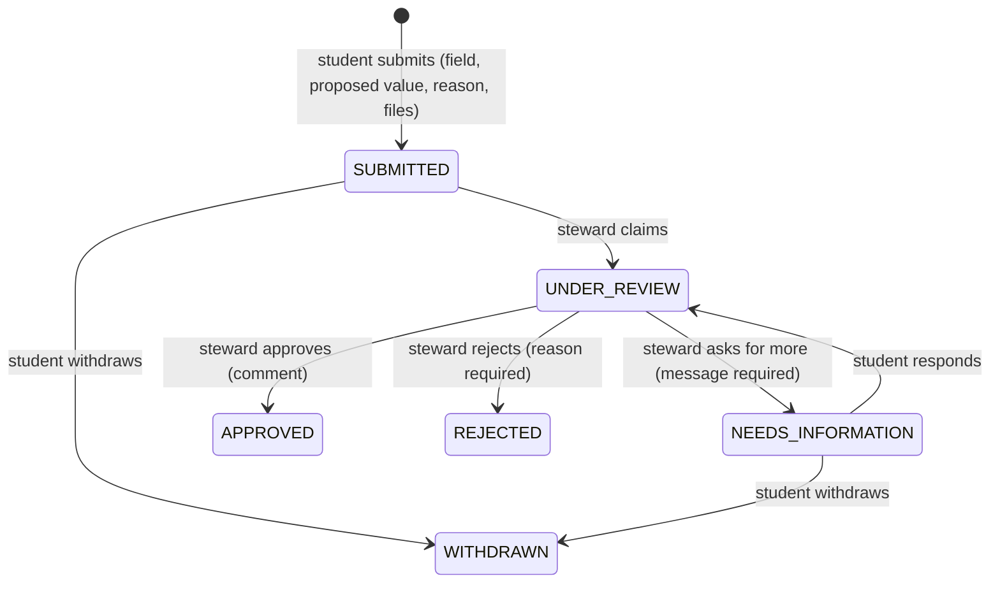

- Students see institution-controlled values read-only, each with a provenance badge, and a "Request correction" action per value (STU-05).
- Reviewers hold `ACADEMIC_DATA_STEWARD`. Faculty and Administrators do not decide corrections unless they hold that bundle.
- Approval writes the new value with `verification: VERIFIED`, `sourceRef: CORRECTION`, keeps the original in history, emits `academic_record.changed` (eligibility re-evaluation) and notifies the student. Rejection notifies the student with the reason.
- Service level: decision within 5 working days `[PROPOSED TARGET]`; overdue requests appear on the steward's dashboard.

### 9.6 Student-submitted academic information

1. The student enters a value (for example, 12th percentage) and attaches the marksheet as evidence.
2. The value is stored as `STUDENT_SUBMITTED` + `PENDING`; eligibility treats it as pending.
3. The evidence pipeline (§12) may extract the printed values; mismatches with the entered values are flagged for the steward.
4. The steward verifies (value becomes `VERIFIED`) or rejects (reason required).
5. If an institution import later supplies the same field, the institution value supersedes it; history is kept and the student is notified when values differ.

### 9.7 Scales and normalisation

- CGPA is stored on its original scale with `scale.kind` and `scale.max`. Eligibility rules declare the scale they compare on (default `CGPA_10`).
- No conversion between scales is applied unless the institution configures an approved conversion rule (none by default). Without one, a comparison across scales yields `UNKNOWN` with reason `SCALE_MISMATCH`.
- Percentages are 0–100 with up to two decimals. Active backlogs are integers ≥ 0; cleared backlogs are recorded in history, not in the active count.
- Semester results store semester number, SGPA (with scale), credits earned, result date and result status.

### 9.8 Missing-value semantics

| In an import cell or form | Stored as | Shown as |
|---|---|---|
| Empty | `availability: UNKNOWN` (existing values unchanged on update) | "Not available" |
| `NA` | `availability: NOT_APPLICABLE` | "Not applicable" |
| `0` | `value: 0`, `availability: PRESENT` | "0" |

Missing values never become zero, never make a student ineligible and never reduce readiness.

### 9.9 Eligibility with missing or unverified data

Missing or unverified required values produce `PENDING_VERIFICATION`, listing exactly which fields are missing or unverified and what the student can do (submit a marksheet, request a correction, wait for verification). Details in §16.4.

### 9.10 Demonstration data policy

- Until real data is authorised, every environment uses synthetic data from the generator (Appendix D). Every generated document has `isDemoData: true`.
- When an institution is in demo mode, every portal shows a persistent banner: "Demo data — these are not real students or companies."
- Synthetic people use neutral generated names; synthetic companies are fictional and suffixed "(Demo)"; no real logos.
- The seed command refuses to run against a database containing a non-demo institution, and is disabled in production builds.
- Analytics computed on demo data carry the demo label in the UI and in any generated report.

### 9.11 Path to ERP/SIS integration

When the university approves integration: a connector writes into a staging collection; the same validators as imports run; provenance is `ERP_SYNC`; a nightly sync applies changes as diffs with history; conflicts with steward-verified values are queued for review rather than overwritten. Details in §35.2.

### 9.12 Acceptance criteria

- AC-ACA-01: A student sees each official value with its provenance badge and cannot edit it.
- AC-ACA-02: A correction request moves through the state machine; approval updates the value, keeps history and triggers eligibility re-evaluation.
- AC-ACA-03: A student-submitted value stays `PENDING` and yields `PENDING_VERIFICATION` in eligibility until verified.
- AC-ACA-04: Imports and forms distinguish empty, `NA` and `0` exactly as in §9.8.
- AC-ACA-05: Demo mode shows the banner on every portal page, and the seed command refuses to run against non-demo data.

---

## 10. Six Role Workflows

Each portal shares the design system and platform services but has its own information hierarchy. Page IDs refer to §27 (routes) and §31 (UI inventory); permission keys refer to Appendix B; endpoints refer to §25.

Common to every portal:

- **Loading:** skeletons shaped like the final content (cards, table rows, chart frames); never a blank page or a full-screen spinner for more than one second.
- **Empty states:** say what will appear, why it is empty, and the next action.
- **Errors:** inline error card with the cause in plain words, a retry button and the request ID; form errors next to fields plus an error summary (§28.12).
- **Session expiry:** silent refresh; if refresh fails, redirect to login with `?next=` and a "Your session ended" notice.
- **Demo mode:** persistent banner (§9.10).

### 10.1 Student portal

**Purpose.** Give each student one honest view of eligibility, readiness and next actions, and the tools to improve and apply.

**Responsibilities.** Keep student-managed details current; submit evidence; take assessments; attend mock interviews; follow the preparation plan; apply to drives; track applications; respond to offers; request academic corrections.

**Navigation.** Desktop sidebar: Home · Profile · Academics · Skills · Evidence · Projects · Resume · Assessments · Mock interviews · Readiness · Drives · Matching · Gaps · Preparation · Applications · Notifications · Settings. Mobile bottom bar (five items): Home · Drives · Skills · Plan · More (opens the full menu).

**Dashboard (STU-01).**

```text
┌──────────────┬───────────────────────────────────────────────────────────────────────┐
│ [Logo]       │ Top bar: title · search (own items) · [Bell + count] · [Avatar menu]   │
│ Home         ├───────────────────────────────────────────────────────────────────────┤
│ Profile      │ Welcome back, <first name>        │ NEXT BEST ACTION                  │
│ Academics    │ Profile completeness  ████░ 72%    │ "Get your SQL project verified"   │
│ Skills       │                                    │ [Open evidence]                   │
│ Evidence     ├────────────────────────────────────┼───────────────────────────────────┤
│ ...          │ GENERAL READINESS (target role)    │ DRIVES OPEN TO YOU                │
│              │ [Radar: 4 dimensions]              │ Company · Role · Closes 12 Nov    │
│              │ Demonstrated 58 · Coverage 64%     │ [Eligibility pill] [Match meter]  │
│              │ State: Provisional  [Why?]         │ [View] [Apply]                    │
│              ├────────────────────────────────────┼───────────────────────────────────┤
│              │ TOP GAPS for your target role      │ THIS WEEK'S PLAN · checkpoints    │
│              ├────────────────────────────────────┴───────────────────────────────────┤
│              │ Evidence: 3 pending review · 1 needs resubmission [Resolve]            │
│              │ Applications: stage steppers for active applications                  │
└──────────────┴───────────────────────────────────────────────────────────────────────┘
```

The eligibility pill and the match meter are **different components with different visual language** and sit side by side, never merged (golden rule 1).

**Pages.** STU-01 to STU-31 (§27.4).

**Data visibility.** Own records only. Published drives whose audience includes the student's batch and programme, including drives the student is ineligible for (with the reason). Faculty feedback addressed to the student. A student-friendly summary of evidence processing (readability problems, missing fields) — never AI risk flags, duplicate signals about other students, or reviewer-internal notes.

**Editable by the student.** Photo; permitted contact details; LinkedIn, GitHub and portfolio links; career interests (primary and optional secondary target role profile); weekly availability (hours, preferred days); resume versions and the default resume; skill claims; evidence drafts and resubmissions; plan task status and notes; notification preferences; consents.

**Restrictions.** Cannot edit institution-controlled values (request a correction instead); cannot verify evidence; cannot see other students; cannot register when ineligible unless an approved exception exists; cannot register after the deadline; cannot see recruiter identities beyond the company name.

**Key workflows.**

| # | Workflow | Steps |
|---|---|---|
| S1 | Activation and onboarding | Accept invitation → set password and consents → onboarding checklist: confirm profile, choose target role, set availability, upload resume, add first evidence, take the baseline aptitude assessment → dashboard |
| S2 | Evidence | Choose type → fill type-specific fields → upload files → submit → status timeline → fix and resubmit when asked → verified items update skills |
| S3 | Skill claims | Add a claim from the taxonomy picker (synonyms supported) → link evidence → claim shows "Claimed, not verified" until verified observations exist |
| S4 | Assessments | Available list → start (rules shown) → answers autosave → submit (or auto-submit at deadline) → result and level mapping → readiness updates |
| S5 | Mock interviews | Request with preferred slots, or accept a scheduled one → attend → read feedback → improvement actions offered to the plan |
| S6 | Readiness | Radar and dimension cards → explanation with contributing evidence and missing items → "How to improve" links |
| S7 | Drives and applications | Browse and filter → drive detail → eligibility explanation → match and gaps → create a plan → apply (eligible, before deadline, release-field consent) → follow rounds → accept or decline an offer |
| S8 | Preparation | Generate a plan from a drive or the target role → weekly tasks → mark tasks done → checkpoints (assessment or interview) → automatic re-plan |
| S9 | Academic correction | Open a value → request correction with reason and files → follow status → see outcome |

**APIs.** `/auth/*`, `/students/me*`, `/students/{id}/profile`, academics and corrections, `/skills*`, skill claims, `/files`, `/evidence*`, assessments and attempts, mock interviews, `/students/{id}/readiness`, `/drives*`, eligibility, registrations, `/drives/{id}/match`, gaps, `/preparation-plans*`, notifications.

**Specific states.** Readiness `NOT_ENOUGH_EVIDENCE` shows a "Building your profile" card with the checklist instead of a number. No drives: "No drives are open for your batch yet. You'll be notified when one is published." No evidence: guided call to action with the four most valuable evidence types for the student's target role.

**Notifications received.** Verification requested, completed or needing resubmission; assessment published and result available; interview scheduled, changed and feedback available; new drive matching the profile; eligibility met or missed with reason; application status changes; shortlist result; offer recorded; checkpoint due; low-readiness nudge; correction decision; announcements.

### 10.2 Faculty portal

**Purpose.** Verify evidence and evaluate skills for the faculty member's own students, conduct mock interviews, and mentor. P06: "record mock-interview evaluations; verify project and skill claims for own students."

**Responsibilities.** Clear the review queue within the service level; evaluate projects with the rubric; record direct skill evaluations; schedule and evaluate mock interviews; guide mentees and act on low-readiness nudges.

**Navigation.** Home · Review queue · Project evaluations · Skill evaluations · Mock interviews · My students · Guidance · Department analytics · Notifications · Settings.

**Dashboard (FAC-01)** — a work inbox, not a chart wall.

```text
┌───────────────────────────────────────────────────────────────────────────────────────┐
│ KPI tiles: Assigned reviews 14 · Due today 3 · Overdue 1 · Interviews this week 5      │
│            Mentees below readiness threshold 4                                         │
├──────────────────────────────────────────────────────┬────────────────────────────────┤
│ REVIEW QUEUE (top 10, sorted by due time)             │ INTERVIEW AGENDA (next 7 days) │
│ Student · Evidence type · Claimed skills · Flags · Due│ 10:00 Mock technical · Room 2  │
│ [Open]                                                │ [Evaluate]                     │
├──────────────────────────────────────────────────────┼────────────────────────────────┤
│ MENTEE WATCHLIST: low readiness, missed checkpoints   │ DEPARTMENT SNAPSHOT (aggregate)│
│ [Send guidance]                                       │ median readiness, coverage     │
└──────────────────────────────────────────────────────┴────────────────────────────────┘
```

**Data visibility.** Full internal view of assigned students (mentees and students whose reviews are assigned): profile, academic summary (read-only), evidence and documents, skill profile, readiness, plans, interview history. Department-level aggregates only for other students. No recruiter data, no grants, no access logs.

**Editable.** Review decisions; skill levels within the decision (bounded by caps, §13.4); project rubric scores; direct skill evaluations; own interview schedule and evaluations (amendments within 7 days, logged); guidance notes; tasks added to mentees' plans.

**Restrictions.** Cannot review evidence of students outside their assignments or where they declared a conflict of interest; cannot change official academic data; cannot approve drives, grants or exceptions; cannot see other faculty members' draft evaluations.

**Evidence review workflow (core differentiator, FAC-05).**

1. Open the queue (filters: department, evidence type, skill, flag, submitted date; sort by due time or risk).
2. Claim the item (soft lock for 30 minutes, renewable) so two reviewers do not duplicate work.
3. Review workspace, side by side:
   - **Left:** document viewer (PDF pages, image zoom and rotate, page thumbnails), with highlight boxes where extracted fields were found.
   - **Right, top:** student summary (name, programme, batch, mentor), the student's claims (skills and claimed levels) and description.
   - **Right, middle:** extracted fields with source quotes; deterministic rule results (pass, fail, not applicable) with plain explanations; duplicate signals; issuer verification result if any; the AI summary and consistency flags labelled "AI-assisted — confirm before deciding".
   - **Right, bottom (decision panel):** Approve (set a verified level for each claimed skill; the allowed maximum per evidence type is shown), Reject (reason code and comment required), Request resubmission (reason code and instructions required), Escalate (reason required).
4. Submit; the next item opens. Time to decision is recorded for service-level reporting.

**Project evaluation (FAC-06).** Rubric for the five Project Depth competencies (§11.5) with anchored 1–5 descriptors; levels for technical skills demonstrated in the project; repository and demo link check results; documentation review; comment to the student.

**Mock interviews (FAC-08, FAC-09).** Publish availability slots or schedule directly; mode (in person with room, or online with a meeting link); evaluation form using the rubric (§14.6); strengths, improvements and recommended actions; submission creates observations and notifies the student.

**Guidance (FAC-10).** List of mentees below the low-readiness threshold or with missed checkpoints; guidance notes visible to the student; add tasks to a mentee's plan.

**Notifications.** Review assigned or escalated; review overdue; interview requested, booked or cancelled; mentee low-readiness nudge (P06 "nudge to student and mentor"); mentee missed checkpoint.

### 10.3 Placement Officer portal

**Purpose.** Run placement operations: companies, drives, eligibility, registrations, rounds, shortlists, offers, recruiter coordination and operational reports. P06: "drives, criteria, shortlists, batch reports, student detail."

**Navigation.** Home · Companies · Drives · Students · Academic stewardship (only with the bundle) · Assessments and question banks (if permitted) · Training programmes · Learning resources · Reports · Notifications · Settings.

**Dashboard (OFF-01)** — an operations console.

```text
┌───────────────────────────────────────────────────────────────────────────────────────┐
│ KPI tiles: Active drives · Registrations open · Awaiting Head approval · Shortlists to │
│ publish · Offers this season          [Create drive] [Add company] [Request access]   │
├───────────────────────────────────────────────────────────────────────────────────────┤
│ DRIVE PIPELINE (columns by status): Draft │ Pending approval │ Published │ Closed │    │
│ In progress │ Completed  — cards: company, role, key date, registrations             │
├──────────────────────────────────────────┬────────────────────────────────────────────┤
│ DEADLINES THIS WEEK (timeline)           │ TASKS: provisional registrations to review,│
│                                          │ round results to publish, grant requests   │
└──────────────────────────────────────────┴────────────────────────────────────────────┘
```

**Drive lifecycle (summary; full design in §20).** Add company → create drive draft (wizard: details → roles → eligibility rule → skill requirements per role → release field set → schedule and rounds → audience) → preview the eligibility × readiness picture → submit for approval → Placement Head approves → publish → registration window → close registration → rounds and shortlists → offers → complete → archive. Recruiter grants are requested from the drive page (OFF-13) and approved by the Placement Head.

**Data visibility.** Students within the operational scope (profile, academic summary, verified skills, readiness, drive match); verified evidence documents of students in scope (viewing is audit-logged); all drives, registrations and companies in scope; recruiter accounts of their companies.

**Editable.** Companies; drives (drafts freely; published drives through versioned edits, §20.6); eligibility rules (drafts); requirements; registration status with reason; rounds; shortlists; offers; grant requests; training programmes; learning resources.

**Restrictions.** Cannot approve their own drive publication when Head approval is required; cannot approve grants, release policies or eligibility exceptions; cannot change official academic data unless holding `ACADEMIC_DATA_STEWARD`; cannot decide evidence reviews; cannot read access logs unless holding `AUDITOR`.

**Notifications.** Drive approved or returned; registration window closing; recruiter decisions submitted; grant approved, rejected, expiring; exception decided; correction requests (stewards).

### 10.4 Placement Head portal

**Purpose.** Institution-wide oversight: approvals, recruiter access control, institutional analytics and reports. P06: "all of the above plus recruiter access control and institutional analytics."

**How the Head differs from the Officer.**

| Placement Officer | Placement Head |
|---|---|
| Executes operations within a scope | Governs the whole institution |
| Creates and runs drives | Approves drive publication (and everything the Officer can do, through explicitly granted permissions) |
| Requests recruiter grants | Approves, extends, suspends and revokes grants; approves the data release policy |
| Requests eligibility exceptions | Decides eligibility exceptions |
| Operational reports | Institutional analytics, training needs, outcome reports |
| — | Approves activation of new readiness configurations drafted by the Administrator (DEC-10) |
| — | Reviews recruiter access logs (`AUDITOR` by default) |

**Navigation.** Institution dashboard · Analytics (Supply vs demand · Readiness · Departments · Batches · Gaps and training needs · Training effectiveness · Outcomes and funnel · Verification coverage) · Approvals · Recruiter access · Access logs · Reports · Placement operations (the Officer pages).

**Dashboard (HEAD-01)** — executive analytics.

```text
┌───────────────────────────────────────────────────────────────────────────────────────┐
│ HERO FIGURE: Students with complete readiness evidence 61%   (one per view)           │
│ KPI tiles: Active-batch students · Median readiness · Eligible for open drives ·       │
│ Offers this season · Pending approvals                                                │
├────────────────────────────────────────────┬──────────────────────────────────────────┤
│ SKILL SUPPLY vs DRIVE DEMAND (top 10)       │ APPROVALS INBOX                          │
│ paired horizontal bars, sorted by shortfall │ Drives 2 · Grants 3 · Exceptions 1       │
├────────────────────────────────────────────┼──────────────────────────────────────────┤
│ READINESS DISTRIBUTION (histogram)          │ ALERTS: grants expiring in 48 h, review  │
│                                             │ backlog over service level, failed jobs  │
├────────────────────────────────────────────┴──────────────────────────────────────────┤
│ DEPARTMENT COMPARISON (table with inline meters) · PLACEMENT FUNNEL (season)          │
└───────────────────────────────────────────────────────────────────────────────────────┘
```

(The hero value above is a placeholder showing layout only.)

**Data visibility.** Institution-wide students and drives; analytics; grants; access logs; release policy; approval queues. Evidence documents only when escalated or under investigation (audited).

**Editable.** Approval decisions (with comments); grant changes; release-policy approval; readiness-configuration activation; report definitions; and all Officer operations.

**Restrictions.** Cannot decide evidence reviews (faculty) unless also holding a faculty role and acting in that role; cannot edit the taxonomy or system settings (Administrator).

**Notifications.** Approval requests; grants expiring; revoked or suspicious recruiter activity (rate-limit breaches, repeated denials); escalated reviews; weekly institutional summary (digest).

### 10.5 Recruiter portal

**Purpose.** Let an external recruiter evaluate candidates for an approved drive within the released fields, and record round decisions when permitted. P06: "only students registered for their own approved drive, only fields approved for release, rate-limited, fully logged, no bulk export."

**Onboarding (REC-02).** First login → confirm company details → accept data-use terms (purpose limitation, no copying or exporting, access windows, logging) → explanation of how access works → dashboard. Until the company association is verified and a grant is approved, the dashboard shows "Waiting for access approval" and nothing else.

**Dashboard (REC-01).**

```text
┌───────────────────────────────────────────────────────────────────────────────────────┐
│ ACTIVE ACCESS                                                                          │
│ ┌ Drive card ──────────────────────────────────────────────────────────────────────┐  │
│ │ Company · Role(s) · Access 01 Nov – 15 Nov (ends in 6 days)                       │  │
│ │ Confirmed candidates 312 · Round 2 in progress  [View candidates] [Record results]│  │
│ └──────────────────────────────────────────────────────────────────────────────────┘  │
│ PENDING ACCESS: requested grants awaiting approval (no data)                          │
│ EXPIRED ACCESS: listed for reference only (no data, no links to candidates)           │
└───────────────────────────────────────────────────────────────────────────────────────┘
```

**Candidates (REC-05).** Search and facets computed only from released fields (for example, verified skill with minimum level, current stage, programme and department if released, CGPA band if CGPA is released); a table of at most 25 rows per page with columns drawn only from released fields; sorting only on released fields; no "select all", no export; every page load and profile view is logged.

**Candidate profile (REC-06).** Released fields only, grouped (Academic · Verified skills with level and verification method · Projects if released · Resume if released, opened in the browser; downloading requires the grant's resume permission and counts against the daily cap).

**Round decisions (REC-07).** For the current round: Advance / Hold / Not selected, with structured feedback; "Submit decisions" sends them to the Placement Officer, who publishes results to students.

**Restrictions.** No other drives, no unregistered students, no unreleased fields, no readiness scores, no gap analyses, no internal comments, no exports, no access outside the grant window. A banner shows "Your access to this drive ends on <date>".

**Notifications.** Grant approved, expiring (48 hours), extended, suspended or revoked; registration closed (candidate pool final); decisions received by the placement team.

### 10.6 Administrator portal

**Purpose.** Run the platform: accounts and imports, organisation structure, taxonomy, evidence configuration, scoring configuration drafts, release-policy drafts, grant policy and oversight, notification configuration, audit and health.

**Dashboard (ADM-01)** — a platform console.

```text
┌───────────────────────────────────────────────────────────────────────────────────────┐
│ ACCOUNTS: total · by role · active · pending invitations · suspended · deactivated     │
├──────────────────────────────────────────┬────────────────────────────────────────────┤
│ RECENT IMPORTS (state, counts, actor)     │ PLATFORM HEALTH: API · worker · MongoDB ·  │
│                                           │ Redis · storage · scanner · AI provider ·  │
│                                           │ queue backlogs · failed jobs              │
├──────────────────────────────────────────┼────────────────────────────────────────────┤
│ VERIFICATION QUEUE HEALTH (counts, ageing,│ RECENT AUDIT EVENTS · CONFIG CHANGES       │
│ service level — no document content)      │                                            │
└──────────────────────────────────────────┴────────────────────────────────────────────┘
```

**Restrictions.** No access to evidence documents or AI analyses by default; cannot decide reviews; cannot approve grants (may perform an emergency revoke with a reason, which notifies the Placement Head); cannot activate a readiness configuration alone (Placement Head approval, DEC-10); cannot create another Administrator without a second Administrator's approval.

**How P06 §9 "Admin Dashboard" capabilities are distributed** (decision DEC-06):

| P06 §9 capability | Where it lives | Role |
|---|---|---|
| Skill taxonomy editor with merge and synonym tools | ADM-13 to ADM-19 | Administrator |
| Evidence source configuration and weights | ADM-20 | Administrator |
| Readiness model settings | ADM-22 (draft, simulate) → HEAD-11 (activate) | Administrator drafts; Placement Head approves |
| Drive management | `/placement/drives` | Placement Officer (Head has the same permissions) |
| Recruiter grant management with expiry | OFF-13 (request), HEAD-13 (approve, extend, revoke), ADM-24 (policy and emergency revoke) | Officer, Head, Administrator |
| Verification queue | FAC-04 (decisions), ADM-21 (health and reassignment) | Faculty; Administrator or Review Coordinator |
| Access-log review | HEAD-14, ADM-25 | Placement Head, Administrator (auditor) |

**Notifications.** Import completed or failed; Administrator request awaiting approval; health alerts (queue backlog, failed jobs, scanner or AI provider down, storage errors); emergency revoke confirmations.

### 10.7 Unified cross-role workflow

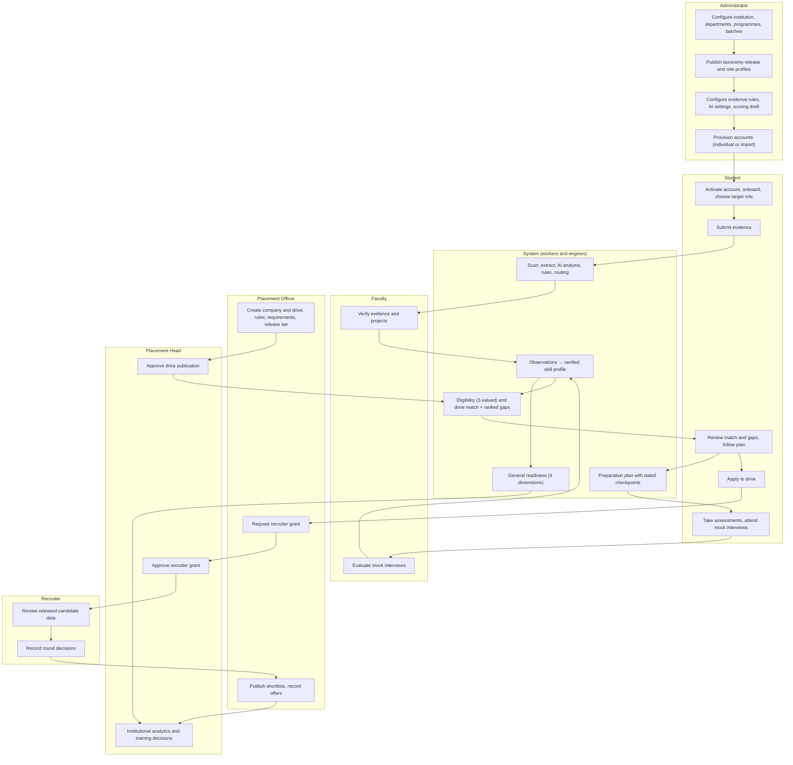

---

## 11. Skill Taxonomy M1

`[MANDATORY-P06]` REQ-P06-01, REQ-P06-02. M1 is independent and is built first; every later module refers to taxonomy IDs and versions.

### 11.1 Principles

1. Every skill has a stable ID. Names, synonyms and descriptions may change; IDs never do.
2. Every skill belongs to exactly **one cluster**, and every cluster maps to exactly **one readiness dimension**. A skill is therefore counted in one dimension only.
3. Students claim only **concrete** skills. Requirements may reference concrete skills or **categories**.
4. Taxonomy changes are made in a draft workspace and take effect only when a **release** is published. Every computation records the release it used.
5. AI may suggest mappings and new synonyms; only a taxonomy manager approves them.

### 11.2 Concepts

| Concept | Definition | Example |
|---|---|---|
| Concrete skill | A claimable, assessable skill | React, SQL, DSA, Quantitative Aptitude |
| Category | A requirement-only node with **any-of** semantics: any member at the required level satisfies it | Frontend Framework = {React, Angular, Vue, Svelte, Next.js} |
| Cluster | Grouping for navigation and analytics; carries the readiness dimension | "Frontend Development" → TECHNICAL |
| Broader link | A directed "is a member of" edge from a concrete skill to a category (a DAG; a skill may belong to several categories) | React → Frontend Framework |
| Topics | Descriptive sub-topics of a composite concrete skill, used for assessments and planning, **not** for matching | DSA topics: arrays, graphs, dynamic programming… |
| Synonym | Alternative text resolving to one skill | "ReactJS", "React.js" → React |
| Equivalence | Approved partial substitutability between two concrete skills, with a level penalty | MySQL ↔ PostgreSQL, penalty 1 |
| Related skill | Informational association used only in recommendations | Docker ~ Kubernetes |
| Proficiency level | 1 to 5, with generic and cluster-specific descriptors (§11.3) | DSA level 3 |
| Role profile | A target-role baseline: skills with expected level, importance (1–5) and mandatory flag | Software Developer (entry) |
| Release | Immutable published snapshot of all of the above | `2026.3` |

**Why composite skills are not categories.** If "DSA" were a category of its sub-topics, a student strong only in arrays would satisfy "DSA level 4". Composite competencies (DSA, SQL, Communication) are therefore concrete skills assessed as a whole; their sub-topics are `topics[]` metadata. Categories are used only where any one member genuinely satisfies the need (a framework, a database product, a BI tool, a cloud platform). When an officer picks a category requirement, the UI shows "Satisfied by any of: …".

### 11.3 Proficiency levels

Level 0 is not a level a student "has"; it is the computational value for "no verified evidence".

| Level | Name | Observable meaning | Typical supporting evidence |
|---|---|---|---|
| 1 | Foundation | Knows core concepts and vocabulary; can follow a worked example | Introductory course or participation certificate; basic quiz |
| 2 | Working | Completes standard, well-defined tasks with some guidance; uses common tools | Graded coursework; guided project; foundation assessment ≥ 60% |
| 3 | Independent | Solves typical tasks independently in reasonable time; explains choices; debugs own work | Intermediate assessment ≥ 70%; faculty-evaluated project component; evaluated internship work |
| 4 | Advanced | Handles non-standard problems; optimises; reviews others' work; makes and defends design trade-offs | Advanced assessment ≥ 75%; strong mock-interview evaluation; substantial project with clear ownership |
| 5 | Expert (exceptional on campus) | Recognised excellence: high competitive-programming ranks, significant open-source or research contributions; teaches others | Must be corroborated by at least two independent evaluative sources (§13.4) |

**Cluster-specific descriptor examples** (stored per cluster; skills may override):

| Cluster | L1 | L2 | L3 | L4 | L5 |
|---|---|---|---|---|---|
| Data Structures & Algorithms | Knows arrays, strings, Big-O basics | Implements standard structures; solves easy problems | Solves medium problems (hashing, two pointers, recursion, BFS/DFS) within time | Solves hard problems (DP, advanced graphs); proves complexity | Sustained high contest performance |
| Spoken / interview communication | Basic conversation | Clear answers to familiar questions | Structured answers (situation–task–action–result); explains own project clearly | Persuasive; handles follow-ups and ambiguity | Leads discussions; presents to large audiences |
| Quantitative aptitude (institutional proctored test) | < 40% | 40–59% | 60–74% | 75–89% | ≥ 90% |
| Project depth competencies | Tutorial-level clone | Guided project with small extensions | Independent project with original scope and a working deployment | Complex system; documented trade-offs; tests and CI; real users or measured results | Production-grade or significant open-source impact |

Score-to-level bands are configuration, recorded in each assessment (§14.3), and calibrated in M0 with faculty.

### 11.4 Clusters and dimensions

| Dimension | Clusters |
|---|---|
| TECHNICAL | Programming Languages · Data Structures & Algorithms · Computer Science Fundamentals · Frontend Development · Backend Development · Databases · Cloud & DevOps · Software Testing & QA · Data Analysis · Statistics & Mathematics · Data Visualization & BI · Machine Learning · Data Engineering Foundations |
| APTITUDE | Quantitative Aptitude · Logical Reasoning · Verbal Ability |
| COMMUNICATION | Spoken Communication · Written Communication · Presentation · Group Discussion · Interview Communication |
| PROJECT_DEPTH | Project Engineering (five competencies: Problem Framing & Complexity · Design & Architecture · Implementation Quality & Testing · Ownership & Contribution · Documentation & Demonstration) |

### 11.5 Example hierarchy (seed)

```text
TECHNICAL
├── Programming Languages
│   ├── Java · Python · C · C++ · C# · JavaScript · TypeScript · Go · Kotlin
│   └── [Category] Object-Oriented Language → Java, C++, C#, Python, Kotlin
├── Data Structures & Algorithms
│   └── DSA  (topics: arrays, strings, linked lists, stacks and queues, trees, heaps,
│              graphs, greedy, dynamic programming, sorting and searching, complexity)
├── Computer Science Fundamentals
│   └── Object-Oriented Programming · Operating Systems · Computer Networks · DBMS Concepts
├── Frontend Development
│   ├── HTML & CSS · Responsive Design · Web Accessibility
│   └── [Category] Frontend Framework → React, Angular, Vue, Svelte, Next.js
├── Backend Development
│   ├── REST API Design · Authentication Basics
│   └── [Category] Backend Framework → Node.js (Express), NestJS, Spring Boot, Django, Flask, ASP.NET Core
├── Databases
│   ├── SQL · Database Design (normalisation, indexing)
│   ├── [Category] Relational Database → MySQL, PostgreSQL, Oracle Database, SQL Server
│   └── [Category] NoSQL Database → MongoDB, Redis, Cassandra
├── Cloud & DevOps
│   ├── Git · Linux · Docker · CI/CD Basics
│   └── [Category] Cloud Platform → AWS, Microsoft Azure, Google Cloud
├── Software Testing & QA
│   ├── Manual Testing · SDLC & STLC · Agile/Scrum Basics · API Testing · Unit Testing
│   ├── Performance Testing Basics · Test Automation
│   └── [Category] Automation Tool → Selenium, Playwright, Cypress, Appium
├── Data Analysis
│   └── Excel / Spreadsheets · Pandas & NumPy · Data Cleaning · Exploratory Data Analysis
├── Statistics & Mathematics
│   └── Descriptive Statistics · Probability · Inferential Statistics & Hypothesis Testing · Linear Algebra Basics
├── Data Visualization & BI
│   ├── Data Visualization (Matplotlib, Seaborn, Plotly) · Dashboard Design
│   └── [Category] BI Tool → Power BI, Tableau, Looker Studio
├── Machine Learning
│   ├── Supervised Learning · Unsupervised Learning · Model Evaluation · Feature Engineering · scikit-learn · NLP Basics
│   └── [Category] Deep Learning Framework → TensorFlow, PyTorch
└── Data Engineering Foundations
    └── ETL Basics · Analytical SQL (window functions)
APTITUDE
└── Quantitative Aptitude · Logical Reasoning · Verbal Ability
COMMUNICATION
└── Spoken English Communication · Written Communication · Presentation Skills · Group Discussion · Interview Communication
PROJECT_DEPTH
└── Problem Framing & Complexity · Design & Architecture · Implementation Quality & Testing ·
    Ownership & Contribution · Documentation & Demonstration
```

### 11.6 Synonyms and normalisation

- **Normalisation function** (shared by search, imports, AI mapping and claims): Unicode NFKC → lowercase → trim → collapse whitespace → unify separators (`.`, `-`, `_`, space) → protected tokens keep their symbols (`c++`, `c#`, `.net`, `node.js`).
- **Resolution order:** exact skill name → exact synonym → (suggestion only) fuzzy candidates by trigram similarity or edit distance. Fuzzy candidates are never auto-applied.
- **Seed synonyms:** JS → JavaScript; TS → TypeScript; ReactJS, React.js → React; Node, NodeJS → Node.js (Express); Postgres → PostgreSQL; Mongo → MongoDB; CPP, C plus plus → C++; Golang → Go; ML → Machine Learning (category search alias); Data Structures, DS Algo → DSA; MS Excel → Excel / Spreadsheets; PowerBI → Power BI; Quant → Quantitative Aptitude; Spoken English → Spoken English Communication; OOPs, OOPS → Object-Oriented Programming.
- **Conflict rule:** a synonym string may resolve to only one active skill. Adding a synonym already used elsewhere is blocked with a link to the other skill.
- **Unresolved terms queue:** free-text skills from students, imports or AI extraction that do not resolve go to a queue (ADM-13 tab) where a taxonomy manager maps them, creates a skill, or ignores them.

### 11.7 Seed role profiles (three P06 roles, four profiles)

P06 requires a populated taxonomy for **software development, data and testing**. "Data" is covered by two profiles. All values are `[ASSUMPTION]` seeds to be validated in the M0 taxonomy workshop with faculty and placement staff. Importance is 1–5; **M** marks mandatory requirements.

**Software Developer — entry level**

| Skill | Level | Imp. | M | Skill | Level | Imp. | M |
|---|---|---|---|---|---|---|---|
| DSA | 3 | 5 | M | Quantitative Aptitude | 3 | 4 | M |
| [Category] Object-Oriented Language | 3 | 5 | M | Logical Reasoning | 3 | 4 | M |
| Object-Oriented Programming | 3 | 4 | M | Verbal Ability | 2 | 3 | |
| SQL | 2 | 4 | M | Interview Communication | 3 | 4 | M |
| DBMS Concepts | 2 | 3 | | Spoken English Communication | 3 | 3 | |
| Operating Systems | 2 | 3 | | Problem Framing & Complexity | 2 | 3 | |
| Computer Networks | 2 | 2 | | Design & Architecture | 2 | 2 | |
| Git | 2 | 3 | | Implementation Quality & Testing | 2 | 3 | |
| [Category] Backend Framework | 2 | 3 | | Ownership & Contribution | 3 | 3 | |
| [Category] Frontend Framework | 2 | 2 | | Documentation & Demonstration | 2 | 2 | |
| REST API Design | 2 | 2 | | | | | |

**Data Analyst — entry level**

| Skill | Level | Imp. | M | Skill | Level | Imp. | M |
|---|---|---|---|---|---|---|---|
| SQL | 3 | 5 | M | Quantitative Aptitude | 3 | 5 | M |
| Excel / Spreadsheets | 3 | 4 | M | Logical Reasoning | 3 | 4 | |
| Data Cleaning | 3 | 4 | M | Verbal Ability | 2 | 3 | |
| Exploratory Data Analysis | 3 | 4 | | Presentation Skills | 3 | 4 | |
| [Category] BI Tool | 3 | 4 | M | Written Communication | 3 | 3 | |
| Descriptive Statistics | 3 | 4 | M | Interview Communication | 3 | 4 | M |
| Data Visualization | 3 | 4 | | Problem Framing & Complexity | 2 | 3 | |
| Python | 2 | 3 | | Ownership & Contribution | 2 | 3 | |
| Probability | 2 | 2 | | Documentation & Demonstration | 3 | 3 | |

**Data Scientist — entry level**

| Skill | Level | Imp. | M | Skill | Level | Imp. | M |
|---|---|---|---|---|---|---|---|
| Python | 3 | 5 | M | Data Visualization | 2 | 3 | |
| Pandas & NumPy | 3 | 4 | M | DSA | 2 | 3 | |
| Inferential Statistics & Hypothesis Testing | 3 | 4 | M | Quantitative Aptitude | 3 | 4 | |
| Probability | 3 | 4 | | Logical Reasoning | 3 | 4 | |
| Supervised Learning | 3 | 5 | M | Presentation Skills | 3 | 3 | |
| Model Evaluation | 3 | 4 | M | Interview Communication | 3 | 4 | M |
| Unsupervised Learning | 2 | 3 | | Problem Framing & Complexity | 3 | 4 | |
| Feature Engineering | 2 | 3 | | Design & Architecture | 2 | 3 | |
| scikit-learn | 3 | 4 | | Implementation Quality & Testing | 2 | 3 | |
| SQL | 2 | 4 | M | Ownership & Contribution | 3 | 3 | |
| Linear Algebra Basics | 2 | 3 | | Documentation & Demonstration | 3 | 3 | |
| [Category] Deep Learning Framework | 2 | 2 | | | | | |

**Software Test Engineer (QA) — entry level**

| Skill | Level | Imp. | M | Skill | Level | Imp. | M |
|---|---|---|---|---|---|---|---|
| Manual Testing | 3 | 5 | M | Agile/Scrum Basics | 2 | 2 | |
| SDLC & STLC | 3 | 4 | M | Performance Testing Basics | 1 | 1 | |
| [Category] Automation Tool | 2 | 4 | M | Quantitative Aptitude | 3 | 4 | M |
| [Category] Object-Oriented Language | 2 | 4 | M | Logical Reasoning | 3 | 4 | M |
| API Testing | 2 | 3 | | Verbal Ability | 2 | 3 | |
| SQL | 2 | 3 | | Written Communication | 3 | 4 | |
| Unit Testing | 2 | 3 | | Interview Communication | 3 | 4 | M |
| Git | 2 | 2 | | Implementation Quality & Testing | 3 | 4 | M |
| | | | | Documentation & Demonstration | 3 | 3 | |

Each programme has a **default role profile** (for example, B.Tech CSE → Software Developer) used when a student has not chosen a target role.

### 11.8 Equivalences

- **Workflow:** any taxonomy manager, faculty member or officer may propose (two skills, direction, penalty 0–2, rationale) → `PROPOSED` → a taxonomy manager approves or rejects with reason, consulting subject faculty → takes effect in the next published release.
- **Rules:** concrete-to-concrete only; same dimension only; one hop (no chaining); penalty is subtracted from the matched level; categories already cover any-of cases, so equivalences are for requirements naming a specific product.
- **Seed proposals** (to be approved in M0): MySQL ↔ PostgreSQL (1); Java ↔ C# (1); Selenium ↔ Playwright (1); Tableau ↔ Power BI (1); TypeScript → JavaScript (0, one way); Next.js → React (0, one way).

### 11.9 Planning metadata

Each skill carries `hoursPerLevelStep` (default by cluster, configurable): programming language 30; DSA 40; framework 25; SQL and databases 20; aptitude 15; communication 10 plus practice sessions; project depth 30; machine learning 40; BI tool 15; testing tool 20. These are planning estimates for M9, not measurements. `[ASSUMPTION]`

### 11.10 Versioning and change impact

| Change | Effect | Recompute |
|---|---|---|
| Add skill or synonym | Available after publication; unresolved-term queue re-runs | None beyond resolution |
| Rename or edit description | Display only | None |
| Merge A into B | A becomes `MERGED` (`mergedInto: B`); references resolve to B at read time; a background job migrates claims and observations; published drives keep their snapshot and show "merged into B" in explanations; officers are asked to re-base | Profiles, readiness and open matches for affected students |
| Deprecate | Hidden from pickers; existing references stay valid; officers warned | None |
| Category membership or broader links change | Changes matching expansion | Open drive matches |
| Equivalence approved or removed | Changes matching | Open drive matches |
| Level descriptors change | Guides future evaluations only; never changes existing levels | None |
| Role profile change | Changes readiness baselines | Readiness for students with that target role |

- Before publishing, the release screen (ADM-18) shows an **impact preview**: counts of affected skills, students, open drives and role profiles.
- Publishing creates an immutable snapshot, emits `taxonomy.release_published`, syncs search synonym mappings (§34) and schedules recomputation off-peak.
- A published drive pins the release it was approved with. "Re-base to latest release" shows a requirement diff and needs re-approval when requirements change materially.

### 11.11 Administration (P06 §9: taxonomy editor with merge and synonym tools)

ADM-13 to ADM-19 provide: a searchable skills table (filters: cluster, dimension, kind, status); a skill editor (name, description, cluster, kind, categories, topics, synonyms with conflict checks, equivalences, level descriptors, hours per level, assessable flag, status); a **merge tool** (select duplicates → impact preview → merge with reason); **synonym bulk import** (CSV); the **unresolved-terms queue**; equivalence review; role profile editor; level descriptor editor; and release management with draft-versus-published diff and publication notes.

### 11.12 Acceptance criteria

- AC-TAX-01: The seed release contains the four role profiles in §11.7 with every referenced skill present.
- AC-TAX-02: Searching "reactjs" returns React; searching a category returns its members.
- AC-TAX-03: A requirement on "Frontend Framework" level 3 is satisfied by React level 3 (REQ-P06-15 example).
- AC-TAX-04: Merging two skills previews impact, preserves history and remaps references.
- AC-TAX-05: Every computation stores the taxonomy release used; publishing a release triggers the documented recomputations.
- AC-TAX-06: A synonym cannot point to two active skills.

---

## 12. Evidence Ingestion and Verification M2 M3

`[MANDATORY-P06]` evidence ingestion (M2) and faculty verification with verified and unverified flags (M3): REQ-P06-03, REQ-P06-04, REQ-P06-05. Text extraction, OCR and AI-assisted analysis are a **PlaceCampus enhancement** (ENH-04), not a university requirement; the platform must work fully with them switched off.

### 12.1 Design principles

1. Upload requests return as soon as files and metadata are safely stored. All analysis runs in workers.
2. Different evidence types use different verification strategies (§12.2). There is no single universal method.
3. AI extracts, classifies, maps and flags. It never decides authenticity, verification or rejection.
4. Deterministic rules are versioned, explainable and testable; their results are shown to reviewers in plain language.
5. Every step is idempotent and re-runnable; every result records the versions that produced it.
6. The reviewer sees everything on one screen and decides with mandatory reasons.

### 12.2 Supported evidence types and strategies

Accepted files for all types: PDF, JPEG, PNG, WebP; at most 10 MB per file, 5 files per item, 20 pages per PDF `[PROPOSED TARGET]`. HEIC, Office documents, archives and executables are rejected.

| Type | Student-entered fields (required *) | Verification strategy | Observation source and level cap (§13.3) | Decided by |
|---|---|---|---|---|
| `CERTIFICATION` | Title*, issuer*, issue date*, expiry date, credential ID, verification URL, claimed skills* | Extraction → issuer registry match → verification URL or QR check against allow-listed issuer hosts → credential-ID uniqueness → duplicate signals → faculty review unless issuer-verified and policy allows auto-verification | `CERT_PARTICIPATION` cap 1; `CERT_ASSESSED` cap 3 (tier from the issuer registry) | Faculty, or issuer verification (DEC-04) |
| `INTERNSHIP` | Organisation*, role*, start date*, end date, supervisor name and email, description*, claimed skills* | Letter extraction → organisation and date consistency → duplicate signals → mentor review of the work description | `INTERNSHIP` cap 3 | Faculty |
| `PROJECT` | Title*, description*, personal role*, team size*, start and end dates, repository URL, demo URL, documentation file, claimed skills* | Link checks (reachable, public repository, student's linked GitHub account among contributors) → documentation extraction → faculty rubric evaluation (§10.2) | `PROJECT_EVALUATED` cap 4 for technical skills and Project Depth competencies | Faculty (project guide or mentor preferred) |
| `ACHIEVEMENT` | Title*, organiser*, date*, rank or position, URL, claimed skills | Extraction → link check → review | `EXTERNAL_ACHIEVEMENT` cap 3 | Faculty |
| `CODING_PROFILE` | Platform*, username*, profile URL*, current rating or badges, screenshot | Link check → optional ownership check (a one-time code placed in the profile bio) → review against configured rating bands | `CODING_PLATFORM` cap 3 (DSA and languages) | Faculty |
| `EXTERNAL_ASSESSMENT` | Provider*, test name*, score*, maximum score*, date*, report file or URL | Imported through an institutional channel → system-verified; student-uploaded → review | `ASSESSMENT_EXTERNAL` cap 3 | System or faculty |
| `ACADEMIC_MARKSHEET` | Semester or exam*, values being supported* | Extraction → comparison with submitted values → data-steward decision (§9.6) | No skill observation (academic data only) | Data steward |
| `COURSE_RESULT` | Imported by the institution only | Course-to-skill mapping table | `ACADEMIC_COURSE` cap 2 | System |
| Resume (not evidence) | Uploaded on STU-12 | Optional AI parsing suggests skill claims for the student to confirm; never verifies anything | None | — |

Internal assessments and mock interviews are not uploaded evidence; M5 writes their observations directly (§14).

### 12.3 Upload, validation and storage

**Validation on upload (API, synchronous):**

| Check | Rule |
|---|---|
| Authentication and permission | `evidence:create:own`; the student must be `ACTIVE` |
| Size | ≤ 10 MB per file (also enforced at the edge with `client_max_body_size`) |
| Extension allow-list | `.pdf`, `.jpg`, `.jpeg`, `.png`, `.webp` |
| Content sniffing | `file-type` magic-number detection must agree with the extension; the client `Content-Type` is ignored |
| PDF structure | Encrypted PDFs rejected; embedded JavaScript, launch actions or attachments flagged and the file rejected |
| Image decode | `sharp` metadata read succeeds; pixel count ≤ 40 megapixels |
| Filename | Stored only as a sanitised display name; never used as a storage key |
| Rate limit | 30 uploads per student per hour `[PROPOSED TARGET]` |

**Storage layout (private bucket, server-side encryption on):**

```text
quarantine/{institutionId}/{fileId}            uploaded, not yet scanned
evidence/{institutionId}/{studentId}/{fileId}  clean originals (moved after scan)
derived/{institutionId}/{fileId}/page-{n}.png  rendered pages for OCR and viewing
text/{institutionId}/{fileId}.txt              extracted text when larger than 32 KB
imports/{institutionId}/{batchId}/{fileId}     bulk-import files
reports/{institutionId}/{reportId}             generated reports
```

Object keys never contain names or registration numbers. Quarantined objects are deleted after 30 days; infected files are kept in quarantine for 30 days for investigation, then purged.

**Hashing and fingerprints (worker):**

| Fingerprint | Purpose |
|---|---|
| SHA-256 of raw bytes | Exact duplicates (same student: repeated submission; another student: high-severity signal) |
| 64-bit difference hash of each image and of the first rendered PDF page | Near-duplicates such as a re-photographed certificate (Hamming distance ≤ 6) |
| 64-bit SimHash of normalised extracted text | Near-duplicate text (distance ≤ 3) |
| Normalised credential ID + issuer | The same credential claimed by two students |

### 12.4 Processing pipeline

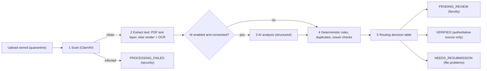

| Step | Job (queue) | Work | Output |
|---|---|---|---|
| 1 | `evidence.scan` (`evidence-processing`) | Stream each file to `clamd`; move clean files out of quarantine | `files.scanStatus` |
| 2 | `evidence.extract` (`evidence-processing`) | PDF: text layer through `pdfjs-dist`; if fewer than 50 characters per page, render up to 5 pages (poppler `pdftoppm` in the worker image) and OCR them. Images: normalise with `sharp` (orientation, greyscale, resize to ~2000 px long side) then OCR with `tesseract.js` (English data bundled in the image; no runtime download). Compute fingerprints. Decode QR codes from page images (`jsQR`). | `document_extractions` (method, pages, mean OCR confidence, text or text location, QR payloads, fingerprints) |
| 3 | `evidence.analyze` (`ai-analysis`) | Call the `DocumentAnalyzer` (§12.6) | `ai_analyses` |
| 4 | `evidence.rules` (`evidence-processing`) | Run the rule catalogue (§12.7) | `evidence_items.ruleResults`, risk level |
| 5 | `evidence.route` (`evidence-processing`) | Apply the routing table (§12.8); create and assign the review | New verification status; `verification_reviews` |

Each step is keyed `evidenceId:version:step`. A step that already completed for that version is skipped on retry. If OCR tooling is unavailable (for example on a Windows development machine without poppler), extraction is marked `PARTIAL` and the pipeline continues; the reviewer still sees the document.

### 12.5 What AI may and may not do

| AI may | AI must not |
|---|---|
| Classify the document type | Set `VERIFIED`, `REJECTED` or `NEEDS_RESUBMISSION` |
| Extract fields with source quotes | Decide that a certificate is authentic |
| Identify claimed or mentioned skills and suggest taxonomy IDs | Create taxonomy entries |
| Suggest a level cap from the document's nature (participation versus assessed) | Assign verified levels |
| Assess readability | Compare against the student's official record (done deterministically) |
| Flag inconsistencies and possible edits | Receive registration numbers, CGPA, contact details or other unnecessary personal data |
| Produce a neutral summary and uncertainty notes | Be the only signal behind any automated outcome |

The UI keeps five things visibly distinct: **information extraction** (AI or OCR), **skill relevance** (AI suggestion plus taxonomy resolution), **policy validation** (deterministic rules), **issuer verification** (authoritative checks) and the **faculty decision**.

### 12.6 AI document-analysis adapter

```ts
interface DocumentAnalyzer {
  readonly provider: 'anthropic' | 'none';
  analyze(input: DocumentAnalysisInput): Promise<DocumentAnalysisResult>;
}

interface DocumentAnalysisInput {
  evidenceType: EvidenceType;
  declared: { title?: string; issuer?: string; issueDate?: string; organisation?: string; claimedSkills: string[] };
  files: Array<{ mediaType: 'application/pdf' | 'image/png' | 'image/jpeg' | 'image/webp'; base64: string }>;
  extractedText?: string;                 // OCR/text layer, truncated to a configured size
  taxonomyContext: { release: string; candidateSkills: Array<{ id: string; name: string; synonyms: string[] }> };
  promptVersion: string;
}
```

**Structured result (validated with Zod on receipt):**

```json
{
  "documentType": "CERTIFICATE | INTERNSHIP_LETTER | MARKSHEET | PROJECT_REPORT | ACHIEVEMENT | CODING_PROFILE | OTHER | UNREADABLE",
  "documentTypeConfidence": 0.0,
  "readability": "GOOD | FAIR | POOR",
  "extracted": {
    "holderName": null, "issuerName": null, "issuerDomain": null, "title": null,
    "issueDate": null, "expiryDate": null, "credentialId": null, "verificationUrl": null,
    "score": null, "scoreMax": null, "grade": null,
    "organisation": null, "roleTitle": null, "startDate": null, "endDate": null,
    "semester": null, "sgpa": null, "cgpa": null
  },
  "fieldEvidence": [{ "field": "title", "quote": "exact text seen", "page": 1 }],
  "skillMentions": [{ "text": "React", "suggestedSkillId": "skl_…", "matchType": "EXACT | SYNONYM | INFERRED", "relevance": 0.0, "suggestedLevelCap": 1, "rationale": "…" }],
  "consistencyFlags": [{ "code": "DATE_IN_FUTURE | ISSUER_UNCLEAR | POSSIBLE_EDIT | LOW_QUALITY | MISSING_KEY_FIELD | CLAIM_NOT_SUPPORTED | DECLARED_MISMATCH", "detail": "…" }],
  "summary": "Neutral one-paragraph description",
  "uncertainty": ["…"]
}
```

**Default implementation: Claude through the official Anthropic TypeScript SDK (`@anthropic-ai/sdk`).** Rules for the coding stage:

| Topic | Rule |
|---|---|
| Model | From configuration `AI_MODEL`; default `claude-opus-5-5`. Switching models is a configuration change validated against the evaluation set (§12.9) and recorded in an ADR. |
| Call shape | `client.messages.parse()` with `output_config.format = zodOutputFormat(DocumentAnalysisSchema)` (structured outputs). Guard `parsed_output` being `null` → `INVALID_OUTPUT`. |
| Inputs | PDFs as `document` content blocks (base64), images as `image` blocks (base64), placed before the instruction text. API limits (32 MB per request, 600 pages) are far above PlaceCampus limits. |
| Effort | Set `output_config.effort` explicitly (this model's default is `medium`); start with `low` or `medium` and keep whichever passes the evaluation thresholds at lower cost. |
| Sampling parameters | Do not send `temperature`, `top_p` or `top_k` (rejected from API version `2026-10-21`). |
| Output size | `max_tokens` 8,000; if `stop_reason` is `max_tokens`, retry once with a larger limit, then mark `INVALID_OUTPUT`. |
| Refusals | Check `stop_reason` before reading content. Opt into server-side fallback (`fallbacks: "default"` with beta header `server-side-fallback-2026-07-01`; Claude API only, not on Batches). A final `refusal` → `aiStatus: REFUSED` → normal faculty review without AI findings. |
| Timeouts and retries | Per-request timeout 120,000 ms (TypeScript SDK uses milliseconds); SDK `maxRetries: 2` (retries 408, 409, 429, 5xx and connection errors). On top, BullMQ: 4 attempts, exponential backoff from 60 s, honouring `retry-after`. |
| Error handling | Typed SDK errors, most specific first: `RateLimitError` and `APIConnectionError` → retry; `AuthenticationError`, `PermissionDeniedError`, `BadRequestError` → unrecoverable, `aiStatus: FAILED`, admin health alert; never string-match messages. |
| Rate control | BullMQ limiter on `ai-analysis` (default 20 jobs per minute, configurable) and concurrency 2. |
| Prompt caching | Stable system prompt and the taxonomy context block for the current release come first with `cache_control`; per-document content follows. Verify with `usage.cache_read_input_tokens`. |
| Bulk reprocessing | Message Batches API (asynchronous, lower cost, results keyed by `custom_id`) for backfills or prompt-version re-runs only; never for interactive uploads. |
| Data minimisation | Send only the files, the evidence type, the student's declared document fields and the candidate skill list. **Never send the student's name, registration number, CGPA, contact details or other evidence.** Name comparison happens locally (rule R-03). |
| Secrets and logs | API key exists only in the worker's environment; logs record request IDs, token usage, latency and outcome — never document content or extracted personal data. |
| Kill switches | `ai.enabled` per institution and per evidence type; disabling routes everything to "rules and OCR only". |
| Post-validation | Suggested skill IDs must belong to the supplied candidate list (others go to the unresolved-terms queue); dates must parse; each `fieldEvidence.quote` is fuzzy-matched against extracted text when text exists — unmatched fields are shown as "unconfirmed". Model-reported confidence is a weak signal and never drives an automated outcome. |
| Prompt versioning | Prompts live in `apps/api/src/evidence/ai/prompts/`; `promptVersion` is stored on every analysis; changing a prompt requires an evaluation run. |
| Candidate skills | Skills from clusters relevant to the evidence type plus the student's claims, at most about 200 entries with synonyms, to keep requests small and cacheable. |

A `none` provider implements the same interface and returns `DISABLED`, so every environment works without an AI key.

### 12.7 Deterministic rule catalogue

Each result is `{ ruleId, ruleVersion, outcome: PASS | WARN | FAIL | NOT_APPLICABLE | ERROR, severity: LOW | MEDIUM | HIGH, explanation, data }`. Explanations use templates so reviewers and students read the same wording.

| Rule | Check | Outcome logic |
|---|---|---|
| R-01 File integrity | Scan clean, type allowed, decodable | Infected → FAIL HIGH (security); corrupt → FAIL MEDIUM |
| R-02 Readability | Extracted text length and OCR confidence; AI readability if present | < 80 characters overall and readability POOR or unknown → FAIL |
| R-03 Holder name | Token-set similarity between extracted holder name and the official name (initials expanded, case and order insensitive) | ≥ 0.85 PASS; 0.60–0.85 WARN; < 0.60 FAIL; not found → WARN |
| R-04 Dates | Issue date not in the future; end ≥ start; expiry not passed; not implausibly early (configurable window before enrolment) | Violations → FAIL or WARN (expired) |
| R-05 Issuer recognition | Issuer matched in the issuer registry (name variants, domains, verification URL patterns, tier) | Known / unknown (unknown → WARN) |
| R-06 Issuer verification | Verification URL or QR URL on an allow-listed host: fetched server-side (HTTPS only, allow-listed hosts only, 5 s timeout, 1 MB cap, no redirects off-list) and checked for credential ID and holder name | Both found → `ISSUER_VERIFIED`; otherwise `NOT_CONFIRMED` |
| R-07 Credential uniqueness | Same normalised credential ID and issuer on another student's evidence | Found → FAIL HIGH (`DUPLICATE_CREDENTIAL`) |
| R-08 Exact duplicate | SHA-256 equal to another file | Same student → WARN; other student → FAIL HIGH |
| R-09 Near duplicate | Image hash distance ≤ 6 or text SimHash distance ≤ 3 against other students' evidence | WARN HIGH (`POSSIBLE_DUPLICATE`) |
| R-10 Claim support | Each claimed skill appears in extracted text or AI skill mentions (via synonyms) | Per skill: SUPPORTED or NOT_FOUND (WARN) |
| R-11 Declared versus extracted | Student-entered title, issuer, organisation and dates against extracted values | Mismatch → WARN |
| R-12 Links (projects, coding profiles) | URL reachable; repository public and existing; student's linked GitHub username among owners or contributors; last activity date | Failures → WARN; repository not found → FAIL |
| R-13 Marksheet consistency | Extracted semester and SGPA against submitted values | Mismatch → WARN (steward decides) |
| R-14 Quality | Short image side < 600 px; pages over the limit | WARN |

The **risk level** (LOW, MEDIUM, HIGH) is the highest severity among WARN and FAIL results. It orders the review queue; it is not a decision.

The **issuer registry** (ADM-20) lists issuers with names, aliases, domains, verification URL patterns, tier (`ASSESSED` or `PARTICIPATION`) and whether `autoVerifyEligible` is allowed (DEC-04). It starts empty except for entries the team verifies manually; no issuer is added without a human check.

### 12.8 Routing and state machines

**Routing decision table (first matching row wins):**

| # | Condition | New status | Method recorded |
|---|---|---|---|
| 1 | R-01 FAIL (infected) | `PROCESSING_FAILED` (reason `SECURITY`); security alert | Automatic |
| 2 | R-01 FAIL (corrupt or unsupported) | `NEEDS_RESUBMISSION` (`UNSUPPORTED_OR_CORRUPT_FILE`) | Automatic, deterministic |
| 3 | R-02 FAIL after OCR, and AI readability POOR or unavailable | `NEEDS_RESUBMISSION` (`UNREADABLE`); faculty may reopen | Automatic, deterministic |
| 4 | Source is an institution record (course results) or an institution-imported external assessment | `VERIFIED` | `SYSTEM_RECORD` |
| 5 | R-06 `ISSUER_VERIFIED` **and** R-03 PASS **and** R-07, R-08, R-09 clean **and** the issuer is `autoVerifyEligible` (DEC-04) | `VERIFIED`; 10% random sample queued for faculty audit | `ISSUER_VERIFIED` |
| 6 | A non-security pipeline step failed after all retries | `PENDING_REVIEW` with flag `PROCESSING_INCOMPLETE` | Faculty |
| 7 | Everything else | `PENDING_REVIEW`, ordered by risk and due date | Faculty |

**Five separate lifecycles.**

1. **Upload (per file):** `RECEIVING → STORED_QUARANTINE → CLEAN | INFECTED | REJECTED_TYPE | ERROR`.
2. **Processing (per evidence version):** `NOT_STARTED → SCANNING → EXTRACTING → ANALYZING → APPLYING_RULES → ROUTING → COMPLETED`, or `FAILED` (with the failed step) or `CANCELLED` (withdrawn).
3. **AI analysis:** `NOT_REQUESTED | DISABLED | QUEUED → RUNNING → SUCCEEDED | INVALID_OUTPUT | REFUSED | FAILED`.
4. **Verification (business status shown to users):**

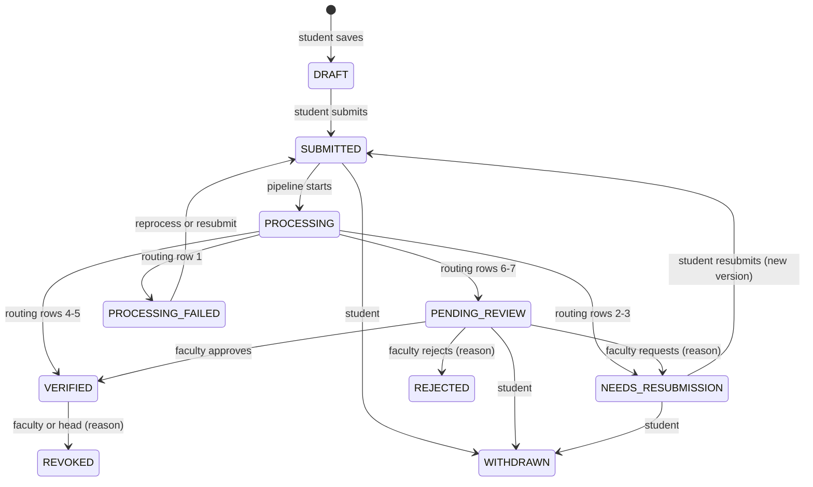

5. **Review task (faculty):** `UNASSIGNED → ASSIGNED → CLAIMED → COMPLETED`; `ASSIGNED | CLAIMED → REASSIGNED`; `ASSIGNED → ESCALATED → ASSIGNED`; `CLAIMED → ASSIGNED` when the lock expires or is released; `CANCELLED` when the evidence is withdrawn.

**Transition rules.**

| Transition | Authorized actor | Reason required |
|---|---|---|
| Submit, resubmit, withdraw | Owning student | No (withdraw: optional) |
| Approve | Assigned faculty (not the owner; no declared conflict) | Comment optional; skill levels required |
| Reject | Assigned faculty | Reason code and comment |
| Request resubmission | Assigned faculty | Reason code and instructions |
| Escalate | Assigned faculty | Reason code |
| Reassign | Review Coordinator or Administrator (queue health) | Yes |
| Revoke verification | Faculty who verified, Review Coordinator or Placement Head | Yes; observations invalidated; student notified |
| Reprocess | Administrator or assigned faculty | No (logged) |
| Automatic transitions | System (routing table) | Reason code from the rule |

**Reason codes.** Reject: `NOT_RELEVANT_TO_CLAIMED_SKILL`, `INSUFFICIENT_EVIDENCE`, `NAME_MISMATCH`, `SUSPECTED_TAMPERING`, `DUPLICATE_OF_OTHERS_WORK`, `ISSUER_NOT_RECOGNISED`, `EXPIRED_CREDENTIAL`, `OUT_OF_POLICY`, `OTHER`. Resubmission: `UNREADABLE`, `MISSING_PAGES`, `MISSING_FIELDS`, `WRONG_DOCUMENT`, `NEED_SUPPORTING_DOCUMENT`, `LINK_INACCESSIBLE`, `OTHER`. Escalation: `CONFLICT_OF_INTEREST`, `NEEDS_SUBJECT_EXPERT`, `SUSPECTED_FRAUD`, `POLICY_QUESTION`. A comment is always required with `OTHER`.

**Approval sets skill levels.** For each claimed skill the reviewer chooses a verified level up to the cap for the evidence type and issuer tier (shown inline); the reviewer may add skills found in the document and remove irrelevant ones. Each approved skill becomes a verified observation (§13.2).

**Reviewer assignment.**

1. Candidates: faculty with an `EVIDENCE_REVIEWER` or `MENTOR` assignment for the student; for projects, prefer `PROJECT_GUIDE`.
2. Exclude the student, and anyone with a declared conflict of interest.
3. Choose the candidate with the fewest open reviews; break ties by least recently assigned.
4. If none: the department review pool (faculty of the student's department with the reviewer purpose); if still none: the Review Coordinator queue.
5. Service level: 3 working days `[PROPOSED TARGET]` (institution holiday calendar respected); reminder after 2 days; escalation to the Review Coordinator on breach.
6. A claimed review holds a 30-minute renewable soft lock.
7. Optional second reviewer for HIGH-risk items `[OPTIONAL]`.

### 12.9 AI governance

| Topic | Rule |
|---|---|
| Purpose | Reduce routine reviewer effort; never replace the reviewer |
| Consent | Students are told at activation that AI-assisted processing is used and may opt out at any time in Settings; opted-out evidence skips the AI step and is reviewed manually |
| Provider agreement and retention | Sending student documents to an external provider needs institutional approval and an agreement covering retention and use (DEC-05). Zero-data-retention or regional inference arrangements are evaluated with the provider; none is assumed. Until approved, environments use synthetic documents only. |
| Evaluation before enabling | A labelled evaluation set of at least 150 synthetic or consented documents (60 certificates, 30 internship letters, 30 marksheets, 30 project documents). `[PROPOSED TARGET]` thresholds: document type ≥ 95% correct; title, issuer and date exact match ≥ 90%; holder name ≥ 95%; skill mapping precision ≥ 85% and recall ≥ 75%. Re-run on any model or prompt change; results stored in `docs/ai-evaluations/`. |
| Transparency | The privacy notice explains AI use; reviewers see AI findings labelled "AI-assisted"; students see plain-language processing results, not AI risk flags |
| Human in the loop | Permanent (P06); no automated rejection; automated verification only from authoritative sources |
| Monitoring | Weekly: resubmission and rejection rates by department and evidence type; AI failure, refusal and invalid-output rates; reviewer overrides of AI suggestions |
| Incident response | Kill switch per institution and evidence type; reprocessing after fixes; audit log of switches |

### 12.10 Background processing architecture (all queues)

BullMQ on Redis. Queue names, jobs and policies are shared across the platform; later sections refer to this table.

| Queue | Jobs | Concurrency per worker | Attempts and backoff | Idempotency key |
|---|---|---|---|---|
| `evidence-processing` | `evidence.scan`, `evidence.extract`, `evidence.rules`, `evidence.route` | 2 | 3, exponential from 30 s | `evidenceId:version:step` |
| `ai-analysis` | `evidence.analyze` | 2, limiter 20/min | 4, exponential from 60 s, honours `retry-after` | `evidenceId:version:analyze:promptVersion` |
| `profile` | `profile.recompute` (debounced 20 s) | 4 | 3 | `profile:studentId` |
| `readiness` | `readiness.recompute` (debounced 30 s), `readiness.batch.chunk` | 4 | 3 | `readiness:studentId` / `batchRunId:chunk` |
| `matching` | `match.compute`, `match.drive.fanout` | 4 | 3 | `match:driveId:roleId:studentId` |
| `eligibility` | `eligibility.drive.fanout`, `eligibility.evaluate` | 4 | 3 | `elig:driveId:studentId:ruleVersion` |
| `imports` | `import.validate`, `import.commit`, `import.revert` | 1 | 2 (commit resumes from the last chunk) | `batchId:operation` |
| `notifications` | `notify.dispatch`, `email.send`, `sms.send`, `digest.build` | 5, provider limiter | 5, exponential from 60 s | `notificationId:channel` |
| `analytics` | `analytics.snapshot.refresh` (nightly 02:00 IST and on demand) | 1 | 2 | `snapshotType:scope:date` |
| `maintenance` | `grant.expiry.sweep` (every 5 min), `outbox.relay` (continuous), `review.sla.check` (hourly), `plan.checkpoint.scan` (hourly), `auth.token.cleanup` (daily), `quarantine.purge` (daily) | 1 | 3 | Scheduler key |

- **Idempotency:** deterministic job IDs (BullMQ ignores a job whose ID already exists while it is waiting or active); handlers check persisted step state; side effects are protected by unique indexes.
- **Debouncing:** BullMQ's deduplication with a TTL (its "debounce" mode with extend and replace), or a delayed job with a fixed ID; verify the exact option names against the BullMQ version adopted.
- **Duplicate jobs:** rejected by job ID; a recompute requested while one is running is coalesced into one follow-up run.
- **Failed jobs:** after the final attempt, a `job_failures` record (queue, job name, job ID, non-personal payload reference, error class and message, attempts, timestamp) and a health alert when the failure rate crosses a threshold. ADM-29 retries jobs safely because handlers are idempotent.
- **Monitoring:** per queue — waiting count, oldest waiting age, active, failed per hour, p95 processing time — exposed on ADM-29 and as metrics (§37.8).
- **Shutdown:** workers stop taking jobs on SIGTERM and finish the current job within 30 s; stalled jobs are re-queued by BullMQ.
- **Worker Redis connections** use `maxRetriesPerRequest: null`, as BullMQ requires.
- **Never block HTTP:** upload and submit endpoints return after persisting metadata and enqueueing; the UI polls processing status (TanStack Query, every 5 s while processing, stopping when final).
- **Readiness recalculation events:** `evidence.verified`, `evidence.verification_revoked`, `assessment.attempt_graded` and `interview.evaluation_submitted` lead to `observation.*` → `profile.recompute` → `skill_profile.updated` → `readiness.recompute` and `match.compute` (§6.6).

### 12.11 Acceptance criteria

- AC-EVD-01: Uploading a 10 MB PDF returns within 3 s `[PROPOSED TARGET]`, and processing continues in the background with visible status.
- AC-EVD-02: A file whose content does not match its extension, an encrypted PDF and an infected test file (EICAR) are each rejected or failed with the documented reason.
- AC-EVD-03: With AI disabled, every evidence type can still be submitted, reviewed and verified.
- AC-EVD-04: No path lets AI output set `VERIFIED` or `REJECTED`; automated verification happens only through routing rows 4 and 5.
- AC-EVD-05: The reviewer workspace shows the document, extracted fields with quotes, rule results, duplicate signals and AI findings side by side, and every decision requires its reason.
- AC-EVD-06: A student cannot approve their own evidence, and a faculty member cannot review a student outside their assignments (negative tests).
- AC-EVD-07: Two students submitting the same credential ID produce a HIGH-risk duplicate flag on the second submission.
- AC-EVD-08: Re-running any pipeline step for the same version produces no duplicate records.

---

## 13. Student Skill Profile M4

`[MANDATORY-P06]` REQ-P06-06: "aggregates evidence into levelled skill claims"; at least four evidence types with verification status visible.

### 13.1 Design

Every source of skill information is first converted into **observations** (§5.6). The profile is a pure function of a student's observations, the taxonomy release and the cap configuration. This single path gives three guarantees: nothing is counted twice, every level is explainable, and recomputation is deterministic.

```text
Evidence decisions (M3) ──┐
Assessment results (M5) ──┤
Interview rubrics (M5) ───┼──► skill_observations ──► aggregateSkill() ──► skill_profiles ──► readiness (M6), matching (M8)
Faculty evaluations ──────┤                              (packages/scoring)
Course results (imports) ─┘
Student claims ─────────────► skill_claims (displayed, never scored)
```

### 13.2 Observation sources

| Source | Observation written | Verification | Method |
|---|---|---|---|
| Evidence submitted with claimed skills | One per claimed skill, level = min(claimed level, cap) | `PENDING` | — |
| Evidence approved by faculty | One per approved skill at the reviewer's chosen level | `VERIFIED` (the pending ones are superseded) | `FACULTY_REVIEW` |
| Evidence auto-verified by issuer check | One per claimed skill, level = min(claimed level, issuer tier default level) | `VERIFIED` | `ISSUER_VERIFIED` |
| Evidence rejected or verification revoked | Existing observations for that evidence | `INVALIDATED` | — |
| Internal assessment graded | One per skill section, level from the assessment's score bands | `VERIFIED` | `ASSESSMENT_PROCTORED` or `ASSESSMENT_UNPROCTORED` |
| External assessment imported by the institution | One per mapped skill | `VERIFIED` | `SYSTEM_RECORD` |
| Mock-interview evaluation submitted | One per rubric criterion mapped to a skill | `VERIFIED` | `INTERVIEW_RUBRIC` |
| Project rubric evaluation | One per Project Depth competency and per evaluated technical skill | `VERIFIED` | `FACULTY_REVIEW` |
| Direct faculty skill evaluation | One for the evaluated skill | `VERIFIED` | `FACULTY_EVALUATION` |
| Course result imported | One per skill in the course-to-skill mapping, level from grade bands (grade point ≥ 8 → level 2; ≥ 6 → level 1) | `VERIFIED` | `SYSTEM_RECORD` |
| Student self-claim | None (claim only) | — | — |
| Plan task marked done | None — completing a task never creates evidence | — | — |

### 13.3 Source-type caps

Caps are configurable per source type and cluster (ADM-20), versioned with the readiness configuration, and shown to reviewers.

| Source type | Default cap | Notes |
|---|---|---|
| `CERT_PARTICIPATION` | 1 | Attendance or completion without a graded exam |
| `CERT_ASSESSED` | 3 | Graded or proctored certification exams |
| `ACADEMIC_COURSE` | 2 | Course grades show coursework, not job-level skill |
| `CODING_PLATFORM` | 3 | DSA and programming languages only; rating bands configured |
| `INTERNSHIP` | 3 | Faculty-reviewed work description |
| `EXTERNAL_ACHIEVEMENT` | 3 | Hackathons, contests, publications |
| `ASSESSMENT_EXTERNAL` | 3 | |
| `ASSESSMENT_INTERNAL_UNPROCTORED` | 3 | |
| `ASSESSMENT_INTERNAL_PROCTORED` | 4 (5 for APTITUDE clusters) | |
| `PROJECT_EVALUATED` | 4 | |
| `INTERVIEW_RUBRIC` | 4 | |
| `FACULTY_EVALUATION` | 4 | |

**Certificates alone can never exceed level 3**, and participation certificates never exceed level 1.

### 13.4 Aggregation rules (`aggregateSkill`)

Input: the student's observations for one concrete skill (merged skills resolved through the taxonomy release).

1. **Effective level** of each observation: `e = min(supportedLevel, cap(sourceType, cluster))`.
2. Ignore `INVALIDATED` observations and observations past their `validUntil` date (expired certifications).
3. **Group by source type.**
   - Repeated measurements (`ASSESSMENT_*`, `INTERVIEW_RUBRIC`, `CODING_PLATFORM`, `FACULTY_EVALUATION`): use the **most recent** observation in the group, so a newer, lower result replaces an older, higher one.
   - Achievements (`CERT_*`, `PROJECT_EVALUATED`, `INTERNSHIP`, `EXTERNAL_ACHIEVEMENT`, `ACADEMIC_COURSE`): use the **maximum** in the group.
4. **Verified level** = maximum across groups using `VERIFIED` observations only (0 if none). **Evaluated level** = the same calculation including `PENDING` observations.
5. **Level 5 gate:** level 5 stands only if at least two `VERIFIED` observations with `e ≥ 4` come from two different evaluative source types (proctored internal assessment, interview rubric, project evaluation, faculty evaluation) within the last 18 months, at least one human-evaluated. Otherwise the level is 4. For APTITUDE clusters, two proctored level-5 results on different test forms suffice.
6. **Confidence:** `HIGH` when the verified level is supported by two or more distinct verified source types, or by one human evaluation in the last 12 months; `MEDIUM` with one evaluative source; `LOW` when only certificates, course results, coding profiles or external sources support it.
7. **Staleness:** if the observation that determines the level is older than 24 months (12 months for APTITUDE and COMMUNICATION), the skill is flagged `stale`. In v1 the level is unchanged and readiness is unaffected; the planner suggests re-assessment. (A decay rule may be added after calibration — DEC-01 follow-up.)
8. **Explanation:** the determining observation and all other contributing observations, with source, date, level, method and verifier.

**Worked example — DSA for one student**

| Observation | Source type | Supported | Cap | Effective | Status | Date |
|---|---|---|---|---|---|---|
| A | `CERT_ASSESSED` (DSA course exam) | 3 | 3 | 3 | VERIFIED | Jan 2026 |
| B | `ASSESSMENT_INTERNAL_PROCTORED` | 4 | 4 | 4 | VERIFIED | Mar 2026 |
| C | `ASSESSMENT_INTERNAL_PROCTORED` | 3 | 4 | 3 | VERIFIED | Sep 2026 |
| D | `INTERVIEW_RUBRIC` (problem solving) | 4 | 4 | 4 | VERIFIED | Oct 2026 |
| E | `CODING_PLATFORM` | 4 | 3 | 3 | PENDING | Oct 2026 |

Groups: certificates → 3; proctored assessments → most recent (C) → 3; interview → 4; coding platform → pending only. **Verified level = 4** (from D), **evaluated level = 4**, confidence `HIGH` (human evaluation within 12 months), not stale. Level 5 is impossible here because no observation reaches 5.

### 13.5 Claim states and display categories

| Claim status | Meaning |
|---|---|
| `CLAIMED` | Declared by the student; no linked evidence |
| `PENDING_VERIFICATION` | Linked evidence submitted, not decided |
| `VERIFIED` | Verified level ≥ claimed level |
| `PARTIALLY_VERIFIED` | 1 ≤ verified level < claimed level |
| `NOT_SUPPORTED` | All linked evidence rejected or revoked |
| `WITHDRAWN` | Removed by the student |

The Skills page (STU-06) groups skills into **Verified** (verified level ≥ 1), **Pending verification** (evaluated level > verified level), **Claimed only** (no observations) and **Not supported**. Verified and unverified information are never shown in the same style: verified levels use a solid badge with the verification method; claimed levels use an outlined "Claimed" badge.

### 13.6 Profile document and history

`skill_profiles` holds one current document per student: for each skill — claimed, evaluated and verified levels, claim status, confidence, stale flag, determining observation IDs, counts by source type, last assessed date and last verifier — plus summary counts (verified skills, evidence types covered) and `profileVersion`, `taxonomyRelease`, `capConfigVersion`, `inputsHash`, `computedAt`. When any verified level changes, a compact diff is appended to `skill_profile_history` for trend charts.

### 13.7 Recomputation

- Triggered by `observation.recorded` and `observation.invalidated`, debounced 20 seconds per student (§12.10); also by taxonomy releases and cap-configuration changes (batch).
- Recomputation is skipped when the inputs hash is unchanged.
- A changed profile emits `skill_profile.updated`, which triggers readiness and open-drive match recomputation.
- Target: the profile reflects a faculty approval within 60 seconds `[PROPOSED TARGET]`.

### 13.8 Visibility

Students see their full profile and evidence trail; assigned faculty and placement staff in scope see the same; recruiters see only verified levels, verification method and confidence for skills relevant to their drive and only when "verified skills" is a released field (§21.5). Pending and claimed-only skills are never shown to recruiters.

### 13.9 Acceptance criteria

- AC-PRO-01: A synthetic student's profile can be assembled from at least four evidence types (for example certification, project, assessment and mock interview) with each skill's verification status visible (P06 acceptance).
- AC-PRO-02: A certificate-only skill never exceeds level 3; a participation certificate never exceeds level 1.
- AC-PRO-03: Level 5 requires the corroboration rule.
- AC-PRO-04: Pending or claimed levels never contribute to verified levels.
- AC-PRO-05: The same observations always produce the same profile (property-based test).
- AC-PRO-06: Revoking a verification lowers the affected skill on the next recomputation and the student is notified.

---

## 14. Assessments and Mock Interviews M5

`[MANDATORY-P06]` REQ-P06-07: rubric-based evaluation capture and history. In-platform test delivery is ENH-05.

### 14.1 Question banks

| Field | Notes |
|---|---|
| Bank | Name, owning skill or topic, status |
| Question types | `MCQ_SINGLE`, `MCQ_MULTI`, `NUMERIC` (with tolerance), `SHORT_TEXT` (exact or pattern match). Coding questions are out of scope; coding skill comes from external platform results (§14.5). |
| Content | Stem (sanitised Markdown with optional image), options, answer key (stored server-side, never sent to the browser before results are released), explanation |
| Classification | Skill IDs, topic, difficulty 1–5, estimated seconds |
| Lifecycle | `DRAFT → IN_REVIEW → ACTIVE → RETIRED`; a second staff member reviews before `ACTIVE`; edits to active questions create a new version |
| Statistics | Exposure count, proportion correct (difficulty index), discrimination index (top versus bottom third); over-exposed questions are rotated out |
| Import | CSV import per bank with validation and preview |

### 14.2 Assessment definition

| Setting | Options |
|---|---|
| Type | `APTITUDE`, `TECHNICAL`, `COMMUNICATION_WRITTEN`, `ROLE_BASED` |
| Target skills | One or more concrete skills; each maps to a section |
| Blueprint | Per section: bank or skill filter, number of questions, difficulty mix |
| Randomisation | Question selection per attempt, question order, option order |
| Timing | Duration; availability window (`opensAt`, `closesAt`); per-student extra-time accommodations |
| Attempts | Maximum attempts; cool-down between attempts (default 14 days) |
| Audience | Batches, departments, programmes or named students |
| Delivery mode | `ONLINE_UNPROCTORED`, `SUPERVISED_LAB` (access code; optional IP range), `EXTERNAL_PROCTORED` |
| Scoring | Marks per question; optional negative marking |
| Level mapping | Per section, score bands → levels 1–5 (for example < 40% none, 40–59% L1, 60–69% L2, 70–79% L3, ≥ 80% L4; L5 only for proctored aptitude per §13.3) |
| Results release | Immediately or after the window closes |
| Lifecycle | `DRAFT → PUBLISHED → CLOSED → ARCHIVED`; published assessments are immutable (changes create a new version) |

Owners: placement officers with `assessment:manage` (aptitude and role-based tests) and faculty with that permission (technical tests).

### 14.3 Attempt lifecycle

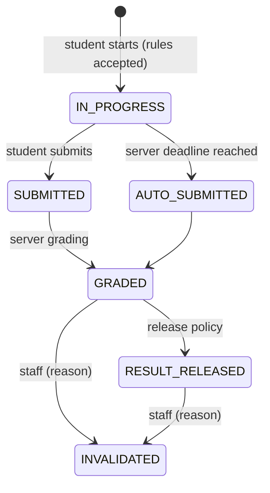

- The server owns the clock: `deadlineAt = min(startedAt + duration + accommodation, closesAt)`.
- Responses autosave on change and every 15 seconds; reconnecting within the deadline resumes the attempt; only one attempt may be in progress per student and assessment.
- Questions are served without answer keys; grading happens on the server.
- Grading produces per-section scores → levels → `VERIFIED` observations (`ASSESSMENT_PROCTORED` for supervised and externally proctored modes, otherwise `UNPROCTORED`). Invalidating an attempt invalidates its observations.

**Integrity controls (where feasible, never at the cost of accessibility):** randomised forms; strict server time limits; one active session per attempt (a second device ends the first); window focus changes and unusually fast completion are logged and flagged for staff, never auto-penalised; supervised labs require an access code and may restrict IP ranges. Paste is not blocked (accessibility); flags are informational.

**Accessibility:** keyboard-operable questions, screen-reader labels, visible time remaining announced at intervals through a polite live region, and staff-configured extra time.

### 14.4 External assessment results

Institution-supplied CSV exports (for example from coding-assessment platforms or national online course exams) are imported with a column mapping to students and skills; rows become `VERIFIED` observations with `SYSTEM_RECORD`. Results uploaded by students go through the `EXTERNAL_ASSESSMENT` evidence route (§12.2). API integrations are OPT-06.

### 14.5 Mock interviews

| Aspect | Design |
|---|---|
| Types | `TECHNICAL`, `HR_BEHAVIOURAL`, `GROUP_DISCUSSION`, `PROJECT_VIVA` |
| Scheduling | Faculty publish slots; students book (one active booking per type), or faculty and officers schedule directly; optional link to a target drive or role profile |
| Lifecycle | `REQUESTED → SCHEDULED → (RESCHEDULED) → COMPLETED`, or `NO_SHOW` or `CANCELLED` (reason) |
| Logistics | Room or online meeting link; reminders 24 hours and 1 hour before |
| Evaluators | One to three faculty; each submits an evaluation |
| Evaluation | Per-criterion score (1–5 with anchors) and comment; strengths; improvements; recommended actions chosen from taxonomy-linked templates (feed the planner); an overall practice recommendation ("ready for real interviews" or "needs more practice"), which is never a hiring signal |
| Lifecycle of an evaluation | `DRAFT → SUBMITTED → AMENDED` (within 7 days, with reason, versioned) |

**Default technical-interview rubric (version 1)**

| Criterion | Maps to | 1 | 3 | 5 |
|---|---|---|---|---|
| Technical knowledge (evaluator picks one to three skills discussed; each scored) | The selected technical skills | Major misconceptions | Correct on fundamentals, gaps in depth | Deep, precise, connects concepts |
| Problem solving | DSA | Cannot start without heavy help | Reaches a working approach with hints | Optimal approach with clear reasoning and complexity analysis |
| Communication | Interview Communication | Hard to follow | Clear but unstructured | Concise, structured, adapts to the listener |
| Project understanding | Ownership & Contribution (and Design & Architecture when discussed) | Cannot explain own project | Explains what was built | Explains design trade-offs, own contribution and impact |
| Professional conduct | Not mapped (feedback only) | — | — | — |

The HR rubric maps to Spoken English Communication and Interview Communication; the group-discussion rubric maps to Group Discussion; the project viva maps to the five Project Depth competencies.

**Multiple evaluators:** for each criterion, the observation level is the floor of the mean of the evaluators' scores (conservative). One observation is written per interview per mapped skill.

### 14.6 Contribution to readiness

Assessments and interviews influence readiness **only through observations and the skill profile** (§15.3):

| Source | Skills affected | Dimension |
|---|---|---|
| Aptitude assessments | Quantitative Aptitude, Logical Reasoning, Verbal Ability | APTITUDE |
| Technical assessments | Tested technical skills | TECHNICAL |
| Written communication tests | Written Communication | COMMUNICATION |
| Interview: technical knowledge, problem solving | Selected skills, DSA | TECHNICAL |
| Interview: communication; HR; group discussion | Communication skills | COMMUNICATION |
| Interview: project understanding; project viva | Project Depth competencies | PROJECT_DEPTH |

Completing plan tasks never changes a level; only a new assessment or an authorised evaluation does.

### 14.7 History and analytics

Students see every attempt and interview with dates, scores, levels and feedback (STU-13 to STU-17). Staff see per-assessment score distributions, per-question statistics and per-cohort participation; faculty see interview history for assigned students.

### 14.8 Acceptance criteria

- AC-ASM-01: Answer keys are never present in any response to a student before results are released (API test).
- AC-ASM-02: The deadline is enforced on the server; a late submission is rejected and the attempt is auto-submitted.
- AC-ASM-03: Grading produces observations with the configured level bands; invalidation removes them from the profile.
- AC-ASM-04: A faculty member can schedule a mock interview, record a rubric evaluation and amend it within 7 days with a reason; the student sees the feedback and the history.
- AC-ASM-05: Interview criteria update only their mapped skills, in the dimensions listed in §14.6.

---

## 15. Readiness Engine M6

`[MANDATORY-P06]` REQ-P06-08 to REQ-P06-12. Readiness is dimension-wise, explainable, recomputed on new evidence (debounced), computable for 5,000 students in a background job, and independent from eligibility.

### 15.1 What readiness is, and is not

- **General readiness** measures how much of a target role's baseline the student has **demonstrated with verified evidence**, in four dimensions: Technical, Aptitude, Communication and Project Depth.
- It is **not** eligibility (no CGPA, backlogs or other academic rules), **not** a drive match (that is M8), and **not** a prediction of selection. UI copy: "Readiness summarises your verified evidence against your target role. It is not a prediction of selection."

### 15.2 Reconciling P06 dimensions with the presentation's categories

P06 requires four dimensions. The presentation scores five categories with fixed weights (Verified Skills 32%, Assessments 24%, Academics 18%, Projects 16%, Interviews 10%). The two are different layers:

| Problem with scoring the five categories directly | Example |
|---|---|
| **Double counting** | A DSA assessment raises "Assessments" and, because assessments also verify skills, raises "Verified Skills" again |
| **No dimension structure** | Communication and aptitude disappear into category averages; P06's radar cannot be drawn |
| **Eligibility leakage** | "Academics: CGPA" (18%) re-uses the main eligibility input, contradicting P06's critical distinction |
| **Overlapping meaning** | "Projects" and "Interviews" both evidence project depth and communication |

**Decision (DEC-01, DEC-02):** the four dimensions are the scoring structure; the five categories are **evidence-source groups** that feed one skill profile and appear in explanations as contribution shares. The presentation's weights were labelled "Illustrative Weighting" and are retired as score weights. CGPA is excluded.

### 15.3 The two-layer model

```text
Layer 1 — evidence to skills (M4)                     Layer 2 — skills to dimensions (M6)
Verified Skills (certs, internships,  ┐
  coding profiles, achievements)      │
Assessments                           ├─► observations ─► skill levels ─► baseline attainment per dimension
Academics (course results only)       │   (one skill each)   (one value    (each skill in exactly one dimension)
Projects (faculty-evaluated)          │                       per skill)
Interviews (rubric criteria)          ┘
```

**Category-to-dimension contribution matrix** (which categories *can* influence which dimension, through the skills they evidence):

| Evidence category (presentation) | Technical | Aptitude | Communication | Project Depth |
|---|---|---|---|---|
| Verified Skills | Yes | No | Yes (for example a verified communication course) | No |
| Assessments | Yes | Yes (only source) | Yes (written tests) | No |
| Academics (course results; never CGPA) | Yes (capped at level 2) | No | No | No |
| Projects | Yes (skills used) | No | No | Yes |
| Interviews | Yes | No | Yes | Yes |

**Why nothing is counted twice:** every observation belongs to one skill; each skill has one verified level (taken as a maximum or latest value per §13.4, never a sum); each skill belongs to one dimension; dimensions combine skills by importance weights.

### 15.4 Formulas

Notation, for one student and their target role profile `R` (primary choice, else the programme default):

- For each requirement `r` in `R`: expected level `E_r` (1–5), importance `I_r` (1–5), dimension `d(r)`.
- `L_r` = the student's verified level for `r`. For a category requirement, `L_r` is the maximum verified level among its members (the same resolver as M8, so the two engines agree).
- Attainment: `a_r = min(L_r / E_r, 1)`. Exceeding the expected level earns no extra credit, so a strong skill cannot hide a missing one.
- Evidenced: `c_r = 1` if `L_r ≥ 1`, else `0`.

For each dimension `d` with requirements `B_d`:

```text
Demonstrated score   D_d = 100 × Σ(I_r × a_r) / Σ I_r
Coverage             C_d = Σ(I_r × c_r) / Σ I_r
Potential            P_d = D_d + 100 × (1 − C_d)          (if every unevidenced skill were verified at its expected level)
Pending uplift       D_d* = D_d computed with evaluated levels (§13.4)
```

Overall, with dimension weights `W_d` (sum to 1):

```text
Overall demonstrated   O  = Σ W_d × D_d
Overall coverage       OC = Σ W_d × C_d
Overall potential      OP = Σ W_d × P_d
```

- Default weights `[APPROVAL]` (DEC-01): Technical 0.40, Aptitude 0.20, Communication 0.20, Project Depth 0.20. A role profile may override them (for example, analytics roles weighting Aptitude higher), within the active configuration.
- Values are computed with full precision, stored to one decimal place and displayed as integers (round half up).
- **Normalisation:** every input is already on the 0–5 level scale; attainment normalises against expected levels; scores are 0–100.

### 15.5 States and missing data

| Scope | State | Rule (configurable thresholds) | UI |
|---|---|---|---|
| Dimension | `NO_EVIDENCE` | `C_d = 0` | "No evidence yet" with what to add; the axis is shown hollow on the radar |
| Dimension | `INSUFFICIENT` | `0 < C_d < 0.40` | Score shown with an "Insufficient evidence" label and coverage |
| Dimension | `SCORED` | `C_d ≥ 0.40` | Score with coverage |
| Overall | `NOT_ENOUGH_EVIDENCE` | `OC < 0.25`, or two or more dimensions `NO_EVIDENCE` | "Building your profile — X% evidence coverage"; **no overall number** |
| Overall | `PROVISIONAL` | Not `NOT_ENOUGH_EVIDENCE` and not `COMPLETE` | Overall score labelled "Provisional" with coverage |
| Overall | `COMPLETE` | Every dimension `SCORED` and `OC ≥ 0.75` | Overall score with coverage |

The score is always called **"demonstrated readiness"** and always appears with coverage and the potential range, so a low number caused by missing evidence is never mistaken for low ability.

### 15.6 Bands and thresholds

Thresholds exist only where a feature needs them (DEC-10):

- **Low-readiness nudge (P06 §11):** overall state `PROVISIONAL` or `COMPLETE` with `O < 40`, or any `SCORED` dimension below 30. Sent to the student and their mentor, at most once every 14 days per student, with the specific dimensions and two suggested actions.
- **Display bands for distributions:** Foundation (0–39), Developing (40–69), Strong (70–100), computed only for `PROVISIONAL` and `COMPLETE` snapshots. Histograms always show the raw distribution as well.
- All thresholds are provisional and are recalibrated after the first cohort's data, through a new configuration version.

### 15.7 Explanation payload

Each snapshot stores, per dimension: score, coverage, potential, state, pending uplift; **top contributors** (skills with attainment and the evidence that determined them); **shortfalls** (skills below the expected level, by importance); **missing** (unevidenced skills, by importance); and **category contribution shares** — for each presentation category `k`, `Σ(I_r × a_r for skills whose determining observation is in k) / Σ(I_r × a_r)`. This keeps the presentation's five-category vocabulary as an explanation ("Your technical score is supported by Assessments 45%, Projects 30%, Verified Skills 25%") without using it as weights.

Sentences are generated from templates, for example: "Technical: 73 (coverage 82%). DSA is verified at level 2; your target role expects level 3. DBMS Concepts has no verified evidence yet."

### 15.8 Worked example (illustrative, shortened baseline)

| Dimension | Requirement (E, I) | Verified L | a | Evidenced |
|---|---|---|---|---|
| Technical | DSA (3, 5) | 2 | 0.667 | yes |
| | Object-Oriented Language (3, 5) | 3 | 1.0 | yes |
| | SQL (2, 4) | 2 | 1.0 | yes |
| | DBMS Concepts (2, 3) | 0 | 0 | no |
| Aptitude | Quantitative Aptitude (3, 4) | 3 | 1.0 | yes |
| | Logical Reasoning (3, 4) | 2 | 0.667 | yes |
| | Verbal Ability (2, 3) | 0 | 0 | no |
| Communication | Interview Communication (3, 4) | 2 | 0.667 | yes |
| | Spoken English Communication (3, 3) | 0 | 0 | no |
| Project Depth | Five competencies (total importance 13) | 0 | 0 | no |

| Dimension | D | C | P | State |
|---|---|---|---|---|
| Technical | 12.33/17 → **72.5** | 14/17 → 82% | 90.1 | SCORED |
| Aptitude | 6.67/11 → **60.6** | 8/11 → 73% | 87.9 | SCORED |
| Communication | 2.67/7 → **38.1** | 4/7 → 57% | 81.0 | SCORED |
| Project Depth | 0 | 0% | 100 | NO_EVIDENCE |

Overall: `O = 0.4×72.5 + 0.2×60.6 + 0.2×38.1 + 0.2×0 = 48.7`; `OC = 58.9%`; `OP = 89.8`. One dimension has no evidence, so the state is **PROVISIONAL**. The student sees: "Demonstrated readiness 49 (provisional) · Evidence coverage 59% · Up to 90 if your remaining baseline skills are verified at the expected levels · Project Depth: no evidence yet — submit a project for faculty evaluation."

(The presentation's worked example of 72.0 used different inputs and a different model; it is not comparable.)

### 15.9 Presentation in the UI

- **Radar** (P06): four axes, 0–100; demonstrated polygon (navy, translucent fill); potential polygon (dashed outline); `NO_EVIDENCE` axes drawn hollow with a label. An optional "batch median" overlay appears only when the comparison group has at least 20 students.
- A data table under every radar lists each dimension's score, coverage, potential and state (accessibility, §28.9).
- Eligibility never appears inside readiness components, and readiness never appears inside eligibility components.

### 15.10 Recomputation triggers

| Trigger | Scope | Mode |
|---|---|---|
| `skill_profile.updated` | One student | Debounced 30 s |
| Student changes target role | One student | Immediate job |
| Role profile changed in a taxonomy release | Students with that target role | Batch run |
| Readiness configuration activated | Institution | Batch run |
| Nightly consistency check | Students whose inputs hash differs from their latest snapshot | Batch run |

A snapshot is written only when its inputs hash changes; the previous snapshot keeps `isCurrent: false`. Snapshots are immutable and retained for trend and training-effectiveness analysis.

### 15.11 Batch computation for 5,000 students

1. Create `batch_runs` (scope, trigger, configuration version, total count, `status: RUNNING`).
2. Fan out chunk jobs of 250 student IDs to the `readiness` queue (20 chunks for 5,000).
3. Each chunk: one `$in` query for the 250 current profiles; role profiles and configuration loaded once and cached; compute in memory with `packages/scoring`; one `bulkWrite` inserting new snapshots and clearing `isCurrent` on replaced ones; `$inc` the run's processed and failed counters.
4. The last chunk marks the run `COMPLETED` and records `durationMs`; per-student failures are listed without stopping the run.

Computation is well under 1 ms per student; the cost is database reads and writes. `[PROPOSED TARGET]` under 5 minutes for 5,000 students on a small dedicated cluster; the P06 acceptance limit is 15 minutes. The measurement protocol is in §33.5.

### 15.12 Configuration and governance

`readiness_configs` versions hold dimension weights, coverage and state thresholds, display bands, nudge rules, the cap-table version (§13.3) and the default role profile per programme. Lifecycle: `DRAFT → PENDING_APPROVAL → ACTIVE → RETIRED`. The Administrator drafts and runs a **simulation** (distribution before and after, students changing state or band); the Placement Head approves activation (DEC-10); activation triggers a batch run. Exactly one configuration is active per institution. All changes are audited.

### 15.13 Acceptance criteria

- AC-RDY-01: Each student has four dimension scores with coverage, potential, state and an explanation; the radar renders with a table alternative.
- AC-RDY-02: Readiness never reads CGPA, backlogs or eligibility (static check: the readiness module has no dependency on academic or eligibility modules; unit test with changed CGPA leaves readiness unchanged).
- AC-RDY-03: Missing evidence produces `NO_EVIDENCE` or `NOT_ENOUGH_EVIDENCE` states, never an unexplained zero.
- AC-RDY-04: A verified evidence decision updates readiness within 2 minutes `[PROPOSED TARGET]`, debounced so ten rapid changes cause at most two computations.
- AC-RDY-05: Batch readiness for 5,000 synthetic students completes as a background job in under 15 minutes, with the duration recorded in `batch_runs` (P06 acceptance).
- AC-RDY-06: Identical inputs give identical snapshots; every snapshot records configuration, taxonomy, profile and algorithm versions.

---

## 16. Eligibility Engine M7

`[MANDATORY-P06]` REQ-P06-12, REQ-P06-14. Eligibility is an independent, academic and administrative computation per drive. Skills, readiness and match scores are **never** eligibility conditions (§4.4, row 24).

### 16.1 Field registry (whitelist)

Rules may reference only registered fields. Each field defines type, source, scale and default verification policy.

| Field key | Type | Source | Scale | Verification required by default |
|---|---|---|---|---|
| `academic.cgpa` | number | `academic_records.cgpa` | Declared (default `CGPA_10`) | Yes |
| `academic.activeBacklogs` | integer ≥ 0 | `academic_records.activeBacklogs` | Count | Yes |
| `academic.totalBacklogs` | integer ≥ 0 | `academic_records.backlogHistoryCount` | Count | Yes |
| `academic.class10.percentage` | number | `academic_records.class10.percentage` | Percent | Yes |
| `academic.class12.percentage` | number | `academic_records.class12.percentage` | Percent | Yes |
| `academic.diploma.percentage` | number | `academic_records.diploma.percentage` | Percent | Yes |
| `academic.educationGapYears` | integer ≥ 0 | `academic_records.educationGapYears` | Count | Yes |
| `student.programmeId` | id | `students.programmeId` | — | Institution source |
| `student.departmentId` | id | `students.departmentId` | — | Institution source |
| `student.graduationYear` | integer | `batches.graduationYear` via `students.batchId` | — | Institution source |
| `student.currentSemester` | integer | `students.currentSemester` | — | Institution source |
| `placement.acceptedOfferCount` | integer | Derived from `offers` | Count | System |
| `placement.highestAcceptedCtcLpa` | number | Derived from `offers` | INR lakh per annum | System |

The two `placement.*` fields support common placement-cell policies (for example, limiting applications after an accepted offer). They are administrative policy, not academic merit. `[ASSUMPTION]` — confirm the institution's placement policy in M0.

System preconditions are checked outside the rule: the student account is `ACTIVE`, the student is in the drive's audience, and the drive is open.

### 16.2 Operators and limits

| Type | Operators |
|---|---|
| number, integer | `EQ`, `NEQ`, `GT`, `GTE`, `LT`, `LTE`, `BETWEEN` (inclusive) |
| id, enum | `IN`, `NOT_IN` |
| boolean | `IS_TRUE`, `IS_FALSE` |
| any | `IS_KNOWN` (rarely needed) |
| logical | `AND`, `OR`, `NOT` |

Limits: depth ≤ 4, leaves ≤ 30, value lists ≤ 50. **No expressions, scripts, regular expressions or raw database queries are ever accepted or evaluated.**

### 16.3 Rule schema

```json
{
  "schemaVersion": 1,
  "root": {
    "op": "AND",
    "children": [
      { "field": "academic.cgpa", "cmp": "GTE", "value": 7.0, "scale": "CGPA_10", "label": "CGPA at least 7.0" },
      { "field": "academic.activeBacklogs", "cmp": "EQ", "value": 0, "label": "No active backlogs" },
      { "field": "student.graduationYear", "cmp": "IN", "value": [2027] },
      { "op": "OR", "label": "12th or diploma at least 60%", "children": [
          { "field": "academic.class12.percentage", "cmp": "GTE", "value": 60 },
          { "field": "academic.diploma.percentage", "cmp": "GTE", "value": 60 }
      ] }
    ]
  },
  "verificationPolicy": { "acceptUnverifiedSources": [], "pendingRegistration": "ALLOW_PROVISIONAL" }
}
```

### 16.4 Evaluation with three-valued logic

Each leaf evaluates to `TRUE`, `FALSE` or `UNKNOWN`:

1. Read the field's `ProvenancedValue` (§9.3).
2. `availability: NOT_APPLICABLE` → `FALSE` with reason `NOT_APPLICABLE` (the condition cannot be met through this path; an `OR` with another path still works).
3. `availability: UNKNOWN` → `UNKNOWN` with reason `MISSING`.
4. Value present but not acceptable under the trust policy (for example `STUDENT_SUBMITTED` + `PENDING`) → `UNKNOWN` with reason `UNVERIFIED`.
5. Scale differs from the rule's scale and no approved conversion exists → `UNKNOWN` with reason `SCALE_MISMATCH`.
6. Otherwise compare → `TRUE` (`MET`) or `FALSE` (`NOT_MET`).

Groups use Kleene logic:

| AND | TRUE | UNKNOWN | FALSE |
|---|---|---|---|
| **TRUE** | TRUE | UNKNOWN | FALSE |
| **UNKNOWN** | UNKNOWN | UNKNOWN | FALSE |
| **FALSE** | FALSE | FALSE | FALSE |

| OR | TRUE | UNKNOWN | FALSE |
|---|---|---|---|
| **TRUE** | TRUE | TRUE | TRUE |
| **UNKNOWN** | TRUE | UNKNOWN | UNKNOWN |
| **FALSE** | TRUE | UNKNOWN | FALSE |

`NOT(UNKNOWN) = UNKNOWN`. Root `TRUE` → **ELIGIBLE**; `FALSE` → **INELIGIBLE**; `UNKNOWN` → **PENDING_VERIFICATION**. All leaves are evaluated (no short-circuit) so the explanation is complete.

**Explanation per leaf:** path, label, field, operator, expected value, actual value with provenance badge, result and reason code. **Summary sentences** are generated from templates, for example "Not eligible: your CGPA 6.9 is below the required 7.0" or "Pending verification: your 12th percentage is awaiting verification — no action needed unless asked." Students see their own explanation; staff see it for students in scope.

The evaluator is a pure function in `packages/scoring`: `evaluateEligibility(rule, facts, trustPolicy) → EligibilityResult`.

### 16.5 Validation when a rule is saved

Schema validation; whitelisted fields only; operator compatible with the field type; values within field ranges; scale declared for scaled fields; no empty groups; depth and size limits; canonicalised form and SHA-256 hash stored.

### 16.6 Rule builder (OFF-07)

- Visual AND/OR groups with field pickers, operator selectors and typed value inputs.
- A plain-language preview: "CGPA at least 7.0 AND no active backlogs AND graduating in 2027 AND (12th at least 60% OR diploma at least 60%)".
- **Cohort preview:** counts of eligible, ineligible and pending students in the drive's audience, and per-clause failure counts, before saving.
- Save as an institution template for reuse.

### 16.7 Versioning and history

- `eligibility_rules` versions are immutable; a drive references `ruleId` and `version`.
- Editing a published drive's rule creates a new version with a reason. Loosening takes effect immediately; **tightening after registration opens requires Placement Head approval**, and existing registrations of students who become ineligible are flagged for the officer's decision, never withdrawn automatically.
- `eligibility_results` keep the current result per student and drive plus history (rule version, data hash, outcome, explanation, timestamp).

### 16.8 Evaluation triggers

Drive publication (whole audience, fan-out on the `eligibility` queue); rule version change; `academic_record.changed` (that student's open drives); offer accepted (policy fields); student status change; nightly consistency run. Changed outcomes emit `eligibility.changed`, which notifies the student with the reason (P06 §11).

### 16.9 Exceptions

An officer requests an exception for one student and one drive with a reason → the Placement Head approves or rejects (reason required) → an approved exception lets the student register and is recorded on the registration; it expires when registration closes. The institution can disable exceptions entirely. Every step is audited and the student is notified.

### 16.10 Server-side enforcement at registration

Inside the registration transaction the API re-evaluates eligibility with current data (never a cached result), and checks: drive `PUBLISHED` and before the deadline; student `ACTIVE` and in the audience; no existing registration; consent to the drive's release field set captured.

| Outcome | Result |
|---|---|
| ELIGIBLE | Registration `CONFIRMED` |
| PENDING_VERIFICATION | Per drive policy: `ALLOW_PROVISIONAL` → registration `PROVISIONAL` (excluded from recruiter scope until confirmed); `BLOCK` → 422 `ELIGIBILITY_PENDING` with what is missing |
| INELIGIBLE | 422 `ELIGIBILITY_NOT_MET` with reasons — unless an approved exception exists, in which case `CONFIRMED` with `exceptionId` |

When a provisional student's data is verified, re-evaluation confirms the registration or flags it for the officer.

### 16.11 Acceptance criteria

- AC-ELG-01: Truth-table tests cover every combination of `TRUE`, `FALSE` and `UNKNOWN` for `AND`, `OR` and `NOT`.
- AC-ELG-02: A student with a missing or unverified required field is `PENDING_VERIFICATION`, never `INELIGIBLE`, with the field named.
- AC-ELG-03: An ineligible student cannot register through the API even when the UI is bypassed; an approved exception allows it.
- AC-ELG-04: Rules containing unknown fields, wrong operators, scripts or query operators are rejected at save time.
- AC-ELG-05: Changing a student's skills or readiness never changes their eligibility (unit test).
- AC-ELG-06: Each result carries a clause-level explanation and the rule version used.

---

## 17. Skill Matching Engine M8

`[MANDATORY-P06]` REQ-P06-15: compare the verified profile with drive requirements using taxonomy expansion. The algorithm is deterministic and explainable; AI may help normalise free text upstream (taxonomy resolution) but never replaces the matching logic.

### 17.1 Inputs and output

| Input | Source |
|---|---|
| Verified skill profile (verified and evaluated levels, confidence, determining evidence) | M4 `skill_profiles` (current) |
| Requirements of the job role: skill or category, required level, importance 1–5, mandatory flag | M7 drive version snapshot |
| Taxonomy graph: categories and members, approved equivalences, merges | The taxonomy release pinned by the drive |
| Planning metadata: hours per level step | Same release |
| Algorithm version and parameters (ready threshold) | Configuration |

Output: one `gap_analyses` document per student, drive and job role (P06's GapAnalysis entity), holding the match summary and requirement-level results, with `profileVersion`, `taxonomyRelease`, `driveVersion`, `algorithmVersion` and `inputsHash`.

### 17.2 Algorithm

For each requirement `r` (required level `E_r`, importance `I_r`, mandatory `m_r`):

1. **Load** the verified profile and the role's requirements.
2. **Normalise:** resolve the requirement's skill through merges in the pinned release (A merged into B → B; the explanation notes it).
3. **Expand** to the satisfier set `S(r)`:
   - concrete skill → `{skill}`;
   - category → all member skills;
   - add approved equivalents of each concrete satisfier (one hop), each with its level penalty.
4. **Effective level:** `L_r = max over s in S(r) of max(0, L_s − penalty_s)`, where `L_s` is the verified level. Record `matchedVia` (skill, path, penalty, equivalence ID). Ties: penalty 0 first, then higher confidence, then alphabetical.
5. **Gap:** `g_r = max(0, E_r − L_r)`.
6. **Status:**
   - `MET` when `g_r = 0`;
   - `PENDING` when `g_r > 0` but the same calculation with **evaluated** levels gives `g_r = 0` (pending verification would close it);
   - `PARTIAL` when `g_r > 0` and `L_r ≥ 1`;
   - `MISSING` when `L_r = 0` and nothing pending.
7. **Requirement score:** `s_r = min(L_r / E_r, 1)`.
8. **Match score:** `M = 100 × Σ(I_r × s_r) / Σ I_r`. **Requirement coverage:** `Σ(I_r × [L_r ≥ 1]) / Σ I_r`. **Mandatory met:** all mandatory requirements `MET`.
9. **Drive readiness class:**

| Class | Rule |
|---|---|
| `INSUFFICIENT_EVIDENCE` | Coverage < 0.40 |
| `READY` | All mandatory met and `M ≥ readyThreshold` (default 80) |
| `NEARLY_READY` | Every mandatory gap ≤ 1 level and `M ≥ 60` |
| `NOT_READY` | Otherwise |

10. **Prioritise gaps** (§18) and **generate explanations** from templates.

### 17.3 Examples

**P06 / Keshav category example.** Requirement: Frontend Framework, level 3. Student: React verified at level 4. React is a member of the category → `L_r = 4`, `g_r = 0`, `MET` via React. Explanation: "Requires a frontend framework at level 3. Met by React (verified level 4)."

**Brief example.** Requirement: DSA level 4, mandatory, importance 5. Student: DSA verified level 2.

| Field | Value |
|---|---|
| Required level | 4 |
| Current verified level | 2 (from "DSA Intermediate Assessment", 12 Aug 2026, proctored) |
| Gap | 2 levels |
| Importance | 5 (mandatory) |
| Severity | CRITICAL (§18.2) |
| Impact | 50.0 (§18.3) |
| Explanation | "This drive requires DSA at level 4. Your verified level is 2. Gap: 2 levels. Mandatory." |
| Suggested preparation | Advanced DSA resource set; 30 medium and 15 hard practice problems; checkpoint: DSA Advanced assessment; then a technical mock interview |

**Equivalence example.** Requirement: PostgreSQL level 3. Student: MySQL level 3, PostgreSQL none. Equivalence MySQL ↔ PostgreSQL (penalty 1) → `L_r = 2`, `g_r = 1`, `PARTIAL` via MySQL with penalty 1.

### 17.4 When matches are computed

| Trigger | Scope |
|---|---|
| A student opens a drive or its match page | That pair, computed synchronously (pure function, a few reads; cached) |
| Drive published, or requirements changed (new drive version) | All students in the audience (fan-out on `matching`) |
| `skill_profile.updated` | The student's open drives (registered, or in the audience while registration is open) |
| Drive re-based to a newer taxonomy release | All audience students |

P06: gap analysis must work "for any student against any drive". Ineligible students can still see their match, labelled "You are not eligible for this drive. This comparison is for preparation only."

### 17.5 Separation rules

- Matching never reads or changes eligibility; eligibility never reads match results.
- The UI shows eligibility (status pill) and match (meter plus gap count) as separate components.
- General readiness (M6) and drive match (M8) use the same skill resolver, so a category is interpreted identically in both, but they are stored and displayed separately.
- The search index uses synonym mappings generated from the same taxonomy release (§34) for **search**; the matching engine uses the graph in code for **decisions**.

### 17.6 Acceptance criteria

- AC-MAT-01: The React → Frontend Framework example passes (P06 §8).
- AC-MAT-02: Equivalence penalties apply exactly once and never chain.
- AC-MAT-03: Pending evidence produces `PENDING`, not `MET`.
- AC-MAT-04: Identical inputs give identical outputs; outputs store all versions and the inputs hash.
- AC-MAT-05: Any student can be matched against any drive, including drives they are ineligible for.

---

## 18. Gap Analysis Engine M8

`[MANDATORY-P06]` REQ-P06-16: ranked, specific, actionable gaps, ordered by impact.

### 18.1 Gap types

| Type | Condition | Typical action |
|---|---|---|
| `MISSING` | No verified evidence for any satisfier | Learn, practise, then get evaluated |
| `INSUFFICIENT_LEVEL` | Verified level below required | Level up, then re-assess |
| `PENDING_VERIFICATION` | Pending evidence would close it | Wait for review; follow up if overdue ("quick win") |
| `STALE` (advisory) | Requirement met, but by stale evidence | Re-assess to confirm |
| `LOW_CONFIDENCE` (advisory) | Requirement met with LOW confidence | Take an assessment to strengthen evidence |

Advisory items are listed separately and never counted as gaps.

### 18.2 Severity

| Severity | Rule |
|---|---|
| CRITICAL | Mandatory and gap ≥ 2 |
| HIGH | Mandatory and gap = 1; or optional and gap ≥ 3 |
| MEDIUM | Optional and gap = 2 |
| LOW | Optional and gap = 1 |

### 18.3 Impact and ordering

```text
impact = 100 × (I / 5) × (g / E) × m / 1.5        m = 1.5 if mandatory, 1.0 otherwise     (range 0–100)
```

Gaps are ordered by **impact (descending)**, then **effort hours (ascending)**, then skill name — fully deterministic. Severity, feasibility and "quick win" are badges, not alternative sort keys.

**Worked example (Keshav's Full Stack Developer use case):**

| Requirement | E | Student L | g | I | Mandatory | Impact | Severity |
|---|---|---|---|---|---|---|---|
| DSA | 3 | 2 | 1 | 5 | Yes | 33.3 | HIGH |
| Node.js (Express) | 3 | 2 | 1 | 4 | Yes | 26.7 | HIGH |
| Interview Communication | 3 | 2 | 1 | 4 | No | 17.8 | LOW |
| JavaScript, React, SQL | 3, 3, 2 | 4, 4, 3 | 0 | — | — | Met | — |

Ordered list: DSA → Node.js → Interview Communication.

### 18.4 Effort and feasibility

- **Effort hours** for a gap: the sum of `hoursPerLevelStep` for each level from `L + 1` to `E` (for a category, the member the student is closest on; otherwise the category default).
- **Available hours** `H = weeklyHours × weeksUntil(deadline)`. Deadline: the drive's first round date if set, otherwise registration close + 14 days (configurable); for role-profile gaps, the student's chosen target date, or no feasibility shown.
- Walking the ordered list with cumulative effort:
  - `FEASIBLE` — cumulative effort ≤ H;
  - `AT_RISK` — cumulative effort > H but this gap alone fits;
  - `NOT_FEASIBLE` — this gap alone exceeds H.
- Shown honestly: "At 6 hours per week this gap is unlikely to close before 20 Nov. Increase weekly hours to 14 or focus on mandatory gaps."
- Example: DSA level 2 → 4 needs 40 + 40 = 80 hours; 6 hours/week × 5 weeks = 30 hours → `NOT_FEASIBLE`.

### 18.5 Suggested actions (deterministic)

Templates per cluster and gap type produce actions: resources from the library matching the skill and target level (§19.5), a practice template, and the checkpoint that would evidence progress (assessment, mock interview, project review or evidence submission). For `PENDING_VERIFICATION`: "Your '<evidence title>' is awaiting review; expected by <date>." AI-generated suggestions are optional and secondary (OPT-12); AI never ranks gaps.

### 18.6 Overall gaps (not tied to a drive)

The same engine runs against the student's target role profile, producing the "Top gaps" card on the dashboard and STU-24. Without a deadline, feasibility is not shown.

### 18.7 Progress tracking

Each requirement's gap size is stored per computation; STU-22 and the plan show a small trend, and the date a gap first reaches zero is recorded as "closed on". Cohort-level gap closure feeds analytics (§22).

### 18.8 Acceptance criteria

- AC-GAP-01: For any student and drive, the gap list is non-empty when any requirement is unmet, ordered by the impact formula, with severity, effort, feasibility and actions.
- AC-GAP-02: Changing a deadline or weekly hours changes feasibility labels, not the ordering.
- AC-GAP-03: A gap never makes a student ineligible.
- AC-GAP-04: Pending-verification gaps are labelled as such with the expected review date.

---

## 19. Preparation Planner M9

`[MANDATORY-P06]` REQ-P06-17: a time-bound plan with resources and dated checkpoints, shown as a calendar.

### 19.1 Inputs and outputs

| Inputs | Outputs |
|---|---|
| Ordered gaps (drive or role profile), current and target levels | Plan with tasks (learn, practise), dated checkpoints and weekly summaries |
| Start date, target date (deadline) | Feasibility summary and deferred gaps |
| Weekly availability (hours, preferred days), blackout dates (institution exam calendar, student unavailability) | Calendar entries and an optional personal ICS feed |
| Other active plans (shared capacity) | `algorithmVersion`, `inputsHash`, plan version |
| Resource library and checkpoint catalogue (assessments by skill and level; interview availability) | — |
| Assessment outcomes and progress history | — |

### 19.2 Plan types and limits

`DRIVE` plans (from a drive's gap analysis) and `ROLE` plans (from target-role gaps). One active plan per student per drive; at most three active plans per student; all plans share the student's weekly capacity.

### 19.3 Scheduling algorithm (`packages/scoring/planner`)

1. **Horizon:** `W = ceil((target − start) / 7)` weeks (at least 1). Weekly capacity = weekly hours minus hours already allocated by other active plans.
2. **Task generation**, for each gap in impact order and each level step `k → k + 1`:
   - `LEARN`: one or two library resources for the skill and level `k + 1` (effort from the resource; fallback 40% of the step's hours);
   - `PRACTICE`: a cluster template (for example DSA: "Solve 15 medium problems on graphs and dynamic programming"; SQL: "20 queries including joins and window functions"; communication: "Two recorded answers using the situation–task–action–result structure"), 50% of the step's hours;
   - `CHECKPOINT` at the end of each gap, plus an intermediate checkpoint when a gap spans two or more levels. Type, in order of preference: an `ASSESSMENT` available for the skill and level; a `MOCK_INTERVIEW` (technical or communication skills); a `PROJECT_REVIEW` (Project Depth); an `EVIDENCE_SUBMISSION` (certification). About 10% of the step's hours.
   - `PENDING_VERIFICATION` gaps get one "Await verification" item (no effort) and a follow-up reminder after the service level.
3. **Scheduling:** fill week by week; alternate between the top two open gaps within a week; respect dependencies (learn → practise → checkpoint); place items on preferred days within a daily cap (weekly hours ÷ preferred days); skip blackout dates; a checkpoint's due date is the last preferred day of the week in which its prerequisites finish.
4. **Insufficient capacity:** schedule in impact order until capacity is used; remaining gaps become `DEFERRED` with a warning and options — the weekly hours needed, a later target date (role plans), or "mandatory gaps only".
5. **Output** with algorithm version and inputs hash; deterministic for the same inputs.

### 19.4 Re-planning

Triggers: a checkpoint overdue by two days (re-plan offered); a gap closed by verification (its remaining tasks are removed and the gap marked `CLOSED`); drive dates changed; weekly hours or blackout dates changed; requirements changed; the student asks. Re-planning keeps `DONE` and `IN_PROGRESS` tasks, regenerates future items and increments the plan version; the previous version is kept as `SUPERSEDED`.

### 19.5 Learning resource library (ENH-16)

Curated by placement officers and faculty (OFF and FAC pages; Administrators may also manage it). Fields: title, URL, provider, type (`ARTICLE`, `VIDEO`, `COURSE`, `PRACTICE_SET`, `BOOK`, `INTERNAL_SESSION`), skill IDs, target levels, estimated minutes, cost (`FREE` by default; paid items flagged), language, status (`DRAFT`, `PUBLISHED`, `RETIRED`), curator, last link check (monthly job), student helpfulness votes. **Every resource is checked by a human before publication**; demo seeds are labelled and are not published to real institutions without review.

### 19.6 Task and checkpoint states

| Item | States | Notes |
|---|---|---|
| Task | `TODO → IN_PROGRESS → DONE` or `SKIPPED` | `DONE` is self-reported (optional note or proof link) and **never changes a verified level** |
| Checkpoint | `SCHEDULED → DUE → COMPLETED` or `MISSED` | `COMPLETED` only when the linked evaluation outcome exists; the outcome level is shown |

### 19.7 Faculty involvement

Mentors can view mentees' plans, add tasks and notes, and schedule interview checkpoints; every change notifies the student.

### 19.8 Calendar (P06 "preparation plan as a calendar")

- **Views:** Week (desktop default), Month, Agenda (mobile default and the accessible view).
- Items are labelled with skill name and type; checkpoints use a distinct icon and label, not colour alone.
- **Rescheduling:** drag within the plan window on desktop, with an equivalent "Move to date" action for keyboard and touch users (WCAG 2.2 dragging alternative).
- **Personal ICS feed** (ENH-06): a revocable, tokenised, read-only URL that the student can add to a personal calendar.
- Built with shadcn primitives and `date-fns` (§7.6).

### 19.9 Notifications

Checkpoint due (two days before and on the day); checkpoint missed; weekly plan summary (Monday digest); re-plan suggested; mentor added a task.

### 19.10 Acceptance criteria

- AC-PLN-01: Generating a plan from any gap analysis yields tasks and dated checkpoints within the horizon (P06 acceptance: "preparation plan generated with dated checkpoints").
- AC-PLN-02: When capacity is insufficient, deferred gaps and the hours needed are shown explicitly.
- AC-PLN-03: Marking tasks done never changes skill levels; a checkpoint completes only with an evaluation outcome.
- AC-PLN-04: Re-planning preserves completed and in-progress tasks and keeps the previous version.
- AC-PLN-05: The calendar offers week, month and agenda views, and every drag action has a keyboard alternative.

---

## 20. Placement Drive Management M7

`[MANDATORY-P06]` REQ-P06-13: drives, roles, criteria, registration and shortlists.

### 20.1 Companies

Fields: name, legal name, website, verified domains, industry, headquarters city, description, logo (uploaded only with the company's permission; demo companies have none), status (`ACTIVE`, `ARCHIVED`), `isDemoData`. Company HR contacts are recruiter users linked through `recruiter_profiles`. Officers manage companies (OFF-02, OFF-03).

### 20.2 Drive data

| Group | Fields |
|---|---|
| Identity | `code` (for example `DRV-2026-0042`), title, company, description, type (`ON_CAMPUS`, `OFF_CAMPUS`, `POOL`, `VIRTUAL`) |
| Audience | Batches, programmes, departments |
| Job roles (embedded, 1–5) | `roleId`, title, description, locations, employment type (`FULL_TIME`, `INTERNSHIP`, `INTERNSHIP_WITH_PPO`), compensation (CTC range in INR lakh per annum, or monthly stipend), expected openings (optional), **skill requirements** (skill or category, level, importance 1–5, mandatory), optional source role-profile template |
| Eligibility | `ruleId` and `ruleVersion` (§16) |
| Release field set | Field keys from the release policy (§21.5), approved with the drive and shown to students before they register |
| Schedule | Registration opens, registration closes, first round, results expected |
| Rounds (embedded) | Sequence, name, type (`ONLINE_TEST`, `GROUP_DISCUSSION`, `TECHNICAL_INTERVIEW`, `HR_INTERVIEW`, `OTHER`), date and time, mode, location or link, status |
| Policies | Pending-eligibility policy (`ALLOW_PROVISIONAL` or `BLOCK`), roles per student (default 1), withdrawal deadline, exceptions allowed, drive-ready threshold (default 80) |
| Governance | Status, version, pinned taxonomy release, approval record (submitted by and at, approved by and at, comments), created by |

### 20.3 Drive lifecycle

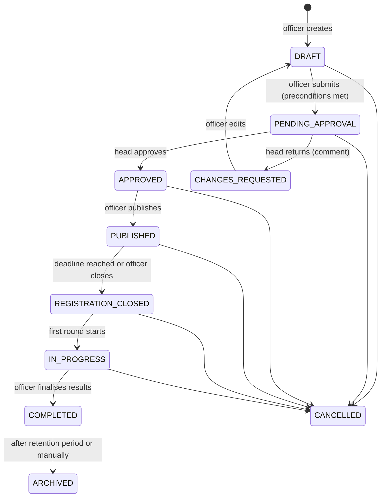

| Transition | Actor | Preconditions and effects |
|---|---|---|
| Submit | Placement Officer | At least one role with at least one requirement; valid eligibility rule; release field set within policy; schedule valid (opens < closes < first round) |
| Approve / request changes | Placement Head (not the submitter) | Comment required for changes; if `drive.requiresHeadApproval` is off, submitting moves straight to `APPROVED` |
| Publish | Placement Officer or Head | Emits `drive.published` → eligibility fan-out, match fan-out, notifications; registration opens at the configured time |
| Close registration | Automatic at the deadline, or officer | Provisional registrations pending at close are flagged for the officer |
| Start, complete | Officer | Completing requires every confirmed registration to have a final outcome |
| Cancel | Officer (Head approval once published) | Reason required; all registrants notified; recruiter grants revoked |

Transitions are enforced by the drive service on the server; the UI only offers allowed actions.

### 20.4 Registrations (shown as "Applications")

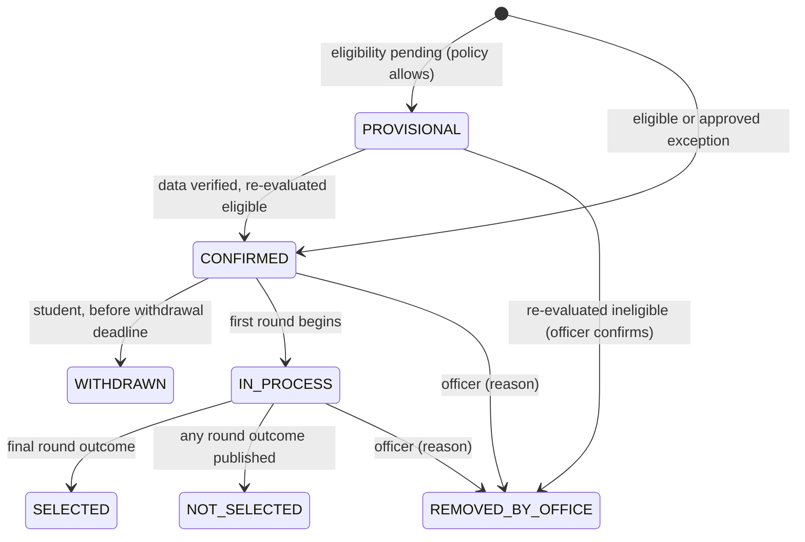

- **Duplicate protection:** unique index on `(institutionId, driveId, studentId)`; `Idempotency-Key` on the create request; creation only through the registration transaction (§16.10).
- **Consent:** at registration the student sees the drive's release field set and confirms; the consent and policy version are stored on the registration and in `consents`.
- **Status history:** every change records actor, reason and time; students see a stage stepper (STU-29).
- **Recruiter scope:** only `CONFIRMED`, `IN_PROCESS`, `SELECTED` and `NOT_SELECTED` registrations with recorded consent are ever visible to recruiters (§21.6).

### 20.5 Rounds and shortlists

1. The officer defines rounds and their schedule.
2. Per round, outcomes (`ADVANCE`, `HOLD`, `NOT_SELECTED`) come from recruiter submissions (when the grant allows) or officer entry.
3. The officer reviews the draft shortlist and **publishes** it; only published outcomes are visible to students and count in the funnel.
4. Publishing notifies shortlisted and non-shortlisted students ("shortlist result", P06 §11) and updates registration stages.
5. Retraction is exceptional, needs a reason and is audited.

### 20.6 Editing a published drive

| Change | Re-approval needed | Effect |
|---|---|---|
| Description, round schedule, location or link, adding a round | No | Registrants notified of schedule changes |
| Loosening eligibility | No (new rule version) | Re-evaluation; newly eligible students notified |
| Tightening eligibility | Yes (Head) | Re-evaluation; affected registrations flagged for the officer, never auto-withdrawn |
| Requirement changes (skills, levels, importance, mandatory), adding or removing roles, compensation changes | Yes (Head) | New drive version; matches recomputed; registrants notified |
| Expanding the release field set | Yes (Head) | Existing registrants must re-consent before newly added fields are released for them |

Every edit increments `drive.version`; previous versions are kept in `drive_versions` for audit and for explaining results computed against them.

### 20.7 Offers (selection records)

The officer records an offer for each selected registration (role, CTC, joining date, optional offer document). The student accepts or declines before the response deadline (STU-29). Acceptance updates placement policy fields and triggers eligibility re-evaluation for other drives (§16.1). A company withdrawing an offer is recorded with a reason.

### 20.8 Drive analytics

Per drive (OFF-06, OFF-09): eligibility × readiness quadrant before opening (§22.9), match distribution among eligible students, top gaps, registrations over time, department breakdown, and the funnel eligible → registered → shortlisted (per round) → selected → accepted.

### 20.9 Notifications

New drive published (the audience receives a digest item; students whose match class is `READY` or `NEARLY_READY` receive a direct "New drive matching your profile" message — P06 §11); eligibility changed with reason; registration closing in 48 hours (eligible students who have viewed but not registered); round schedule; shortlist result; offer recorded; drive cancelled.

### 20.10 Acceptance criteria

- AC-DRV-01: A drive moves through every lifecycle state only through allowed transitions with the right actors; invalid transitions return 409.
- AC-DRV-02: A student cannot register twice for the same drive, even with concurrent requests (test with parallel calls).
- AC-DRV-03: Material edits after publication create a new version and require Head approval where listed.
- AC-DRV-04: Only published shortlists are visible to students and counted in funnels.
- AC-DRV-05: Recruiters never see provisional or withdrawn registrations.

---

## 21. Recruiter Security Architecture M10

`[MANDATORY-P06]` REQ-P06-18 to REQ-P06-24, REQ-P06-32, REQ-P06-33. P06 calls recruiter access "the highest-risk surface in this project".

### 21.1 Threat model

| Threat | Example | Primary controls |
|---|---|---|
| Identifier manipulation (IDOR) | Changing a candidate ID in the URL to another student | Opaque per-registration references; scope-first queries; 404 outside scope |
| Cross-company access | Recruiter of company A opening company B's drive | Grant requires company match and drive scope |
| Stale access | Using access after a drive ends | Time-boxed grants checked on every request |
| Field leakage | Seeing CGPA when it was not released, through the profile, a sort, a filter or facet counts | Projection plus serializer whitelist; filter and sort allow-lists derived from released fields |
| Scraping and bulk export | Paging through all candidates and copying | Page-size cap, daily view cap, rate limits, no export endpoint, logging and alerts |
| Audience confusion | Using a campus session against recruiter APIs, or the reverse | Separate cookies and token audiences |
| Session theft | Stolen cookie | HTTP-only, Secure, SameSite cookies; short access tokens; refresh rotation with reuse detection |
| Insider misuse | Over-broad grants | Head approval, minimum default field set, visible release set for students, access-log review |

### 21.2 Access chain

```text
Recruiter account ACTIVE
  └─ company association VERIFIED (officer or head confirmed with the company)
      └─ grant APPROVED by Placement Head, now within [startsAt, expiresAt), drive in an allowed state
          └─ drive = grant.driveId (and role within grant.roleIds, if limited)
              └─ registration CONFIRMED / IN_PROCESS / SELECTED / NOT_SELECTED with consent recorded
                  └─ fields = grant.releasedFields ∩ drive.releaseFieldSet ∩ policy-releasable fields
```

Any broken link denies access.

### 21.3 Recruiter–company association

`recruiter_profiles.companyAssociation`: `PENDING_VERIFICATION → VERIFIED` or `REJECTED`. An officer or the Head verifies through the company's official HR channel; a matching business-email domain is supporting evidence, not proof. Only verified recruiters can receive grants. If a recruiter leaves the company, the association is ended and all grants are revoked.

### 21.4 Access grants

| Field | Meaning |
|---|---|
| `recruiterUserId`, `companyId`, `driveId`, optional `roleIds` | Scope |
| `permissions` | `VIEW_CANDIDATES` (always), `VIEW_RESUME`, `DOWNLOAD_RESUME`, `SUBMIT_ROUND_DECISIONS` |
| `releasedFields` | Must be a subset of the drive's release field set |
| `startsAt`, `expiresAt` | Window; at most 60 days, and no later than drive completion + 7 days `[PROPOSED TARGET]` |
| `dailyCandidateViewCap` | Default 300 distinct candidates per day |
| `status` | `REQUESTED`, `APPROVED`, `REJECTED`, `SUSPENDED`, `REVOKED`, `EXPIRED` |
| Governance | Requested by and reason; approved by, at and comment (approver ≠ requester); revoked or suspended by, at and reason; policy version; version |

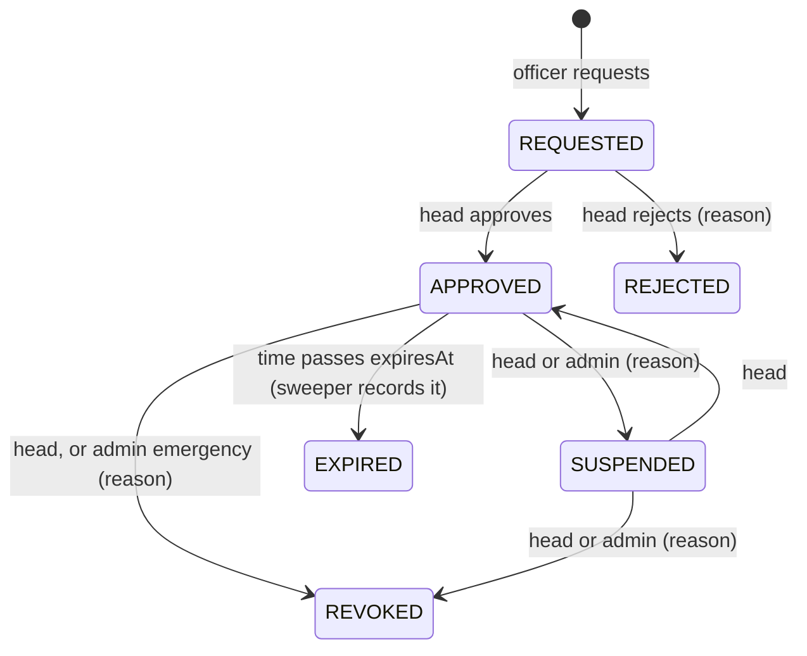

The **effective** state is computed on every request: `APPROVED` and now within the window and drive in `PUBLISHED`, `REGISTRATION_CLOSED`, `IN_PROGRESS` or `COMPLETED` (within the 7-day grace) and recruiter `ACTIVE` and association `VERIFIED` and company match → active. The sweeper only records `EXPIRED` for reporting; authorization never depends on it. Grant resolution is an indexed query on every request and is not cached, so revocation takes effect immediately. Extending a grant changes `expiresAt`, needs Head approval and increments the version.

### 21.5 Data release policy (P06 documentation deliverable)

Machine-readable in `data_release_policies` (versioned) and published as `docs/policies/data-release-policy.md` plus a public summary at `/data-release-policy` (PUB-08). Changes: the Administrator drafts, the Placement Head approves; a drive keeps the policy version it was published with.

| Class | Fields | Rule |
|---|---|---|
| **A — default on** (may be switched off per drive) | Candidate reference (opaque); official name; programme; department; graduation year; current stage in this drive; verified skills relevant to this drive's requirements (skill, verified level, verification method, confidence) | Included in a drive's release set unless removed |
| **B — off by default** (officer adds per drive; Head approves; students see before registering) | Verified CGPA; active backlog count; 10th, 12th or diploma percentage; registration number; institutional email; phone (only if the student opted in); default resume for the drive; verified project titles and summaries; verified certification list; LinkedIn, GitHub and portfolio links; requirement coverage summary for this drive (met and unmet requirements, no score); all verified skills | Requires explicit inclusion |
| **C — never releasable** | Internal identifiers; date of birth; home address; personal email or phone without opt-in; photograph `[APPROVAL]`; unverified claims; pending or rejected evidence; evidence documents; faculty comments and evaluations; AI analyses and rule results; readiness scores and snapshots; gap analyses beyond the coverage summary; preparation plans; assessment attempt details; mock-interview feedback; notifications; registrations and outcomes for other drives; offers from other companies; eligibility exceptions; correction requests; audit and access logs; consents; any sensitive personal attribute (none are stored in v1) | Not selectable anywhere |

### 21.6 Enforcement layers

Recruiter authorization lives in the dedicated authorization module (`RecruiterAccessPolicy`, P06 Track J) and the recruiter feature module calls it before any read. Layers 3–4 and layers 5–6 each independently prevent field leakage; neither is relied on alone.

| Layer | Control |
|---|---|
| 0 Edge | Nginx `recruiter_api` zone rate limit (§21.8) |
| 1 Authentication | Recruiter guard: `pc_rat` cookie, ES256 signature, `aud = pc-recruiter`, session active in Redis, account `ACTIVE`, association `VERIFIED` |
| 2 Grant resolution | Active grant for (recruiter, drive) as in §21.4; otherwise 404 (no grant) or 403 `GRANT_INACTIVE` (expired, suspended, revoked) |
| 3 Scope-first query | Every query starts with `{ institutionId, driveId: grant.driveId, status: { $in: releasable }, consentRecorded: true }` (and role filter if limited); user filters can only narrow it; candidates are addressed by `registrations.publicRef` (128-bit random, base32), never by `studentId` |
| 4 Projection | MongoDB projection built from the effective released fields for every read of registrations and students |
| 5 Serializer whitelist | `RecruiterCandidateDto` built from an allow-list mapping with `excludeExtraneousValues` |
| 6 Release guard | Before sending, the response's keys are checked against the released set; any extra key returns 500, logs a security event and alerts |
| 7 Access log | Every request — allowed or denied — written to `access_logs` (§21.9) |
| 8 Anomaly alerts | Many denials, cap nearly reached, or unusual paging → alert to the Placement Head |

**Status codes:** drive without any grant → 404; inactive grant on a known drive → 403 `GRANT_INACTIVE`; `candidateRef` outside scope → 404; filter or sort on an unreleased field → 400 `FIELD_NOT_RELEASED`; limits → 429; campus token on a recruiter route → 401. All responses carry `Cache-Control: no-store`.

### 21.7 Candidate search with facets (P06 §8)

- Parameters: `q` (searches the name only if the name is released), `skills` (skill ID with minimum verified level, expanded through the taxonomy resolver), `stage`, `programmeId` and `departmentId` (if released), `cgpaMin` (if CGPA is released), `sort` (allowed: name, stage, relevance, CGPA if released), `page`, `pageSize` (≤ 25).
- Facets are computed with an aggregation `$facet` over the scoped set and only for released attributes.
- Default implementation: MongoDB aggregation over the drive's registrations joined with projected student fields (a drive has hundreds to a few thousand registrants). Optional Atlas Search for fuzzy name search must place the scope conditions inside the query's `filter` clause, never as a post-filter (§34).

### 21.8 Session policy and rate limits (P06 §7, §16)

| Control | Value `[PROPOSED TARGET]` |
|---|---|
| Route group | `/recruiter/*` with its own layout, middleware branch, cookies (`pc_rat`, `pc_rrt`) and audience |
| Access token | 10 minutes |
| Session | 12 hours absolute; 30 minutes idle |
| Edge (Nginx, per IP) | `recruiter_api`: 30 requests/minute, burst 10; `recruiter_pages`: 60/minute; campus zone: 300/minute |
| Application (per recruiter user, Redis) | 60 requests/minute overall; candidate profile 30/minute; search 20/minute; resume 10/hour; daily distinct-candidate cap per grant (default 300) |
| Login | 5 attempts per minute per IP; lockout rules of §8.11 |

### 21.9 Access logging (P06: "fully logged", "logged and reviewable")

`access_logs` documents: institution, recruiter, company, grant, drive, action (`LOGIN`, `LOGOUT`, `LIST`, `SEARCH`, `FACETS`, `VIEW_CANDIDATE`, `VIEW_RESUME`, `DOWNLOAD_RESUME`, `SUBMIT_DECISIONS`, `DENIED`), candidate references returned or viewed, fields returned, sanitised filters, result count, outcome (`ALLOWED`, `DENIED`), deny reason, request ID, IP address, user agent, timestamp.

- Append-only: the application has no update or delete path; the database user's role should allow only insert and find on this collection where the hosting tier permits custom roles.
- Retained for at least one year (configurable, §32.15).
- Reviewable on HEAD-14 and ADM-25 with filters (recruiter, drive, action, outcome, date) and per-recruiter summaries.
- Optional transparency for students: "Your profile was viewed by <company> recruiters for <drive>" `[OPTIONAL]`.

### 21.10 No export

No CSV, spreadsheet or bulk endpoints exist under `/recruiter`; page size is capped; there is no "select all"; resume downloads are individual, permission-gated and capped. Copying from the screen cannot be prevented technically; terms of use, caps, logs and alerts address it.

### 21.11 Acceptance criteria

- AC-REC-01: The recruiter authorization suite (§36.6) passes in CI, including the P06 negative test: a recruiter cannot reach an unregistered student.
- AC-REC-02: Every recruiter request, allowed or denied, produces exactly one access-log entry.
- AC-REC-03: Revoking or suspending a grant blocks the next request immediately.
- AC-REC-04: No recruiter response ever contains a field outside the effective release set (property-based test over random release sets).
- AC-REC-05: There is no recruiter endpoint that returns more than 25 candidates or produces a file export.
- AC-REC-06: The data release policy document matches the machine-readable catalogue (generated in CI).

---

## 22. Institutional Analytics M10

`[MANDATORY-P06]` REQ-P06-25, REQ-P06-26. Every metric below has a precise definition, a source and a calculation. Dashboard values come from the analytics API (or clearly labelled development fixtures), never from hard-coded numbers.

### 22.1 Principles

- Counts are **distinct students** unless stated otherwise.
- Every chart and tile shows its scope (batch, department, drive set) and its **data freshness** ("Computed 31 Oct 2026, 02:05").
- Demo data is labelled on every analytics view (§9.10).
- Readiness metrics use only `PROVISIONAL` and `COMPLETE` snapshots unless the metric is about coverage itself; `NOT_ENOUGH_EVIDENCE` counts are always shown alongside.
- Breakdowns with fewer than 5 students show "fewer than 5" instead of a value in generated reports, to protect individuals; interactive staff views within permission scope show exact values.

### 22.2 Data pipeline

- **Snapshots:** `analytics.snapshot.refresh` runs nightly at 02:00 IST and on demand (HEAD and ADM pages), writing `analytics_snapshots` documents keyed by type and scope (institution, batch, department, programme, drive, training programme). Dashboards read snapshots for speed.
- **Live drill-down:** small scopes (one drive, one department list) query live with indexed aggregations.
- Snapshot types: `READINESS_DISTRIBUTION`, `SUPPLY_DEMAND`, `GAP_FREQUENCY`, `DEPARTMENT_COMPARISON`, `BATCH_COMPARISON`, `VERIFICATION_COVERAGE`, `FUNNEL`, `TRAINING_EFFECTIVENESS`, `DRIVE_READINESS_VIEW`.

### 22.3 Skill supply against drive demand ("the single most valuable report" — P06 §10)

**Scope.** Student pool `S` = active students in the selected batch(es), department(s) and programme(s) who have opted into placements. Drive set `D` = drives in `PUBLISHED`, `REGISTRATION_CLOSED` or `IN_PROGRESS`, plus `APPROVED` drives whose first round is within 90 days (configurable) — or one selected drive (P06 acceptance: "produced for a real drive").

**Per requirement skill `s`** (concrete skill or category) across all requirement instances in `D`:

| Measure | Definition |
|---|---|
| Demand (drive roles) | Number of distinct drive roles with a requirement on `s` |
| Demand (openings) | Sum of expected openings of those roles; shown only when every role states openings, otherwise "not specified" |
| Mandatory share | Share of those requirements marked mandatory |
| Required level | Most common required level (ties → the higher level); the single-drive view uses that drive's level |
| Supply | Students in `S` whose effective verified level for `s` (through the taxonomy resolver) is ≥ the required level |
| Near supply | Students exactly one level short — the training opportunity |
| Unverified potential | Students whose evaluated level (pending evidence) is ≥ the required level while the verified level is below — the verification opportunity |
| Coverage | Supply ÷ \|S\| |
| High-confidence supply | Supply whose skill confidence is HIGH |
| Shortfall against openings | max(0, openings − supply), only when openings are known |
| Department breakdown | Supply and near supply per department |

**Training priority** (what to run next term): `priority(s) = demandRoles(s) × (0.5 + 0.5 × mandatoryShare(s)) × nearSupply(s) / |S|`. The top ten skills form the "Train next term" list, each with its reasoning ("Required by 7 drive roles, 6 mandatory; 412 students are one level short").

**Presentation.** Paired horizontal bars per skill showing *students meeting the required level* against *openings* — both counts of people on one axis — sorted by shortfall. When openings are unknown, a ranked bar chart of coverage (%) is shown with demand roles as labels. A full table (all measures above) is always available, sortable and exportable by staff (audited).

### 22.4 Readiness distribution

- Histogram of overall demonstrated readiness in 10-point bins for `PROVISIONAL` and `COMPLETE` snapshots, with a separate bar or note for `NOT_ENOUGH_EVIDENCE`.
- Small multiples: one histogram per dimension.
- Statistics: median, interquartile range, and the coverage distribution.
- Display bands (§15.6) as shaded backgrounds with labels, never as the only encoding.
- Trend: monthly median from snapshot history.
- Filters: batch, department, programme, target role profile.

### 22.5 Department and batch comparison

Per department (and, separately, per graduation batch): students; share in each readiness state; median overall readiness; median per dimension; verification coverage; students eligible for open drives; registrations; offers. Presented as a sortable table with inline meters. The batch view adds a monthly trend line of median readiness.

### 22.6 Gap frequency

For a drive or a drive set and its eligible students: per requirement skill, the share of students with a gap, the mean gap size, the share where the requirement is mandatory and the count of CRITICAL gaps. A department × skill **heatmap** (sequential navy scale, values printed in every cell, legend with numeric scale, table alternative) shows where gaps concentrate.

### 22.7 Verification coverage

Evidence items by status; share of students with at least one verified item per evidence type; share of skill claims verified; median hours from submission to decision; service-level breach rate; share auto-verified (routing rows 4–5); reviewer workload distribution; all by department and evidence type.

### 22.8 Training effectiveness

Uses `training_programs` (targeted skills, participants, dates, conducted by; ENH-14).

- **Pre** value: participant's verified level per target skill at the programme start (from `skill_profile_history`); **post**: at programme end + 14 days (configurable).
- **Comparison group** `Q`: non-participants in the same batch and departments whose pre level is within ±1 of participants'.
- **Effect** = mean change of participants − mean change of the comparison group (difference in differences), with group sizes, the share of participants improving by at least one level, and a 95% bootstrap confidence interval (1,000 resamples, computed in the worker).
- The same calculation runs on readiness dimension scores.
- Caveats are always displayed: observational, not causal; groups under 20 are flagged "insufficient sample".
- Chart: dumbbell per skill (participants' pre → post mean, with the comparison group's change as a reference).

### 22.9 Drive readiness view before a drive opens (ENH-11)

For an `APPROVED` or `PUBLISHED` drive (P06: "a batch-level readiness view before a drive opens"):

| | Ready (`READY` or `NEARLY_READY`) | Not ready (`NOT_READY`) | Insufficient evidence |
|---|---|---|---|
| **Eligible** | count | count | count |
| **Pending verification** | count | count | count |
| **Ineligible** | count | count | count |

Each cell links to the filtered student list (staff only). Below it: the match-score distribution for eligible students, the drive's top gaps and suggested actions (for example, a targeted session for the most frequent mandatory gap). The grid makes P06's "eligible and unready, or ready and ineligible" visible without merging the two concepts.

### 22.10 Placement funnel and outcomes

| Stage | Definition |
|---|---|
| Eligible | Students with an `ELIGIBLE` result for the drive at registration close |
| Registered | Registrations `CONFIRMED` or later |
| Shortlisted | Advanced in at least one published round |
| Selected | Registrations `SELECTED` |
| Accepted | Offers accepted |

Conversion between consecutive stages is shown as a percentage; the largest drop is highlighted with a label. Views: per drive, per season (academic year), per department. **Placement rate** = students with at least one accepted offer ÷ opted-in students of the batch. Median and maximum accepted CTC are internal-only figures.

### 22.11 KPI tile definitions

| Tile | Definition |
|---|---|
| Active-batch students | Active students in batches graduating this or next academic year |
| Readiness evidence complete | Share of those students with overall state `COMPLETE` |
| Median readiness | Median overall score among `PROVISIONAL` and `COMPLETE` |
| Eligible for open drives | Distinct students eligible for at least one drive in `PUBLISHED` |
| Pending reviews | Evidence in `PENDING_REVIEW` within scope |
| Offers this season | Offers recorded since the season start date (institution setting) |

### 22.12 Reports

Institutional reports (OFF-19, HEAD-15): drive report, season placement report, readiness and gaps report, verification report, training-effectiveness report. Formats: on screen; printable layout (browser print styles to PDF); CSV for staff with permission (audited; aggregate by default; student-level lists only for officers and the Head with a recorded purpose). Recruiters have no reports or exports.

### 22.13 Acceptance criteria

- AC-ANL-01: The supply-against-demand report is produced for a specific drive and for the active drive set, with every measure in §22.3 (P06 acceptance).
- AC-ANL-02: Readiness distribution, department comparison, gap frequency, verification coverage, funnel and training effectiveness each match hand-computed values on a fixed synthetic dataset (golden tests).
- AC-ANL-03: Each analytics view shows scope and freshness, and every chart has a table alternative.
- AC-ANL-04: No dashboard value is hard-coded (code search in CI for numeric literals in dashboard components is part of review; fixtures are labelled).

---

## 23. Notifications and Communication

`[MANDATORY-P06]` REQ-P06-28 for the six P06 notifications; the rest is ENH-09.

### 23.1 Architecture

```text
Domain event (outbox) → notification rules (per event) → recipient resolution (owning module, scope-checked)
  → preference filter → in-app notification document → channel deliveries (email, SMS) on the notifications queue
  → provider adapters → delivery status and retries
```

### 23.2 Channels

| Channel | Implementation | Local development |
|---|---|---|
| In-app | `notifications` collection; bell and notification centre | Same |
| Email | `EmailProvider` interface; SMTP adapter (`nodemailer`); provider configurable | Mailpit (captures mail) or console adapter |
| SMS | `SmsProvider` interface; console/log adapter by default; paid provider optional (OPT-11) | Console adapter |
| Push | Not in v1 (OPT-08, OPT-10) | — |

No paid service is required for local development or tests.

### 23.3 Notification catalogue

`P06` marks the notifications P06 §11 requires.

| Event | Recipients | Default channels | Notes |
|---|---|---|---|
| Invitation and reminder | Invited user | Email | Mandatory |
| Account activated | User | In-app, email | — |
| Lockout, password reset, password changed | User | Email | Security; cannot be disabled |
| Role assignment changed, account suspended or reactivated | User | In-app, email | Mandatory |
| Evidence submitted | Student | In-app | Confirmation |
| **Verification requested** (P06) | Assigned faculty | In-app; email hourly digest | — |
| **Verification completed** (P06) | Student | In-app, email | Includes decision and reason |
| Resubmission requested, verification revoked | Student | In-app, email | Reason included |
| Review overdue or escalated | Faculty, Review Coordinator | In-app, email | — |
| Academic correction decided | Student | In-app, email | — |
| Assessment published; result released | Audience; student | In-app (daily digest for publication) | — |
| Interview scheduled, rescheduled, cancelled; reminders (24 h, 1 h); feedback available | Student and evaluators | In-app, email; SMS optional | — |
| **New drive matching your profile** (P06) | Audience students with match `READY` or `NEARLY_READY` | In-app, email | Others get a daily digest item |
| **Eligibility met or missed, with reason** (P06) | Student | In-app; email while the drive is open | Sent only when the outcome changes |
| Registration confirmed, provisional, withdrawn, removed | Student | In-app | Removed: reason included |
| Registration closing in 48 hours | Eligible students who viewed but did not register | In-app | Once per drive |
| **Shortlist result** (P06) | Registered students of the round | In-app, email | Neutral wording for not shortlisted |
| Offer recorded; response reminder | Student | In-app, email | — |
| **Preparation checkpoint due** (P06) | Student | In-app, email | Two days before and on the day |
| Checkpoint missed; re-plan suggested | Student (and mentor for repeated misses) | In-app | — |
| **Low-readiness nudge** (P06, "to student and mentor") | Student and mentor | In-app; email at most weekly | At most once per 14 days per student |
| Drive approval requested or decided | Head; officer | In-app, email | — |
| Grant requested, approved, rejected, expiring (48 h), suspended, revoked | Head, officer, recruiter as relevant | In-app, email | Recruiters only about their own grants |
| Eligibility exception requested or decided | Head; officer; student | In-app, email | — |
| Import completed or failed; Administrator request awaiting approval | Administrators | In-app (email for requests) | — |
| Platform health alert | Administrators | In-app, email | — |
| Recruiter anomaly alert | Placement Head | In-app, email | — |
| Announcement | Selected audience | In-app; email optional | Created by Administrator or placement staff |

### 23.4 Preferences

Per user and category: channel toggles and digest frequency (immediate or daily) for low-priority categories. Security, account-status, invitation and offer notifications cannot be disabled. Quiet hours for email and SMS, 22:00–07:00 IST, except security messages.

### 23.5 Recipient rules

The module that owns an event resolves recipients (for example, a student's mentor through `faculty_assignments` with purpose `MENTOR`). Recipients are always scope-checked through the authorization module; recruiters receive messages only about their own grants and drives.

### 23.6 Delivery and retries

Each notification stores deliveries per channel: status (`QUEUED`, `SENT`, `FAILED`, `SUPPRESSED` by preference, `BOUNCED`), attempts, provider message ID and last error. Retries: 5 attempts with exponential backoff from 60 seconds; permanent failures (invalid address) are marked and shown on the Administrator's health page. Idempotency key: `(eventId, recipientId, channel)`.

### 23.7 Templates and content rules

`notification_templates` hold subject and body per channel with variables, a version and the locale (`en-IN`). Administrators edit templates with a preview (ADM-26). Emails use a simple branded layout and link to the portal; **emails and SMS never include CGPA, scores, readiness, evidence content or other sensitive details** — they say what happened and link to the page. Non-mandatory emails include an unsubscribe link to preferences.

### 23.8 In-app experience

A bell with an unread count (announced politely to screen readers when it changes), a notification centre (filters: unread, category), mark one or all as read, and deep links to the relevant page (every key screen has a URL). Freshness: TanStack Query polls the unread count every 60 seconds and refetches on window focus.

### 23.9 Acceptance criteria

- AC-NOT-01: Each of the six P06 notifications is produced by its triggering event in an integration test.
- AC-NOT-02: Preferences suppress optional channels and never suppress mandatory ones.
- AC-NOT-03: Re-delivering the same event never creates duplicate notifications.
- AC-NOT-04: Local development and CI run without any paid email or SMS service.

---

## 24. MongoDB Database Design

### 24.1 Conventions

| Topic | Rule |
|---|---|
| Names | Collections `snake_case` plural; Mongoose models `PascalCase` singular; fields `camelCase` |
| Schema notation | In the schema blocks below, fields marked `?` are optional and all others are required; `…Id` fields are ObjectId references to the named collection; inline object and array types are embedded documents; `timestamps` means `createdAt`/`updatedAt` |
| Per-collection metadata | Ownership of every collection is listed in §6.5; access rules in §32.5; history handling (history collections, versions, append-only logs) is stated with each collection; retention in §24.15 |
| Identifiers | `_id: ObjectId`; external references as ObjectId; human codes (`DRV-2026-0042`) where users need them; recruiter-facing references are random `publicRef` strings, never ObjectIds |
| Institution scope | Every business document has `institutionId` (required, indexed); every unique index starts with `institutionId` |
| Audit fields | `createdAt`, `updatedAt` (Mongoose timestamps); `createdBy`, `updatedBy` on human-edited documents |
| Concurrency | `optimisticConcurrency: true` (Mongoose `__v`) on human-edited documents (drives, rules, taxonomy, configs, plans); APIs use `If-Match` (§25.1) |
| Demo flag | `isDemoData: boolean` (default `false`) on every business document |
| Deletion | Status lifecycles instead of deletes; physical deletion only for drafts, expired tokens, purged quarantine and retention jobs |
| Enumerations | Defined once in `packages/shared` (Appendix A) and enforced with Mongoose `enum` |
| Time | Stored in UTC; displayed in `Asia/Kolkata` |
| Money | CTC as numbers in INR lakh per annum (two decimals); stipends as integer INR per month |
| Indexes | Declared in schemas, created by migration scripts (`autoIndex: false` in production); `tools/` verifies them; hot queries have `explain()` tests asserting an index scan |
| Transactions | Require a replica set (Atlas; local single-node replica set; `MongoMemoryReplSet` in tests). Used for: registration create; review decision + observations + outbox; import chunk commit; grant decisions; drive transitions + outbox; correction approval; batch-run chunk writes |
| Write concern | `majority` for state changes; reads from primary |
| Document size | Embedded arrays have documented caps (the 16 MB document limit is never approached) |

### 24.2 Embedding versus referencing

**Embed** when the data is bounded, owned by the parent, read with it and rarely queried alone: semester results (≤ 12) in `academic_records`; job roles (≤ 5) and their requirements (≤ 40 each) and rounds (≤ 10) in `drives`; tasks (≤ 300) and checkpoints in `preparation_plans`; channel deliveries (≤ 3) in `notifications`; released fields in `recruiter_access_grants`; requirement results in `gap_analyses`; status history in `registrations` (≤ 50).

**Reference** when the data is unbounded, shared, queried independently or has different access rules: observations, claims, attempts, evaluations, registrations, eligibility results, access logs, audit logs, evidence events, import rows, history collections.

**Mapping to P06 entities and the brief's logical collections**

| P06 entity / brief name | Physical design |
|---|---|
| Skill · SkillSynonym · SkillCluster | `skills` · `skill_synonyms` · `skill_clusters` |
| SkillEquivalences · RoleSkillMappings · SkillLevels | `skill_equivalences` · `role_profiles` · level scale inside `taxonomy_releases` plus cluster descriptors |
| Institutions · Users · RoleAssignments · Departments · Programmes · Batches | Same names |
| Student · AcademicRecords · SemesterResults · AcademicCorrectionRequests | `students` · `academic_records` (semester results embedded) · `academic_correction_requests` |
| EvidenceItem · EvidenceHistory | `evidence_items` · `evidence_events` |
| Verification / VerificationRecords · AIAnalysisRecords | `verification_reviews` · `ai_analyses` |
| SkillProfile / VerifiedSkillProfiles · StudentSkillClaims | `skill_profiles` (with `skill_observations`) · `skill_claims` |
| Assessment · QuestionBanks · AssessmentAttempts | `assessments` · `question_banks` + `questions` · `assessment_attempts` |
| MockInterview · InterviewFeedback | `mock_interviews` · `interview_evaluations` |
| ReadinessConfigurations · ReadinessSnapshot | `readiness_configs` · `readiness_snapshots` |
| Companies · Drive · JobRoles · DriveRequirement | `companies` · `drives` (roles and requirements embedded) |
| EligibilityRule · EligibilityResults | `eligibility_rules` · `eligibility_results` |
| Registration / Applications · Shortlists · SelectionRecords | `registrations` · `shortlists` · `offers` |
| DriveMatches · GapAnalysis | `gap_analyses` (one document holds the match summary and the gaps) |
| PreparationPlan · LearningTasks · ProgressRecords | `preparation_plans` (tasks, checkpoints and progress embedded) |
| RecruiterAccessGrant · ReleasedFields · AccessLog | `recruiter_access_grants` (released fields embedded) + `data_release_policies` · `access_logs` |
| ImportBatches · ImportErrors | `import_batches` · `import_rows` |
| Notifications · AuditLogs · SystemConfigurations | `notifications` · `audit_logs` · `system_configurations` |

### 24.3 Identity and organisation

**`institutions`** — the university (one per deployment in v1).

```ts
{ _id, code: string /*unique*/, name, shortName, timezone: 'Asia/Kolkata', locale: 'en-IN',
  allowedEmailDomains: string[], academicYearStartMonth: number, holidayCalendar: { date: Date, label: string }[],
  settings: { demoMode: boolean, requiresHeadApprovalForDrives: boolean, eligibilityExceptionsEnabled: boolean,
              aiAnalysisEnabled: boolean, mfaRequiredRoles: Role[] },
  status: 'ACTIVE' | 'SUSPENDED', isDemoData, createdAt, updatedAt }
```
Indexes: `{ code: 1 }` unique. Owner: Administrator. Retention: permanent.

**`departments`**, **`programmes`**, **`batches`**

```ts
departments { _id, institutionId, code, name, status: 'ACTIVE'|'ARCHIVED', isDemoData, timestamps }
programmes  { _id, institutionId, code, name, degree: 'BTECH'|'MTECH'|'MCA'|'BCA'|'MBA'|'OTHER', departmentIds: ObjectId[],
              durationSemesters, defaultRoleProfileId?, status, isDemoData, timestamps }
batches     { _id, institutionId, code /* e.g. 2027 */, graduationYear: number, programmeIds: ObjectId[], status, isDemoData, timestamps }
```
Indexes: `{ institutionId: 1, code: 1 }` unique on each. Owner: Administrator.

**`users`** — human identity.

```ts
{ _id, institutionId, fullName, emailNormalized /*lowercase NFC*/, emailDisplay, phoneE164?,
  status: 'INVITED'|'INVITATION_EXPIRED'|'ACTIVE'|'SUSPENDED'|'DEACTIVATED', statusReason?, statusChangedBy?, statusChangedAt?,
  audience: 'CAMPUS' | 'RECRUITER', lastLoginAt?, mfaEnabled: boolean,
  notificationPreferences: { [category: string]: { inApp: boolean, email: boolean, sms: boolean, digest: 'IMMEDIATE'|'DAILY' } },
  aiProcessingOptOut: boolean, isDemoData, timestamps }
```
Indexes: `{ institutionId: 1, emailNormalized: 1 }` unique; `{ institutionId: 1, status: 1 }`; `{ institutionId: 1, audience: 1 }`. Access: self (limited), Administrator. Retention: account lifetime + policy (§32.15).

**`auth_credentials`** — never returned by any API.

```ts
{ _id, userId /*unique*/, passwordHash?: string /*argon2id*/, passwordChangedAt?, failedLoginCount: number,
  lockedUntil?: Date, lockoutLevel: number, mfaSecretEncrypted?: string, mfaRecoveryCodeHashes?: string[], timestamps }
```
Indexes: `{ userId: 1 }` unique. Access: Identity module only.

**`role_assignments`**

```ts
{ _id, institutionId, userId, role: Role, bundles: PermissionBundle[],
  scope: { departmentIds?: ObjectId[], programmeIds?: ObjectId[], batchIds?: ObjectId[], all?: boolean,
           companyId?: ObjectId /*recruiter*/, studentId?: ObjectId /*student*/ },
  status: 'PENDING'|'ACTIVE'|'REVOKED'|'EXPIRED'|'ALUMNI', validFrom, validTo?, grantedBy, grantReason, revokedBy?, revokedReason?, timestamps }
```
Indexes: `{ institutionId: 1, userId: 1, role: 1, status: 1 }`; partial unique `{ institutionId: 1, userId: 1, role: 1 }` where `status = 'ACTIVE'`. History: revoked assignments are kept.

**`sessions`** — refresh-token families.

```ts
{ _id, userId, audience: 'CAMPUS'|'RECRUITER', activeRoleAssignmentId?, refreshTokenHash, familyId, rotatedFromId?,
  createdAt, lastUsedAt, idleExpiresAt, absoluteExpiresAt, revokedAt?, revokeReason?, ip, userAgent }
```
Indexes: `{ refreshTokenHash: 1 }` unique; `{ userId: 1, revokedAt: 1 }`; TTL on `absoluteExpiresAt` (+30 days for forensics). Redis mirrors `sess:{id}` revocation state.

**`auth_tokens`** — invitation, password-reset and email tokens.

```ts
{ _id, institutionId, userId, type: 'INVITATION'|'PASSWORD_RESET', tokenHash, expiresAt, usedAt?, invalidatedAt?, createdBy?, createdAt }
```
Indexes: `{ tokenHash: 1 }` unique; `{ userId: 1, type: 1 }`; TTL on `expiresAt` + 30 days.

**`admin_requests`** — two-person rule for new Administrators.

```ts
{ _id, institutionId, requestedBy, candidateName, candidateEmailNormalized, justification,
  status: 'PENDING_APPROVAL'|'APPROVED'|'REJECTED'|'CANCELLED', decidedBy?, decisionReason?, decidedAt?, invitationTokenId?, timestamps }
```
Rule: `decidedBy ≠ requestedBy` (checked in service and by test).

### 24.4 People

**`students`**

```ts
{ _id, institutionId, userId, registrationNumber /*institution-controlled*/,
  officialName: ProvenancedValue<string>, departmentId, programmeId, batchId, section?, currentSemester: ProvenancedValue<number>,
  status: 'ACTIVE'|'GRADUATED'|'LEFT'|'SUSPENDED', placementOptIn: boolean,
  // student-managed
  photoFileId?, contact: { phoneE164?, shareWithRecruiters: boolean }, links: { linkedin?, github?, portfolio? },
  githubUsername?, targetRoleProfileIds: ObjectId[] /*≤ 2; first is primary*/,
  availability: { weeklyHours: number, preferredDays: ('MON'|'TUE'|'WED'|'THU'|'FRI'|'SAT'|'SUN')[], blackoutDates: Date[] },
  resumes: { fileId, label, uploadedAt, isDefault }[] /*≤ 5*/,
  icsFeedTokenHash?, onboardingCompletedAt?, isDemoData, timestamps }
```
Indexes: `{ institutionId: 1, registrationNumber: 1 }` unique; `{ institutionId: 1, userId: 1 }` unique; `{ institutionId: 1, batchId: 1, departmentId: 1, status: 1 }`; `{ institutionId: 1, programmeId: 1 }`. Access: self, faculty assigned, staff in scope; recruiters only through §21.

**`staff_profiles`**

```ts
{ _id, institutionId, userId, employeeId, designation, departmentId?, placementUnit?,
  employmentStatus: 'ACTIVE'|'ON_LEAVE'|'RELIEVED', isDemoData, timestamps }
```
Indexes: `{ institutionId: 1, employeeId: 1 }` unique; `{ institutionId: 1, userId: 1 }` unique.

**`recruiter_profiles`**

```ts
{ _id, institutionId, userId, companyId, designation, phoneE164?,
  companyAssociation: { status: 'PENDING_VERIFICATION'|'VERIFIED'|'REJECTED'|'ENDED', verifiedBy?, verifiedAt?, note? },
  termsAcceptedAt?, termsVersion?, isDemoData, timestamps }
```
Indexes: `{ institutionId: 1, userId: 1 }` unique; `{ institutionId: 1, companyId: 1 }`.

**`faculty_assignments`**

```ts
{ _id, institutionId, facultyUserId, studentId, purposes: ('MENTOR'|'EVIDENCE_REVIEWER'|'INTERVIEWER'|'PROJECT_GUIDE')[],
  conflictOfInterest: boolean, validFrom, validTo?, assignedBy, timestamps }
```
Indexes: `{ institutionId: 1, facultyUserId: 1, studentId: 1 }` unique; `{ institutionId: 1, studentId: 1 }`. Bulk-managed by officers or Administrators (CSV import of mentor lists supported).

**`consents`**

```ts
{ _id, institutionId, userId, purpose: 'PRIVACY_NOTICE'|'TERMS'|'AI_PROCESSING'|'DRIVE_RELEASE'|'RECRUITER_TERMS',
  policyVersion, context?: { driveId?, registrationId?, releaseFieldSet?: string[] }, grantedAt, withdrawnAt?, ip, userAgent }
```
Indexes: `{ institutionId: 1, userId: 1, purpose: 1 }`. Retention: as long as the related data plus the legal period.

### 24.5 Academic data

**`academic_records`** — one per student.

```ts
{ _id, institutionId, studentId /*unique*/,
  class10: { board?: ProvenancedValue<string>, percentage: ProvenancedValue<number>, passingYear?: ProvenancedValue<number> },
  class12: { board?: ProvenancedValue<string>, percentage: ProvenancedValue<number>, passingYear?: ProvenancedValue<number> },
  diploma: { institution?: ProvenancedValue<string>, percentage: ProvenancedValue<number>, passingYear?: ProvenancedValue<number> },
  cgpa: ProvenancedValue<number>, activeBacklogs: ProvenancedValue<number>, backlogHistoryCount: ProvenancedValue<number>,
  educationGapYears: ProvenancedValue<number>,
  semesters: { semester: number, sgpa: ProvenancedValue<number>, creditsEarned: ProvenancedValue<number>,
               resultDate?: Date, resultStatus: 'PASS'|'FAIL'|'WITHHELD'|'UNKNOWN' }[] /*≤ 12*/,
  dataVersion: number, isDemoData, timestamps }
```
Indexes: `{ institutionId: 1, studentId: 1 }` unique; `{ institutionId: 1, 'cgpa.value': 1 }` (cohort previews). Owner: Academic Data module. Writes only through the provenance service.

**`academic_record_history`** — append-only.

```ts
{ _id, institutionId, studentId, fieldPath, previous: ProvenancedValue<unknown>, next: ProvenancedValue<unknown>,
  actorId, reason?, sourceRef, at }
```
Indexes: `{ institutionId: 1, studentId: 1, at: -1 }`. Retention: permanent while the student record exists.

**`academic_correction_requests`**

```ts
{ _id, institutionId, studentId, fieldPath, currentValueSnapshot, proposedValue, reason, fileIds: ObjectId[],
  status: 'SUBMITTED'|'UNDER_REVIEW'|'NEEDS_INFORMATION'|'APPROVED'|'REJECTED'|'WITHDRAWN',
  assignedTo?, messages: { by, text, at }[] /*≤ 20*/, decisionBy?, decisionReason?, decidedAt?, dueAt, timestamps }
```
Indexes: `{ institutionId: 1, status: 1, dueAt: 1 }`; `{ institutionId: 1, studentId: 1, createdAt: -1 }`.

**`course_results`** and **`course_skill_mappings`** (optional; only if the institution imports course-level grades)

```ts
course_results        { _id, institutionId, studentId, courseCode, courseName, semester, grade, gradePoint, credits, source: ProvenanceSource, importBatchId, timestamps }
course_skill_mappings { _id, institutionId, courseCode, skillIds: ObjectId[], gradeBands: { minGradePoint: number, level: 1|2 }[], approvedBy, timestamps }
```
Indexes: `{ institutionId: 1, studentId: 1, courseCode: 1, semester: 1 }` unique; `{ institutionId: 1, courseCode: 1 }` unique on mappings.

### 24.6 Skill taxonomy

**`skills`**

```ts
{ _id, institutionId, name, slug, description?, kind: 'CONCRETE'|'CATEGORY', clusterId,
  categoryIds: ObjectId[] /*broader categories, DAG*/, topics: string[], relatedSkillIds: ObjectId[],
  levelDescriptors?: { level: 1|2|3|4|5, text: string }[], hoursPerLevelStep?: number, assessable: boolean, claimable: boolean,
  status: 'DRAFT'|'ACTIVE'|'DEPRECATED'|'MERGED', mergedInto?: ObjectId, firstRelease?, lastChangedRelease?, isDemoData, timestamps }
```
Indexes: `{ institutionId: 1, slug: 1 }` unique; `{ institutionId: 1, clusterId: 1, status: 1 }`; `{ institutionId: 1, categoryIds: 1 }`; text index on `name` for the local search provider. Rule: `claimable` is `false` for categories.

**`skill_clusters`**

```ts
{ _id, institutionId, name, slug, dimension: 'TECHNICAL'|'APTITUDE'|'COMMUNICATION'|'PROJECT_DEPTH',
  levelDescriptors: { level, text }[], defaultHoursPerLevelStep, sortOrder, status, timestamps }
```
Indexes: `{ institutionId: 1, slug: 1 }` unique.

**`skill_synonyms`**

```ts
{ _id, institutionId, skillId, text, normalized, type: 'SYNONYM'|'ABBREVIATION'|'MISSPELLING'|'LEGACY_NAME',
  source: 'SEED'|'ADMIN'|'IMPORT'|'AI_SUGGESTION', status: 'ACTIVE'|'RETIRED', approvedBy?, timestamps }
```
Indexes: partial unique `{ institutionId: 1, normalized: 1 }` where `status = 'ACTIVE'` (one active meaning per string); `{ institutionId: 1, skillId: 1 }`.

**`skill_equivalences`**

```ts
{ _id, institutionId, fromSkillId, toSkillId, bidirectional: boolean, levelPenalty: 0|1|2, rationale,
  status: 'PROPOSED'|'APPROVED'|'REJECTED'|'RETIRED', proposedBy, decidedBy?, decisionReason?, effectiveRelease?, timestamps }
```
Indexes: `{ institutionId: 1, fromSkillId: 1, toSkillId: 1 }` unique; `{ institutionId: 1, status: 1 }`.

**`role_profiles`**

```ts
{ _id, institutionId, name, slug, family: 'SOFTWARE_DEVELOPMENT'|'DATA_ANALYTICS'|'DATA_SCIENCE'|'SOFTWARE_TESTING'|'OTHER',
  description, requirements: { skillId, expectedLevel: 1|2|3|4|5, importance: 1|2|3|4|5, mandatory: boolean }[] /*≤ 60*/,
  dimensionWeightOverride?: { TECHNICAL: number, APTITUDE: number, COMMUNICATION: number, PROJECT_DEPTH: number },
  status: 'DRAFT'|'ACTIVE'|'RETIRED', version, timestamps }
```
Indexes: `{ institutionId: 1, slug: 1 }` unique.

**`taxonomy_releases`** — immutable published snapshots.

```ts
{ _id, institutionId, release /* e.g. '2026.3' */, status: 'DRAFT'|'PUBLISHED'|'SUPERSEDED',
  levelScale: { level, name, description }[], snapshotFileId /*full JSON snapshot in object storage*/, snapshotHash,
  counts: { skills, categories, synonyms, equivalences, roleProfiles }, changeSummary, impactPreview, publishedBy?, publishedAt? }
```
Indexes: `{ institutionId: 1, release: 1 }` unique. Workers load and cache the snapshot per release for deterministic computation.

**`unresolved_skill_terms`**

```ts
{ _id, institutionId, normalized, examples: string[] /*≤ 5*/, occurrences: number, sources: ('CLAIM'|'IMPORT'|'AI')[],
  status: 'OPEN'|'MAPPED'|'CREATED'|'IGNORED', resolvedSkillId?, resolvedBy?, timestamps }
```
Indexes: `{ institutionId: 1, normalized: 1 }` unique; `{ institutionId: 1, status: 1, occurrences: -1 }`.

**`issuers`** — issuer registry for evidence rules.

```ts
{ _id, institutionId, name, aliases: string[], domains: string[], verificationUrlPatterns: string[],
  tier: 'ASSESSED'|'PARTICIPATION', defaultLevel: 1|2|3, autoVerifyEligible: boolean,
  status: 'ACTIVE'|'RETIRED', verifiedBy /*human check required*/, timestamps }
```
Indexes: `{ institutionId: 1, name: 1 }` unique; `{ institutionId: 1, domains: 1 }`.

### 24.7 Files and evidence

**`files`**

```ts
{ _id, institutionId, ownerType: 'STUDENT'|'STAFF'|'IMPORT'|'REPORT'|'SYSTEM', ownerId, purpose: 'EVIDENCE'|'RESUME'|'PHOTO'|'IMPORT'|'REPORT'|'CORRECTION'|'OFFER',
  storageKey, bucket, displayName, mimeType /*sniffed*/, sizeBytes, sha256, imageHash?, pageCount?,
  scanStatus: 'PENDING'|'CLEAN'|'INFECTED'|'ERROR', scanEngineVersion?, scannedAt?,
  uploadedBy, retentionUntil?, deletedAt?, isDemoData, createdAt }
```
Indexes: `{ institutionId: 1, ownerType: 1, ownerId: 1 }`; `{ institutionId: 1, sha256: 1 }`; `{ institutionId: 1, imageHash: 1 }`; `{ scanStatus: 1, createdAt: 1 }`.

**`evidence_items`**

```ts
{ _id, institutionId, studentId, type: EvidenceType, title, description?,
  fields: { issuer?, issueDate?, expiryDate?, credentialId?, credentialIdNormalized?, verificationUrl?, organisation?, roleTitle?,
            startDate?, endDate?, repositoryUrl?, demoUrl?, teamSize?, personalRole?, platform?, username?, profileUrl?,
            score?, scoreMax?, provider?, testName?, semester?, rank? },
  claimedSkills: { skillId?: ObjectId, rawText?: string, claimedLevel: 1|2|3|4|5 }[] /*≤ 10*/,
  fileIds: ObjectId[] /*≤ 5*/, version: number, previousVersionId?,
  verificationStatus: VerificationStatus, processingStatus: ProcessingStatus, aiStatus: AiStatus,
  ruleResults: RuleResult[], riskLevel?: 'LOW'|'MEDIUM'|'HIGH', flags: string[],
  currentReviewId?, latestExtractionId?, latestAnalysisId?,
  decision?: { by, at, outcome, reasonCode?, comment?, method: 'FACULTY_REVIEW'|'ISSUER_VERIFIED'|'SYSTEM_RECORD' },
  submittedAt?, isDemoData, timestamps }
```
Indexes: `{ institutionId: 1, studentId: 1, createdAt: -1 }`; `{ institutionId: 1, verificationStatus: 1, submittedAt: 1 }`; `{ institutionId: 1, type: 1, verificationStatus: 1 }`; `{ institutionId: 1, 'fields.credentialIdNormalized': 1, 'fields.issuer': 1 }` (sparse). Access: owner, assigned faculty, staff in scope (verified items), Review Coordinator; never recruiters.

**`evidence_events`** — append-only timeline (EvidenceHistory).

```ts
{ _id, institutionId, evidenceId, version, type: 'CREATED'|'SUBMITTED'|'STATUS_CHANGED'|'STEP_COMPLETED'|'ASSIGNED'|'DECIDED'|'REPROCESSED'|'WITHDRAWN'|'REVOKED',
  fromStatus?, toStatus?, actorType: 'USER'|'SYSTEM', actorId?, reasonCode?, comment?, data?, at }
```
Indexes: `{ institutionId: 1, evidenceId: 1, at: 1 }`.

**`document_extractions`**

```ts
{ _id, institutionId, evidenceId, version, fileId, method: 'PDF_TEXT'|'OCR'|'MIXED'|'NONE', status: 'COMPLETED'|'PARTIAL'|'FAILED',
  pages: number, meanOcrConfidence?, textInline?: string /*≤ 32 KB*/, textFileId?, qrPayloads: string[], textSimHash?,
  engineVersions: { pdfjs?, tesseract?, poppler? }, durationMs, error?, createdAt }
```
Indexes: `{ institutionId: 1, evidenceId: 1, version: 1 }`; `{ institutionId: 1, textSimHash: 1 }`.

**`ai_analyses`**

```ts
{ _id, institutionId, evidenceId, version, provider: 'anthropic'|'none', model?, promptVersion, effort?,
  status: 'SUCCEEDED'|'INVALID_OUTPUT'|'REFUSED'|'FAILED'|'DISABLED', result?: DocumentAnalysisResult,
  postValidation: { droppedSkillIds: string[], unconfirmedFields: string[] },
  usage?: { inputTokens, outputTokens, cacheReadTokens }, latencyMs?, providerRequestId?, errorClass?, createdAt }
```
Indexes: `{ institutionId: 1, evidenceId: 1, version: 1, createdAt: -1 }`. Access: assigned faculty, Review Coordinator; not students (they see a summary), not Administrators by default. Retention: 2 years or with the evidence.

**`verification_reviews`** (P06 Verification)

```ts
{ _id, institutionId, evidenceId, evidenceVersion, studentId, reviewerUserId?,
  status: 'UNASSIGNED'|'ASSIGNED'|'CLAIMED'|'COMPLETED'|'REASSIGNED'|'ESCALATED'|'CANCELLED',
  assignmentReason: 'MENTOR'|'REVIEWER'|'PROJECT_GUIDE'|'DEPARTMENT_POOL'|'COORDINATOR'|'AUDIT_SAMPLE',
  claimedAt?, lockExpiresAt?, dueAt, escalation?: { reasonCode, by, at },
  decision?: { outcome: 'APPROVE'|'REJECT'|'REQUEST_RESUBMISSION', reasonCode?, comment?, instructions?,
               skillDecisions: { skillId, verifiedLevel: 1|2|3|4|5 }[], rubricScores?: { competencySkillId, level }[] },
  decidedAt?, timeToDecisionMinutes?, timestamps }
```
Indexes: `{ institutionId: 1, reviewerUserId: 1, status: 1, dueAt: 1 }`; `{ institutionId: 1, status: 1, dueAt: 1 }`; `{ institutionId: 1, evidenceId: 1, evidenceVersion: 1 }`.

### 24.8 Skill profile

**`skill_claims`** (StudentSkillClaims)

```ts
{ _id, institutionId, studentId, skillId, claimedLevel: 1|2|3|4|5, source: 'SELF'|'RESUME_SUGGESTION_CONFIRMED'|'EVIDENCE_FORM',
  evidenceIds: ObjectId[], status: 'CLAIMED'|'PENDING_VERIFICATION'|'VERIFIED'|'PARTIALLY_VERIFIED'|'NOT_SUPPORTED'|'WITHDRAWN',
  note?, timestamps }
```
Indexes: partial unique `{ institutionId: 1, studentId: 1, skillId: 1 }` where `status ≠ 'WITHDRAWN'`.

**`skill_observations`**

```ts
{ _id, institutionId, studentId, skillId, sourceType: ObservationSourceType,
  sourceRef: { kind: 'EVIDENCE'|'ASSESSMENT_ATTEMPT'|'INTERVIEW_EVALUATION'|'FACULTY_EVALUATION'|'COURSE_RESULT'|'EXTERNAL_RESULT', id: ObjectId },
  supportedLevel: 1|2|3|4|5, verification: 'VERIFIED'|'PENDING'|'INVALIDATED',
  method?: 'FACULTY_REVIEW'|'ISSUER_VERIFIED'|'SYSTEM_RECORD'|'ASSESSMENT_PROCTORED'|'ASSESSMENT_UNPROCTORED'|'INTERVIEW_RUBRIC'|'FACULTY_EVALUATION',
  humanEvaluated: boolean, verifiedBy?, observedAt, validUntil?, invalidatedReason?, taxonomyRelease, supersedesId?, createdAt }
```
Indexes: `{ institutionId: 1, studentId: 1, skillId: 1, verification: 1 }`; unique `{ institutionId: 1, 'sourceRef.kind': 1, 'sourceRef.id': 1, skillId: 1 }` (idempotent writes). Size: about 30–80 per student (≈ 400,000 for 5,000 students). Retention: with the student record.

**`skill_profiles`** (SkillProfile; one current document per student)

```ts
{ _id, institutionId, studentId /*unique*/, profileVersion, taxonomyRelease, capConfigVersion, inputsHash, computedAt,
  skills: { skillId, claimedLevel?, evaluatedLevel, verifiedLevel, claimStatus?, confidence: 'HIGH'|'MEDIUM'|'LOW'|null,
            stale: boolean, determiningObservationIds: ObjectId[], countsBySource: Record<string, number>,
            lastAssessedAt?, lastVerifiedBy? }[] /*≤ 300*/,
  summary: { verifiedSkillCount, pendingSkillCount, evidenceTypesCovered: EvidenceType[] } }
```
Indexes: `{ institutionId: 1, studentId: 1 }` unique; `{ institutionId: 1, 'skills.skillId': 1, 'skills.verifiedLevel': 1 }` (supply analytics and recruiter skill filters).

**`skill_profile_history`**: `{ _id, institutionId, studentId, profileVersion, changes: { skillId, fromVerified, toVerified }[], computedAt }`; index `{ institutionId: 1, studentId: 1, computedAt: -1 }`.

### 24.9 Assessments and interviews

```ts
question_banks { _id, institutionId, name, skillIds, topic?, ownerUserId, status: 'ACTIVE'|'ARCHIVED', timestamps }
questions      { _id, institutionId, bankId, type: 'MCQ_SINGLE'|'MCQ_MULTI'|'NUMERIC'|'SHORT_TEXT', stem, mediaFileId?,
                 options?: { key, text }[], answerKey /*never sent to students before release*/, tolerance?, explanation?,
                 skillIds, topic?, difficulty: 1|2|3|4|5, estimatedSeconds, status: 'DRAFT'|'IN_REVIEW'|'ACTIVE'|'RETIRED',
                 version, authorId, reviewedBy?, stats: { exposures, correctRate?, discrimination? }, timestamps }
assessments    { _id, institutionId, title, type, skillSections: { skillId, bankFilter, count, difficultyMix, levelBands: { minPercent, level }[] }[],
                 durationMinutes, window: { opensAt, closesAt }, attemptsAllowed, cooldownDays, audience: { batchIds, programmeIds, departmentIds, studentIds },
                 deliveryMode: 'ONLINE_UNPROCTORED'|'SUPERVISED_LAB'|'EXTERNAL_PROCTORED', accessCodeHash?, allowedIpRanges?: string[],
                 scoring: { marksPerQuestion, negativeMarking?: number }, resultsRelease: 'IMMEDIATE'|'AFTER_CLOSE',
                 status: 'DRAFT'|'PUBLISHED'|'CLOSED'|'ARCHIVED', version, createdBy, timestamps }
assessment_attempts { _id, institutionId, assessmentId, assessmentVersion, studentId, source: 'INTERNAL'|'EXTERNAL_IMPORT',
                 servedQuestions: { questionId, questionVersion, optionOrder?: string[] }[], responses: { questionId, answer, savedAt }[],
                 startedAt, deadlineAt, submittedAt?, status: 'IN_PROGRESS'|'SUBMITTED'|'AUTO_SUBMITTED'|'GRADED'|'RESULT_RELEASED'|'INVALIDATED',
                 score?: { raw, max, percent }, sectionScores?: { skillId, percent, level? }[], integrityEvents: { type, at }[] /*≤ 200*/,
                 flags: string[], invalidatedBy?, invalidatedReason?, external?: { provider, externalId, reportUrl? }, timestamps }
```
Indexes: `{ institutionId: 1, bankId: 1, status: 1 }` (questions); `{ institutionId: 1, status: 1, 'window.opensAt': 1 }` (assessments); `{ institutionId: 1, studentId: 1, assessmentId: 1, startedAt: -1 }` and partial unique `{ institutionId: 1, studentId: 1, assessmentId: 1 }` where `status = 'IN_PROGRESS'` (attempts).

```ts
interview_rubrics     { _id, institutionId, name, interviewType, version, status,
                        criteria: { key, label, description, mapping: { kind: 'SKILL'|'SELECTABLE_SKILLS'|'NONE', skillId? }, anchors: { score: 1|2|3|4|5, text }[] }[] }
interview_slots       { _id, institutionId, facultyUserId, startsAt, endsAt, mode: 'IN_PERSON'|'ONLINE', location?, meetingUrl?, interviewTypes, bookedInterviewId?, status: 'OPEN'|'BOOKED'|'CANCELLED' }
mock_interviews       { _id, institutionId, studentId, type, rubricId, rubricVersion, evaluatorUserIds: ObjectId[] /*≤ 3*/, slotId?,
                        scheduledStart, scheduledEnd, mode, location?, meetingUrl?, linkedDriveId?, linkedRoleProfileId?,
                        status: 'REQUESTED'|'SCHEDULED'|'RESCHEDULED'|'COMPLETED'|'NO_SHOW'|'CANCELLED', statusReason?, createdBy, timestamps }
interview_evaluations { _id, institutionId, mockInterviewId, studentId, evaluatorUserId,
                        criteriaScores: { criterionKey, skillId?, score: 1|2|3|4|5, comment? }[], strengths, improvements,
                        recommendedActionKeys: string[], practiceRecommendation: 'READY_FOR_REAL_INTERVIEWS'|'NEEDS_MORE_PRACTICE',
                        status: 'DRAFT'|'SUBMITTED'|'AMENDED', submittedAt?, amendments: { at, reason, previous }[] /*≤ 5*/, timestamps }
```
Indexes: `{ institutionId: 1, facultyUserId: 1, startsAt: 1 }` (slots); `{ institutionId: 1, studentId: 1, scheduledStart: -1 }` and `{ institutionId: 1, evaluatorUserIds: 1, scheduledStart: 1 }` (interviews); unique `{ institutionId: 1, mockInterviewId: 1, evaluatorUserId: 1 }` (evaluations).

### 24.10 Readiness

```ts
readiness_configs   { _id, institutionId, version, status: 'DRAFT'|'PENDING_APPROVAL'|'ACTIVE'|'RETIRED',
                      dimensionWeights: { TECHNICAL, APTITUDE, COMMUNICATION, PROJECT_DEPTH },
                      thresholds: { dimensionInsufficientBelow: 0.40, overallNotEnoughBelow: 0.25, overallCompleteFrom: 0.75 },
                      bands: { name, min, max }[], nudge: { overallBelow: 40, dimensionBelow: 30, minDaysBetween: 14 },
                      capTable: { sourceType, clusterId?, cap }[], defaultRoleProfileByProgramme: { programmeId, roleProfileId }[],
                      simulation?: { runAt, summary }, draftedBy, approvedBy?, approvedAt?, effectiveFrom?, timestamps }
readiness_snapshots { _id, institutionId, studentId, roleProfileId, configVersion, taxonomyRelease, profileVersion, algorithmVersion,
                      inputsHash, trigger: 'PROFILE_UPDATED'|'TARGET_ROLE_CHANGED'|'BATCH'|'CONFIG'|'MANUAL', batchRunId?,
                      dimensions: { [d in Dimension]: { score: number|null, coverage: number, potential: number, pendingUplift: number,
                                    state: 'NO_EVIDENCE'|'INSUFFICIENT'|'SCORED', topContributors, shortfalls, missing, categoryShares } },
                      overall: { score: number|null, coverage: number, potential: number, state: 'NOT_ENOUGH_EVIDENCE'|'PROVISIONAL'|'COMPLETE', band?: string },
                      explanationText: string[], isCurrent: boolean, computedAt }
batch_runs          { _id, institutionId, type: 'READINESS'|'ELIGIBILITY'|'MATCHING'|'PROFILE'|'ANALYTICS', scope, trigger, configVersion?,
                      status: 'RUNNING'|'COMPLETED'|'COMPLETED_WITH_ERRORS'|'FAILED'|'CANCELLED', total, processed, failed,
                      failures: { studentId, error }[] /*≤ 500*/, startedAt, finishedAt?, durationMs?, triggeredBy? }
```
Indexes: partial unique `{ institutionId: 1, status: 1 }` where `status = 'ACTIVE'` (one active config); partial unique `{ institutionId: 1, studentId: 1, roleProfileId: 1 }` where `isCurrent = true`; `{ institutionId: 1, studentId: 1, computedAt: -1 }`; `{ institutionId: 1, isCurrent: 1, 'overall.state': 1 }` (distributions); `{ institutionId: 1, type: 1, startedAt: -1 }` (runs).

### 24.11 Placement

```ts
companies   { _id, institutionId, name, legalName?, website?, domains: string[], industry?, headquarters?, description?,
              logoFileId?, status: 'ACTIVE'|'ARCHIVED', isDemoData, timestamps }
drives      { _id, institutionId, code, companyId, title, description, type, audience: { batchIds, programmeIds, departmentIds },
              jobRoles: { roleId, title, description, locations: string[], employmentType, compensation: { ctcLpaMin?, ctcLpaMax?, stipendMonthlyInr? },
                          openings?: number, requirements: { requirementId, skillId, requiredLevel, importance, mandatory }[], sourceRoleProfileId? }[],
              eligibility: { ruleId, ruleVersion }, releaseFieldSet: string[], releasePolicyVersion,
              schedule: { registrationOpensAt, registrationClosesAt, firstRoundAt?, resultsExpectedBy? },
              rounds: { roundId, sequence, name, type, scheduledAt?, mode?, location?, meetingUrl?, status: 'PLANNED'|'IN_PROGRESS'|'COMPLETED' }[],
              policies: { pendingEligibility: 'ALLOW_PROVISIONAL'|'BLOCK', rolesPerStudent, withdrawalDeadline?, exceptionsAllowed, readyThreshold },
              status: DriveStatus, version, taxonomyRelease, approval?: { submittedBy, submittedAt, decidedBy?, decidedAt?, outcome?, comment? },
              cancellation?: { by, at, reason }, createdBy, isDemoData, timestamps }
drive_versions { _id, institutionId, driveId, version, snapshot, changeSummary, changedBy, changedAt }
```
Indexes (drives): `{ institutionId: 1, code: 1 }` unique; `{ institutionId: 1, status: 1, 'schedule.registrationClosesAt': 1 }`; `{ institutionId: 1, companyId: 1 }`; `{ institutionId: 1, 'audience.batchIds': 1, status: 1 }`; `{ institutionId: 1, 'jobRoles.requirements.skillId': 1, status: 1 }` (demand analytics). `drive_versions`: `{ institutionId: 1, driveId: 1, version: 1 }` unique.

```ts
eligibility_rules      { _id, institutionId, name, version, schemaVersion, root /*AST*/, verificationPolicy, canonicalHash,
                         status: 'DRAFT'|'ACTIVE'|'RETIRED', isTemplate: boolean, createdBy, reason?, timestamps }
eligibility_results    { _id, institutionId, studentId, driveId, ruleId, ruleVersion, outcome: 'ELIGIBLE'|'INELIGIBLE'|'PENDING_VERIFICATION',
                         clauses: { path, label, field, operator, expected, actual, provenanceSource?, result: 'TRUE'|'FALSE'|'UNKNOWN', reasonCode }[],
                         summary: string[], factsHash, exceptionId?, isCurrent: boolean, evaluatedAt }
eligibility_exceptions { _id, institutionId, studentId, driveId, reason, requestedBy, status: 'REQUESTED'|'APPROVED'|'REJECTED'|'EXPIRED'|'USED',
                         decidedBy?, decisionReason?, decidedAt?, expiresAt, timestamps }
```
Indexes: `{ institutionId: 1, name: 1, version: 1 }` unique (rules); partial unique `{ institutionId: 1, studentId: 1, driveId: 1 }` where `isCurrent = true` and `{ institutionId: 1, driveId: 1, outcome: 1, isCurrent: 1 }` (results); `{ institutionId: 1, driveId: 1, studentId: 1, status: 1 }` (exceptions).

```ts
registrations { _id, institutionId, driveId, studentId, roleIds: string[], publicRef /*random 128-bit, base32*/,
                status: 'PROVISIONAL'|'CONFIRMED'|'WITHDRAWN'|'IN_PROCESS'|'SELECTED'|'NOT_SELECTED'|'REMOVED_BY_OFFICE',
                eligibilitySnapshot: { resultId, outcome, evaluatedAt, exceptionId? }, consent: { consentId, releaseFieldSet, policyVersion, at },
                currentRoundId?, roundOutcomes: { roundId, outcome: 'ADVANCE'|'HOLD'|'NOT_SELECTED', source: 'RECRUITER'|'OFFICER',
                                                  recordedBy, recordedAt, publishedAt?, feedback? }[],
                statusHistory: { from, to, by, reason?, at }[] /*≤ 50*/, isDemoData, timestamps }
shortlists    { _id, institutionId, driveId, roundId, registrationIds: ObjectId[], outcomeByRegistration: { registrationId, outcome }[],
                status: 'DRAFT'|'SUBMITTED_BY_RECRUITER'|'PUBLISHED'|'RETRACTED', submittedBy?, publishedBy?, publishedAt?, retraction?: { by, at, reason } }
offers        { _id, institutionId, registrationId, driveId, studentId, companyId, roleId, ctcLpa?, stipendMonthlyInr?, joiningDate?, offerFileId?,
                status: 'OFFERED'|'ACCEPTED'|'DECLINED'|'WITHDRAWN_BY_COMPANY'|'EXPIRED', responseDeadline, respondedAt?, recordedBy, isDemoData, timestamps }
```
Indexes: `{ institutionId: 1, driveId: 1, studentId: 1 }` unique; `{ institutionId: 1, publicRef: 1 }` unique; `{ institutionId: 1, driveId: 1, status: 1 }`; `{ institutionId: 1, studentId: 1, createdAt: -1 }` (registrations); `{ institutionId: 1, driveId: 1, roundId: 1 }` (shortlists); `{ institutionId: 1, studentId: 1, status: 1 }` and `{ institutionId: 1, driveId: 1 }` (offers).

### 24.12 Matching, gaps and preparation

```ts
gap_analyses { _id, institutionId, studentId, driveId?, roleId?, roleProfileId?, kind: 'DRIVE'|'ROLE_PROFILE',
               profileVersion, taxonomyRelease, driveVersion?, algorithmVersion, inputsHash,
               summary: { matchScore, coverage, mandatoryMet, readinessClass: 'READY'|'NEARLY_READY'|'NOT_READY'|'INSUFFICIENT_EVIDENCE', gapCount },
               requirements: { requirementId?, skillId, requiredLevel, importance, mandatory, effectiveLevel, evaluatedLevel,
                               matchedVia?: { skillId, path: 'SELF'|'CATEGORY_MEMBER'|'EQUIVALENCE', penalty, equivalenceId? },
                               status: 'MET'|'PARTIAL'|'MISSING'|'PENDING', gap, severity?, impact?, effortHours?,
                               feasibility?: 'FEASIBLE'|'AT_RISK'|'NOT_FEASIBLE', actions: { type, ref?, text }[], explanation }[] /*≤ 60*/,
               advisories: { skillId, type: 'STALE'|'LOW_CONFIDENCE', text }[], deadline?, isCurrent: boolean, computedAt }
```
Indexes: partial unique `{ institutionId: 1, studentId: 1, kind: 1, driveId: 1, roleId: 1, roleProfileId: 1 }` where `isCurrent = true`; `{ institutionId: 1, driveId: 1, isCurrent: 1, 'summary.readinessClass': 1 }`; `{ institutionId: 1, driveId: 1, 'requirements.skillId': 1, 'requirements.status': 1 }` (gap frequency).

```ts
preparation_plans  { _id, institutionId, studentId, kind: 'DRIVE'|'ROLE', driveId?, roleProfileId?, gapAnalysisId, planVersion,
                     status: 'ACTIVE'|'COMPLETED'|'SUPERSEDED'|'ARCHIVED', startDate, targetDate, weeklyHours, preferredDays,
                     tasks: { taskId, gapSkillId, type: 'LEARN'|'PRACTICE'|'AWAIT_VERIFICATION'|'CUSTOM', title, resourceId?, effortMinutes,
                              scheduledDate, status: 'TODO'|'IN_PROGRESS'|'DONE'|'SKIPPED', note?, proofUrl?, completedAt?, addedBy? }[] /*≤ 300*/,
                     checkpoints: { checkpointId, gapSkillId, type: 'ASSESSMENT'|'MOCK_INTERVIEW'|'PROJECT_REVIEW'|'EVIDENCE_SUBMISSION',
                                    targetLevel, dueDate, linkedRef?, status: 'SCHEDULED'|'DUE'|'COMPLETED'|'MISSED', outcomeLevel?, completedAt? }[],
                     deferredGaps: { skillId, hoursNeeded }[], feasibility: { availableHours, requiredHours, message },
                     algorithmVersion, inputsHash, mentorNotes: { by, text, at }[], timestamps }
learning_resources { _id, institutionId, title, url, provider, type, skillIds, targetLevels: number[], estimatedMinutes, cost: 'FREE'|'PAID',
                     language, status: 'DRAFT'|'PUBLISHED'|'RETIRED', curatedBy, reviewedBy?, lastCheckedAt?, linkHealthy?: boolean,
                     votes: { helpful: number, notHelpful: number }, isDemoData, timestamps }
training_programs  { _id, institutionId, name, targetSkillIds, startDate, endDate, conductedBy, audience, status, timestamps }
training_enrollments { _id, institutionId, trainingProgramId, studentId, attended: boolean, enrolledAt }
```
Indexes: `{ institutionId: 1, studentId: 1, status: 1 }` and `{ institutionId: 1, 'checkpoints.dueDate': 1, 'checkpoints.status': 1 }` (plans); `{ institutionId: 1, skillIds: 1, status: 1 }` (resources); `{ institutionId: 1, trainingProgramId: 1, studentId: 1 }` unique (enrolments).

### 24.13 Recruiter security

```ts
recruiter_access_grants { _id, institutionId, recruiterUserId, companyId, driveId, roleIds?: string[],
                          permissions: ('VIEW_CANDIDATES'|'VIEW_RESUME'|'DOWNLOAD_RESUME'|'SUBMIT_ROUND_DECISIONS')[],
                          releasedFields: string[], startsAt, expiresAt, dailyCandidateViewCap,
                          status: 'REQUESTED'|'APPROVED'|'REJECTED'|'SUSPENDED'|'REVOKED'|'EXPIRED',
                          requestedBy, requestReason, decidedBy?, decidedAt?, decisionComment?,
                          suspension?: { by, at, reason }, revocation?: { by, at, reason, emergency: boolean },
                          policyVersion, version, timestamps }
data_release_policies   { _id, institutionId, version, status: 'DRAFT'|'PENDING_APPROVAL'|'ACTIVE'|'RETIRED',
                          fields: { key, label, class: 'A'|'B'|'C', description, sourcePath, studentVisibleText }[],
                          draftedBy, approvedBy?, approvedAt?, timestamps }
access_logs             { _id, institutionId, recruiterUserId?, companyId?, grantId?, driveId?, action, candidateRefs: string[] /*≤ 25*/,
                          fieldsReturned: string[], filters?: object, resultCount?, outcome: 'ALLOWED'|'DENIED', denyReason?,
                          requestId, ip, userAgent, at }
```
Indexes: `{ institutionId: 1, recruiterUserId: 1, driveId: 1, status: 1 }`, `{ institutionId: 1, driveId: 1, status: 1 }`, `{ status: 1, expiresAt: 1 }` (grants); `{ institutionId: 1, version: 1 }` unique (policies); `{ institutionId: 1, recruiterUserId: 1, at: -1 }`, `{ institutionId: 1, driveId: 1, at: -1 }`, `{ institutionId: 1, outcome: 1, at: -1 }` (access logs). Access logs have no update or delete path; retention ≥ 1 year.

**Derived search collections (§34.3)** — rebuilt from source data; never edited by users.

```ts
candidate_search_docs { _id /* = registrationId */, institutionId, driveId, registrationStatus, publicRef,
                        name, programmeId, departmentId, graduationYear, stage,
                        verifiedSkills: { skillId, level }[], cgpaBand?: string /* e.g. '7.0-7.9' */, updatedAt }
search_synonyms       { _id, institutionId, taxonomyRelease, mappingType: 'equivalent' | 'explicit',
                        input?: string[] /* explicit only */, synonyms: string[] }
```
Indexes: `{ institutionId: 1, driveId: 1, registrationStatus: 1 }` and the Atlas Search index `candidates_search` (candidate docs); `{ institutionId: 1, taxonomyRelease: 1 }` (synonyms, used as the Atlas Search synonym source). Candidate documents contain only policy-releasable values; per-grant release filtering still happens in the query guard and the serializer (§21.6). Owner: recruiter module (candidates) and taxonomy module (synonyms).

### 24.14 Platform operations

```ts
import_batches         { _id, institutionId, role: ImportRole, mode: 'CREATE_ONLY'|'CREATE_AND_UPDATE_PROFILE'|'ACADEMIC_UPDATE', templateVersion,
                         fileId, fileSha256, status: ImportStatus, counts: { total, valid, invalid, duplicates, conflicts, willCreate, willUpdate, unchanged,
                         created, updated, failed, skipped }, reason?, uploadedBy, confirmedBy?, confirmedAt?, idempotencyKey?, reportFileId?,
                         revert?: { requestedBy, approvedBy?, at, reason, outcomeCounts }, expiresAt, timestamps }
import_rows            { _id, institutionId, batchId, sheet, rowNumber, rowHash, normalized: object, outcome: ImportRowOutcome,
                         errors: { field, code, message }[], matchedUserId?, diff?: { field, from, to }[], appliedAt? }
notifications          { _id, institutionId, recipientUserId, category, eventId, title, body, deepLink, priority: 'LOW'|'NORMAL'|'HIGH',
                         readAt?, deliveries: { channel: 'IN_APP'|'EMAIL'|'SMS', status, attempts, providerMessageId?, lastError?, updatedAt }[], createdAt }
notification_templates { _id, institutionId, key, channel, locale, subject?, body, variables: string[], version, status, updatedBy, timestamps }
announcements          { _id, institutionId, title, body, audience: { roles, batchIds, departmentIds }, publishAt, expiresAt?, createdBy, status }
audit_logs             { _id, institutionId, actorUserId?, actorRole?, action, entityType, entityId, before?, after?, reason?,
                         requestId, ip?, prevHash, hash, at }
system_configurations  { _id, institutionId, key, value, version, status: 'ACTIVE'|'SUPERSEDED', changedBy, changeReason, timestamps }
outbox_events          { _id, institutionId, eventId /*uuid*/, type, aggregateType, aggregateId, payload, status: 'PENDING'|'PUBLISHED'|'FAILED',
                         attempts, createdAt, publishedAt? }
job_failures           { _id, queue, jobName, jobId, payloadRef, errorClass, errorMessage, attempts, failedAt, retriedAt?, resolvedAt? }
analytics_snapshots    { _id, institutionId, type, scopeKey, scope, configVersion?, taxonomyRelease?, data, sourceCounts, isDemoData, computedAt }
```
Indexes: `{ institutionId: 1, createdAt: -1 }`, `{ institutionId: 1, fileSha256: 1, role: 1, mode: 1 }` (import batches); `{ batchId: 1, rowNumber: 1, sheet: 1 }` unique and TTL on import rows 90 days after commit (summaries kept on the batch); `{ recipientUserId: 1, readAt: 1, createdAt: -1 }`, unique `{ eventId: 1, recipientUserId: 1 }` (notifications); `{ institutionId: 1, key: 1, channel: 1, locale: 1, version: 1 }` unique (templates); `{ institutionId: 1, entityType: 1, entityId: 1, at: -1 }`, `{ institutionId: 1, actorUserId: 1, at: -1 }` (audit); partial unique `{ institutionId: 1, key: 1 }` where `status = 'ACTIVE'` (configs); `{ status: 1, createdAt: 1 }`, unique `{ eventId: 1 }`, TTL 14 days after publish (outbox); `{ institutionId: 1, type: 1, scopeKey: 1, computedAt: -1 }` (snapshots).

**Audit hash chain (ENH-13):** `hash = SHA-256(prevHash + canonical JSON of the entry)`; a daily job verifies the chain and alerts on a break.

### 24.15 Retention summary `[ASSUMPTION — confirm with the university, §32.15]`

| Data | Retention |
|---|---|
| Student identity, academic records and history | While the student is enrolled + 3 years, then archive or delete per university policy |
| Evidence files and decisions | Enrolment + 1 year (verified items kept with the profile until then) |
| AI analyses | 2 years or with the evidence, whichever is shorter |
| Readiness snapshots, gap analyses | 3 years (aggregated statistics kept anonymised) |
| Registrations, offers | 5 years (placement records) |
| Recruiter access logs | At least 1 year (configurable up to 3) |
| Audit logs | 3 years |
| Sessions, auth tokens | TTL as above |
| Import rows | 90 days after commit; batch summaries permanent |
| Quarantined and infected files | 30 days |

### 24.16 Migrations and seeding

- **Migrations:** versioned scripts in `apps/api/src/database/migrations/` (timestamped, idempotent, forward-only with a documented manual rollback), run by a CLI (`pnpm --filter api db:migrate`) and recorded in a `migrations` collection. Indexes are created by migrations, not by `autoIndex` in production. Data migrations (for example, taxonomy merges) run as resumable batch jobs.
- **Reference seeds** (all environments): proficiency scale, clusters, the seed taxonomy release with the four role profiles (§11.7), default readiness configuration (draft until approved), data release policy draft, notification templates, rubric v1, default system configuration.
- **Synthetic data** (development, CI, demo only): the deterministic generator in `tools/seed` (Appendix D) — 5,000 students across departments and batches, staff, companies, drives, evidence with sample documents, assessments, interviews and plans — every document flagged `isDemoData: true`. The generator refuses to run against a non-demo institution.
- **Bootstrap:** `admin:bootstrap` (§8.6) creates the first Administrator.

---

## 25. REST API Specification

### 25.1 Conventions

| Topic | Rule |
|---|---|
| Base path | `/api/v1` (same origin as the web app through the edge proxy; Next.js rewrites in development) |
| Format | JSON, `camelCase`; dates ISO 8601 UTC; IDs are 24-character hex strings (validated with `IsMongoId`) except recruiter `candidateRef` |
| Success envelope | `{ "data": …, "meta": { "requestId": "…", "pagination"?: … } }` |
| Error format | RFC 9457 problem details, `application/problem+json`: `{ "type", "title", "status", "detail", "code", "errors"?: [{ "field", "code", "message" }], "requestId" }` |
| Offset pagination (staff tables) | `page` (≥ 1), `pageSize` (default 25, max 100) → `meta.pagination: { page, pageSize, total, totalPages }`; `total` uses an indexed count with a time limit |
| Cursor pagination (feeds, logs) | `limit` (≤ 100), `cursor` (opaque) → `meta.pagination: { nextCursor }` |
| Recruiter pagination | Offset, `pageSize` ≤ 25, no totals beyond the scoped set |
| Filtering | Explicit, typed query parameters per endpoint; unknown parameters → 400. Raw objects are never passed to MongoDB; Mongoose `sanitizeFilter` is enabled globally (blocks `$`-operator injection). |
| Sorting | `sort=field,-field` with a per-endpoint allow-list |
| Search | `q` (minimum 2 characters, maximum 100) |
| Idempotency | `Idempotency-Key` (UUID) required on: evidence submit, registration create, import commit, offer response, grant decisions. Stored in Redis for 24 hours with the response; the same key with a different body → 422 `IDEMPOTENCY_KEY_REUSED`. |
| Optimistic concurrency | `GET` returns `ETag: "<version>"`; `PATCH`/`PUT` on versioned resources require `If-Match` → 412 `PRECONDITION_FAILED` on mismatch, 428 if missing |
| Authentication | HTTP-only cookies (§32.2); unsafe methods require `X-CSRF-Token` matching the `pc_csrf` cookie plus an allowed `Origin` |
| Tracing | `X-Request-Id` accepted or generated; returned on every response and in every error |
| Rate limits | `RateLimit-Limit`, `RateLimit-Remaining`, `RateLimit-Reset`; `Retry-After` on 429 |
| Asynchronous work | 202 with `{ "data": { "status": "…", "statusUrl": "…" } }` |
| Created resources | 201 with a `Location` header |
| Caching | `Cache-Control: no-store` on all authenticated responses |
| Documentation | `@nestjs/swagger` on every controller and DTO; OpenAPI JSON at `/api/v1/openapi.json`; Swagger UI at `/api/docs` outside production (production: disabled or behind Administrator login); committed snapshot `docs/api/openapi.json` with a CI drift check; typed client generated into `packages/api-client` |
| Versioning | Additive changes stay in v1; breaking changes require v2 |

**Error codes**

| HTTP | Code | When |
|---|---|---|
| 400 | `VALIDATION_FAILED` | DTO validation errors (per-field list) |
| 400 | `FIELD_NOT_RELEASED` | Recruiter filter or sort on an unreleased field |
| 401 | `UNAUTHENTICATED` | Missing or invalid session, or wrong token audience |
| 403 | `FORBIDDEN` | Permission missing for an action on a visible resource |
| 403 | `GRANT_INACTIVE` | Recruiter grant expired, suspended or revoked |
| 403 | `CSRF_FAILED` | CSRF token or origin check failed |
| 404 | `NOT_FOUND` | Missing **or out of scope** (no existence leak) |
| 409 | `INVALID_STATE_TRANSITION` | Transition not allowed from the current state |
| 409 | `DUPLICATE` | Unique constraint (for example, second registration) |
| 409 | `CONFLICT` | Identity conflict in imports, synonym conflicts |
| 412 / 428 | `PRECONDITION_FAILED` / `PRECONDITION_REQUIRED` | ETag mismatch / missing `If-Match` |
| 413 | `PAYLOAD_TOO_LARGE` | Upload or body size exceeded |
| 415 | `UNSUPPORTED_MEDIA_TYPE` | File type not allowed or content mismatch |
| 422 | `ELIGIBILITY_NOT_MET`, `ELIGIBILITY_PENDING`, `REGISTRATION_CLOSED`, `TWO_PERSON_RULE`, `ATTEMPTS_EXHAUSTED`, `IDEMPOTENCY_KEY_REUSED`, `BUSINESS_RULE` | Business-rule violations with explanation |
| 423 | `ACCOUNT_LOCKED` | Login during lockout |
| 429 | `RATE_LIMITED`, `DAILY_VIEW_CAP_REACHED` | Limits |
| 500 | `INTERNAL`, `RELEASE_GUARD_VIOLATION` | Unexpected errors (no internals in the response) |
| 503 | `DEPENDENCY_UNAVAILABLE` | Database, Redis or storage unavailable |

### 25.2 How to read the endpoint tables

`Permission` uses Appendix B keys; scope (own, assigned, operational scope, institution, grant) is enforced by the authorization module's policies in addition to the key. **Database interaction:** each endpoint reads and writes only the collections owned by its module (§6.5, §24); effects on other modules happen through outbox events (§26.5), and state-changing endpoints run inside a transaction where §24.1 requires one. Request and response columns summarise the DTOs; the authoritative definitions are the class-validator DTOs and the generated OpenAPI document. All list endpoints accept the pagination parameters of §25.1 unless stated.

### 25.3 Authentication and sessions

| Method | Path | Permission | Purpose | Request | Response / notes |
|---|---|---|---|---|---|
| POST | `/auth/login` | Public (rate-limited) | Campus login | `{ email, password, totpCode? }` | 200 `{ user, roles[], activeRole?, requiresRoleSelection, csrfToken }`; sets `pc_at`, `pc_rt`, `pc_csrf`; 401 generic; 423 locked |
| POST | `/auth/logout` | Authenticated | End session | — | 204; session revoked |
| POST | `/auth/refresh` | Refresh cookie | Rotate tokens | — | 204; reuse of a rotated token revokes the whole family |
| GET | `/auth/refresh-redirect?next=` | Refresh cookie | Refresh then redirect (used by middleware) | `next` must be a same-origin relative path | 302 to `next` or `/login` |
| GET | `/auth/me` | Authenticated | Current principal | — | `{ user, activeRole, permissions[], scopes, institution }` |
| POST | `/auth/active-role` | Authenticated | Switch active role | `{ roleAssignmentId }` | 200; new tokens; audited |
| POST | `/auth/password/forgot` | Public | Request reset | `{ email }` | 202 always |
| POST | `/auth/password/reset` | Reset token | Set new password | `{ token, newPassword }` | 204; all sessions revoked |
| POST | `/auth/password/change` | Authenticated | Change password | `{ currentPassword, newPassword }` | 204; other sessions revoked |
| GET | `/auth/sessions` | Authenticated | List own sessions | — | Sessions (device, last used) |
| DELETE | `/auth/sessions/{sessionId}` | Authenticated (own) | Revoke a session | — | 204 |
| POST | `/auth/mfa/setup`, `/auth/mfa/verify` | Authenticated | TOTP enrolment (DEC-18) | `{ code }` | Recovery codes shown once |
| POST | `/recruiter/auth/login` | Public (recruiter edge zone) | Recruiter login | `{ email, password }` | Sets `pc_rat`, `pc_rrt`, `pc_csrf`; audience `pc-recruiter` |
| POST | `/recruiter/auth/logout`, `/recruiter/auth/refresh` | Recruiter session | — | — | As campus equivalents |
| GET | `/recruiter/auth/me` | Recruiter session | Current recruiter | — | `{ user, company, associationStatus }` |

### 25.4 Invitations and activation

| Method | Path | Permission | Purpose | Request | Response / notes |
|---|---|---|---|---|---|
| GET | `/invitations/{token}/preview` | Public (token) | Show activation details | — | `{ maskedEmail, role, institutionName, expiresAt }`; 410 if used or expired |
| POST | `/invitations/{token}/accept` | Public (token) | Activate | `{ password, acceptPrivacyNotice: true, acceptTerms: true, aiProcessingConsent: boolean }` | 200 with session cookies and role home URL |

### 25.5 Users, roles and Administrator requests

| Method | Path | Permission | Purpose | Request | Response / notes |
|---|---|---|---|---|---|
| GET | `/admin/users` | `user:read` | Search accounts | `role`, `status`, `departmentId`, `programmeId`, `batchId`, `createdFrom/To`, `lastLoginFrom/To`, `q`, `sort` | Paged user summaries |
| GET | `/admin/users/stats` | `user:read` | Dashboard counts | — | Totals by role and status |
| POST | `/admin/users/check-duplicates` | `user:create:*` | Pre-submit duplicate check | `{ email?, registrationNumber?, employeeId? }` | Matches |
| POST | `/admin/users` | `user:create:{role}` | Create one account | Discriminated DTO by `role`: `CreateStudentDto`, `CreateFacultyDto`, `CreatePlacementOfficerDto`, `CreatePlacementHeadDto`, `CreateRecruiterDto` (§8.5); `sendInvitation: boolean` | 201 user; `ADMINISTRATOR` rejected with 422 |
| GET | `/admin/users/{userId}` | `user:read` | Account detail | — | User, roles, sessions summary, recent audit |
| PATCH | `/admin/users/{userId}` | `user:update` | Update identity fields | Name, phone, emails (with reason) | `If-Match` |
| POST | `/admin/users/{userId}/suspend` · `/reactivate` · `/deactivate` | `user:status:manage` | Status changes | `{ reason }` | 200; sessions revoked as applicable |
| POST | `/admin/users/{userId}/resend-invitation` | `user:invite` | New invitation token | — | 202 |
| POST | `/admin/users/{userId}/revoke-sessions` | `user:status:manage` | Force logout | `{ reason }` | 204 |
| GET / POST | `/admin/users/{userId}/role-assignments` | `role:assign` | List or add a role (never ADMINISTRATOR) | `{ role, scope, bundles?, validTo?, reason }` | 201 |
| PATCH / DELETE | `/admin/role-assignments/{id}` | `role:assign` | Change scope or revoke | `{ scope?, bundles?, reason }` | `If-Match`; revoke keeps history |
| POST | `/admin/admin-requests` | `admin:request` | Request a new Administrator | `{ name, email, justification }` | 201 `PENDING_APPROVAL` |
| POST | `/admin/admin-requests/{id}/approve` · `/reject` | `admin:approve` | Second Administrator decides | `{ reason? }` | 422 `TWO_PERSON_RULE` if approver = requester |
| GET / POST | `/admin/faculty-assignments` | `assignment:manage` | List or create mentor and reviewer assignments (CSV import supported at `/admin/faculty-assignments/import`) | `{ facultyUserId, studentId, purposes[] }` | — |

### 25.6 Bulk imports

| Method | Path | Permission | Purpose | Request | Response / notes |
|---|---|---|---|---|---|
| GET | `/admin/import-templates` | `import:run:*` | Available templates and versions | — | `[{ role, version, sheets[] }]` |
| GET | `/admin/import-templates/{role}?format=xlsx\|csv` | `import:run:{role}` | Download template | — | File (generated from the template definition) |
| POST | `/admin/imports` | `import:run:{role}` | Upload a file | multipart: `role`, `mode`, `file`, `reason?` | 202 `{ batchId, status: VALIDATING }`; 409 if the same file was imported in 30 days without `overrideReimport=true&reason` |
| GET | `/admin/imports` | `import:read` | History | `role`, `status`, `from`, `to` | Paged batches |
| GET | `/admin/imports/{batchId}` | `import:read` | Status and counts | — | Batch with counts and state |
| GET | `/admin/imports/{batchId}/rows` | `import:read` | Row results | `outcome`, `sheet` | Paged rows with errors and diffs |
| GET | `/admin/imports/{batchId}/error-report?format=xlsx\|csv` | `import:read` | Download error report | — | File (formula-safe) |
| POST | `/admin/imports/{batchId}/commit` | `import:run:{role}` | Confirm | `{ confirmedRowCount, acknowledgeAcademicChanges?: true, sendInvitations: boolean }` + `Idempotency-Key` | 202; 422 if counts differ |
| POST | `/admin/imports/{batchId}/cancel` | `import:run:{role}` | Cancel before commit | — | 200 |
| POST | `/admin/imports/{batchId}/send-invitations` | `user:invite` | Send held invitations | — | 202 |
| POST | `/admin/imports/{batchId}/revert` | `import:revert` | Reconcile | `{ reason }` | 202; academic reverts need a second approver (`/revert/approve`) |

### 25.7 Organisation

| Method | Path | Permission | Purpose |
|---|---|---|---|
| GET / POST / PATCH | `/admin/departments`, `/admin/departments/{id}` | `org:manage` | Manage departments (archive instead of delete) |
| GET / POST / PATCH | `/admin/programmes`, `/admin/programmes/{id}` | `org:manage` | Manage programmes (default role profile) |
| GET / POST / PATCH | `/admin/batches`, `/admin/batches/{id}` | `org:manage` | Manage batches |
| GET | `/lookups/departments`, `/lookups/programmes`, `/lookups/batches` | Authenticated (campus) | Read-only lookups for forms and filters |
| GET / PATCH | `/admin/institution` | `settings:manage` | Institution profile and settings (`If-Match`) |

### 25.8 Students and profiles

| Method | Path | Permission | Purpose | Request | Response / notes |
|---|---|---|---|---|---|
| GET | `/students` | `student:read:scoped` / `:assigned` | Staff student list | `departmentId`, `programmeId`, `batchId`, `section`, `readinessState`, `readinessBand`, `eligibleForDriveId`, `q`, `sort` | Paged summaries (scope-filtered by policy) |
| GET | `/students/me` | `profile:read:own` | Own profile | — | Full own profile |
| GET | `/students/{studentId}/profile` | Own, assigned, or scoped | **P06 path.** Composite profile: identity, academic summary, skill-profile summary, readiness summary, evidence counts | — | Field set depends on viewer (policy-driven serializer) |
| PATCH | `/students/me/profile` | `profile:update:own` | Student-managed fields | Photo file ID, contact, links, GitHub username, `shareWithRecruiters` | `If-Match`; institution fields rejected |
| PUT | `/students/me/target-roles` | `profile:update:own` | Choose target roles | `{ roleProfileIds: [primary, secondary?] }` | Triggers readiness recompute |
| PUT | `/students/me/availability` | `profile:update:own` | Availability | `{ weeklyHours, preferredDays[], blackoutDates[] }` | Triggers plan feasibility refresh |
| POST / GET / PATCH / DELETE | `/students/me/resumes`, `/students/me/resumes/{fileId}` | `profile:update:own` | Resume versions (≤ 5), default flag | multipart / `{ label, isDefault }` | — |
| POST | `/students/me/resumes/{fileId}/suggest-skills` | `profile:update:own` | Optional AI parsing → suggested claims to confirm | — | 202; suggestions never verify |
| GET / POST | `/students/me/onboarding` | `profile:read:own` | Onboarding checklist state | — | Steps with completion |
| POST / DELETE | `/students/me/ics-feed` | `plan:manage:own` | Create or revoke personal calendar feed | — | `{ url }` shown once |

### 25.9 Academic data and corrections

| Method | Path | Permission | Purpose | Request | Response / notes |
|---|---|---|---|---|---|
| GET | `/students/me/academics`, `/students/{studentId}/academics` | Own / scoped / assigned (summary) | Provenanced academic record | — | Values with provenance badges |
| GET | `/students/{studentId}/academics/history` | Own / steward / scoped | Change history | `fieldPath?` | Cursor-paged history |
| PATCH | `/students/{studentId}/academics` | `academic:update:official` (steward) | Manual official change | `{ changes: [{ fieldPath, value, scale? }], reason }` | `If-Match`; history written; `academic_record.changed` |
| POST | `/students/me/academics/submissions` | `academic:submit:own` | Student-submitted values with marksheet evidence | `{ values: [{ fieldPath, value, scale? }], evidenceId }` | Stored `STUDENT_SUBMITTED` + `PENDING` |
| POST | `/academic-submissions/{id}/verify` · `/reject` | `academic:submission:verify` | Steward decision | `{ reason? }` (reject: required) | — |
| POST | `/students/me/academic-corrections` | `academic-correction:create:own` | Request correction | `{ fieldPath, proposedValue, reason, fileIds[] }` | 201 `SUBMITTED` |
| GET | `/students/me/academic-corrections` | Own | Own requests | — | List |
| POST | `/students/me/academic-corrections/{id}/respond` · `/withdraw` | Own | Respond to information request; withdraw | `{ message?, fileIds? }` | — |
| GET | `/academic-corrections` | `academic-correction:decide` | Steward queue | `status`, `dueBefore`, `departmentId` | Paged |
| POST | `/academic-corrections/{id}/claim` · `/request-information` · `/approve` · `/reject` | `academic-correction:decide` | Decisions | `{ message }` / `{ comment? }` / `{ reason }` | State machine of §9.5 |

### 25.10 Files

| Method | Path | Permission | Purpose | Request | Response / notes |
|---|---|---|---|---|---|
| POST | `/files` | Authenticated with purpose-specific permission | Upload into quarantine | multipart `file`, `purpose` | 201 `{ fileId, scanStatus: PENDING }`; 413 / 415 |
| GET | `/files/{fileId}` | Owner or policy | Metadata | — | Includes `scanStatus` |
| GET | `/files/{fileId}/download-url` | Owner or policy (audited for staff) | Short-lived signed URL (60 s) | `disposition=inline\|attachment` | `{ url, expiresAt }`; only `CLEAN` files |

### 25.11 Taxonomy (P06 `/skills/*`)

| Method | Path | Permission | Purpose | Request | Response / notes |
|---|---|---|---|---|---|
| GET | `/skills` | Authenticated | Search skills with synonyms | `q`, `clusterId`, `dimension`, `kind`, `status`, `claimable` | Paged skills (search provider, §34) |
| GET | `/skills/resolve` | Authenticated | Normalise free text to candidates | `text` | `{ exact?, synonymOf?, suggestions[] }` |
| GET | `/skills/{skillId}` | Authenticated | Detail | — | Synonyms, categories, members (for categories), equivalences, level descriptors |
| POST | `/skills` | `taxonomy:manage` | Create (draft workspace) | `{ name, kind, clusterId, categoryIds[], topics[], description?, hoursPerLevelStep?, assessable }` | 201 |
| PATCH | `/skills/{skillId}` | `taxonomy:manage` | Edit draft | Partial | `If-Match` |
| POST | `/skills/{skillId}/deprecate` | `taxonomy:manage` | Deprecate | `{ reason }` | — |
| POST | `/skills/merge` | `taxonomy:manage` | Merge | `{ sourceSkillIds[], targetSkillId, reason }` | Impact preview first via `/skills/merge/preview` |
| GET / POST / DELETE | `/skills/{skillId}/synonyms`, `/skills/{skillId}/synonyms/{id}` | read: authenticated; write: `taxonomy:manage` | Synonyms | `{ text, type }` | 409 on conflict |
| POST | `/skills/synonyms/import` | `taxonomy:manage` | Bulk synonyms (CSV) | multipart | Preview then commit |
| GET / POST / PATCH | `/skill-clusters`, `/skill-clusters/{id}` | read: authenticated; write: `taxonomy:manage` | Clusters and level descriptors | — | — |
| GET / POST | `/skill-equivalences` | read: staff; propose: `taxonomy:propose` | List or propose | `{ fromSkillId, toSkillId, bidirectional, levelPenalty, rationale }` | 201 `PROPOSED` |
| POST | `/skill-equivalences/{id}/approve` · `/reject` | `taxonomy:manage` | Decide | `{ reason }` | — |
| GET / POST / PATCH | `/role-profiles`, `/role-profiles/{id}` | read: authenticated; write: `taxonomy:manage` | Role profiles | Requirements list | `If-Match` |
| GET | `/proficiency-levels` | Authenticated | Level scale | — | — |
| GET | `/taxonomy/releases`, `/taxonomy/releases/{release}` | Staff | Releases | — | — |
| GET | `/taxonomy/releases/draft/diff` · `/impact` | `taxonomy:manage` | Draft diff and impact preview | — | Counts of affected skills, students, drives |
| POST | `/taxonomy/releases` | `taxonomy:publish` | Publish draft as a release | `{ release, changeSummary }` | 201; triggers recomputation |
| GET / POST | `/admin/unresolved-skill-terms`, `/admin/unresolved-skill-terms/{id}/resolve` | `taxonomy:manage` | Queue | `{ action: MAP\|CREATE\|IGNORE, skillId? }` | — |

### 25.12 Evidence

| Method | Path | Permission | Purpose | Request | Response / notes |
|---|---|---|---|---|---|
| POST | `/evidence` | `evidence:create:own` | Create (draft) or submit | `{ type, title, description?, fields, claimedSkills[], fileIds[], submit: boolean }` + `Idempotency-Key` when `submit` | 201 `{ evidenceId, verificationStatus }` |
| GET | `/evidence` | Own | Own evidence list | `type`, `status` | Paged |
| GET | `/students/{studentId}/evidence` | Assigned or scoped | A student's evidence | `type`, `status` | Scoped staff view |
| GET | `/evidence/{evidenceId}` | Own / assigned / scoped (verified only) | Detail with status timeline | — | Students get the student-friendly processing summary |
| PATCH | `/evidence/{evidenceId}` | Own, in `DRAFT` or `NEEDS_RESUBMISSION` | Edit | Partial | `If-Match` |
| POST | `/evidence/{evidenceId}/submit` · `/resubmit` | Own | Submit or resubmit (new version) | — + `Idempotency-Key` | 202 |
| POST | `/evidence/{evidenceId}/withdraw` | Own | Withdraw | `{ reason? }` | 409 if decided |
| GET | `/evidence/{evidenceId}/processing` | Own / assigned | Pipeline step status | — | Steps, AI status (no AI content for students) |
| GET | `/evidence/{evidenceId}/analysis` | `evidence:review:assigned` or Review Coordinator | Extraction, AI analysis, rule results, duplicates | — | Reviewer-only |
| POST | `/evidence/{evidenceId}/reprocess` | `evidence:reprocess` | Re-run pipeline | `{ steps?: [] }` | 202 |
| POST | `/evidence/{evidenceId}/revoke-verification` | `verification:revoke` | Revoke | `{ reason }` | Observations invalidated |

### 25.13 Faculty reviews and queue health

| Method | Path | Permission | Purpose | Request | Response / notes |
|---|---|---|---|---|---|
| GET | `/faculty/reviews` | `evidence:review:assigned` | Own queue | `status`, `type`, `departmentId`, `skillId`, `risk`, `submittedFrom/To`, `sort=dueAt\|-riskLevel` | Paged |
| GET | `/faculty/reviews/{reviewId}` | Assigned reviewer | Review workspace payload | — | Evidence, files (signed URLs on demand), student summary, extraction, AI, rules, duplicates, caps |
| POST | `/faculty/reviews/{reviewId}/claim` · `/release` | Assigned reviewer | Soft lock | — | `lockExpiresAt` |
| POST | `/faculty/reviews/{reviewId}/approve` | Assigned reviewer | Approve | `{ skillDecisions: [{ skillId, verifiedLevel }], rubricScores?, comment? }` | 422 if a level exceeds its cap |
| POST | `/faculty/reviews/{reviewId}/reject` | Assigned reviewer | Reject | `{ reasonCode, comment }` (required) | — |
| POST | `/faculty/reviews/{reviewId}/request-resubmission` | Assigned reviewer | Ask to resubmit | `{ reasonCode, instructions }` (required) | — |
| POST | `/faculty/reviews/{reviewId}/escalate` | Assigned reviewer | Escalate | `{ reasonCode, comment? }` | — |
| GET | `/admin/verification-queue/stats` | `queue:health:read` | Counts, ageing, service level (no content) | `departmentId`, `type` | — |
| POST | `/verification-queue/{reviewId}/reassign` | `queue:reassign` | Reassign | `{ reviewerUserId, reason }` | — |

### 25.14 Skill profile, claims and evaluations

| Method | Path | Permission | Purpose | Request | Response / notes |
|---|---|---|---|---|---|
| GET | `/students/{studentId}/skill-profile` | Own / assigned / scoped | Verified, evaluated and claimed levels with explanations | `dimension?`, `status?` | Profile |
| GET | `/students/{studentId}/skill-profile/skills/{skillId}` | Same | Evidence trail for one skill | — | Observations with sources |
| GET | `/students/{studentId}/skill-profile/history` | Same | Level history | `skillId?` | Cursor-paged |
| GET / POST | `/students/me/skill-claims` | `skill-claim:manage:own` | List or add claims | `{ skillId, claimedLevel, evidenceIds?[], note? }` | 409 duplicate |
| PATCH / DELETE | `/students/me/skill-claims/{claimId}` | Own | Edit level or withdraw | — | — |
| POST | `/faculty/students/{studentId}/skill-evaluations` | `skill:evaluate:assigned` | Direct evaluation | `{ skillId, level, comment }` | Observation `FACULTY_EVALUATION` |

### 25.15 Assessments and question banks

| Method | Path | Permission | Purpose | Request | Response / notes |
|---|---|---|---|---|---|
| GET / POST / PATCH | `/question-banks`, `/question-banks/{bankId}` | `assessment:manage` | Banks | `{ name, skillIds[], topic? }` | — |
| GET / POST | `/question-banks/{bankId}/questions` | `assessment:manage` | Questions | Question DTO (answer key write-only) | — |
| PATCH | `/questions/{questionId}` | `assessment:manage` | Edit (new version if active) | Partial | `If-Match` |
| POST | `/questions/{questionId}/submit-review` · `/approve` · `/retire` | `assessment:manage` (approver ≠ author) | Lifecycle | — | — |
| POST | `/question-banks/{bankId}/questions/import` | `assessment:manage` | CSV import | multipart | Preview then commit |
| GET / POST / PATCH | `/assessments`, `/assessments/{id}` | `assessment:manage` | Definitions | Assessment DTO (§14.2) | Published = immutable |
| POST | `/assessments/{id}/publish` · `/close` · `/archive` | `assessment:manage` | Lifecycle | — | — |
| GET | `/students/me/assessments` | `assessment:attempt:own` | Available, upcoming and history | — | — |
| POST | `/assessments/{id}/attempts` | `assessment:attempt:own` | Start attempt | `{ accessCode? }` | 201 `{ attemptId, deadlineAt, questions[] }` (no keys); 422 `ATTEMPTS_EXHAUSTED` or cooldown |
| PUT | `/assessment-attempts/{attemptId}/responses` | Own, in progress | Autosave | `{ responses: [{ questionId, answer }] }` | 204; 409 after deadline |
| POST | `/assessment-attempts/{attemptId}/events` | Own | Integrity events (focus loss) | `{ type }` | 204 |
| POST | `/assessment-attempts/{attemptId}/submit` | Own | Submit | — | 202 → graded |
| GET | `/assessment-attempts/{attemptId}/result` | Own (after release) / staff | Result | — | Scores, levels, explanations |
| GET | `/assessments/{id}/attempts` | `assessment:manage` | Attempts and statistics | — | — |
| POST | `/assessment-attempts/{attemptId}/invalidate` | `assessment:manage` | Invalidate | `{ reason }` | Observations invalidated |
| POST | `/assessments/external-results/import` | `assessment:import` | Institution CSV of external results | multipart + mapping | Preview then commit |

### 25.16 Mock interviews

| Method | Path | Permission | Purpose | Request | Response / notes |
|---|---|---|---|---|---|
| GET / POST / PATCH | `/interview-rubrics`, `/interview-rubrics/{id}` | `rubric:manage` | Rubrics | Criteria with mappings and anchors | Versioned |
| GET / POST / DELETE | `/faculty/interview-slots` | `interview:schedule:assigned` | Availability slots | `{ startsAt, endsAt, mode, location?, meetingUrl?, interviewTypes[] }` | — |
| GET | `/students/me/interview-slots` | `interview:request:own` | Bookable slots | `type` | — |
| POST | `/students/me/mock-interviews` | `interview:request:own` | Book a slot or request | `{ type, slotId? , preferredWindows?, linkedDriveId? }` | 201 |
| POST | `/mock-interviews` | `interview:schedule:assigned` / `:scoped` | Schedule directly | `{ studentId, type, rubricId, evaluatorUserIds[], scheduledStart, scheduledEnd, mode, location?, meetingUrl? }` | 201 |
| GET | `/mock-interviews` | Own / evaluator / scoped | List | `studentId?`, `status`, `from`, `to` | — |
| PATCH | `/mock-interviews/{id}` | Scheduler or evaluator | Reschedule | Times, place | Notifications sent |
| POST | `/mock-interviews/{id}/cancel` · `/no-show` · `/complete` | Scheduler or evaluator | Lifecycle | `{ reason }` where needed | — |
| POST | `/mock-interviews/{id}/evaluations` | Evaluator | Submit evaluation | `{ criteriaScores[], strengths, improvements, recommendedActionKeys[], practiceRecommendation, submit: boolean }` | Observations on submit |
| PATCH | `/interview-evaluations/{id}` | Same evaluator, ≤ 7 days | Amend | Changes + `{ reason }` | Versioned |
| GET | `/students/{studentId}/mock-interviews` | Own / assigned / scoped | History with feedback | — | — |

### 25.17 Readiness (P06 `/students/:id/readiness`)

| Method | Path | Permission | Purpose | Request | Response / notes |
|---|---|---|---|---|---|
| GET | `/students/{studentId}/readiness` | Own / assigned / scoped | **P06 path.** Current snapshot | `roleProfileId?` (default primary) | Dimensions, overall, states, explanation (example in §25.27) |
| GET | `/students/{studentId}/readiness/history` | Same | Snapshot history | `from`, `to` | Cursor-paged |
| POST | `/students/{studentId}/readiness/recompute` | `readiness:recompute` | Manual recompute | — | 202; rate-limited |
| GET / POST | `/admin/readiness-configs` | `readiness-config:draft` | List or create draft | Config DTO (§24.10) | — |
| PATCH | `/admin/readiness-configs/{id}` | `readiness-config:draft` | Edit draft | Partial | `If-Match` |
| POST | `/admin/readiness-configs/{id}/simulate` | `readiness-config:draft` | Cohort impact | `{ scope? }` | 202 → summary |
| POST | `/admin/readiness-configs/{id}/submit` | `readiness-config:draft` | Send for approval | — | `PENDING_APPROVAL` |
| POST | `/readiness-configs/{id}/approve` · `/reject` | `readiness-config:approve` (Head) | Activate or reject | `{ reason? }` | Activation starts a batch run |
| POST | `/readiness/batch-runs` | `readiness:batch` | Start batch | `{ scope: { batchId?, departmentId? } }` | 202 `{ batchRunId }` |
| GET | `/readiness/batch-runs`, `/readiness/batch-runs/{id}` | `readiness:batch` | Run status and duration | — | Counts, `durationMs` |

### 25.18 Companies and drives (P06 `/drives/*`)

| Method | Path | Permission | Purpose | Request | Response / notes |
|---|---|---|---|---|---|
| GET / POST | `/companies` | `company:manage` (read: officer, head) | List or create | Company DTO | — |
| GET / PATCH | `/companies/{id}` | `company:manage` | Detail or edit | — | `If-Match` |
| POST | `/companies/{id}/archive` | `company:manage` | Archive | `{ reason }` | — |
| GET / POST | `/companies/{id}/recruiters` | `company:manage` | Recruiters of a company | — | — |
| POST | `/recruiter-profiles/{id}/verify-association` · `/reject-association` · `/end-association` | `recruiter:verify` | Association decisions | `{ note? }` / `{ reason }` | Ending revokes grants |
| GET | `/drives` | Students: published in audience; staff: scope | List | `status`, `companyId`, `batchId`, `from`, `to`, `q`, `eligibility` (students), `sort` | Students' items include their own eligibility outcome and match summary as separate fields |
| POST | `/drives` | `drive:create` | Create draft | Drive DTO (§20.2) | 201 |
| GET | `/drives/{driveId}` | Audience student / scoped staff | Detail | — | Students see release field set and policies |
| PATCH | `/drives/{driveId}` | `drive:update` | Edit (draft, or versioned edit when published) | Partial + `reason` when published | `If-Match`; returns whether re-approval is required |
| PUT | `/drives/{driveId}/roles/{roleId}/requirements` | `drive:update` | Replace requirements | `{ requirements[] }` | New version if published |
| POST | `/drives/{driveId}/submit` | `drive:submit` | Submit for approval | — | 409 if preconditions fail (details listed) |
| POST | `/drives/{driveId}/approve` · `/request-changes` | `drive:approve` (approver ≠ submitter) | Decide | `{ comment }` | — |
| POST | `/drives/{driveId}/publish` · `/close-registration` · `/start` · `/complete` · `/archive` | `drive:operate` | Lifecycle | — | 409 `INVALID_STATE_TRANSITION` |
| POST | `/drives/{driveId}/cancel` | `drive:operate` (+ Head once published) | Cancel | `{ reason }` | Notifies registrants; revokes grants |
| GET | `/drives/{driveId}/versions` | Staff in scope | Version history | — | — |

### 25.19 Eligibility

| Method | Path | Permission | Purpose | Request | Response / notes |
|---|---|---|---|---|---|
| GET | `/eligibility/fields` | `eligibility-rule:manage` | Field registry and operators | — | Drives the rule builder |
| POST | `/eligibility-rules/validate` | `eligibility-rule:manage` | Validate a rule | Rule AST | Errors with paths |
| GET / POST | `/eligibility-rules` | `eligibility-rule:manage` | Templates and versions | Rule DTO | — |
| GET / PUT | `/drives/{driveId}/eligibility-rule` | `eligibility-rule:manage` | Drive's rule | Rule AST + `reason` (if published) | New version; tightening needs approval |
| POST | `/drives/{driveId}/eligibility/preview` | `eligibility-rule:manage` | Cohort impact of a candidate rule | Rule AST | `{ eligible, ineligible, pending, clauseFailures[] }` |
| POST | `/drives/{driveId}/eligibility/evaluate` | `eligibility:evaluate` | Re-evaluate audience | — | 202 batch run |
| GET | `/drives/{driveId}/eligibility` | Scoped staff | Results | `outcome`, `departmentId`, `q` | Paged with explanations |
| GET | `/students/me/drives/{driveId}/eligibility` | Own | Own result and explanation | — | Computed on demand if stale |
| POST | `/drives/{driveId}/eligibility-exceptions` | `eligibility-exception:request` | Request exception | `{ studentId, reason }` | 201 |
| POST | `/eligibility-exceptions/{id}/approve` · `/reject` | `eligibility-exception:approve` | Decide | `{ reason }` | — |

### 25.20 Registrations, rounds, shortlists and offers

| Method | Path | Permission | Purpose | Request | Response / notes |
|---|---|---|---|---|---|
| POST | `/drives/{driveId}/registrations` | `registration:create:own` | Apply | `{ roleIds[], releaseConsent: true }` + `Idempotency-Key` | 201 `CONFIRMED` or `PROVISIONAL`; 422 `ELIGIBILITY_NOT_MET` / `ELIGIBILITY_PENDING` / `REGISTRATION_CLOSED`; 409 `DUPLICATE` |
| DELETE | `/drives/{driveId}/registrations/me` | Own | Withdraw before the deadline | `{ reason? }` | — |
| GET | `/students/me/registrations`, `/students/me/registrations/{id}` | Own | Applications and progress | — | Stage history, offers |
| GET | `/drives/{driveId}/registrations` | `registration:read:scoped` | Staff list | `status`, `departmentId`, `q`, `roundId`, `sort` | Paged |
| POST | `/registrations/{id}/transition` | `registration:manage:scoped` | Officer status change | `{ to, reason }` | State machine of §20.4 |
| POST / PATCH | `/drives/{driveId}/rounds`, `/drives/{driveId}/rounds/{roundId}` | `drive:operate` | Rounds | Round DTO | — |
| PUT | `/drives/{driveId}/rounds/{roundId}/outcomes` | `shortlist:manage` | Officer-entered outcomes | `{ outcomes: [{ registrationId, outcome, feedback? }] }` | Draft shortlist |
| POST | `/drives/{driveId}/rounds/{roundId}/shortlists/publish` | `shortlist:manage` | Publish | — | Notifies students |
| POST | `/shortlists/{id}/retract` | `shortlist:manage` + Head | Retract | `{ reason }` | — |
| POST | `/drives/{driveId}/offers` | `offer:record` | Record offer | `{ registrationId, roleId, ctcLpa?, stipendMonthlyInr?, joiningDate?, offerFileId?, responseDeadline }` | — |
| PATCH | `/offers/{id}` | `offer:record` | Update or company withdrawal | — | `If-Match` |
| POST | `/offers/{id}/accept` · `/decline` | Own student | Respond | — + `Idempotency-Key` | Triggers eligibility re-evaluation |
| GET | `/drives/{driveId}/export/registrations` | `export:create:staff` | Staff export (audited, purpose required) | `purpose` | CSV; never available to recruiters |

### 25.21 Matching and gaps (P06 `/drives/:id/match`)

| Method | Path | Permission | Purpose | Request | Response / notes |
|---|---|---|---|---|---|
| GET | `/drives/{driveId}/match` | Student (own) or scoped staff | **P06 path.** Student: own match and gaps for the drive (computed on demand if stale). Staff: cohort match summary | `roleId?`; staff: `readinessClass`, `departmentId`, `page` | Student: match summary + ordered gaps; staff: distribution and paged per-student summaries |
| GET | `/drives/{driveId}/match/students/{studentId}` | Scoped staff / assigned faculty | One student's detail | `roleId?` | Full requirement results |
| POST | `/drives/{driveId}/match/recompute` | `match:recompute` | Recompute cohort | — | 202 |
| GET | `/drives/{driveId}/gaps/summary` | Scoped staff | Gap frequency for the drive | `departmentId?` | Per-skill frequency, mean gap, critical counts |
| GET | `/students/{studentId}/gaps` | Own / assigned / scoped | Overall gaps against target role, plus top drive gaps | `roleProfileId?`, `driveId?` | Ordered gaps |
| GET | `/drives/{driveId}/readiness-view` | Scoped staff | Eligibility × readiness quadrant (§22.9) | `roleId?` | Grid counts and links |

### 25.22 Preparation plans (P06 `/preparation-plans`) and resources

| Method | Path | Permission | Purpose | Request | Response / notes |
|---|---|---|---|---|---|
| POST | `/preparation-plans` | `plan:manage:own` or `plan:annotate:assigned` | Generate | `{ studentId?, driveId? \| roleProfileId?, startDate?, targetDate?, weeklyHours? }` | 201 plan with tasks and dated checkpoints |
| GET | `/preparation-plans` | Own / assigned / scoped | List | `studentId?`, `status` | — |
| GET | `/preparation-plans/{planId}` | Same | Detail | — | — |
| PATCH | `/preparation-plans/{planId}` | Own | Settings (weekly hours, target date, preferred days) | Partial | Triggers re-plan |
| POST | `/preparation-plans/{planId}/replan` | Own / mentor | Re-plan | — | New plan version |
| PATCH | `/preparation-plans/{planId}/tasks/{taskId}` | Own | Task status, note, proof, date | `{ status?, note?, proofUrl?, scheduledDate? }` | Never changes levels |
| POST | `/preparation-plans/{planId}/tasks` | Own / mentor | Custom task | `{ title, gapSkillId?, scheduledDate, effortMinutes }` | — |
| POST | `/preparation-plans/{planId}/notes` | Mentor | Mentor note | `{ text }` | Student notified |
| GET | `/preparation-plans/calendar` | Own / assigned | Merged calendar items | `from`, `to` | Tasks and checkpoints |
| GET | `/calendar/feed/{token}.ics` | Token (no session) | Personal ICS feed | — | Read-only, revocable |
| GET / POST / PATCH | `/learning-resources`, `/learning-resources/{id}` | read: authenticated; write: `resource:manage` | Resource library | Resource DTO | Publication needs reviewer |
| POST | `/learning-resources/{id}/vote` | Student | Helpfulness | `{ helpful: boolean }` | — |
| GET / POST / PATCH | `/training-programs`, `/training-programs/{id}` | `training:manage` | Training programmes | — | — |
| POST | `/training-programs/{id}/participants` | `training:manage` | Add participants (list or CSV) | `{ studentIds[] }` | — |

### 25.23 Recruiter portal (P06 `/recruiter/*`), grants and access logs

| Method | Path | Permission | Purpose | Request | Response / notes |
|---|---|---|---|---|---|
| GET | `/recruiter/drives` | Recruiter (active grants) | Granted drives | — | Drive summaries with grant window and counts |
| GET | `/recruiter/drives/{driveId}` | Active grant | Drive workspace | — | Released field list, stage counts, expiry |
| GET | `/recruiter/drives/{driveId}/candidates` | Active grant | Scoped candidate search | `q`, `skills=skillId:minLevel,…`, `stage`, released-field filters, `sort`, `page`, `pageSize ≤ 25` | Released fields only; 400 `FIELD_NOT_RELEASED` |
| GET | `/recruiter/drives/{driveId}/candidates/facets` | Active grant | Facet counts | Same filters | Released attributes only |
| GET | `/recruiter/drives/{driveId}/candidates/{candidateRef}` | Active grant | Candidate profile | — | Released fields; counts toward the daily cap |
| GET | `/recruiter/drives/{driveId}/candidates/{candidateRef}/resume` | Grant with `VIEW_RESUME` / `DOWNLOAD_RESUME` | Resume URL | `disposition=inline\|attachment` | Signed URL (60 s); logged; capped |
| PUT | `/recruiter/drives/{driveId}/rounds/{roundId}/decisions` | Grant with `SUBMIT_ROUND_DECISIONS` | Draft decisions | `{ decisions: [{ candidateRef, outcome, feedback? }] }` | — |
| POST | `/recruiter/drives/{driveId}/rounds/{roundId}/submit` | Same | Submit to officer | — | Shortlist `SUBMITTED_BY_RECRUITER` |
| GET | `/recruiter/drives/{driveId}/progress` | Active grant | Stage counts | — | Aggregates only |
| GET | `/recruiter/access` | Recruiter | Own grants and status | — | Includes pending and expired (no data) |
| POST | `/recruiter/onboarding/accept-terms` | Recruiter | Accept data-use terms | `{ termsVersion }` | Consent recorded |
| POST | `/drives/{driveId}/recruiter-access-grants` | `grant:request` | Officer requests a grant | `{ recruiterUserId, roleIds?, permissions[], releasedFields[], startsAt, expiresAt, dailyCandidateViewCap?, reason }` | 201 `REQUESTED`; 422 if fields exceed the drive's release set |
| GET | `/recruiter-access-grants` | `grant:read` | All grants | `status`, `driveId`, `recruiterUserId`, `expiringWithinHours` | — |
| POST | `/recruiter-access-grants/{id}/approve` · `/reject` | `grant:approve` (approver ≠ requester) | Decide | `{ comment }` / `{ reason }` | — |
| POST | `/recruiter-access-grants/{id}/suspend` · `/reinstate` · `/revoke` | `grant:revoke` (Head); `grant:revoke:emergency` (Admin) | Control | `{ reason }` | Immediate effect |
| PATCH | `/recruiter-access-grants/{id}` | `grant:request` → approval | Extend or change | `{ expiresAt?, releasedFields?, reason }` | Returns to approval |
| GET | `/access-logs` | `access-log:read` | Review recruiter access | `recruiterUserId`, `driveId`, `action`, `outcome`, `from`, `to` | Cursor-paged |
| GET | `/access-logs/summary` | `access-log:read` | Per-recruiter and per-drive summaries | Same | — |
| GET | `/data-release-policy` | Authenticated (campus) and public summary page | Active policy | — | Field catalogue |
| POST / PATCH | `/admin/data-release-policies`, `/admin/data-release-policies/{id}` | `release-policy:draft` | Draft | Field catalogue | — |
| POST | `/data-release-policies/{id}/approve` | `release-policy:approve` (Head) | Activate | `{ comment }` | — |

### 25.24 Analytics and reports

| Method | Path | Permission | Purpose |
|---|---|---|---|
| GET | `/analytics/readiness-distribution` | `analytics:read:institution` / `:department` | §22.4 (`batchId`, `departmentId`, `programmeId`, `roleProfileId`) |
| GET | `/analytics/skill-supply-demand` | `analytics:read:institution`, `report:read:operational` | §22.3 (`driveId` or `driveSet=ACTIVE_UPCOMING`, scope filters) |
| GET | `/analytics/gap-frequency` | Same | §22.6 |
| GET | `/analytics/department-comparison`, `/analytics/batch-comparison` | `analytics:read:institution` | §22.5 |
| GET | `/analytics/verification-coverage` | `analytics:read:institution`, `queue:health:read` | §22.7 |
| GET | `/analytics/training-effectiveness` | `analytics:read:institution` | §22.8 (`trainingProgramId`) |
| GET | `/analytics/placement-funnel` | `analytics:read:institution`, `report:read:operational` | §22.10 (`driveId`, `season`, `departmentId`) |
| GET | `/analytics/kpis` | Role dashboards | §22.11 tiles for the caller's role and scope |
| POST | `/analytics/snapshots/refresh` | `analytics:refresh` | 202 on-demand refresh |
| GET | `/reports/{reportType}` | `report:read:operational` / `:institution` | Report data (`format=json\|csv`; CSV audited) |

Faculty department analytics use the same endpoints with `:department` scope, returning aggregates only.

### 25.25 Notifications and announcements

| Method | Path | Permission | Purpose |
|---|---|---|---|
| GET | `/notifications` | Own | Cursor-paged list (`unread`, `category`) |
| GET | `/notifications/unread-count` | Own | Badge count |
| POST | `/notifications/{id}/read`, `/notifications/read-all` | Own | Mark read |
| GET / PUT | `/notifications/preferences` | Own | Preferences (mandatory categories not editable) |
| GET / PUT | `/admin/notification-templates`, `/admin/notification-templates/{id}` | `notification-config:manage` | Templates with preview (`/preview`) |
| POST / GET | `/announcements` | `announcement:create` / audience | Create (audience, schedule) or read |

### 25.26 Audit, health, jobs and settings

| Method | Path | Permission | Purpose |
|---|---|---|---|
| GET | `/admin/audit-logs`, `/admin/audit-logs/{id}` | `audit:read` | Filters: actor, entity type and ID, action, date range |
| GET | `/admin/audit-logs/verify-chain` | `audit:read` | Hash-chain verification result |
| GET | `/health/live`, `/health/ready` | Public (minimal output) | Liveness and readiness (MongoDB, Redis, storage) |
| GET | `/admin/platform-health` | `platform:health` | Services, queue metrics, failed jobs, scanner, AI provider, storage |
| GET | `/admin/jobs/failed` | `jobs:manage` | Failed jobs |
| POST | `/admin/jobs/{queue}/{jobId}/retry` | `jobs:manage` | Retry (idempotent) |
| GET / PUT | `/admin/settings/{key}` | `settings:manage` | Versioned settings (`If-Match`, reason) — evidence configuration, AI switches, issuer registry (`/admin/issuers`), caps, thresholds, feature flags |

### 25.27 Representative examples

**Campus login**

```http
POST /api/v1/auth/login
Content-Type: application/json

{ "email": "student.demo001@placecampus.example", "password": "••••••••••••" }
```

```json
{
  "data": {
    "user": { "id": "66f1c0a1e4b0a1b2c3d4e5f6", "fullName": "Demo Student 001", "audience": "CAMPUS" },
    "roles": [{ "roleAssignmentId": "66f1c0a1e4b0a1b2c3d4e5f7", "role": "STUDENT" }],
    "activeRole": "STUDENT",
    "requiresRoleSelection": false,
    "csrfToken": "b3f…"
  },
  "meta": { "requestId": "req_01J9…" }
}
```

**Import upload and commit**

```http
POST /api/v1/admin/imports           (multipart: role=STUDENT, mode=CREATE_ONLY, file=students-2027.xlsx)
→ 202 { "data": { "batchId": "6700…", "status": "VALIDATING", "statusUrl": "/api/v1/admin/imports/6700…" } }

GET /api/v1/admin/imports/6700…
→ 200 { "data": { "status": "AWAITING_CONFIRMATION",
                  "counts": { "total": 512, "valid": 498, "invalid": 9, "duplicates": 3, "conflicts": 2, "willCreate": 498 } } }

POST /api/v1/admin/imports/6700…/commit
Idempotency-Key: 0f0c2a64-6b38-4a4e-9a54-6c2d1b8f2e11
{ "confirmedRowCount": 498, "sendInvitations": true }
→ 202 { "data": { "status": "COMMITTING" } }
```

**Faculty approval**

```http
POST /api/v1/faculty/reviews/6702…/approve
X-CSRF-Token: b3f…
{ "skillDecisions": [ { "skillId": "65aa…sql", "verifiedLevel": 3 }, { "skillId": "65aa…pbi", "verifiedLevel": 2 } ],
  "comment": "Certificate verified against issuer page; SQL capped at the assessed-certificate maximum." }
```

Error when a level exceeds its cap:

```json
{
  "type": "https://placecampus.example/problems/validation-failed",
  "title": "Validation failed",
  "status": 422,
  "code": "BUSINESS_RULE",
  "detail": "Verified level exceeds the maximum allowed for this evidence type.",
  "errors": [ { "field": "skillDecisions[0].verifiedLevel", "code": "LEVEL_ABOVE_CAP", "message": "Maximum for CERT_ASSESSED is 3." } ],
  "requestId": "req_01J9…"
}
```

**Readiness (P06 `/students/:id/readiness`)**

```json
{
  "data": {
    "studentId": "66f1…", "roleProfile": { "id": "65bb…", "name": "Software Developer (entry)" },
    "overall": { "score": 48.7, "coverage": 0.589, "potential": 89.8, "state": "PROVISIONAL", "band": "Developing" },
    "dimensions": {
      "TECHNICAL":     { "score": 72.5, "coverage": 0.824, "potential": 90.1, "state": "SCORED" },
      "APTITUDE":      { "score": 60.6, "coverage": 0.727, "potential": 87.9, "state": "SCORED" },
      "COMMUNICATION": { "score": 38.1, "coverage": 0.571, "potential": 81.0, "state": "SCORED" },
      "PROJECT_DEPTH": { "score": null, "coverage": 0, "potential": 100, "state": "NO_EVIDENCE" }
    },
    "explanation": [
      "Technical: DSA is verified at level 2; your target role expects level 3.",
      "Project Depth: no evidence yet — submit a project for faculty evaluation."
    ],
    "versions": { "config": 3, "taxonomyRelease": "2026.3", "profile": 41, "algorithm": "readiness-1.0.0" },
    "computedAt": "2026-10-31T06:12:09Z",
    "disclaimer": "Readiness summarises verified evidence against your target role. It is not a prediction of selection."
  },
  "meta": { "requestId": "req_01J9…" }
}
```

**Registration rejected for eligibility**

```json
{
  "type": "https://placecampus.example/problems/eligibility-not-met",
  "title": "Eligibility not met",
  "status": 422,
  "code": "ELIGIBILITY_NOT_MET",
  "detail": "You are not eligible for this drive.",
  "errors": [ { "field": "academic.cgpa", "code": "NOT_MET", "message": "CGPA 6.9 is below the required 7.0." } ],
  "requestId": "req_01J9…"
}
```

**Drive match (student view of `/drives/:id/match`)**

```json
{
  "data": {
    "driveId": "6705…", "roleId": "r1",
    "summary": { "matchScore": 71.4, "coverage": 0.86, "mandatoryMet": false, "readinessClass": "NOT_READY", "gapCount": 3 },
    "eligibility": { "note": "Eligibility is shown separately on the drive page." },
    "gaps": [
      { "skill": "DSA", "requiredLevel": 4, "currentLevel": 2, "gap": 2, "mandatory": true, "importance": 5,
        "severity": "CRITICAL", "impact": 50.0, "effortHours": 80, "feasibility": "NOT_FEASIBLE",
        "explanation": "This drive requires DSA at level 4. Your verified level is 2.",
        "actions": [ { "type": "RESOURCE", "text": "Advanced DSA practice set" }, { "type": "CHECKPOINT", "text": "DSA Advanced assessment" } ] }
    ]
  }
}
```

**Recruiter candidate (released fields only)**

```json
{
  "data": {
    "candidateRef": "K7Q2M9X4T1VZ8P3R",
    "fields": {
      "name": "Demo Student 214", "programme": "B.Tech CSE", "graduationYear": 2027, "stage": "ROUND_2",
      "verifiedSkills": [ { "skill": "Java", "level": 3, "method": "ASSESSMENT_PROCTORED", "confidence": "HIGH" } ]
    },
    "releasedFieldKeys": ["name", "programme", "graduationYear", "stage", "verifiedSkills.driveRelevant"]
  },
  "meta": { "requestId": "req_01J9…", "dailyViewsRemaining": 287 }
}
```

**Recruiter out of scope** — `GET /api/v1/recruiter/drives/{otherDriveId}/candidates` → `404 NOT_FOUND`, and one `access_logs` entry with `outcome: DENIED, denyReason: NO_GRANT`.

---

## 26. Backend Architecture NestJS

### 26.1 Source layout (`apps/api/src`)

```text
main.ts                 HTTP bootstrap (helmet, cookies, global pipes, filters, Swagger outside production)
worker.ts               BullMQ worker bootstrap (application context, no HTTP listener)
cli.ts                  Operator commands: admin:bootstrap, db:migrate, seed:demo, keys:rotate
app.module.ts           HTTP composition
worker.module.ts        Worker composition (processors only)
config/                 Zod-validated environment, typed ConfigService
common/                 Problem-details filter, interceptors (logging, timeout, idempotency, ETag), pipes,
                        decorators, pagination, Clock abstraction, normalisers, hashing, publicRef generator
database/               Mongoose connection, withTransaction helper, migrations, index verification
authz/                  AuthorizationService, permission map (from packages/shared), policies, scope builders,
                        PermissionsGuard, @RequirePermission, RecruiterAccessPolicy
identity/               Login, sessions, refresh rotation, tokens, passwords, MFA, CampusAuthGuard,
                        RecruiterAuthGuard, CsrfGuard, @Public
organisation/           Institution, departments, programmes, batches, lookups
people/                 Students, staff profiles, recruiter profiles, faculty assignments, consents
academic/               Provenance service, academic records, history, submissions, corrections
imports/                Template definitions, XLSX/CSV parsers, row validators, matchers, processors
files/                  StorageAdapter (S3, local-dev), ScannerAdapter (ClamAV, noop-dev), signed URLs
taxonomy/               M1: skills, clusters, synonyms, equivalences, role profiles, releases, resolver
search/                 SearchProvider interface, MongoSearchProvider, AtlasSearchProvider
evidence/               M2: evidence lifecycle; pipeline/ (scan, extract, analyze, rules, route);
                        extraction/ (pdf text, OCR, QR, fingerprints); ai/ (DocumentAnalyzer, anthropic adapter,
                        none adapter, prompts, schema); rules/ (R-01…R-14); issuers/
verification/           M3: review assignment, queue, decisions, escalation, service-level checks
skill-profile/          M4: claims, observations, aggregation (calls packages/scoring), history
assessments/            M5: banks, questions, assessments, attempts, grading, external imports
interviews/             M5: rubrics, slots, mock interviews, evaluations
readiness/              M6: configs, snapshots, recompute, batch runs (calls packages/scoring)
drives/                 M7: companies, drives, versions, rounds, shortlists, offers
eligibility/            M7: field registry, rule validation, evaluation (calls packages/scoring), exceptions
registrations/          M7: registration transaction, consent, status machine
matching/               M8: match and gaps (calls packages/scoring)
preparation/            M9: plans, planner (calls packages/scoring), calendar, ICS, resources, training
recruiter/              M10: recruiter-facing controllers and services (uses RecruiterAccessPolicy)
grants/                 M10: grant lifecycle, release policies
access-logs/            M10: append-only writer and review queries
analytics/              M10: snapshot builders, KPI queries, reports
notifications/          Rules, recipients, templates, channels (email, SMS, in-app), preferences
audit/                  Append-only audit writer with hash chain, queries, verification job
jobs/                   Queue registry, outbox relay, schedulers, job failures, platform-health metrics
health/                 Terminus health indicators
```

### 26.2 Layering inside a feature module

```text
Controller  ─► Application service ─► Domain logic (pure; packages/scoring or module domain/*.ts)
   │                 │
   │                 ├─► AuthorizationService (permission + resource policy + scope filter)
   │                 ├─► Repository (Mongoose access, scope filters always applied)
   │                 ├─► Other modules' exported services (never their models)
   │                 └─► DomainEventsService (outbox, in the same transaction)
   └─ DTO validation, auth decorators, HTTP mapping only
```

Rules:

1. Controllers contain no business logic and never touch models.
2. Services own use cases and transactions; they call the authorization module before reading or changing data.
3. Repositories are used where scoping must be applied consistently (students, evidence, registrations, recruiter queries); simple modules may use the model directly inside their own service.
4. A module never imports another module's Mongoose model. Cross-module reads go through exported services; cross-module reactions go through events.
5. Deterministic engines live in `packages/scoring` with no NestJS or Mongoose imports, so they are unit-testable and reusable by the worker.

### 26.3 Cross-cutting components

| Component | Responsibility |
|---|---|
| `RequestIdMiddleware` | Accept or create `X-Request-Id`; attach to logs and responses |
| Global `ValidationPipe` | `whitelist`, `forbidNonWhitelisted`, `transform`; nested DTO validation |
| `ProblemDetailsFilter` | Map `DomainError` subclasses and framework errors to RFC 9457; never leak stack traces or queries |
| `LoggingInterceptor` (pino) | Method, route, status, duration, request ID, hashed user ID; PII redaction paths |
| `TimeoutInterceptor` | 15 s default; uploads 60 s |
| `IdempotencyInterceptor` (`@Idempotent()`) | Redis-backed `Idempotency-Key` handling |
| `ETagInterceptor` / `@RequireIfMatch()` | Version headers and preconditions |
| `CampusAuthGuard` / `RecruiterAuthGuard` | Cookie token verification (ES256, `kid`, audience), Redis session check, principal construction |
| `CsrfGuard` | Double-submit token and `Origin` check on unsafe methods |
| `PermissionsGuard` + `@RequirePermission()` | Coarse permission check before the handler |
| `ThrottlerGuard` (Redis storage) | Named limiters: `default`, `login`, `upload`, `search`, `recruiter`, `recruiterProfile`, `recruiterResume` |
| `AuditService.record()` | Explicit calls inside services for significant actions (more precise than an interceptor) |
| `Clock` | Injectable time source; tests control time (grant expiry, deadlines) |

### 26.4 Authorization module (P06: dedicated module, not scattered through controllers)

```ts
interface Principal {
  userId: string; institutionId: string; audience: 'CAMPUS' | 'RECRUITER';
  activeRole: Role; roleAssignmentId: string; permissions: ReadonlySet<Permission>;
  bundles: PermissionBundle[]; scope: RoleScope; sessionId: string;
}

interface ResourcePolicy<R> {
  can(principal: Principal, action: Action, resource: R): PolicyDecision;   // { allowed, reason }
  scopeFilter(principal: Principal, action: Action): FilterQuery<unknown>;  // merged into every list query
}
```

- **Permission map** (Appendix B) lives in `packages/shared` and is the single source for the API guards and the web navigation.
- **Policies** (examples): `StudentRecordPolicy` (own, assigned via `faculty_assignments`, operational scope, institution), `EvidencePolicy` (owner; assigned reviewer; staff see verified items only; Administrators no content), `AcademicRecordPolicy` (field-level: who may edit official values), `DrivePolicy` (audience for students; scope for staff), `RegistrationPolicy`, `GrantPolicy` (approver ≠ requester), `AnalyticsPolicy` (department aggregates for faculty), `RecruiterAccessPolicy` (grant resolution, scope-first filter, effective released fields — §21.6).
- `AuthorizationService.assert(principal, action, resource)` throws `ForbiddenError` or `NotFoundError` (out-of-scope reads return 404).
- Every policy has table-driven tests (role × relationship × action → allow or deny).

### 26.5 Events and the outbox

- `DomainEventsService.record(session, event)` inserts into `outbox_events` within the caller's transaction.
- The worker's relay reads `PENDING` events in creation order (batches of 100), enqueues consumer jobs per event type and marks them `PUBLISHED`; failures retry with backoff and alert after repeated failure.
- Consumers are idempotent by `eventId` (unique keys on their side effects, plus a Redis processed-event set with a 7-day TTL).
- The in-process NestJS event emitter is not used for cross-module side effects, because events must survive restarts.

### 26.6 Workers

`worker.ts` creates an application context with `WorkerModule`, which imports each feature module's processors (`@Processor('queue-name')`) with the concurrency and limiter settings of §12.10. Workers write a heartbeat to Redis every 15 seconds; ADM-29 shows worker liveness. SIGTERM stops new jobs and lets current jobs finish within 30 seconds. `QUEUE_DRIVER=inline` (tests only) runs processors synchronously so integration tests do not need Redis.

### 26.7 Configuration

Environment variables are validated with Zod at startup (the process exits on invalid configuration). `.env.example` lists every key with a placeholder:

```text
NODE_ENV, PORT=4000, APP_BASE_URL, CORS_ALLOWED_ORIGINS (development only)
MONGODB_URI, REDIS_URL
JWT_PRIVATE_KEY_PEM (API only), JWT_PUBLIC_JWKS (API and web), JWT_ACTIVE_KID
COOKIE_SECURE=true, COOKIE_PREFIX_HOST=__Host-, COOKIE_PREFIX_SECURE=__Secure-
STORAGE_DRIVER=s3|local, S3_ENDPOINT, S3_REGION, S3_BUCKET, S3_ACCESS_KEY_ID, S3_SECRET_ACCESS_KEY
SCANNER_DRIVER=clamav|noop, CLAMAV_HOST, CLAMAV_PORT
AI_PROVIDER=anthropic|none, ANTHROPIC_API_KEY, AI_MODEL=claude-opus-5-5, AI_EFFORT=medium, AI_REQUEST_TIMEOUT_MS=120000
SEARCH_PROVIDER=mongo|atlas
EMAIL_DRIVER=smtp|console, SMTP_HOST, SMTP_PORT, SMTP_USER, SMTP_PASSWORD, EMAIL_FROM
SMS_DRIVER=console|provider, SMS_API_KEY
QUEUE_DRIVER=bullmq|inline, LOG_LEVEL, FIELD_ENCRYPTION_KEY (MFA secrets), DEMO_SEED_ENABLED=false
```

Secrets come from the hosting platform's secret store or GitHub Environments; they are never committed or logged (§32.16).

### 26.8 Shared utilities

Pagination builders; problem-details helpers; the provenance service (only path to write academic values); normalisers (email, phone, skill text, credential IDs); canonical JSON and SHA-256 helpers for inputs hashes; `publicRef` generator; CSV and XLSX helpers with formula-injection protection; signed-URL helper; the `Clock`.

### 26.9 Allowed module dependencies

| Module | May depend on |
|---|---|
| identity, authz | organisation |
| people | identity, organisation |
| academic | people, files |
| imports | people, academic, identity, notifications |
| taxonomy | search |
| evidence | files, taxonomy, people (read), jobs |
| verification | evidence, people (assignments) |
| skill-profile | taxonomy (events from verification, assessments, interviews, academic) |
| assessments, interviews | taxonomy, people |
| readiness | skill-profile, taxonomy |
| drives, eligibility, registrations | academic (read through service), people, taxonomy (pinning) |
| matching | skill-profile, drives, taxonomy |
| preparation | matching, assessments, interviews, taxonomy |
| recruiter, grants, access-logs | drives, registrations, skill-profile, people, authz |
| analytics | read services of readiness, matching, drives, registrations, skill-profile, evidence |
| notifications, audit, jobs | Every module may call them; they depend on no feature module |

A lint rule (`eslint-plugin-boundaries` or dependency-cruiser configuration) enforces this table in CI.

### 26.10 Coding standards

No `any`; one DTO per request shape; services return typed results, never raw documents; typed `DomainError` subclasses; all time through `Clock`; all money and percentages validated at the boundary; every state change in a documented state machine helper (`assertTransition(from, to, actor)`); every new endpoint documented in Swagger and covered by at least one integration test.

---

## 27. Frontend Architecture Nextjs

### 27.1 Source layout (`apps/web`)

```text
app/
  (public)/                  layout with marketing header and footer
    page.tsx  about/  platform/  how-it-works/  contact/  privacy/  terms/  data-release-policy/
  (auth)/                    centred auth layout
    login/  activate/[token]/  forgot-password/  reset-password/[token]/  account-recovery/
    access-denied/  select-role/  mfa/
  student/(portal)/          AppShell (student navigation, mobile bottom bar)
  faculty/(portal)/          AppShell (faculty navigation)
  placement/(portal)/        AppShell (placement operations; Officer and Head)
  placement-head/(portal)/   AppShell (Head-only pages)
  admin/(portal)/            AppShell (administration)
  recruiter/login/           recruiter auth page
  recruiter/(portal)/        separate RecruiterShell, separate session policy
  not-found.tsx  error.tsx  global-error.tsx
components/
  ui/                        shadcn components (owned source)
  layout/                    AppShell, Sidebar, Topbar, MobileBottomNav, RoleSwitcher, DemoBanner, SkipLink
  status/                    EligibilityPill, MatchMeter, ReadinessRadar, CoverageBar, VerificationBadge,
                             ProvenanceBadge, StatePill, StageStepper, GrantExpiryBanner
  data-table/                Server-paginated table built on TanStack Table + shadcn Table
  charts/                    Recharts wrappers with tokens, table fallbacks and summaries
  forms/                     Field wrappers, ErrorSummary, FileDropzone, SkillPicker, RuleBuilder
  marketing/                 Hero, FeatureGrid, RoleCarousel (Swiper), StepFlow, CTASection, Footer
  motion/                    GSAP and AOS wrappers honouring reduced motion
  calendar/                  Week, month and agenda views
  document-viewer/           pdf.js viewer with highlight overlays
features/<domain>/           query hooks, mutations, domain components, Zod schemas per feature
lib/                         apiFetch, query client, auth helpers, formatters (en-IN), env, url-state hook
middleware.ts                route protection and security headers (proxy.ts if Next.js 16 is adopted)
public/brand/                byte-identical copies of the supplied logo and hero image
styles/globals.css           design tokens (§28)
```

### 27.2 Route protection and session handling

- **Middleware** classifies each path: public, auth, campus portal, recruiter portal.
- For portals it reads the access cookie (`pc_at` or `pc_rat`), verifies the ES256 signature with the public JWKS (`jose`), checks the audience and that the active role matches the portal (`/student` → `STUDENT`; `/faculty` → `FACULTY`; `/placement` → `PLACEMENT_OFFICER` or `PLACEMENT_HEAD`; `/placement-head` → `PLACEMENT_HEAD`; `/admin` → `ADMINISTRATOR`; `/recruiter` → recruiter audience).
- Missing or expired token → redirect to `/api/v1/auth/refresh-redirect?next=…` (recruiter: `/api/v1/recruiter/auth/refresh-redirect`), which rotates tokens and returns, or sends the user to login.
- Wrong role → `/access-denied` (with a link to switch role when the user has the right one).
- Middleware also sets security headers (CSP with nonce, §32.9).
- Each portal layout (server component) calls `/auth/me` server-side over the internal network, forwarding cookies, to render the shell and navigation from the permission list. **The API remains the only authority**; hiding navigation is convenience.

### 27.3 Rendering strategy

| Surface | Strategy |
|---|---|
| Public pages | Static server components; client components only for animation, carousels and the contact form |
| Portal shells | Server components (user, navigation, demo banner) |
| Portal data views | Client components with TanStack Query (frequently changing, interactive); dashboards may prefetch key queries on the server and hydrate (`HydrationBoundary`) for a faster first paint |
| Heavy widgets | `next/dynamic` for charts, the document viewer, the rule builder, the calendar and the assessment player |
| Images | `next/image` with explicit sizes; the hero image has `priority` |

### 27.4 Data layer

- `apiFetch` wraps `fetch` with `credentials: 'include'`, the CSRF header, a request ID, problem-details parsing into a typed `ApiError`, and a single-flight refresh on 401 followed by one retry, then a redirect to login.
- Types come from `packages/api-client` (generated from OpenAPI).
- Query keys: `[domain, resource, params]`. Defaults: `staleTime` 30 s for lists, 5 min for lookups; refetch on window focus; processing statuses poll every 5 s until final.
- Mutations invalidate affected keys; optimistic updates only for low-risk actions (mark notification read, task status).

### 27.5 Forms

React Hook Form with Zod schemas from `packages/shared`; server `errors[].field` mapped onto fields; an error summary that receives focus after a failed submit; autosave of long forms (evidence drafts, drive wizard) to server-side drafts; an unsaved-changes guard on navigation.

### 27.6 State, locale and accessibility

URL query parameters hold filters, sorting and pagination (`useUrlState`), so views are shareable and the back button restores them. Server state lives in TanStack Query; React state and context hold UI state only. Locale `en-IN`: `Intl.NumberFormat('en-IN')` (lakh grouping) and `Intl.DateTimeFormat('en-IN', { timeZone: 'Asia/Kolkata' })`, dates shown as "31 Oct 2026". Focus moves to the main heading after route changes; skip link; landmark regions.

### 27.7 Route inventory

Access column: `Public`, `Auth`, or the role(s) plus required permission or scope. Layout, states, responsive behaviour, motion and acceptance criteria for every page are in §31.

**Public and authentication**

| ID | Route | Purpose | Key components | API dependencies | Access |
|---|---|---|---|---|---|
| PUB-01 | `/` | Landing page (§28.7) | Hero, FeatureGrid, StepFlow, RoleCarousel, CTASection | `POST /contact` only via PUB-05 | Public |
| PUB-02 | `/about` | Project and institution context | Content sections | — | Public |
| PUB-03 | `/platform` | Feature deep-dive | Feature sections, illustrative UI previews (labelled) | — | Public |
| PUB-04 | `/how-it-works` | End-to-end flow for each role | StepFlow, role tabs | — | Public |
| PUB-05 | `/contact` | Contact form | Form (rate-limited, honeypot) | `POST /public/contact` | Public |
| PUB-06 / PUB-07 | `/privacy`, `/terms` | Legal pages | Content | — | Public |
| PUB-08 | `/data-release-policy` | Public summary of recruiter data release | Policy table | `GET /public/data-release-policy` | Public |
| PUB-09 / PUB-10 | not-found, error | Error pages | Illustrated message, links | — | Public |
| AUTH-01 | `/login` | Campus login | Login form, password toggle | `/auth/login` | Public |
| AUTH-02 | `/recruiter/login` | Recruiter login | Login form (recruiter styling) | `/recruiter/auth/login` | Public |
| AUTH-03 | `/activate/[token]` | Invitation activation | Preview card, password form, consents | `/invitations/*` | Token |
| AUTH-04 / AUTH-05 | `/forgot-password`, `/reset-password/[token]` | Password recovery | Forms | `/auth/password/*` | Public / token |
| AUTH-06 | `/account-recovery` | Lost email access guidance | Content | — | Public |
| AUTH-07 | `/access-denied` | Wrong role or missing permission | Message, role switch | `/auth/me` | Authenticated |
| AUTH-08 | `/select-role` | Choose active role | Role cards | `/auth/active-role` | Multi-role users |
| AUTH-09 | `/mfa` | MFA setup and verification | QR, code input, recovery codes | `/auth/mfa/*` | Admin, Head (DEC-18) |

**Student portal**

| ID | Route | Purpose | Key components | API dependencies | Access |
|---|---|---|---|---|---|
| STU-01 | `/student` | Dashboard | NextBestAction, ReadinessRadar, DriveCards (EligibilityPill + MatchMeter), TopGaps, WeekPlan, EvidenceStrip, StageSteppers | `/analytics/kpis`, readiness, drives, gaps, plans, evidence, registrations | STUDENT |
| STU-32 | `/student/onboarding` | First-run checklist | Stepper | `/students/me/onboarding` | STUDENT |
| STU-02 | `/student/profile` | Student-managed profile; target roles; availability | Forms, SkillPicker | `/students/me*` | STUDENT |
| STU-03 | `/student/academics` | Official values with provenance; submissions | ProvenanceBadge, history drawer | academics, submissions | STUDENT |
| STU-04 | `/student/academics/semesters` | Semester results | Table | academics | STUDENT |
| STU-05 | `/student/academics/corrections` | Correction requests | List, request dialog | academic-corrections | STUDENT |
| STU-06 | `/student/skills` | Verified / pending / claimed / not supported | Grouped lists, VerificationBadge, claim dialog | skill-profile, skill-claims | STUDENT |
| STU-07 | `/student/skills/[skillId]` | Evidence trail and how to level up | Timeline, level explainer | skill-profile skill detail | STUDENT |
| STU-08 | `/student/evidence` | Evidence list (tabs: all, certificates, internships, achievements, coding profiles) | DataTable, status filters | `/evidence` | STUDENT |
| STU-09 | `/student/evidence/new` | Type-specific submission wizard | Stepper, FileDropzone, SkillPicker | `/files`, `/evidence` | STUDENT |
| STU-10 | `/student/evidence/[evidenceId]` | Status timeline, feedback, resubmit | Timeline, processing status | evidence detail, processing | STUDENT (owner) |
| STU-11 | `/student/projects` | Project portfolio | Project cards, rubric results | `/evidence?type=PROJECT` | STUDENT |
| STU-12 | `/student/resume` | Resume versions, default, skill suggestions | File list, suggestions panel | resumes | STUDENT |
| STU-13 | `/student/assessments` | Available, upcoming, history | Cards, history table | `/students/me/assessments` | STUDENT |
| STU-14 | `/student/assessments/[assessmentId]/attempt/[attemptId]` | Focused assessment player | Timer, question navigator, autosave indicator | attempts | STUDENT (owner, in progress) |
| STU-15 | `/student/assessments/attempts/[attemptId]` | Result | Score, level mapping, explanations | attempt result | STUDENT |
| STU-16 | `/student/interviews` | Book, upcoming, history | Slot picker, list | interview slots, mock interviews | STUDENT |
| STU-17 | `/student/interviews/[interviewId]` | Details and feedback | Rubric results, actions | mock interview | STUDENT |
| STU-18 | `/student/readiness` | General readiness | ReadinessRadar + table, dimension cards, coverage, history line | readiness, history | STUDENT |
| STU-19 | `/student/readiness/[dimension]` | Dimension explanation | Contributors, shortfalls, missing, category shares | readiness | STUDENT |
| STU-20 | `/student/drives` | Drives in audience | Filters, DriveCards | `/drives` | STUDENT |
| STU-21 | `/student/drives/[driveId]` | Drive detail, eligibility explanation, release set, apply | Tabs (Overview, Eligibility, Match), Apply dialog with consent | drive, eligibility, registrations | STUDENT (audience) |
| STU-22 | `/student/drives/[driveId]/match` | Requirement comparison and ordered gaps | Requirement table, GapList, Create plan | `/drives/{id}/match` | STUDENT |
| STU-23 | `/student/matching` | Which drives and roles fit best | Ranked list by match (separate from eligibility column) | drives with match summaries | STUDENT |
| STU-24 | `/student/gaps` | Gaps against target role and top drive gaps | GapList | `/students/{id}/gaps` | STUDENT |
| STU-25 | `/student/preparation` | Plans | Plan cards | `/preparation-plans` | STUDENT |
| STU-26 | `/student/preparation/[planId]` | Weekly tasks and checkpoints | Week accordion, task checkboxes, feasibility banner | plan | STUDENT |
| STU-27 | `/student/preparation/calendar` | Calendar | Week, month, agenda views; ICS feed | calendar, ICS | STUDENT |
| STU-28 | `/student/applications` | Applications | Table with StageStepper | registrations | STUDENT |
| STU-29 | `/student/applications/[registrationId]` | Progress, rounds, offer response | Timeline, offer card | registration, offers | STUDENT |
| STU-30 | `/student/notifications` | Notification centre | List, filters | notifications | STUDENT |
| STU-31 | `/student/settings` | Preferences, sessions, password, consents (AI opt-out) | Forms | preferences, sessions, consents | STUDENT |

**Faculty portal**

| ID | Route | Purpose | Key components | API dependencies | Access |
|---|---|---|---|---|---|
| FAC-01 | `/faculty` | Work inbox dashboard | KPI tiles, queue table, agenda, watchlist, department snapshot | kpis, reviews, interviews, students | FACULTY |
| FAC-02 | `/faculty/students` | Assigned students | DataTable (readiness state, pending items) | `/students` (assigned) | FACULTY |
| FAC-03 | `/faculty/students/[studentId]` | Mentee view | Tabs: profile, skills, readiness, plan, evidence, interviews | profile, skill-profile, readiness, plans | FACULTY (assigned) |
| FAC-04 | `/faculty/reviews` | Review queue | DataTable with risk and due badges | `/faculty/reviews` | FACULTY |
| FAC-05 | `/faculty/reviews/[reviewId]` | Review workspace | DocumentViewer, extraction panel, RuleResults, AI panel, DecisionPanel | review detail, decisions, signed URLs | FACULTY (assigned) |
| FAC-06 | `/faculty/projects`, `/faculty/projects/[reviewId]` | Project evaluation with rubric | Rubric form, link check results | reviews (type PROJECT) | FACULTY (assigned) |
| FAC-07 | `/faculty/skill-evaluations` | Direct skill evaluations | Form, history | skill-evaluations | FACULTY (assigned) |
| FAC-08 | `/faculty/interviews` | Slots, schedule, requests | Calendar, slot editor | slots, mock interviews | FACULTY |
| FAC-09 | `/faculty/interviews/[interviewId]/evaluate` | Rubric evaluation | Rubric form with anchors | evaluations | FACULTY (evaluator) |
| FAC-10 | `/faculty/guidance` | Low-readiness and missed-checkpoint mentees | List, guidance note dialog | students, plans notes | FACULTY |
| FAC-11 | `/faculty/analytics` | Department aggregates | Charts with tables | analytics (department scope) | FACULTY |
| FAC-14 | `/faculty/resources` | Contribute learning resources | Form, list | learning-resources | FACULTY (`resource:manage`) |
| FAC-12 / FAC-13 | `/faculty/notifications`, `/faculty/settings` | Notifications, preferences | — | notifications, preferences | FACULTY |

**Placement operations (Placement Officer; Placement Head through explicit permissions)**

| ID | Route | Purpose | Key components | API dependencies | Access |
|---|---|---|---|---|---|
| OFF-01 | `/placement` | Operations dashboard | KPI tiles, drive pipeline columns, deadline timeline, tasks | kpis, drives, registrations, grants | OFFICER, HEAD |
| OFF-02 | `/placement/companies` | Companies | DataTable, create dialog | companies | `company:manage` |
| OFF-03 | `/placement/companies/[companyId]` | Company detail, recruiters, association verification | Tabs | companies, recruiters | `company:manage` |
| OFF-04 | `/placement/drives` | Drives by status | Pipeline / table toggle | `/drives` | OFFICER, HEAD |
| OFF-05 | `/placement/drives/new`, `/placement/drives/[driveId]/edit` | Drive wizard | Stepper: details, roles, eligibility, requirements, release set, schedule, audience | drives, eligibility, taxonomy | `drive:create` / `drive:update` |
| OFF-06 | `/placement/drives/[driveId]` | Drive overview | Status header with allowed actions, KPIs, versions | drive, versions | Scope |
| OFF-07 | `/placement/drives/[driveId]/eligibility` | Rule builder, preview, results, exceptions | RuleBuilder, preview counts, results table | eligibility endpoints | `eligibility-rule:manage` |
| OFF-08 | `/placement/drives/[driveId]/requirements` | Skill requirements per role | Requirement editor, category member preview | drives requirements, taxonomy | `drive:update` |
| OFF-09 | `/placement/drives/[driveId]/readiness` | Eligibility × readiness grid, match distribution, top gaps | Quadrant grid, histogram, GapFrequency | readiness-view, gaps summary | Scope |
| OFF-10 | `/placement/drives/[driveId]/registrations` | Registrations | DataTable, provisional review, transitions | registrations | `registration:read:scoped` |
| OFF-11 | `/placement/drives/[driveId]/rounds` | Rounds, outcomes, recruiter submissions, publish | Round tabs, outcome table, publish dialog | rounds, shortlists | `shortlist:manage` |
| OFF-12 | `/placement/drives/[driveId]/offers` | Offers | Table, record dialog | offers | `offer:record` |
| OFF-13 | `/placement/drives/[driveId]/recruiters` | Request and track grants | Grant request form (field picker limited to release set) | grants | `grant:request` |
| OFF-14 | `/placement/students` | Students in scope | DataTable (readiness state, eligibility for a chosen drive as a separate column) | `/students` | `student:read:scoped` |
| OFF-15 | `/placement/students/[studentId]` | Student detail | Tabs: profile, academics, skills, readiness, applications | profile endpoints | Scope |
| OFF-16 | `/placement/academics` | Data-steward queues (corrections, submissions) | Queues, decision dialogs | academic-corrections, submissions | `ACADEMIC_DATA_STEWARD` |
| OFF-17 | `/placement/assessments`, `/placement/question-banks` | Assessments and banks | Editors, statistics | assessments | `assessment:manage` |
| OFF-18 | `/placement/training` | Training programmes and participants | Table, import | training-programs | `training:manage` |
| OFF-19 | `/placement/reports` | Operational reports | Report pickers, CSV export (audited) | reports | `report:read:operational` |
| OFF-20 | `/placement/resources` | Learning resource library | DataTable, editor | learning-resources | `resource:manage` |
| OFF-21 / OFF-22 | `/placement/notifications`, `/placement/settings` | Notifications, preferences | — | — | OFFICER, HEAD |

**Placement Head**

| ID | Route | Purpose | Key components | API dependencies | Access |
|---|---|---|---|---|---|
| HEAD-01 | `/placement-head` | Executive dashboard | Hero figure, KPI tiles, supply-demand chart, histogram, approvals, alerts, department table, funnel | analytics, approvals | HEAD |
| HEAD-02 | `/placement-head/analytics` | Analytics hub | Report cards with freshness | analytics | HEAD |
| HEAD-03 | `…/analytics/supply-demand` | Supply against demand | Paired bars, table, train-next-term list | skill-supply-demand | HEAD |
| HEAD-04 | `…/analytics/readiness` | Distribution | Histograms, small multiples, trend | readiness-distribution | HEAD |
| HEAD-05 / HEAD-06 | `…/analytics/departments`, `…/analytics/batches` | Comparisons | Sortable tables with meters, trend line | comparisons | HEAD |
| HEAD-07 | `…/analytics/gaps` | Gap frequency and training needs | Heatmap with table | gap-frequency | HEAD |
| HEAD-08 | `…/analytics/training` | Training effectiveness | Dumbbell chart, caveats | training-effectiveness | HEAD |
| HEAD-09 | `…/analytics/outcomes` | Funnel and outcomes | Funnel bars, placement rate | placement-funnel | HEAD |
| HEAD-10 | `…/analytics/verification` | Verification coverage | Segmented bars, service level | verification-coverage | HEAD |
| HEAD-11 | `/placement-head/approvals` | Approvals inbox (drives, grants, exceptions, readiness configs, release policy) | Tabs, detail drawers | approve/reject endpoints | HEAD |
| HEAD-12 | `/placement-head/approvals/drives/[driveId]` | Drive approval review | Drive summary, eligibility preview, release set, diff | drive, versions, preview | `drive:approve` |
| HEAD-13 | `/placement-head/recruiter-access` | All grants: approve, extend, suspend, revoke | DataTable, expiry filters | grants | `grant:approve`, `grant:revoke` |
| HEAD-14 | `/placement-head/access-logs` | Recruiter access review | Cursor table, summaries | access-logs | `access-log:read` |
| HEAD-15 | `/placement-head/reports` | Institutional reports | Report pickers | reports | `report:read:institution` |
| HEAD-16 | `/placement-head/data-release-policy` | Review and approve release policy | Field catalogue diff | release policies | `release-policy:approve` |
| HEAD-17 / HEAD-18 | `/placement-head/notifications`, `/placement-head/settings` | — | — | — | HEAD |

**Recruiter portal (separate route group and session policy)**

| ID | Route | Purpose | Key components | API dependencies | Access |
|---|---|---|---|---|---|
| REC-01 | `/recruiter` | Active, pending and expired access | Drive cards with GrantExpiryBanner | `/recruiter/drives`, `/recruiter/access` | Recruiter |
| REC-02 | `/recruiter/onboarding` | Terms and how access works | Stepper, terms acceptance | onboarding | Recruiter |
| REC-03 | `/recruiter/drives` | Granted drives | List | `/recruiter/drives` | Active grant |
| REC-04 | `/recruiter/drives/[driveId]` | Drive workspace | Released field list, stage counts | drive workspace | Active grant |
| REC-05 | `/recruiter/drives/[driveId]/candidates` | Candidate search | Facet panel, DataTable (≤ 25 rows) | candidates, facets | Active grant |
| REC-06 | `/recruiter/drives/[driveId]/candidates/[candidateRef]` | Candidate profile | Released-field sections, resume viewer | candidate, resume | Active grant |
| REC-07 | `/recruiter/drives/[driveId]/rounds/[roundId]` | Round decisions | Decision table, submit dialog | decisions | `SUBMIT_ROUND_DECISIONS` |
| REC-08 | `/recruiter/drives/[driveId]/progress` | Stage counts | Ordinal bars | progress | Active grant |
| REC-09 | `/recruiter/access` | Grants and expiry | Table | `/recruiter/access` | Recruiter |
| REC-10 | `/recruiter/settings` | Password, sessions | Forms | auth | Recruiter |

**Administrator portal**

| ID | Route | Purpose | Key components | API dependencies | Access |
|---|---|---|---|---|---|
| ADM-01 | `/admin` | Platform console | Account KPIs, imports, health, queue health, audit feed | stats, imports, health | ADMIN |
| ADM-02 | `/admin/users` | Users | Tabs, DataTable, bulk actions | `/admin/users` | `user:read` |
| ADM-03 | `/admin/users/[userId]` | User detail | Roles, status actions, sessions, audit | user endpoints | `user:read` |
| ADM-04 | `/admin/users/new` | Create account | Role picker, role-specific forms, duplicate check | create, check-duplicates | `user:create:*` |
| ADM-05 | `/admin/users/admin-requests` | Administrator requests (two-person rule) | List, approve dialog | admin-requests | `admin:request` / `admin:approve` |
| ADM-31 | `/admin/faculty-assignments` | Mentor and reviewer assignments | DataTable, CSV import | faculty-assignments | `assignment:manage` |
| ADM-06 | `/admin/imports/new` | Import wizard | Role and mode, template download, dropzone | imports, templates | `import:run:*` |
| ADM-07 | `/admin/imports/[batchId]` | Validation preview, errors, confirmation, results, revert | Counts, row table, diff viewer, confirm dialog | import detail, rows, commit | `import:read` |
| ADM-08 | `/admin/imports` | Import history | DataTable | imports | `import:read` |
| ADM-09 | `/admin/imports/templates` | Template catalogue | Cards with download | templates | `import:run:*` |
| ADM-10 / 11 / 12 | `/admin/organization/{departments,programmes,batches}` | Organisation | Tables, forms | org endpoints | `org:manage` |
| ADM-13 | `/admin/taxonomy/skills` | Skills and unresolved terms | DataTable, merge tool | skills, unresolved | `taxonomy:manage` |
| ADM-14 | `/admin/taxonomy/skills/[skillId]` | Skill editor | Synonyms, categories, equivalences, descriptors | skill endpoints | `taxonomy:manage` |
| ADM-15 | `/admin/taxonomy/clusters` | Clusters and dimensions | Table, descriptor editor | clusters | `taxonomy:manage` |
| ADM-16 | `/admin/taxonomy/equivalences` | Equivalence review | Queue | equivalences | `taxonomy:manage` |
| ADM-17 | `/admin/taxonomy/role-profiles` | Role profiles | Requirement editor | role-profiles | `taxonomy:manage` |
| ADM-18 | `/admin/taxonomy/releases` | Draft diff, impact, publish | Diff viewer, impact counts | releases | `taxonomy:publish` |
| ADM-19 | `/admin/taxonomy/levels` | Proficiency scale | Editor | proficiency-levels | `taxonomy:manage` |
| ADM-20 | `/admin/evidence/configuration` | Evidence types, caps, issuers, AI switches, routing | Settings forms, issuer registry | settings, issuers | `evidence-rule:manage` |
| ADM-21 | `/admin/evidence/queue` | Queue health and reassignment | Ageing chart, table | queue stats, reassign | `queue:health:read` |
| ADM-22 | `/admin/scoring` | Readiness configurations | Version list, editor, simulation | readiness-configs | `readiness-config:draft` |
| ADM-23 | `/admin/recruiter-access/policy` | Release policy drafts | Field catalogue editor | release policies | `release-policy:draft` |
| ADM-24 | `/admin/recruiter-access/grants` | Grant oversight and emergency revoke | DataTable | grants | `grant:read`, `grant:revoke:emergency` |
| ADM-25 | `/admin/recruiter-access/logs` | Access logs (auditor) | Cursor table | access-logs | `access-log:read` |
| ADM-26 | `/admin/notifications` | Templates and channels | Template editor with preview | templates | `notification-config:manage` |
| ADM-27 | `/admin/announcements` | Announcements | Form, list | announcements | `announcement:create` |
| ADM-28 | `/admin/audit` | Audit log and chain verification | Cursor table, verify button | audit | `audit:read` |
| ADM-29 | `/admin/health` | Platform health, queues, failed jobs | Status tiles, queue table, retry | platform-health, jobs | `platform:health` |
| ADM-30 | `/admin/settings` | Institution settings, security policy, feature flags, demo mode | Forms | settings, institution | `settings:manage` |

---

## 28. UI UX Design System and Branding

### 28.1 Design principles

1. **Trustworthy and warm.** Navy carries structure and trust; orange carries intent and action; cream and white give calm space.
2. **Evidence first.** Every number has its source, state and freshness one click away.
3. **Separate what P06 separates.** Eligibility, readiness and match never share a component, colour role or sort key.
4. **Role-tailored, one system.** Six portals share tokens and components but not layouts (§28.8).
5. **Accessible by default.** WCAG 2.2 AA is the floor (§28.12).
6. **Honest.** No invented statistics, partners, testimonials or logos; sample visuals are labelled "Illustrative".
7. **Not a generic admin template.** Distinctive hero, purposeful dashboards, restrained motion.

### 28.2 Brand assets

**Logo (`PlaceCampus_Logo.png`).**

- Use the original file. Copies in `apps/web/public/brand/` are byte-identical; Next.js serves optimised derivatives (WebP/AVIF) without changing the artwork.
- Never redraw, recolour, distort, add effects to or re-typeset the logo.
- **Backgrounds:** only white, cream or very light neutrals. The logo's navy measures `#001E46`, which is 1.13:1 against brand navy, so the logo must never sit on navy, orange or photographs.
- **Clear space:** at least half the logo's rendered height on every side.
- **Size:** the full lockup (with tagline) at ≥ 180 px wide; at navigation sizes the tagline is not legible (its letters become 3–4 px tall).
- **Navigation:** desktop 40–44 px tall rendered visible content (the PNG's transparent margins are accounted for with `object-fit: contain` inside a fixed box); mobile 32–36 px.
- **Small-size variants (DEC-16):** recommended — approve a pixel-identical crop of mark + wordmark without the tagline (for navigation) and of the "P" mark alone (favicon, app icon), with no redrawing or recolouring, or obtain official variants from the logo's owner. Until decided, navigation uses the full lockup and the favicon is a neutral navy placeholder with no lettering.
- The product tagline "Unified University Placement & Student Readiness Platform" also appears as live text in the hero and footer, so it is readable and accessible.

**Hero image (`Young_Professional_with_Laptop.png`)** — see §28.6. No stock photography is added anywhere. No LPU badge or any other institutional badge or logo is added to the clothing. No other people (for example, the instructors or students in the reference images) are introduced as if they were supplied assets.

### 28.3 Colour system

The brand palette is the user's decision and overrides the UI UX Pro Max suggestion (which proposed a blue primary with an orange accent; §29.3). Orange in UI tokens stays at `#F97316` as briefed; the logo bitmap's orange (≈ `#FC4600`) is left untouched (DEC-17).

**Brand ramps**

| Token | Hex | Use |
|---|---|---|
| `orange-50` / `100` / `200` | `#FFF7ED` / `#FFEDD5` / `#FED7AA` | Tints, highlights, selected rows |
| `orange-400` | `#FB923C` | Decorative accents |
| **`orange-500` (brand)** | **`#F97316`** | Primary buttons (with charcoal text), key highlights, focus ring on navy |
| `orange-600` | `#EA580C` | Primary hover; chart slot 2 |
| `orange-700` | `#C2410C` | Orange text on light surfaces; white-text orange buttons when needed |
| `navy-50` / `100` / `200` | `#EEF3FA` / `#DCE6F5` / `#B9CCE8` | Navy tints, sidebar text on navy (`navy-200`) |
| `navy-600` | `#2A5089` | Info text, links on light surfaces |
| **`navy-900` (brand)** | **`#0B2850`** | Sidebar, headings, secondary buttons, focus ring on light |
| `charcoal` | `#171717` | Body text |
| `neutral-600` / `500` | `#525252` / `#737373` | Muted / subtle text |
| `neutral-300` / `200` / `100` | `#D4D4D4` / `#E5E5E5` / `#F5F5F5` | Dividers, gridlines, muted fills |
| `cream` (brand) | `#FFF2E6` | Warm section bands, footer, accent surfaces |
| `cream-50` | `#FFF9F2` | Portal page background |
| `white` | `#FFFFFF` | Cards, public page background |

**Semantic tokens (light theme)** — measured WCAG 2 contrast ratios:

| Semantic token | Value | Paired with | Contrast |
|---|---|---|---|
| `--background` (public) | white | charcoal text | 17.93:1 |
| `--background` (portals) | `cream-50` | charcoal text | 17.15:1 |
| `--surface-warm` | `cream` | charcoal / navy text | 16.30:1 / 13.32:1 |
| `--card` | white | `--card-foreground` charcoal | 17.93:1 |
| `--primary` | `orange-500` | `--primary-foreground` charcoal | **6.40:1** |
| `--primary-hover` | `orange-600` | charcoal | 5.04:1 |
| `--primary-strong` (only if white text is required) | `orange-700` | white | 5.18:1 |
| `--secondary` | `navy-900` | white | 14.65:1 |
| `--accent` | `cream` | navy | 13.32:1 |
| `--muted-foreground` | `neutral-600` | on white / on cream | 7.81:1 / 7.11:1 |
| `--subtle-foreground` | `neutral-500` | on white | 4.74:1 |
| `--link` | `navy-600` (underlined) | on white | 8.05:1 |
| `--text-emphasis-orange` | `orange-700` | on white / on cream | 5.18:1 / 4.71:1 |
| `--border` (decorative dividers) | `neutral-200` | — | Decorative only |
| `--input-border` | `#8A8580` | on white | 3.65:1 (meets 3:1 for control boundaries) |
| `--ring` | `navy-900` on light; `orange-500` on navy | — | 14.65:1 / 5.23:1 |
| `--success` | `#15803D` | on white | 5.02:1 |
| `--warning` | `#B45309` (text) · `#92400E` on `#FEF3C7` (badge) | — | 5.02:1 · 6.37:1 |
| `--destructive` | `#B91C1C` | on white; white text on it | 6.47:1 |
| `--info` | `navy-600` | on white | 8.05:1 |

**Rules.**

- **White text on `#F97316` fails contrast (2.80:1) and is never used.** Orange buttons use charcoal text.
- Orange is for intentional emphasis and calls to action: one primary action per view, highlighted words, selection indicators, key data emphasis. It is never the background of large areas and never body text on white (use `orange-700` for orange text).
- Navy provides structure: portal sidebar, headings, secondary buttons, important navigation.
- Status colours always come with an icon and a text label.
- Components use semantic tokens only; raw hex values in components fail code review.
- Dark mode is out of scope for v1 (OPT-09); the token structure allows adding it later with separately validated values.

**Token declaration (Tailwind CSS v4 with shadcn variables; specification for the coding stage):**

```css
@theme inline {
  --color-background: var(--background);   --color-foreground: var(--foreground);
  --color-primary: var(--primary);         --color-primary-foreground: var(--primary-foreground);
  --color-secondary: var(--secondary);     --color-secondary-foreground: var(--secondary-foreground);
  --color-accent: var(--accent);           --color-muted-foreground: var(--muted-foreground);
  --color-border: var(--border);           --color-input: var(--input-border);  --color-ring: var(--ring);
  --font-heading: var(--font-outfit);      --font-sans: var(--font-work-sans);
}
:root {
  --background: #FFF9F2; --foreground: #171717; --card: #FFFFFF; --card-foreground: #171717;
  --primary: #F97316; --primary-foreground: #171717; --primary-hover: #EA580C;
  --secondary: #0B2850; --secondary-foreground: #FFFFFF; --accent: #FFF2E6; --accent-foreground: #0B2850;
  --muted: #F5F5F5; --muted-foreground: #525252; --border: #E5E5E5; --input-border: #8A8580; --ring: #0B2850;
  --success: #15803D; --warning: #B45309; --destructive: #B91C1C; --info: #2A5089;
  --radius: 0.625rem;
}
.marketing { --background: #FFFFFF; }
```

### 28.4 Typography

**Headings: Outfit. Body and interface: Work Sans.** The UI UX Pro Max design-system search for PlaceCampus returned exactly this pairing ("geometric, modern, clean, balanced, contemporary, versatile"; §29.2). Both are Google Fonts under the SIL Open Font License, both are variable fonts (weight 100–900) with Latin and Latin Extended subsets. Outfit's geometric forms echo the logo's wordmark.

- Loaded with `next/font/google`, which downloads at build time and self-hosts the files (no runtime requests to Google, `display: swap`, subsets `latin` and `latin-ext`, CSS variables `--font-outfit` and `--font-work-sans`). No other font downloads.
- Fallback stack: `system-ui, -apple-system, "Segoe UI", Roboto, "Noto Sans", sans-serif`.
- **Validation in M0** (before final adoption): render a specimen with long Indian names, registration numbers and dense tables at 14 px; confirm the rupee sign (U+20B9) renders acceptably (fallback glyph allowed if alignment is fine); confirm `font-variant-numeric: tabular-nums` aligns columns in Work Sans, otherwise apply the system font to numeric table cells only; compare with the logo; check readability at 16 px body. Record the result in an ADR.

| Style | Font | Size / line height (desktop) | Mobile | Weight |
|---|---|---|---|---|
| Display (hero) | Outfit | 56–64 / 1.05 | 36–40 | 700 |
| H1 | Outfit | 40 / 1.15 | 32 | 700 |
| H2 | Outfit | 32 / 1.2 | 26 | 600 |
| H3 | Outfit | 24 / 1.3 | 20 | 600 |
| H4 | Outfit | 20 / 1.35 | 18 | 600 |
| Body large | Work Sans | 18 / 1.6 | 17 | 400 |
| Body | Work Sans | 16 / 1.6 | 16 | 400 |
| Body small (dense tables, labels) | Work Sans | 14 / 1.5 | 14 | 400–500 |
| Caption (non-essential metadata only) | Work Sans | 12 / 1.4 | 12 | 500 |

Body text never goes below 14 px in portals or 16 px on mobile forms; paragraph width 60–75 characters; headings use balanced wrapping where supported.

### 28.5 Layout and component foundations

| Foundation | Specification |
|---|---|
| Spacing | 4 px base: 4, 8, 12, 16, 24, 32, 48, 64, 96. Marketing sections 64–96 vertical; portal cards 16–24 padding; dense staff tables 8–12 cell padding |
| Breakpoints | Tailwind defaults (`sm` 640, `md` 768, `lg` 1024, `xl` 1280, `2xl` 1536); tested at 375, 768, 1024, 1440 |
| Containers | Marketing max width 1280 px (`max-w-7xl`) with 24 px gutters (16 px mobile); portals fluid with a 256 px sidebar (collapsible to 72 px) |
| Radius | Buttons and inputs 10 px; app cards 12 px; marketing cards 16 px; badges and chips fully rounded |
| Elevation | `shadow-sm` cards; `shadow-md` popovers and dropdowns; `shadow-lg` dialogs; marketing floating chips a soft, wide shadow |
| Z-index scale | 0 base, 10 sticky headers, 20 dropdowns, 40 overlays and sheets, 50 dialogs, 100 toasts |
| Icons | Lucide only; 2 px stroke; sizes 16, 20, 24 tokens; decorative icons `aria-hidden`; icon-only buttons have accessible names |
| Imagery | Only the supplied hero image; abstract brand shapes (soft cream glows, orange arcs); product UI previews built from real components with sample data and an "Illustrative" label |
| Emoji | Never used as icons |

### 28.6 Hero specification (public home, PUB-01)

**Layout taken from Reference 1 (primary):** clean top navigation; two-column hero; left column with a large two-line headline (one accent word), subtitle and call-to-action buttons; student cut-out on the right over a soft warm glow; floating info chips around the student; generous white space.

**Style taken from Reference 2 (secondary):** warm orange, peach and cream composition on white; orange accent word in the headline; icon-plus-label feature points under the call to action; rounded, friendly cards.

**Not copied:** exact proportions or spacing of either site; Reference 1's purple and its emoji graduation cap; Reference 2's partner-logo strip, instructor photos, course cards and search bar; **any numbers in floating chips** ("150k active students", "10+ million learners" and the like are exactly what golden rule 11 forbids).

```text
Desktop (≥ 1024 px)
┌──────────────────────────────────────────────────────────────────────────────────────────┐
│ [Logo]        Platform  How it works  For roles  About  Contact              [Sign in]    │
├───────────────────────────────────────────────┬──────────────────────────────────────────┤
│ UNIFIED UNIVERSITY PLACEMENT & STUDENT         │        ◜ soft cream radial glow ◝         │
│ READINESS PLATFORM (eyebrow, navy)             │   [chip: shield-check  Verified skills]  │
│                                                │            ┌──────────────┐              │
│ From verified skills to                        │            │   supplied    │ [chip: radar │
│ placement *readiness*  (accent in orange)      │            │   student     │  Explainable │
│                                                │            │   cut-out     │  readiness]  │
│ Subtitle (2–3 lines, max 60ch)                 │ [chip:     │               │              │
│                                                │  target    │               │              │
│ [Sign in] (orange, charcoal text)              │  Drive gap │               │              │
│ [See how it works] (navy outline)              │  analysis] │               │              │
│                                                │  ▁▁▁▁▁ orange arc base shape ▁▁▁▁▁        │
│ ✓ Evidence-based  ✓ Faculty-verified  ✓ Secure │            └── image bottom edge sits on │
│   (icon + label feature points)               │                the section's bottom edge │
└───────────────────────────────────────────────┴──────────────────────────────────────────┘
```

| Aspect | Specification |
|---|---|
| Image placement | Right column; `next/image` with `priority`, explicit width and height (1270 × 1239 source), `sizes="(min-width: 1024px) 40vw, 90vw"`, served as AVIF/WebP; `object-fit: contain; object-position: bottom center` |
| Clipping | The image's bottom edge (the figure is cut at mid-thigh) aligns with the hero's bottom edge or with the orange arc base, so the cut reads as intentional; the head, hands and laptop are never cropped |
| Size | Desktop max height ≈ 560–600 px; tablet ≈ 440 px; mobile ≈ 340 px, centred, below the text |
| Background | White page; a soft cream radial glow (cream → transparent) behind the figure; a low orange arc shape beneath it (decorative SVG, `aria-hidden`) |
| Chips | Three white cards with Lucide icons and feature labels only: "Verified skill profiles" (`ShieldCheck`), "Explainable readiness" (`Radar`), "Drive-specific gap analysis" (`Target`). Desktop: around the figure; tablet: two chips; mobile: hidden or shown as a row under the image |
| Copy (suggested) | Eyebrow: the tagline. Headline: "From verified skills to placement **readiness**". Subtitle: "PlaceCampus brings students, faculty, placement teams and recruiters onto one evidence-based platform — verified skill profiles, explainable readiness, drive-specific gap analysis and personalised preparation." |
| Calls to action | Primary "Sign in" (orange, charcoal text); secondary "See how it works" (navy outline, scrolls to §6 of the page). No "Sign up". |
| Accessibility | The image is decorative (`alt=""`); the headline is the page's single `h1`; chips are a list with visible text |
| Performance | LCP element is the headline or image; reserved aspect-ratio box prevents layout shift (CLS < 0.1) |
| Mobile order | Eyebrow → headline → subtitle → stacked full-width buttons → feature points → image |

### 28.7 Public website structure (PUB-01)

| # | Section | Content and components | Motion (§30) | Data rules |
|---|---|---|---|---|
| 1 | Navigation | Sticky white bar; logo; links Platform, How it works, For roles, About, Contact; "Sign in" button; "Recruiter sign in" in the menu and footer; mobile sheet menu | Shadow appears on scroll | — |
| 2 | Hero | §28.6 | GSAP entrance timeline | No numbers |
| 3 | Value proposition | Three statements with icons: "Evidence, not assumptions" · "Eligibility and readiness, kept separate" · "Clear next steps, not just scores" | AOS fade-up | — |
| 4 | Problem and solution | Two columns "Placement preparation today" (CGPA-driven, generic training, gaps discovered too late — P06's problem statement) vs "With PlaceCampus" | GSAP reveal | No statistics |
| 5 | Platform features | Grid of 8 cards: verified profiles; AI-assisted verification with faculty decisions; readiness by dimension; eligibility rules; drive matching; gap analysis; preparation calendar; secure recruiter access | AOS stagger | — |
| 6 | How PlaceCampus works | Five-step flow: Evidence → Verification → Verified profile → Match and gaps → Plan and improve | GSAP connector line draws on scroll | — |
| 7 | AI-assisted evidence verification | "AI reads and checks; faculty decide" with the pipeline illustrated and the human step emphasised | GSAP step highlight | Wording never implies AI verifies |
| 8 | Verified skill profiles | Illustrative profile card built from real components (verified vs claimed badges) | Fade | "Illustrative" label |
| 9 | Readiness engine | Four-dimension radar (illustrative), coverage concept, "not a prediction" note | Radar draw-in (static under reduced motion) | "Illustrative" label |
| 10 | Company matching | Requirement-versus-profile illustration with category expansion example (React → Frontend Framework) | Fade | Sample data labelled |
| 11 | Skill-gap analysis | Ordered gap list illustration with severity badges | Stagger | Sample data labelled |
| 12 | Personalised preparation | Calendar and checkpoints illustration | Fade | Sample data labelled |
| 13 | Six role benefits | Swiper carousel (mobile) / tabs (desktop): Student, Faculty, Placement Officer, Placement Head, Recruiter, Administrator — one card each with three benefits | Swiper (no autoplay) | — |
| 14 | Institutional analytics | Supply-versus-demand illustration | Fade | Sample data labelled |
| 15 | Trust, privacy and security (recommended addition) | Recruiter scoping, data release policy link, human verification, privacy notice | Fade | Links to PUB-08 |
| 16 | FAQ (recommended addition) | Accordion: "Is readiness a placement prediction?", "Who verifies my evidence?", "What can recruiters see?" | None | — |
| 17 | Call to action | "Ready to see where you stand?" with Sign in; "Questions? Contact the placement cell" | Fade | — |
| 18 | Footer | Cream background; logo; live-text tagline; links (Platform, How it works, Data release policy, Privacy, Terms, Contact, Recruiter sign in); copyright | None | Demo-mode notice when applicable |

### 28.8 Portal shells and role-specific dashboards

- **Shell:** navy sidebar (white and `navy-200` text; active item: orange-tinted pill background, bold label, `aria-current="page"`); white top bar with page title, scoped search, notification bell, role switcher (multi-role users) and user menu; portal background `cream-50`; white cards.
- **Logo in the shell:** on a white header area at the top of the sidebar (never directly on navy, §28.2).
- **Density:** staff portals use the "data-dense dashboard" pattern (the skill's dashboard search) with 8–32 px spacing; the student portal is more spacious; the recruiter portal is minimal and focused.
- **Dashboards are deliberately different** (§10): student — personal, action-led; faculty — work inbox; officer — operations pipeline; head — executive analytics with one hero figure; recruiter — access-scoped workspace; administrator — platform console.
- Every portal shows the demo banner in demo mode and the role name in the top bar.

### 28.9 Charts and data visualisation

Method from the `dataviz` reference (form first, colour by job, validate colours by computation). Recharts implements standard charts; the heatmap and dumbbell are small custom SVG components.

**Categorical palette (light mode, validated on the white card surface):**

| Slot | Hue | Hex |
|---|---|---|
| 1 | Navy-blue | `#2F5F9F` |
| 2 | Orange | `#EA580C` |
| 3 | Aqua | `#1BAF7A` |
| 4 | Yellow | `#EDA100` |
| 5 | Magenta | `#E87BA4` |
| 6 | Green | `#008300` |
| 7 | Violet | `#6250D6` |
| 8 | Red | `#E34948` |

Validator results (`validate_palette.js --mode light --surface #ffffff`): lightness band PASS, chroma floor PASS, worst adjacent colour-vision-deficiency ΔE 9.1 PASS (target ≥ 8), worst adjacent normal-vision ΔE 19.6 PASS (floor 15). Contrast WARN for slots 3, 4 and 5 (2.82, 2.17 and 2.69:1), so the relief rule applies: those series always carry direct labels or the table view, which PlaceCampus provides for every chart anyway. The first three slots also pass the all-pairs test (worst CVD ΔE 10.4, normal 26.4), so scatter-style overlays are capped at three series. Brand orange `#F97316` as a mark colour would fall below 3:1 on white; `orange-600` is used for chart marks instead.

| Colour job | Specification |
|---|---|
| Sequential (heatmaps, magnitude) | Navy-blue ramp: 100 `#CDE2FB`, 200 `#9EC5F4`, 300 `#6DA7EC`, 400 `#3987E5`, 500 `#256ABF`, 600 `#184F95`, 700 `#0D366B`, 800 `#0B2850` |
| Ordinal (funnel stages) | `#86B6EF`, `#5598E7`, `#256ABF`, `#184F95`, `#0B2850` (validator PASS: monotone lightness, step gaps ≥ 0.06, light end 2.11:1, single hue) |
| Orange | Emphasis only (highlight one series, targets and thresholds) and the second sequential context; the orange ramp failed the ordinal checks and is not used for ordered data |
| Diverging (change before/after) | Navy-blue ↔ orange arms with neutral midpoint `#F0EFEC` |
| Status in charts | Good `#0CA30C`, warning `#FAB219`, critical `#D03B3B`; always with icon and label; never in the same chart as the orange series |
| Chrome | Surface white; gridlines `#E5E5E5`; axis `#A3A3A3`; labels `neutral-600`/`neutral-500`; text never uses series colours |

**Mark and interaction rules:** 2 px lines; markers ≥ 8 px; 4 px rounded data ends; 2 px surface gaps between adjacent bars and segments; legend for two or more series and direct labels when four or fewer; one value axis only (never dual axes); tooltips on hover **and** keyboard focus; a "Table" toggle on every chart; a one-sentence screen-reader summary; no pie or donut charts; entrance animations disabled under reduced motion; skeleton while loading; error card with retry; meaningful empty state.

| Chart | Form | Colours |
|---|---|---|
| Readiness by dimension | Radar (P06) + table | Demonstrated slot 1 (20% fill, 2 px stroke); potential dashed `neutral-500` outline; optional batch median slot 2 dashed (≥ 20 students) |
| Readiness distribution | Histogram (10-point bins); band shading with labels | Slot 1 |
| Skill supply vs demand | Paired horizontal bars (same unit) or ranked coverage bars + table | Slot 1 supply, slot 2 openings |
| Department × skill gaps | Heatmap with values in cells and numeric legend | Sequential ramp |
| Placement funnel | Horizontal stage bars with conversion labels; largest drop annotated | Ordinal ramp |
| Training effectiveness | Dumbbell per skill (pre → post), comparison-group change as reference tick | One hue, two shades |
| Verification coverage | Tall segmented bar (≤ 6 parts) with legend and table | Status colours + neutral for "not submitted" |
| KPI tiles | Label, value, signed delta versus a named period, optional 12-point sparkline (muted, current point in orange) | Text tokens |
| Coverage meter | Bar with same-ramp track | Navy ramp |

### 28.10 Component inventory

**shadcn/ui:** Button, Input, Textarea, Select, Combobox (Command + Popover), Checkbox, Radio Group, Switch, Form/Field, Label, Dialog, Alert Dialog, Sheet, Drawer, Popover, Tooltip, Dropdown Menu, Tabs, Accordion, Table, Pagination, Badge, Card, Skeleton, Progress, Separator, Breadcrumb, Avatar, Calendar (date picker), Toast (Sonner), Scroll Area.

**PlaceCampus components:** AppShell, Sidebar, Topbar, MobileBottomNav, RoleSwitcher, DemoBanner, SkipLink, DataTable (server pagination, URL state, column visibility, row selection where allowed), FilterBar and FilterChips, SearchInput, EmptyState, ErrorState, StatTile, KpiRow, HeroFigure, EligibilityPill, MatchMeter, ReadinessRadar, CoverageBar, StatePill, VerificationBadge, ProvenanceBadge, ConfidenceBadge, StageStepper, Timeline, GapList, RequirementTable, RuleBuilder, SkillPicker, FileDropzone, DocumentViewer, RuleResultList, DecisionPanel, RubricForm, AssessmentPlayer, Calendar (week, month, agenda), ApprovalCard, GrantExpiryBanner, ReleasedFieldList, QuadrantGrid, ChartFrame (title, freshness, table toggle, summary), ErrorSummary.

### 28.11 State patterns

| State | Pattern |
|---|---|
| Loading | Skeletons shaped like the content; button spinners with `aria-busy`; no layout shift |
| Empty | Icon, one-sentence explanation, primary next action |
| Error | Plain-language cause, retry, request ID; inline for widgets; full page only when the page cannot render |
| Success | Toast (4 s, polite live region); inline confirmation for forms |
| Destructive actions | Confirmation dialog stating consequences; reason field when required; danger styling separated from primary actions |
| Read-only versus disabled | Read-only values look like text with a lock icon and provenance badge; disabled controls are dimmed with `disabled` semantics and a tooltip explaining why |
| Verification badges | Verified (solid, success, check icon, method on hover); Pending review (info outline, clock icon); Needs resubmission (warning, alert icon); Rejected (destructive, x icon); Processing (neutral, spinner); Claimed (outlined neutral "Claimed") |
| Eligibility pill | Eligible (success, check); Not eligible (neutral dark with x and reason link); Pending verification (warning, hourglass) — never mixed with match visuals |

### 28.12 Accessibility standard (WCAG 2.2 AA)

Text contrast ≥ 4.5:1 (large text ≥ 3:1) and control boundaries ≥ 3:1 (§28.3); visible 2 px focus ring with 2 px offset, never removed; full keyboard operation in logical order; skip link; one `h1` per page and sequential headings; landmarks; labels for every input (never placeholder-only); errors next to fields plus a focusable error summary; `aria-live="polite"` for toasts, counts and assessment time warnings; no information conveyed by colour alone; targets ≥ 24 × 24 CSS px everywhere and ≥ 44 × 44 px for primary mobile controls; sticky headers never hide focused elements (`scroll-padding-top`); content reflows at 320 px and 200% zoom without horizontal scrolling; reduced motion respected; carousels pausable and stopped on focus; every drag action has a non-drag alternative; authentication allows password managers and paste; charts have tables and summaries; language set (`lang="en-IN"`).

### 28.13 Responsive behaviour

Mobile first. Tables become stacked cards below 768 px for student-facing lists; staff tables keep columns with horizontal priority (low-priority columns hidden, available in a row drawer). Charts simplify on small screens (fewer ticks, horizontal bars). The student portal uses a bottom navigation bar on mobile; staff portals use a drawer. The assessment player and review workspace are optimised for tablets and desktops; on phones the review workspace stacks document above panels.

### 28.14 Content and tone

Plain, encouraging, specific. British/Indian English spelling ("programme", "organisation", "personalised"). Numbers formatted for `en-IN` (lakh grouping), CTC shown as "₹ 12.5 LPA", dates "31 Oct 2026", times 12-hour with IST. Never imply prediction ("readiness summarises verified evidence"), never shame ("Not eligible yet: CGPA 6.9, required 7.0"), always give the next step.

---

## 29. UI UX Pro Max Skill Usage

### 29.1 What was read

`.claude/skills/ui-ux-pro-max/SKILL.md` (rule priorities, query contract, design-system workflow, persistence rules), `references/quick-reference.md` (all ten rule categories) and `references/pro-rules.md` (professional polish rules and the canonical pre-delivery checklist, scoped to native/mobile; web teams apply the quick-reference instead). The skill's search script was run with a normal Python invocation (not isolated mode, which fails to import its local `core` module). **No design-system files were persisted** and no code was changed.

### 29.2 Searches run during planning and what they returned

| Command (from the project root) | Result used |
|---|---|
| `python .claude/skills/ui-ux-pro-max/scripts/search.py "campus placement preparation students edtech" --design-system -p "PlaceCampus"` | Pattern "Hero + Features + CTA" (sticky hero CTA + bottom CTA; CTA label contrast ≥ 4.5:1; static hero under reduced motion); style "Minimalism & Swiss Style"; colours: blue primary `#2563EB` with orange CTA `#EA580C` and **black text on the orange CTA** (adjusted from `#F97316`); typography **Outfit / Work Sans**; effects: subtle 200–250 ms hovers; checklist: no emoji icons, visible focus, reduced motion, responsive 375/768/1024/1440 |
| `… "university placement analytics dashboard" --design-system --density 8 --motion 3 --variance 4 -p "PlaceCampus Portals" -f markdown` | Style "Data-Dense Dashboard" (KPI cards, tables, filtering; avoid ornate design); subtle scroll-reveal snippet with reduced-motion guard; Fira Code / Fira Sans suggested (not adopted — monospace headings clash with the brand; Work Sans tabular figures cover data needs) |
| `… "education professional trustworthy friendly" --domain typography` | Alternatives considered: Poppins / Open Sans, Lexend / Source Sans 3 (kept as fallbacks if the M0 validation of Outfit / Work Sans fails) |
| `… "Outfit …" --domain google-fonts`, `… "Work Sans …" --domain google-fonts` | Variable weights 100–900; subsets Latin and Latin Extended; licence data: both OFL |
| `… "Feature-Rich Showcase" --domain landing` (after a zero-result query was retried) | Hero → feature grid → benefits → social proof → CTA, with CTA repetition (social proof replaced by the trust section, since no testimonials may be invented) |
| `… "radar multi-dimension comparison" --domain chart`, `… "funnel conversion stages" --domain chart`, `… "heatmap matrix" …`, `… "distribution histogram" …` | Radar: ≤ 2–3 datasets, 5–8 axes, table and grouped-bar fallback; funnel: 3–8 stages, conversion % between stages, highlight biggest drop; heatmap: values or symbols in cells and numeric legend; distribution: box plot for group comparison (histogram chosen for one cohort) |
| `… "search filter debounce results" --domain ux`, `… "carousel autoplay pause controls" --domain ux` | Debounced suggestions; helpful no-results state; wrap filter chips; carousels need previous/next and pause, stop on focus and reduced motion |
| `… "hero entrance stagger timeline" --domain gsap` | Subtle stagger 250–350 ms, `power1.out`; SplitText (included with GSAP 3.13+) only for short headlines, reverted on cleanup, with reduced-motion fallback; review the GSAP licence |
| `… "server components client boundary data fetching" --stack nextjs`, `… "form validation data table theming" --stack shadcn` | Server components by default, client components as leaves; Table for tabular data; schema validation with field-level errors |

### 29.3 How the results were applied, and what overrides them

- **Applied:** page pattern, typography pairing, CTA contrast rule (dark text on orange), dashboard density, chart guidance, interaction and accessibility rules, motion tokens.
- **Overridden by user decisions:** the blue primary palette (replaced by navy and orange); any style element that conflicts with the supplied logo, palette or reference images; nothing in the skill can change technology choices or product workflows.

### 29.4 How the coding stage must use the skill

1. Before building or restyling a page, run one focused search (`--domain ux`, `--domain chart`, `--stack nextjs` or `--stack shadcn`) for the specific concern, with 2–5 meaningful terms; retry once with a narrower query if results are empty or off-topic.
2. Run the script by its path with a normal Python invocation; never with `python -I`.
3. **Persisting a design system** (`--persist --output-dir <project root>`) creates `design-system/placecampus/MASTER.md`; do this only after the team approves (DEC-22), and first encode the brand overrides from this section. Never use `--force` without explicit approval.
4. Treat results as recommendations; brand assets, palette, reference images, P06 and this plan win every conflict.
5. Before delivering each page, run the web-relevant checks from `references/quick-reference.md` §1–§3 and §5–§9 (accessibility, interaction, performance, layout, typography, motion, forms, navigation) and record the result in the pull request.
6. Do not download or clone the upstream repository again and do not install extra design packages for the skill.

---

## 30. Animation Interaction and Search UX

### 30.1 Motion principles and tokens

Motion explains cause and effect or directs attention; it never decorates for its own sake. At most one or two animated elements per view.

| Token | Value |
|---|---|
| `motion-fast` | 150 ms (hover, press, toggles) |
| `motion-standard` | 250 ms (popovers, tabs, accordions, toasts) |
| `motion-entrance` | 400 ms (section reveals, dialogs) |
| Exit | ~70% of the matching entrance |
| Easing | Decelerate on enter (`power2.out` / `ease-out`); accelerate on exit; linear only for progress |
| Distance | 8–24 px translations; opacity never lingers below 0.2 |
| Reduced motion | `prefers-reduced-motion: reduce` → no transforms or parallax, instant state changes, static final states; implemented once in the motion wrappers |

Only `transform` and `opacity` are animated. Animations never block input and are interruptible.

### 30.2 GSAP (with `@gsap/react`)

| Use | Behaviour |
|---|---|
| Hero entrance | One timeline ≤ 1.2 s: navigation fades in; eyebrow, headline lines and subtitle rise 16 px with a 60 ms stagger; buttons fade; image rises 24 px and fades; chips pop in with a 80 ms stagger. Content is fully visible without JavaScript; animation is progressive enhancement. No perpetual floating loops. |
| Storytelling sections | ScrollTrigger reveals for "How it works" (connector line draws step to step) and the verification pipeline (active step highlight); each triggers once |
| Feature transitions | Tab or step changes cross-fade within the same container |
| Selected dashboard moments | Radar polygon morph when the student switches target role (≤ 400 ms); KPI values are **not** counted up (it delays reading and can mislead) |
| Implementation | `useGSAP` with a scoped container and automatic cleanup; `gsap.matchMedia()` for reduced motion and breakpoints; plugins registered once; licence terms reviewed when adopted |

### 30.3 AOS

Public pages only, for simple reveals where GSAP is unnecessary (value statements, feature cards, role cards, illustrative sections): `fade-up`, 400 ms, `once: true`, offset 80 px; disabled entirely under reduced motion; never on above-the-fold content; never combined with GSAP on the same element.

### 30.4 Swiper

Used for the six role benefits on mobile (tabs on desktop) and an optional feature walkthrough. No autoplay by default; if a carousel ever autoplays it has a visible pause/play button, stops on hover and focus, and is disabled under reduced motion. Keyboard and accessibility modules enabled; pagination bullets have labels; critical information never lives only inside a carousel. Loaded with a dynamic import on the pages that use it.

### 30.5 Dynamic rendering boundaries and performance budgets

Server and client rendering boundaries follow §27.3: static server components for public content, server-rendered portal shells, client components only where interactivity, live data or animation require them, and dynamic imports for heavy widgets.

`[PROPOSED TARGET]` public pages: Largest Contentful Paint ≤ 2.5 s on a mid-range phone over 4G, Cumulative Layout Shift < 0.1, Interaction to Next Paint < 200 ms, landing-page JavaScript ≤ 200 KB gzipped (GSAP, AOS and Swiper loaded lazily). Portals: route-level code splitting; heavy widgets dynamically imported (§27.3); lists over 50 rows paginated on the server or virtualised.

### 30.6 Instant search and filtering pattern

Applies to student lists, evidence, skills and the taxonomy, drives, applications, recruiter candidates, review queues, import rows, audit and access logs, and reports.

| Behaviour | Rule |
|---|---|
| Debounce | 300 ms after typing; minimum 2 characters; `Enter` searches immediately |
| URL synchronisation | `?q=&status=&page=&sort=` updated with `replace` while typing and `push` on explicit filter changes, so views are shareable and the back button restores them |
| Cancellation | TanStack Query passes an `AbortSignal`; superseded requests are aborted |
| No flicker | Previous results stay visible (dimmed) while new ones load (`placeholderData`) |
| Loading | Spinner inside the search field and a thin progress bar on the table |
| Pagination | Server-side; page resets to 1 when filters change |
| Empty results | "No results for 'reakt'." with suggestions (the skill resolver offers "React") and a "Clear filters" action |
| Errors | Inline error with retry; filters preserved |
| Filters | Filter bar with chips for active filters (wrapping, never clipped), individual remove, and "Clear all" |
| Announcements | Result counts announced through a polite live region |
| Keyboard | `/` focuses the page's search; `Esc` clears it |
| Recruiter facets | Facet counts update with filters and include only released attributes (§21.7) |
| Skill picker | Typeahead over `/skills?q=` with synonyms ("ReactJS → React") and categories labelled "Category — any of …" |

### 30.7 Interaction states

Hover, focus-visible, active (subtle 0.98 scale on press), disabled (with a reason tooltip), and loading (button disabled with spinner and `aria-busy`). Optimistic updates only for low-risk actions with rollback on error. Toasts are polite and dismiss after 4 s. Bulk low-risk actions offer undo; destructive actions require confirmation and, where specified, a reason.

---

## 31. Complete UI Inventory

Each row extends the route inventory in §27.7, which already gives every page's **role, purpose, main components, data source and API dependencies, and permissions** (matched by page ID). This matrix adds **layout, user actions, search and filter behaviour, loading, empty and error states, responsive treatment, animation, and acceptance criteria**.

Common rules apply to every page and are not repeated: skeleton loading shaped like the content; error card with cause, retry and request ID; empty state with a next action; WCAG 2.2 AA (§28.12); semantic tokens only; no invented data; demo banner in demo mode; focus to the `h1` after navigation. "Std" in a cell means the common rule applies unchanged. Motion "None" means only standard component transitions (§30.1).

### 31.1 Public website and authentication

| ID | Layout | Main actions | Search / filter | Loading · Empty · Error | Responsive | Motion | Acceptance criteria |
|---|---|---|---|---|---|---|---|
| PUB-01 | Marketing layout; 18 sections (§28.7) | Sign in; See how it works; Recruiter sign in; Contact | — | Static; no data states | §28.6 mobile order; carousel ↔ tabs | GSAP hero + storytelling; AOS reveals; Swiper | No numbers, partners or testimonials; LCP ≤ 2.5 s target; hero image never clipped at head or laptop; works without JavaScript |
| PUB-02 | Content page, two-column on desktop | — | — | Static | Single column | AOS | Accurate project description; no claims of university partnership |
| PUB-03 | Alternating feature sections with illustrative previews | Sign in | — | Static | Stacked | AOS | Every preview labelled "Illustrative" |
| PUB-04 | Role tabs with step flows | Switch role tab | — | Static | Tabs become accordion | GSAP step reveal | All six roles explained; eligibility vs readiness explained separately |
| PUB-05 | Form card + placement-cell contact details | Submit message | — | Button spinner · — · inline field errors and rate-limit message | Full width | None | Honeypot and rate limit; success confirmation; no account creation |
| PUB-06/07 | Long-form text with table of contents | — | — | Static | TOC collapses | None | Versioned, dated policies |
| PUB-08 | Policy table by class | — | — | Std | Table → cards | None | Matches the active policy version |
| PUB-09/10 | Centred message with links | Go home; Sign in | — | — | — | None | Helpful wording; error page shows a reference ID only |
| AUTH-01 | Centred card on cream; logo above | Sign in; forgot password | — | Button spinner · — · generic credential error; lockout message with time | Full-width card on mobile | None | Password manager and paste work; no sign-up link; `?next=` honoured safely |
| AUTH-02 | As AUTH-01 with "Recruiter access" label | Sign in | — | As AUTH-01 | As AUTH-01 | None | Separate endpoint and cookies; recruiter edge limit applied |
| AUTH-03 | Card: invitation preview, password form, consents | Activate | — | Skeleton for preview · — · "Invitation expired or used" with contact guidance | Full width | None | Single-use, expiring token; consents recorded; redirect to role home |
| AUTH-04/05 | Card forms | Request link; set password | — | Std · — · same confirmation for unknown emails | Full width | None | No account enumeration; reset revokes sessions |
| AUTH-06 | Help content | Contact administrator | — | Static | — | None | Explains offline identity verification |
| AUTH-07 | Message card | Switch role; go home | — | — | — | None | States which role is needed without exposing data |
| AUTH-08 | Role cards | Choose role | — | Std | Stacked cards | None | Only active assignments listed; choice audited |
| AUTH-09 | Stepper: scan QR, verify, save recovery codes | Enable MFA; verify | — | Std · — · invalid code message | Full width | None | Recovery codes shown once; required for Admin/Head when DEC-18 approved |

### 31.2 Student portal

| ID | Layout | Main actions | Search / filter | Loading · Empty · Error | Responsive | Motion | Acceptance criteria |
|---|---|---|---|---|---|---|---|
| STU-01 | §10.1 wireframe: two-column card grid | Open next best action; view drive; apply; open plan; resolve evidence | Search own items (top bar) | Card skeletons · "Building your profile" when readiness is `NOT_ENOUGH_EVIDENCE`; "No drives open" · per-card errors | Single column; bottom nav | Radar draw-in (static under reduced motion) | Eligibility pill and match meter are separate components; every value from the API; demo banner when applicable |
| STU-32 | Stepper checklist | Complete steps; skip optional | — | Std | Full width | None | Progress persisted server-side |
| STU-02 | Sectioned form (contact, links, career interests, availability) | Save sections; choose target roles | Skill and role pickers with typeahead | Std · — · field errors + summary | Single column | None | Institution fields shown read-only with provenance; changing target role triggers readiness recompute |
| STU-03 | Value list grouped (10th, 12th, diploma, CGPA, backlogs) with provenance badges | Request correction; submit value with marksheet; view history | — | Std · "Not available" values explained · Std | Cards | None | No edit control on official values; empty, NA and 0 distinguished |
| STU-04 | Semester table | — | Sort by semester | Std · "No semester results imported yet" · Std | Cards | None | SGPA shown with scale and provenance |
| STU-05 | List + "New request" dialog | Create, respond, withdraw | Status filter | Std · "No correction requests" · Std | Cards | None | State machine of §9.5 visible as timeline |
| STU-06 | Four groups (Verified, Pending, Claimed only, Not supported) | Add claim; link evidence; open skill | Search, dimension and cluster filters | Std · guided call to action · Std | Stacked groups | None | Verified and claimed styles never confused; levels with method and confidence |
| STU-07 | Header (levels) + evidence timeline + "How to reach the next level" | Submit evidence; book assessment | — | Std · "No evidence yet" · Std | Single column | None | Determining observation highlighted; caps explained |
| STU-08 | Tabs by type + table | New evidence; open; filter | Type, status, date; search title | Row skeletons · four suggested evidence types · Std | Cards | None | Status badges with icons; processing status refreshes until final |
| STU-09 | Wizard: type → details → files → skills → review | Save draft; submit | Skill picker | Upload progress per file · — · file-level errors (type, size, scan) | Full width steps | None | Autosave drafts; submit returns immediately; Idempotency-Key sent |
| STU-10 | Header + status timeline + feedback + files | Edit and resubmit; withdraw | — | Std · — · Std | Single column | None | Student sees reasons and instructions; no AI risk flags shown |
| STU-11 | Project cards (title, role, stack, rubric results) | Add project; open | Skill filter | Std · "Add your first project" · Std | Single column | None | Faculty rubric results visible after decision |
| STU-12 | File list + default toggle + suggestions panel | Upload; set default; delete; accept suggestions as claims | — | Std · "No resume yet" · Std | Single column | None | Suggestions become claims only after confirmation; never verified |
| STU-13 | Available cards + history table | Start attempt; view result | Type filter | Std · "No assessments available now" · Std | Cards | None | Attempts and cooldown rules shown before starting |
| STU-14 | Focus mode: timer, navigator, question pane | Answer; flag; submit | — | Autosave indicator · — · reconnect banner; deadline auto-submit notice | Usable on tablet and phone | None (timer announcements via live region) | Server-owned deadline; autosave every 15 s; keyboard operable; extra time honoured |
| STU-15 | Score summary + section levels + explanations | Retake (if allowed) | — | Std · results pending release message · Std | Single column | None | Levels mapped per configured bands |
| STU-16 | Upcoming, requests, history; slot picker dialog | Book; cancel; request | Type filter | Std · "No interviews yet" · Std | Cards | None | Reminders scheduled; one active booking per type |
| STU-17 | Details + rubric feedback + actions | Add actions to plan | — | Std · feedback pending message · Std | Single column | None | Feedback visible after submission; amendments shown with date |
| STU-18 | Radar + table; dimension cards; coverage; potential range; history | Change target role; open dimension | Target role selector | Chart skeleton · `NOT_ENOUGH_EVIDENCE` card · chart error with retry | Radar above cards | Radar draw-in / morph on role change | Disclaimer shown; no CGPA anywhere; table alternative present |
| STU-19 | Contributors, shortfalls, missing, category shares | Jump to evidence or plan | — | Std · `NO_EVIDENCE` guidance · Std | Single column | None | Category shares sum to 100% |
| STU-20 | Filter bar + drive cards | View; apply | Company, status, eligibility outcome, match class, deadline; search | Card skeletons · "No drives open for your batch" · Std | Single column cards | None | Ineligible drives shown with reason; separate eligibility and match visuals |
| STU-21 | Header + tabs (Overview, Eligibility, Match) + apply panel | Apply (with release-field consent); withdraw | — | Std · — · registration errors with reasons | Tabs scroll | None | Apply disabled with explanation when ineligible or closed; release fields listed before consent |
| STU-22 | Summary + requirement table + ordered gap list | Create plan; open actions | Severity filter | Std · "All requirements met" · Std | Table → cards | None | Order matches impact formula; feasibility labels honest |
| STU-23 | Ranked list (match) with separate eligibility column | Open drive | Role profile filter | Std · Std · Std | Cards | None | Ranking by match only; eligibility never used to rank |
| STU-24 | Gap list for target role + top drive gaps | Create plan | Role selector | Std · "No gaps for your target role" · Std | Single column | None | Same engine as drive gaps |
| STU-25 | Plan cards with progress and feasibility | Create; open | Status filter | Std · "Create a plan from a drive or your target role" · Std | Single column | None | At most three active plans |
| STU-26 | Week accordion with tasks and checkpoints; feasibility banner | Tick tasks; add note; re-plan; change hours | Week filter | Std · — · Std | Single column | Checkbox micro-transition | Ticking tasks never changes levels; deferred gaps visible |
| STU-27 | Calendar (week/month/agenda) | Move item (drag or "Move to date"); ICS feed | View switch | Std · "No scheduled items" · Std | Agenda default on mobile | None | Keyboard alternative for every drag; checkpoints distinct by icon and label |
| STU-28 | Applications table with stage stepper | Open | Status filter | Std · "You haven't applied yet" · Std | Cards | None | Only published results shown |
| STU-29 | Timeline of rounds + offer card | Accept/decline offer; withdraw (before deadline) | — | Std · — · Std | Single column | None | Offer response uses Idempotency-Key; deadline shown |
| STU-30 | Notification list | Mark read; open link | Unread, category | Std · "You're all caught up" · Std | Full width | None | Deep links work; count announced politely |
| STU-31 | Settings sections | Save preferences; revoke sessions; change password; AI opt-out | — | Std | Single column | None | Mandatory notifications not toggleable; opt-out recorded as consent change |

### 31.3 Faculty portal

| ID | Layout | Main actions | Search / filter | Loading · Empty · Error | Responsive | Motion | Acceptance criteria |
|---|---|---|---|---|---|---|---|
| FAC-01 | §10.2 work inbox | Open review; evaluate interview; send guidance | — | Std · "No pending reviews" · Std | Stacked panels | None | Counts match queue; overdue highlighted with icon and text |
| FAC-02 | Data table | Open student | Department, section, readiness state, pending items; search | Std · "No students assigned" · Std | Priority columns | None | Only assigned students listed (negative test) |
| FAC-03 | Header + tabs | Add guidance; add plan task; schedule interview | — | Std · Std · Std | Tabs scroll | None | Same data as student sees plus faculty-only notes |
| FAC-04 | Queue table with risk and due badges | Claim; open | Department, type, skill, risk, date; sort by due/risk | Std · "Queue is clear" · Std | Priority columns | None | Sorted by due time by default; service-level indicators |
| FAC-05 | Split view: document left, panels right, decision panel sticky bottom | Claim; approve with levels; reject; request resubmission; escalate; next item | — | Document skeleton · — · document load error with retry; lock-lost warning | Stacks vertically on narrow screens | None | Reasons mandatory; caps enforced; AI findings labelled; time-to-decision recorded |
| FAC-06 | Rubric workspace with link check results | Score competencies and skills; decide | Status filter (list) | Std · Std · Std | Stacked | None | Five competencies with anchors; produces observations |
| FAC-07 | Form + history table | Record evaluation | Student, skill filter | Std · Std · Std | Stacked | None | Cap 4 enforced; assigned students only |
| FAC-08 | Calendar of slots and interviews + requests list | Publish slots; schedule; reschedule; cancel | Date range, type | Std · "No interviews scheduled" · Std | Agenda on mobile | None | Conflicts prevented; notifications sent |
| FAC-09 | Rubric form with anchors per criterion | Save draft; submit; amend (≤ 7 days) | — | Std · — · field errors | Single column | None | Mapped criteria create observations; amendments need reasons |
| FAC-10 | Watchlist table + guidance dialog | Send guidance; add task | Reason filter (low readiness, missed checkpoint) | Std · "No mentees need attention" · Std | Cards | None | Nudge sources visible; notes visible to student |
| FAC-11 | Chart grid with tables | Change scope | Batch, programme | Chart skeletons · Std · Std | Single column | None | Aggregates only; groups under 5 shown as "fewer than 5" in exports |
| FAC-14 | Resource list + editor | Propose resource | Skill, level | Std | Single column | None | Resources need a reviewer before publication |
| FAC-12/13 | As student equivalents | — | — | Std | Std | None | Std |

### 31.4 Placement operations (Officer, and Head through explicit permissions)

| ID | Layout | Main actions | Search / filter | Loading · Empty · Error | Responsive | Motion | Acceptance criteria |
|---|---|---|---|---|---|---|---|
| OFF-01 | §10.3 console with pipeline columns | Create drive; add company; request access | — | Std · "No drives yet — create the first one" · Std | Columns become tabs | None | Pipeline counts match drive statuses |
| OFF-02 | Table + create dialog | Create; archive | Industry, status; search | Std · Std · Std | Priority columns | None | Duplicate company names warned |
| OFF-03 | Header + tabs (overview, recruiters, drives) | Verify association; end association | — | Std · Std · Std | Tabs | None | Ending association revokes grants (confirmation) |
| OFF-04 | Pipeline/table toggle | Open; create | Status, company, batch, date; search | Std · Std · Std | Table | None | Allowed actions only per state |
| OFF-05 | Seven-step wizard with autosave and summary sidebar | Save draft; submit for approval | Taxonomy picker; role-profile template import | Std · — · step-level errors; precondition list on submit | Steps stack | None | Release set cannot exceed policy; schedule validated; Idempotent submit |
| OFF-06 | Status header with action buttons; KPI tiles; version history | Publish; close; start; complete; cancel | — | Std · — · invalid transition message | Stacked | None | Transitions enforced server-side; versions listed |
| OFF-07 | Rule builder left; preview counts and clause failures right; results table below; exceptions tab | Edit rule; preview; save version; request exception | Results: outcome, department; search | Preview spinner · — · validation errors at clause | Stacked | None | Plain-language preview; tightening after publication routed to Head |
| OFF-08 | Per-role requirement editor | Add skill/category; set level, importance, mandatory | Skill picker | Std · "Add requirements from a role profile" · Std | Stacked | None | Category members shown; changes after publication versioned |
| OFF-09 | Quadrant grid + histogram + gap frequency table | Open filtered lists | Role selector | Std · Std · Std | Stacked | None | Grid counts reconcile with eligibility and match data |
| OFF-10 | Table with provisional queue | Transition with reason; export (audited) | Status, department, round; search | Std · "No registrations yet" · Std | Priority columns | None | Duplicate prevention; reasons required |
| OFF-11 | Round tabs; outcome table; recruiter submissions; publish dialog | Enter outcomes; review submissions; publish; retract | Outcome filter | Std · Std · Std | Stacked | None | Only published outcomes reach students |
| OFF-12 | Offers table + record dialog | Record; update | Status | Std · Std · Std | Cards | None | Acceptance triggers eligibility re-evaluation |
| OFF-13 | Grants table + request form | Request; view status | Status | Std · "No recruiter access requested" · Std | Stacked | None | Field picker limited to the drive's release set |
| OFF-14 | Student table | Open | Department, programme, batch, readiness state, eligibility for a chosen drive (separate column) | Std · Std · Std | Priority columns | None | Scope enforced; eligibility and readiness in separate columns |
| OFF-15 | Header + tabs | Request exception; schedule interview | — | Std · Std · Std | Tabs | None | Verified evidence documents viewable with audit entry |
| OFF-16 | Two queues (corrections, submissions) | Claim; approve; reject; request info | Status, due date | Std · "Queue is clear" · Std | Cards | None | Steward bundle required; history written |
| OFF-17 | Assessment list/editor; bank editor; statistics | Create; publish; review questions; import | Type, status, skill | Std · Std · Std | Stacked | None | Answer keys never exposed; published assessments immutable |
| OFF-18 | Programme table + participants | Create; add participants (CSV) | Status | Std · Std · Std | Cards | None | Feeds training effectiveness |
| OFF-19 | Report picker + preview | Generate; export CSV (audited, purpose) | Scope filters | Std · Std · Std | Stacked | None | Exports audited; aggregates by default |
| OFF-20 | Resource table + editor | Create; review; retire | Skill, level, status, link health | Std · Std · Std | Cards | None | Human review before publication; broken links flagged |
| OFF-21/22 | Std | — | — | Std | Std | None | Std |

### 31.5 Placement Head

| ID | Layout | Main actions | Search / filter | Loading · Empty · Error | Responsive | Motion | Acceptance criteria |
|---|---|---|---|---|---|---|---|
| HEAD-01 | §10.4 executive layout, one hero figure | Open approvals; open analytics | Season, batch | Chart skeletons · Std · per-chart errors | Single column | None (no count-ups) | Every value traceable to §22 definitions; freshness shown |
| HEAD-02 | Report cards grid | Open report; refresh snapshot | — | Std | Single column | None | Freshness per card |
| HEAD-03 | Chart + full table + "Train next term" list | Change scope; select drive; export | Drive or active set; batch, department | Std · "No active drives in scope" · Std | Chart → ranked list | None | Works for a single real drive (P06 acceptance) |
| HEAD-04 | Histogram + small multiples + trend | Change scope | Batch, department, role profile | Std · Std · Std | Stacked | None | `NOT_ENOUGH_EVIDENCE` count always shown |
| HEAD-05/06 | Sortable tables with meters; trend | Sort; drill down | Batch / department | Std · Std · Std | Priority columns | None | Medians match golden tests |
| HEAD-07 | Heatmap + table + training needs | Drill into cell | Drive set, department | Std · Std · Std | Heatmap → table | None | Values printed in cells; legend numeric |
| HEAD-08 | Dumbbell chart + caveats + table | Select programme | Programme | Std · "No training programmes recorded" · Std | Stacked | None | Small samples flagged; non-causal caveat visible |
| HEAD-09 | Funnel + rates + outcomes table | Change scope | Drive, season, department | Std · Std · Std | Stacked | None | Stage definitions shown on hover/focus |
| HEAD-10 | Segmented bars + service-level table | Change scope | Department, type | Std · Std · Std | Stacked | None | Matches verification data |
| HEAD-11 | Tabs (Drives, Grants, Exceptions, Configs, Policy) with cards | Approve; reject; request changes | Type, age | Std · "Nothing awaiting approval" · Std | Cards | None | Approver ≠ requester enforced; comments required where specified |
| HEAD-12 | Drive summary, eligibility preview, release set, diff to previous version | Approve; request changes | — | Std · — · Std | Stacked | None | Shows everything needed to decide on one page |
| HEAD-13 | Grants table with expiry filters | Approve; extend; suspend; reinstate; revoke | Status, drive, recruiter, expiring within | Std · Std · Std | Priority columns | None | Effect immediate; reasons recorded |
| HEAD-14 | Cursor table + summaries | Filter; open entry | Recruiter, drive, action, outcome, date | Std · "No access recorded" · Std | Priority columns | None | Denied requests visible; read-only |
| HEAD-15 | Report picker | Generate; export | Scope | Std | Stacked | None | Audited exports |
| HEAD-16 | Field catalogue with class and diff | Approve; reject | — | Std | Stacked | None | Generated policy document matches catalogue |
| HEAD-17/18 | Std | — | — | Std | Std | None | Std |

### 31.6 Recruiter portal

| ID | Layout | Main actions | Search / filter | Loading · Empty · Error | Responsive | Motion | Acceptance criteria |
|---|---|---|---|---|---|---|---|
| REC-01 | §10.5 cards (active, pending, expired) | View candidates; record results | — | Std · "Waiting for access approval" · Std | Single column | None | Expired grants show no data or links |
| REC-02 | Stepper with terms | Accept terms | — | Std | Full width | None | Terms acceptance recorded before any access |
| REC-03 | Drive list | Open | — | Std · Std · Std | Cards | None | Only active grants |
| REC-04 | Drive header, released-field list, stage counts, expiry banner | Open candidates | — | Std · Std · 403 `GRANT_INACTIVE` message | Stacked | None | Released fields listed explicitly |
| REC-05 | Facet panel + table (≤ 25 rows) | Search; open candidate | Released-field facets only; search name if released | Row skeletons · "No candidates match" · 400 for unreleased field, 429 cap reached | Facets in a sheet on mobile | None | No select-all, no export; every page view logged |
| REC-06 | Released-field sections; resume viewer | View resume (if permitted); download (if permitted) | — | Std · — · cap reached message | Single column | None | Only released fields rendered (release-guard tested) |
| REC-07 | Decision table for the round | Set outcome and feedback; submit | Stage filter | Std · Std · Std | Cards | None | Requires grant permission; submitted to officer, not to students |
| REC-08 | Ordinal stage bars + table | — | — | Std | Stacked | None | Aggregates only |
| REC-09 | Grants table | Ask officer for extension (contact info) | — | Std | Cards | None | Shows expiry and status |
| REC-10 | Std | Change password; revoke sessions | — | Std | Std | None | Std |

### 31.7 Administrator portal

| ID | Layout | Main actions | Search / filter | Loading · Empty · Error | Responsive | Motion | Acceptance criteria |
|---|---|---|---|---|---|---|---|
| ADM-01 | §10.6 console | Open imports, health, users | — | Std | Stacked | None | Health reflects worker heartbeat and queue metrics |
| ADM-02 | Tabs + table + bulk actions | Create; import; resend; suspend; deactivate | Role, status, department, programme, batch, dates; search | Std · Std · Std | Priority columns | None | Counts match stats endpoint; bulk ≤ 200 |
| ADM-03 | Header + tabs (roles, sessions, audit) | Status changes with reason; manage roles; revoke sessions | — | Std | Tabs | None | Cannot assign Administrator here |
| ADM-04 | Role picker → role form | Check duplicates; create | — | Std · — · field errors + summary | Single column | None | Recruiter creation creates no grant; email domain warnings |
| ADM-05 | Requests list | Request; approve; reject | Status | Std · Std · 422 `TWO_PERSON_RULE` | Cards | None | Requester cannot approve |
| ADM-31 | Assignments table + CSV import | Create; end; import | Faculty, student, purpose | Std · Std · Std | Priority columns | None | Conflict-of-interest flag respected by review assignment |
| ADM-06 | Wizard: role → mode → template → upload | Download template; upload | — | Upload progress · — · file-level errors | Full width | None | Re-import protection message with override |
| ADM-07 | Counts header; tabs (valid, invalid, duplicates, conflicts, updates diff); confirm dialog; results; revert | Download error report; commit; send invitations; revert | Outcome, sheet; search row | Polling status · — · commit failure with resume | Stacked | None | Typed confirmation of row count; academic diff acknowledgement; Idempotency-Key |
| ADM-08 | History table | Open | Role, status, date | Std · "No imports yet" · Std | Cards | None | File hash and actor shown |
| ADM-09 | Template cards | Download XLSX/CSV | — | Std | Grid → list | None | Templates carry version properties |
| ADM-10/11/12 | Tables + forms | Create; edit; archive | Status; search | Std · Std · Std | Cards | None | Codes unique; archived items hidden from pickers |
| ADM-13 | Skills table + unresolved terms tab + merge tool | Create; merge (with preview); resolve term | Cluster, dimension, kind, status; search | Std · Std · Std | Priority columns | None | Merge shows impact before confirming |
| ADM-14 | Editor sections | Edit; add synonym; propose equivalence; deprecate | — | Std · — · synonym conflict error | Single column | None | Changes go to the draft workspace |
| ADM-15 | Cluster table + descriptor editor | Edit | — | Std | Cards | None | Each cluster has exactly one dimension |
| ADM-16 | Proposal queue | Approve; reject | Status | Std · Std · Std | Cards | None | No chaining; same-dimension rule enforced |
| ADM-17 | Role profile editor | Edit requirements | — | Std | Stacked | None | Weights override within config limits |
| ADM-18 | Draft vs published diff + impact counts | Publish release | — | Diff computing spinner · "No draft changes" · Std | Stacked | None | Publication triggers recomputation and search sync |
| ADM-19 | Level scale editor | Edit descriptors | — | Std | Single column | None | Descriptor changes never alter existing levels |
| ADM-20 | Settings sections (types, caps, issuers, AI switches, routing) | Edit with reason; add issuer (human-verified) | Issuer search | Std · Std · Std | Single column | None | Every change versioned and audited; AI kill switch effective immediately |
| ADM-21 | Ageing chart + table | Reassign with reason | Department, type, age | Std · "Queue healthy" · Std | Stacked | None | No document content visible |
| ADM-22 | Version list + editor + simulation results | Draft; simulate; submit for approval | — | Simulation progress · Std · Std | Stacked | None | Activation only through Head approval |
| ADM-23 | Field catalogue editor | Draft; submit | Class filter | Std | Stacked | None | Class C fields not selectable for release |
| ADM-24 | Grants table | Emergency revoke with reason | Status, drive, recruiter | Std · Std · Std | Priority columns | None | Head notified of emergency revocations |
| ADM-25 | Cursor table | Filter | As HEAD-14 | Std | Priority columns | None | Read-only |
| ADM-26 | Template list + editor + preview | Edit; preview; publish version | Channel, category | Std | Stacked | None | Sensitive variables blocked in email/SMS templates |
| ADM-27 | Announcement list + form | Create; schedule; expire | Status | Std | Single column | None | Audience targeting respected |
| ADM-28 | Cursor table + verify chain | Filter; verify | Actor, entity, action, date | Std · Std · Std | Priority columns | None | Chain verification result shown |
| ADM-29 | Status tiles + queue table + failed jobs | Retry job; refresh | Queue filter | Std · "No failed jobs" · Std | Stacked | None | Scanner/AI disabled states clearly flagged (development) |
| ADM-30 | Settings sections | Edit with reason; toggle demo mode | — | Std | Single column | None | Demo mode banner appears across portals when on |

---

## 32. Security Privacy and Governance

### 32.1 Threat summary

| Category | Main threats | Key controls (sections) |
|---|---|---|
| Spoofing | Credential stuffing, stolen sessions, forged tokens | argon2id, lockout, rate limits, MFA for privileged roles, short ES256 tokens, refresh rotation with reuse detection (§32.2–32.3) |
| Tampering | Students altering academic data, forged certificates, edited audit trails | Provenance and steward-only official edits (§9), evidence rules and faculty review (§12), hash-chained audit (§32.11) |
| Repudiation | Disputed decisions or approvals | Mandatory reasons, audit log, two-person rules |
| Information disclosure | Recruiter overreach, IDOR, cross-institution leaks, logs containing PII | Two-layer recruiter enforcement (§21), scope-first queries, 404 for out-of-scope, institution scoping, log redaction |
| Denial of service | Upload floods, scraping, expensive queries | Edge and app rate limits, size limits, `maxTimeMS`, queue limiters |
| Elevation of privilege | Self-approval, spreadsheet admin creation, role confusion | Explicit permissions, two-person rules, no admin via import, audience-separated tokens |

### 32.2 Authentication

- **Password hashing:** argon2id with at least memory 19 MiB, iterations 2, parallelism 1 (OWASP minimum); raise memory to 64 MiB if production capacity allows (benchmark in M0 to keep login under ~250 ms server time). Hash parameters are stored with the hash so they can be upgraded on next login.
- **Password policy, lockout, recovery:** §8.11.
- **MFA (DEC-18):** TOTP required for Administrator and Placement Head; optional for other staff; recovery codes hashed; MFA reset for an Administrator needs a second Administrator.
- **Sessions:** a server-side session record per login (refresh-token family) with idle and absolute expiry; Redis mirrors revocation state so the API can reject revoked sessions on every request.

### 32.3 Tokens and cookies

**Access token** — JWT signed with ES256; header `kid`; claims `iss`, `aud` (`pc-campus` or `pc-recruiter`), `sub` (user ID), `sid` (session ID), `inst` (institution ID), `role` (active role), `raid` (role-assignment ID), `iat`, `exp`. TTL 15 minutes (campus) or 10 minutes (recruiter). Permissions are resolved server-side from the role, not trusted from the token.

**Refresh token** — 256-bit random opaque value; only its SHA-256 hash is stored in `sessions`; rotated on every use; presenting an already-rotated token revokes the whole family and raises a security alert.

| Cookie (production name) | Content | HttpOnly | Secure | SameSite | Path | Max-Age |
|---|---|---|---|---|---|---|
| `__Host-pc_at` | Campus access JWT | Yes | Yes | Lax | `/` | 15 min |
| `__Secure-pc_rt` | Campus refresh token | Yes | Yes | Strict | `/api/v1/auth` | 7 days (idle; 30-day absolute in the session record) |
| `__Host-pc_rat` | Recruiter access JWT | Yes | Yes | Lax | `/` | 10 min |
| `__Secure-pc_rrt` | Recruiter refresh token | Yes | Yes | Strict | `/api/v1/recruiter/auth` | 12 hours absolute |
| `__Host-pc_csrf` | CSRF token (random) | **No** (read by the app) | Yes | Strict | `/` | Session |

Prefixes are configurable so development over `http://localhost` works. **Key rotation:** a new ES256 key pair every 90 days; the JWKS publishes current and previous public keys; the previous key verifies until its tokens expire.

### 32.4 Authorization model

- **RBAC:** each role has an explicit permission set (Appendix B). No role inherits another's permissions by seniority; the Placement Head's set explicitly lists the Placement Officer's permissions plus its own.
- **ABAC:** policies evaluate attributes — institution, active role, scope (departments, programmes, batches, company), relationship (faculty assignment and its purposes, conflict flag), resource state (evidence status, drive status, grant window), drive audience, released fields, and ownership.
- **Resource-level checks** happen in services through the authorization module before any read or change; list queries always merge the policy's scope filter.
- **Field-level control:** recruiter responses are projected and whitelisted to released fields (§21.6); academic records distinguish official fields (steward-only edits) from student-managed fields; the student-facing evidence view omits reviewer-internal data.

### 32.5 Data-access matrix

C = create, R = read, U = update, A = approve/decide, D = delete or revoke. Scope abbreviations: *own*, *asg* (assigned students), *scope* (operational scope), *inst* (institution), *grant* (recruiter grant, released fields only). "—" means no access.

| Resource | Student | Faculty | Placement Officer | Placement Head | Recruiter | Administrator |
|---|---|---|---|---|---|---|
| User accounts and roles | R own | R own | R own | R own | R own | C R U D (no admin via import; admin needs two-person rule) |
| Official academic values | R own; request correction | R asg (summary) | R scope; U+A only with steward bundle | R inst; U+A only with steward bundle | R grant (if released) | — (U only with steward bundle) |
| Student-managed profile | R U own | R asg | R scope | R inst | R grant (if released) | — |
| Evidence and documents | C R U own (draft/resubmit), withdraw | R asg | R scope (verified, audited) | R inst (verified, audited) | — | — (queue metrics only) |
| Evidence decisions | R own | C A asg | R scope | R inst; D (revoke) | — | — |
| AI analyses and rule results | Summary only | R asg | — | R (escalations) | — | — (unless Review Coordinator) |
| Skill claims | C R U D own | R asg | R scope | R inst | — | — |
| Skill profile | R own | R asg | R scope | R inst | R grant (verified, released) | — |
| Direct skill evaluations | R own | C U asg | R scope | R inst | — | — |
| Assessments and question banks | R (available), attempt | C U (with permission) | C U A (with permission) | C U A | — | — |
| Attempts and results | R own | R asg | R scope; invalidate | R inst; invalidate | — | — |
| Mock interviews and evaluations | C (request) R own | C U A asg | C R scope | R inst | — | — |
| Readiness snapshots | R own | R asg | R scope | R inst | — | — |
| Readiness configuration | — | — | — | A (activate) | — | C U (draft, simulate) |
| Taxonomy | R | R; propose equivalences | R; propose | R; propose | — | C U A (publish) |
| Companies | — | — | C R U D (archive) | C R U D | R own company | R |
| Drives | R (audience) | R | C R U (operate) | C R U A (approve) | R grant | R |
| Eligibility rules and results | R own result | — | C R U | C R U A (tightening) | — | R |
| Eligibility exceptions | R own | — | C (request) | A | — | — |
| Registrations | C own (apply), withdraw | R asg | R U scope | R U inst | R grant (releasable statuses) | — |
| Shortlists and offers | R own; respond to offer | — | C U A (publish) | C U A | C (submit decisions, if permitted) | — |
| Gap analyses | R own | R asg | R scope | R inst | — (coverage summary only if released) | — |
| Preparation plans | C R U own | R U (annotate) asg | R scope | R inst | — | — |
| Recruiter grants | — | — | C (request) R | A D | R own | R; D (emergency) |
| Data release policy | R (public summary) | R | R | A | R (fields of own grants) | C U (draft) |
| Access logs | — | — | — (unless auditor) | R | — | R (auditor) |
| Audit logs | — | — | — | R (auditor) | — | R |
| Import batches | — | — | — | — | — | C R U (commit, revert) |
| System settings | — | — | — | — | — | C R U |
| Notifications | R U own | R U own | R U own | R U own | R U own | R U own; templates C U |

### 32.6 Rate limiting

| Surface | Limit `[PROPOSED TARGET]` |
|---|---|
| Edge, campus zone | 300 requests/min per IP (burst 50) |
| Edge, recruiter zones | §21.8 |
| Login | 5/min per IP; 10/hour per account |
| Forgot password | 3/hour per email; 10/hour per IP |
| Uploads | 30/hour per user |
| Search endpoints | 60/min per user |
| General authenticated API | 300/min per user |
| Contact form | 5/hour per IP |
| Recruiter application limits and daily view cap | §21.8 |

### 32.7 CORS

Production serves the web app and the API from one origin through the edge proxy, so CORS is **disabled** (no cross-origin requests accepted). Development allows only `http://localhost:3000` when the Next.js proxy is not used.

### 32.8 CSRF

SameSite cookies, plus a double-submit token (`pc_csrf` cookie echoed in `X-CSRF-Token`) and an `Origin`/`Referer` check on every unsafe method. GET requests never change state, except `refresh-redirect`, which relies on a `SameSite=Strict` refresh cookie and accepts only same-origin relative `next` paths.

### 32.9 Input handling, injection and browser security

- DTO whitelisting (`forbidNonWhitelisted`); typed query parameters; Mongoose `sanitizeFilter`; no `$where`, `mapReduce` with user input or string-built queries; user text used in regular expressions is escaped and length-limited.
- React escapes output; `dangerouslySetInnerHTML` is forbidden except for Markdown (question stems, announcements) rendered through a sanitising pipeline (`react-markdown` + `rehype-sanitize`, proposed).
- **Security headers** (edge and Next.js): `Content-Security-Policy: default-src 'self'; script-src 'self' 'nonce-{n}'; style-src 'self' 'unsafe-inline'; img-src 'self' data: blob: https://{storage-host}; connect-src 'self'; frame-src 'self' https://{storage-host}; frame-ancestors 'none'; object-src 'none'; base-uri 'self'; form-action 'self'`; `Strict-Transport-Security: max-age=31536000; includeSubDomains`; `X-Content-Type-Options: nosniff`; `Referrer-Policy: strict-origin-when-cross-origin`; `Permissions-Policy: camera=(), microphone=(), geolocation=()`. (`style-src 'unsafe-inline'` is reviewed in M6 and removed if the framework allows.)
- **Spreadsheet formula injection:** cells beginning with `=`, `+`, `-`, `@` are neutralised on import and export.
- **SSRF protection** for link checks and issuer verification: HTTPS only; host allow-lists where applicable; DNS resolved and private, loopback and link-local ranges rejected before connecting; no redirects to disallowed hosts; 5 s timeout; 1 MB cap.

### 32.10 Secure file handling

Extension allow-list, magic-number sniffing, size and page limits, quarantine prefix, ClamAV scan before any processing or viewing, private bucket with server-side encryption, short-lived signed URLs (60 s) issued only after authorization, `Content-Disposition` and `nosniff` on downloads, PDFs rendered in the app's viewer (pdf.js) inside a sandboxed frame, image derivatives re-encoded by `sharp` (metadata stripped). The EICAR test file is part of the test suite.

### 32.11 Audit logging

**Audited actions:** logins, failures, lockouts and MFA events; role and status changes; Administrator requests; imports (upload, commit, revert, report download); every academic value change; evidence decisions, reassignments, revocations and reprocessing; staff viewing evidence documents; drive transitions and versioned edits; eligibility rule changes and exceptions; grants (all transitions) and release-policy changes; readiness configuration changes; taxonomy publications and merges; exports; settings changes including the AI kill switch; emergency actions.

**Entry:** actor, active role, action, entity type and ID, before and after (redacted), reason, request ID, IP, timestamp, `prevHash`, `hash`. The log is append-only, hash-chained and verified daily; review at ADM-28 (Administrator as auditor) and for the Placement Head with the `AUDITOR` bundle.

### 32.12 Sensitive data protection

| Class | Examples | Protection |
|---|---|---|
| Restricted | Password hashes, MFA secrets, refresh and invitation tokens, API keys | Never returned or logged; MFA secrets field-encrypted (AES-256-GCM, `FIELD_ENCRYPTION_KEY`); tokens stored only as hashes; keys only in secret stores |
| Confidential | Academic records, evidence documents, phone numbers, AI analyses, access-log IPs, offers | Scoped access, audit on staff document views, encrypted at rest (Atlas storage encryption, S3 server-side encryption), TLS in transit (MongoDB, Redis, storage) |
| Internal | Readiness, gaps, plans, assessments | Scoped access |
| Public | Public website content, public policy summary | — |

Logs use pino redaction for `password`, `token`, `authorization`, `cookie`, `set-cookie`, phone numbers and full email addresses (masked). Backups are encrypted by the providers.

### 32.13 Institution isolation

Every repository query includes `institutionId` from the principal; unique indexes include it; integration tests seed two institutions and assert no cross-institution reads or writes for every module.

### 32.14 Privacy and consent

- **Legal context:** India's Digital Personal Data Protection Act, 2023 and its Rules (with phased commencement) apply to student personal data; the university acts as the data fiduciary and PlaceCampus processes data on its behalf. The team must obtain guidance from the university's legal or data-protection office before any real data is used (DEC-23). This plan does not constitute legal advice.
- **Design principles implemented:** a clear privacy notice at activation; recorded consents (privacy notice, terms, AI-assisted processing, per-drive release consent, recruiter terms); purpose limitation (placement readiness and recruitment only); data minimisation (no caste, religion, health, disability or other sensitive attributes are collected in v1; photographs are never released to recruiters by default); accuracy (correction requests); storage limitation (§24.15); security safeguards (this section); rights handling — students can view their data, request corrections, withdraw optional consents (AI processing, phone sharing) and raise grievances through a named contact; a breach response runbook (contain, assess, notify the institution's officer, notify affected users and authorities as the law requires).
- If any student is under 18, guardian consent rules must be confirmed with the university `[ASSUMPTION: students are adults]`.

### 32.15 Retention and deletion

Retention periods are listed in §24.15 (pending DEC-23). Deletion jobs: purge expired tokens and sessions (TTL), quarantine files (30 days), import rows (90 days); at the end of a student's retention period, personal data and files are deleted and analytics are kept only as anonymised aggregates; legal holds suspend deletion for named records.

### 32.16 Secrets management

Secrets live in the hosting platform's secret store and GitHub Environments; `.env.example` holds placeholders only; gitleaks runs in CI (and optionally as a pre-commit hook); separate secrets per environment; least-privilege database users (application read/write on its database, a read-only analytics user, a separate migration user); rotation: JWT keys every 90 days, database and storage credentials when staff change or on suspected exposure, AI and SMTP keys on exposure; the AI key exists only in the worker environment.

### 32.17 Backup and recovery

Atlas automated backups (frequency and point-in-time recovery depend on the tier chosen in DEC-13); object storage versioning with lifecycle rules; Redis is not a system of record (the outbox and idempotent jobs allow recovery); a restore drill at the end of M3 and M6 into a scratch environment. `[PROPOSED TARGET]` RPO 24 hours, RTO 8 hours for the pilot; runbook in `docs/runbooks/restore.md`.

### 32.18 Security review in M6

OWASP ASVS level 2 selected chapters (authentication, session management, access control, validation, files, API, configuration, logging); dependency audit; secret scan; ZAP baseline scan against staging; manual review of the recruiter module by the authorization owner and one other team member; findings tracked to closure before production.

### 32.19 Acceptance criteria

- AC-SEC-01: The data-access matrix is implemented as table-driven policy tests, all passing.
- AC-SEC-02: Token reuse after rotation revokes the session family.
- AC-SEC-03: Requests without a valid CSRF token or with a foreign `Origin` are rejected.
- AC-SEC-04: NoSQL operator injection attempts in query parameters and bodies are rejected or neutralised.
- AC-SEC-05: No secret appears in the repository or logs (gitleaks and log-redaction tests).
- AC-SEC-06: Cross-institution access tests pass for every module.

---

## 33. Performance and Scalability

### 33.1 Load assumptions `[ASSUMPTION]`

Design for 10,000 students (twice the P06 cohort), 300 staff and 50 recruiters per season. Peaks: a drive publication drawing about 2,000 students within 30 minutes; registration deadlines; supervised assessments with up to 500 concurrent attempts; batch jobs after taxonomy or configuration changes.

### 33.2 Targets `[PROPOSED TARGET]` (none are proven yet)

| Operation | Target |
|---|---|
| API reads (p95) | ≤ 300 ms |
| API writes excluding uploads (p95) | ≤ 500 ms |
| Search and faceted queries (p95) | ≤ 500 ms |
| Upload acknowledgement (10 MB) | ≤ 3 s |
| Evidence processing without AI (p95) / with AI (p95) | ≤ 2 min / ≤ 5 min |
| Readiness update after a verified decision | ≤ 2 min |
| Batch readiness, 5,000 students | ≤ 5 min target; **< 15 min acceptance (P06)** |
| Eligibility fan-out, 3,000-student audience | ≤ 2 min |
| Match fan-out, 3,000-student audience | ≤ 5 min |
| Import validation / commit, 5,000 rows | ≤ 2 min / ≤ 5 min |

### 33.3 Database practices

Indexes as specified in §24 with `explain()` tests for hot queries; projections on every read; `lean()` for read paths; offset pagination capped (page size ≤ 100) and cursor pagination for logs; aggregations start with an indexed `$match`; no unbounded `$lookup`; `maxTimeMS` 5 s on user-driven queries; connection pools sized per process (API 20, worker 10); bulk reads with `$in` and bulk writes with `bulkWrite` in batch jobs.

### 33.4 Caching

In-process LRU plus Redis for the taxonomy release snapshot (immutable per release), lookups (5 minutes), the session revocation state and rate-limit counters; analytics served from precomputed snapshots; immutable hashed static assets cached at the edge; authenticated responses never cached (`no-store`).

### 33.5 Measuring the 5,000-student acceptance target

1. **Dataset:** the synthetic generator (Appendix D) produces 5,000 students with realistic profiles (about 40 observations and 30 skills each), plus a 10,000-student stress set.
2. **Environment:** staging with its configuration recorded in the report (Atlas tier, worker vCPU and memory, Redis plan, worker count and concurrency).
3. **Procedure:** warm caches; trigger `POST /readiness/batch-runs` for the cohort; record `batch_runs.durationMs` and per-chunk timings; repeat three times; report median and maximum.
4. **Acceptance:** maximum < 15 minutes; the result is written to `docs/performance/batch-readiness-<date>.md`, and only then is the target marked `[PROVEN]`.
5. **Regression:** a nightly CI job runs a 1,000-student batch and fails if it exceeds a scaled threshold.

### 33.6 Worker scaling

Per-queue concurrency (§12.10); scale workers horizontally; OCR workers sized at about 2 vCPU with concurrency 2; the AI queue limiter protects provider rate limits; batch jobs are chunked so they interleave with interactive jobs; queue depth and oldest-job age drive alerts and scaling decisions.

### 33.7 Load testing

k6 scenarios against staging in M5 and M6: login burst, dashboard reads, drive publication spike, registration deadline spike, recruiter search and profile views (verifying rate limits trigger correctly), supervised assessment with 500 concurrent attempts (autosave traffic). Each scenario has pass/fail thresholds from §33.2.

### 33.8 Monitoring

Per-route latency histograms and error rates; queue depth, age, failure rates and job durations; MongoDB slow-query profiling; cache hit rates; AI request counts, refusals, failures, token usage and estimated cost; frontend Core Web Vitals (sampled, privacy-preserving). Alerts: error rate > 2% for 5 minutes, p95 above target for 15 minutes, queue oldest job > 10 minutes, failed jobs > 20 per hour, scanner or AI provider unavailable.

---

## 34. Search Architecture

### 34.1 Use cases

| Use case | Users | Needs |
|---|---|---|
| Skills and taxonomy | Everyone (pickers), Administrators | Synonyms, typo tolerance, categories with members |
| Recruiter candidate search | Recruiters | Scoped to one drive, facets on released fields, skill filters with expansion (P06) |
| Students | Staff | Name, registration number, email; filters |
| Companies, drives, applications | Staff, students | Name and code search with filters |
| Evidence and review queues | Faculty, staff | Title search with filters |
| Departments and lookups | Everyone | Small lists |

### 34.2 Options

| Option | Strengths | Weaknesses |
|---|---|---|
| MongoDB indexes (prefix matches on normalised fields, text index) | No extra infrastructure; works locally and in tests | No fuzzy matching or relevance tuning; synonyms handled in application code |
| MongoDB Atlas Search | Same database; fuzzy matching; synonym mappings from a collection; facets (`$searchMeta`); compound filters | Requires Atlas (local options: Atlas CLI local deployment with Docker, or the MongoDB 8.2 Community search preview); index limits on shared tiers must be checked |
| Meilisearch | Fast typo-tolerant search with facets | Another service to run, secure and keep in sync; scoping must be enforced in two systems |

### 34.3 Decision (DEC-13)

A `SearchProvider` interface with two implementations:

- **`MongoSearchProvider`** — local development, tests and fallback: prefix search on normalised fields with collation, text index on skill names, synonym expansion in application code through `skill_synonyms`.
- **`AtlasSearchProvider`** — staging and production, satisfying P06's "Meilisearch or Atlas Search for skill and candidate search; taxonomy expansion at query time through the search index":
  1. `skills_search` index on `skills` (name, description), using a **synonym mapping** whose source collection `search_synonyms` is generated from each taxonomy release: `equivalent` mappings for synonyms (reactjs, react.js, react) and `explicit` mappings from each category to its members (frontend framework → react, angular, vue, svelte, next.js).
  2. `candidates_search` index on `candidate_search_docs`, a derived read model owned by the recruiter module: one document per releasable registration with only policy-releasable values (name, programme, department, graduation year, stage, verified skill IDs and levels, CGPA band) plus `institutionId`, `driveId` and status. Every query places `institutionId`, `driveId` and releasable statuses inside the compound `filter` clause; requests that filter or facet on fields not released by the grant are rejected before querying; responses still pass through the recruiter projection and serializer (§21.6). Documents update from registration and profile events (target lag < 1 minute) and are rebuilt nightly.
- Staff directory searches (students, companies, drives) use regular MongoDB indexes in all environments, keeping the Atlas Search index count at two.
- Skill filters in recruiter search and in matching resolve categories to member IDs in application code, so decisions stay deterministic; the search index's expansion serves free-text queries.

### 34.4 Failure behaviour

If Atlas Search is unavailable or an index is building, the provider falls back to `MongoSearchProvider` (no fuzzy matching) and logs a metric; scoping and projection are unaffected. Synonym mappings resync on every release publication; a nightly job reconciles candidate documents and alerts on drift.

### 34.5 When to adopt Meilisearch (OPT-02)

Only if the institution cannot use Atlas (for example, an on-premises MongoDB without search) or Atlas Search misses the targets in §33.2 at realistic volume. Then a `MeilisearchProvider` implements the same interface, is fed through outbox events, and enforces scoping with filters on every query.

### 34.6 Acceptance criteria

- AC-SRC-01: Searching "reactjs" or "frontend framework" in the skill picker returns React (and the category's members) in both providers.
- AC-SRC-02: Recruiter candidate search never returns registrations outside the grant's drive or releasable statuses, in both providers (shared negative tests).
- AC-SRC-03: Publishing a taxonomy release updates the search synonym mappings.

---

## 35. External Integrations

### 35.1 Integration framework

External data enters only through controlled ingestion: source → staging collection (raw records with a batch ID) → the same validators as imports → code and skill mapping → preview and diff → apply with provenance → audit. Connectors are idempotent by external IDs, isolated (one failing connector does not affect others), individually switchable, monitored, and use credentials held server-side. No API keys or credentials ever reach frontend code. The university is not assumed to provide any API.

| Integration | Status | Current alternative |
|---|---|---|
| ERP/SIS (academics) | OPT-04 | Students template imports (§8.9) |
| LMS (assessments) | OPT-05 | External results CSV import (§14.4) |
| Coding-assessment platforms | OPT-06 | CSV import of test reports; student-submitted `EXTERNAL_ASSESSMENT` evidence |
| Certification verification (P12) | OPT-07 | Issuer registry and allow-listed verification URL checks (R-06) |
| Email | v1 adapter | Mailpit / console locally |
| SMS | v1 adapter (console) | Console adapter |
| Single sign-on | OPT-03 | Email and password with optional MFA |

### 35.2 ERP/SIS

Preferred transport, in order: a read-only API from the SIS, a nightly SFTP CSV drop, or manual exports through the import wizard. Fields: identity, enrolment, academic summary and semester results. Applied as diffs with provenance `ERP_SYNC`; values previously verified by a steward that differ are queued for review instead of being overwritten.

### 35.3 LMS

Assessment results imported by CSV now; a standards-based grade-exchange integration may follow. Each external assessment is mapped to skills and level bands by staff.

### 35.4 Coding-assessment platforms

Institution-supplied test exports (HackerRank or Codility class) are imported with a mapping from test to skills and score bands; such results are `SYSTEM_RECORD` observations. API access, if obtained later, uses the same mapping.

### 35.5 Certification verification

Interface `CertificationVerifier.verify({ issuer, credentialId, holderName }) → { status: VERIFIED | NOT_FOUND | MISMATCH | UNAVAILABLE, reference }`. Today's implementation is the allow-listed URL check (R-06); P06 notes that project P12 may supply a verification service, which would plug into the same interface.

### 35.6 Email

SMTP adapter using the institution's mail relay or a transactional provider chosen later; SPF, DKIM and DMARC configured on the sending domain; bounces mark deliveries failed and surface on the health page.

### 35.7 SMS

Adapter interface with a console implementation by default. Any real provider in India requires sender and template registration on the telecom regulator's DLT platform before messages can be sent; budget and registration are part of OPT-11.

### 35.8 Single sign-on

OpenID Connect (preferred) or SAML with the university identity provider. SSO only **links** to accounts that Administrators already provisioned (matched on verified institutional email); it never creates accounts or assigns roles. Recruiters never use campus SSO.

### 35.9 Integration security

Outbound host allow-lists; inbound webhooks (if any) verified with HMAC signatures and timestamps; per-connector rate limits; every run recorded with counts and errors.

---

## 36. Testing Strategy

### 36.1 Approach

| Level | Scope | Environment | Tools |
|---|---|---|---|
| Unit | Pure engines, validators, policies, state machines, mappers | No database | Jest |
| Integration | API endpoints and module flows with real persistence | `MongoMemoryReplSet` (transactions supported), `QUEUE_DRIVER=inline`, stub adapters (storage local, scanner noop or EICAR-aware stub, AI fixture provider, console email) | Jest, `@nestjs/testing`, supertest |
| Contract | API shape stability | OpenAPI snapshot | Snapshot diff, generated client compile, response schema validation |
| End-to-end | Real browser across the full stack | Docker Compose stack in CI with synthetic seed and the AI fixture provider | Playwright (desktop and mobile projects) |
| Accessibility | Every page in §31 | E2E stack | `@axe-core/playwright`, manual keyboard and NVDA checks |
| Security | Authorization, sessions, uploads, injection, SSRF | Integration and staging | Jest, ZAP baseline, gitleaks, dependency audit |
| Performance | Batch jobs, API under load, index use | Staging, nightly CI | Node timing harness, k6, `explain()` assertions |

No test ever uses real personal data. CI never calls the real AI provider; recorded, synthetic fixtures stand in.

### 36.2 Unit tests (minimum coverage list)

| Area | What is tested |
|---|---|
| Authentication | argon2id verify; token claims and audiences; refresh rotation and reuse detection; lockout progression; MFA codes |
| Role permissions | Permission map snapshot per role and bundle; no inheritance; Placement Head set ⊇ Officer set (explicit) |
| Policies | Table-driven allow/deny for every row of the data-access matrix (§32.5) |
| Account creation | Role DTO validation; duplicate detection; Administrator rejection; two-person rule |
| Bulk import | Template type and version detection; header validation; every field validator; empty / `NA` / `0` semantics; duplicate-in-file; existing match; identity conflict; formula-injection neutralisation; row hashing and idempotency; diff generation |
| Academic validation | Provenance writes; trust policy; scale handling; correction state machine |
| Taxonomy | Normalisation; resolution order; category expansion; equivalence one-hop and penalty; merge remapping; synonym uniqueness |
| Proficiency calculation | `aggregateSkill`: caps, latest-versus-maximum grouping, level-5 gate, confidence, staleness, evaluated versus verified; worked example §13.4 as a golden test; property test (same inputs → same output) |
| Evidence policies | Rules R-01 to R-14; routing table rows; all five lifecycle state machines and transition authorization |
| Readiness | Formulas; states and thresholds; worked example §15.8 golden test; category shares sum to 100%; CGPA independence; determinism |
| Eligibility | Kleene truth tables; leaf reason codes; `NOT_APPLICABLE` semantics; scale mismatch; rule validation rejections (unknown field, wrong operator, scripts, `$` operators) |
| Matching | Category and equivalence examples (§17.3); `PENDING` status; tie-breaking; readiness classes |
| Gap prioritisation | Impact formula; ordering and tie-breaks; severity; feasibility walk |
| Preparation | Task generation; scheduling with capacity, preferred days and blackouts; deferrals; re-plan preserving completed tasks; determinism |
| Recruiter security | Scope-first filter builder; projection builder; release guard; filter and sort allow-lists |
| Notifications | Recipient rules; preference filtering; mandatory categories; deduplication keys |
| State machines | Drives, registrations, grants, imports, corrections, attempts, interviews |

### 36.3 Integration tests

1. Import → account → invitation → activation → login → role home.
2. Academic import (create and `ACADEMIC_UPDATE` with diff) → student academic view → eligibility re-evaluation.
3. Evidence upload → scan → extraction → AI fixture analysis → rules → routing → faculty review (approve, reject, request resubmission, revoke) → observations → skill profile → readiness.
4. Issuer-verified auto-verification path (row 5) and audit sampling.
5. Assessment attempt → grading → observations → readiness; invalidation reverses it.
6. Mock-interview evaluation (multiple evaluators) → observations → readiness.
7. Drive publish → eligibility fan-out → student explanation; academic change → re-evaluation → notification; exception approval → registration.
8. Skill profile change → match recompute → gap ordering.
9. Gap analysis → preparation plan → checkpoint completed by an assessment → automatic re-plan.
10. Registration: eligible, provisional, ineligible, duplicate under concurrent requests.
11. Grant request → approval → recruiter access → access logs; revocation takes effect immediately.
12. Each P06 notification produced by its event (§23.3).
13. Outbox reliability: a simulated crash between commit and relay still delivers the event exactly once to consumers.
14. Analytics golden dataset: every metric in §22 equals hand-computed values.
15. Cross-institution isolation for every module.

### 36.4 Contract tests

The generated OpenAPI document is compared with `docs/api/openapi.json` in CI (intentional changes update the snapshot in the same pull request); `packages/api-client` must compile; integration tests validate response bodies against the OpenAPI schemas.

### 36.5 End-to-end tests (Playwright)

- **P06 named flow (REQ-P06-34):** a student adds evidence → a faculty member verifies it → the student's profile and readiness update → an officer publishes a drive and the Placement Head approves it → the student sees the gap analysis → the student generates a preparation plan with dated checkpoints → the student registers → the Head approves a recruiter grant → the recruiter views candidates and records round decisions → the officer publishes the shortlist → the recruiter views the shortlisted candidates.
- **Role smoke tests:** each portal's dashboard loads with seeded data; navigation works; one key action per role.
- **Administrator import flow** with a sample workbook containing deliberate errors.
- **Eligibility:** explanation shown; registration blocked when ineligible; provisional path.
- **Mobile:** student flows at 375 px width.
- **Accessibility:** axe scan on every page in §31 with zero serious or critical violations.

### 36.6 Recruiter authorization test suite (P06 named deliverable)

Runs on every pull request as a required CI job; 100% must pass. Clock-controlled tests use the injectable `Clock`.

| ID | Scenario | Expected |
|---|---|---|
| RA-01 | Active grant: list candidates of the granted drive | 200, only scoped registrations |
| RA-02 | View a confirmed registrant | 200, response keys exactly equal the effective released set |
| RA-03 | Another company's drive | 404; access log `DENIED` |
| RA-04 | Own company's drive without a grant | 404 |
| RA-05 | **Unregistered student by any identifier** (student ID, registration number, email, guessed `candidateRef`) | 404 — the P06 explicit negative test |
| RA-06 | Withdrawn registration | 404 |
| RA-07 | Provisional registration | 404 |
| RA-08 | Registration without recorded consent | 404 |
| RA-09 | `candidateRef` from drive A used on drive B's route | 404 |
| RA-10 | Grant expired (clock past `expiresAt`) | 403 `GRANT_INACTIVE`; logged |
| RA-11 | Grant not yet started | 403 |
| RA-12 | Grant suspended, then reinstated | 403, then 200 |
| RA-13 | Grant revoked | 403 on the very next request |
| RA-14 | Company association ended or rejected | Denied on all drives |
| RA-15 | Recruiter account suspended | 401 |
| RA-16 | Unreleased fields in lists, profiles, facets and error messages (property-based over random release sets) | Never present |
| RA-17 | Filter on an unreleased field | 400 `FIELD_NOT_RELEASED` |
| RA-18 | Sort on an unreleased field | 400 |
| RA-19 | Facets for unreleased attributes | Not returned |
| RA-20 | `pageSize` above 25 | Rejected or clamped; never more than 25 candidates |
| RA-21 | Export attempts (route scan for export endpoints; `Accept: text/csv`) | No export exists |
| RA-22 | Resume without `VIEW_RESUME` / download without `DOWNLOAD_RESUME` | 403 |
| RA-23 | Daily distinct-candidate cap | 429 `DAILY_VIEW_CAP_REACHED`; logged |
| RA-24 | Per-minute limits on search and profile views | 429 |
| RA-25 | Campus token on recruiter routes; recruiter token on campus routes | 401 both ways |
| RA-26 | Operator injection (`skills[$ne]=`, `driveId[$gt]=`) | Rejected |
| RA-27 | Round decisions without permission; for out-of-scope candidates; visibility to students before publication | 403; 404; not visible |
| RA-28 | Logging completeness and immutability | Exactly one entry per request (including 429s); no API can modify logs |
| RA-29 | Release guard with an injected extra field | 500 `RELEASE_GUARD_VIOLATION`; no data returned |
| RA-30 | Response headers; drive ID supplied in body or headers | `Cache-Control: no-store`; only the route's drive is used |
| RA-31 | Grant approved by its requester; grant fields beyond the drive's release set | 422 both |
| RA-32 | Recruiter of company A reading company B's grant information | Not returned |

### 36.7 Security tests

Automated: data-access matrix; CSRF and origin checks; refresh-token reuse; lockout; upload attacks (mismatched type, polyglot file, encrypted PDF, oversized, EICAR); SSRF attempts (`127.0.0.1`, `169.254.169.254`, private ranges, redirect chains); stored XSS payloads in names, titles and Markdown; formula injection in exports; IDOR across students (student A requesting student B → 404); cross-institution access. CI: `pnpm audit` with a severity gate, Dependabot updates, gitleaks, optional CodeQL; nightly ZAP baseline against staging from M5.

### 36.8 Performance tests

The batch-readiness protocol (§33.5), k6 scenarios (§33.7) and `explain()` assertions that hot queries use indexes.

### 36.9 Accessibility tests

Automated axe scans (§36.5); a manual keyboard walkthrough per portal each milestone; NVDA on Windows for login, evidence submission, readiness, applying to a drive and a review decision; reduced-motion and 200% zoom checks; contrast verification of any new token.

### 36.10 AI evaluation

The evaluation set and thresholds of §12.9 run manually or on a schedule only with an approved key and synthetic or consented documents; results are committed to `docs/ai-evaluations/`. CI uses recorded fixtures with no network access.

### 36.11 Import tests

All template types and versions; corrupted, encrypted and macro-enabled files; a 10,000-row file within the time target; idempotent re-commit; partial commit and failed-row re-import; revert with and without later edits.

### 36.12 Test data management

Factories per collection (`apps/api/test/factories`); the deterministic synthetic generator with a fixed seed (Appendix D); fixtures labelled as synthetic; snapshots reviewed in pull requests.

### 36.13 Coverage targets and merge gates

`packages/scoring` ≥ 95% lines and branches; `authz` ≥ 95%; services ≥ 80%; overall ≥ 75%. Mutation testing for `packages/scoring` is optional. A pull request merges only when lint, type checks, unit, integration, the recruiter suite, the OpenAPI drift check and the build all pass; end-to-end tests run nightly on `main` and before every release.

### 36.14 User acceptance testing (M6)

Scripted scenarios per role run on staging with synthetic data by faculty and placement-cell volunteers; issues triaged by severity; a sign-off checklist per role; P06 acceptance criteria demonstrated (§39.1).

---

## 37. DevOps Environments and Deployment

### 37.1 Environments

| Environment | Purpose | Data | Services |
|---|---|---|---|
| Local | Development on team machines (Windows measured, §3.3) | Synthetic | Native apps; infrastructure via Docker or native alternatives (§37.3) |
| CI | Automated checks | Synthetic, ephemeral | GitHub Actions runners; service containers; Compose for E2E |
| Staging | Production-like verification, UAT, performance | Synthetic only | Same images as production; separate Atlas project, Redis, bucket, keys; AI disabled or with an approved key on synthetic documents; email to a sandbox |
| Production (pilot) | Real use | Real data only after DEC-23 | Managed Atlas, Redis, object storage; edge proxy; web, API, worker, ClamAV |

Every environment has its own credentials, database, bucket and keys; nothing is shared.

### 37.2 Repository tooling

- pnpm workspaces; `packageManager` pinned; `.nvmrc` = 24.
- Root scripts: `pnpm dev` (web, API and worker together), `pnpm build`, `pnpm test`, `pnpm test:integration`, `pnpm test:e2e`, `pnpm lint`, `pnpm typecheck`, `pnpm db:migrate`, `pnpm seed:demo`, `pnpm openapi:generate`, `pnpm templates:generate`, `pnpm policy:generate` (data release policy document).
- ESLint flat config, Prettier, EditorConfig; module-boundary lint rule (§26.9).
- Git: initialise the repository in M0; trunk-based development with short-lived branches (`feat/m1-taxonomy-editor`); protected `main`; at least one reviewer per pull request; changes under `authz/`, `recruiter/`, `grants/` or `access-logs/` also need the authorization owner's review; Conventional Commits recommended.

### 37.3 Local development on Windows

**Option A — recommended (DEC-15): Docker Desktop with the WSL 2 backend.** `docker compose -f infra/compose/docker-compose.yml up -d` starts MongoDB (single-node replica set), Redis, MinIO (with bucket creation), Mailpit and, optionally, ClamAV (`--profile scan`). The apps run natively with `pnpm dev`.

**Option B — without Docker.**

1. MongoDB 8.2.6 (already installed) as a single-node replica set: start `mongod --replSet rs0 --dbpath <data folder> --port 27017`, then run `mongosh --eval "rs.initiate()"` once.
2. Redis-compatible server: Redis in a WSL 2 Ubuntu distribution, or Memurai Developer edition on Windows (pick one).
3. `STORAGE_DRIVER=local` (files under `.data/storage`, development only), `SCANNER_DRIVER=noop` (flagged on the health page), `EMAIL_DRIVER=console`, `AI_PROVIDER=none` unless an approved key is configured.

Tests need neither Docker nor Redis (`MongoMemoryReplSet` and the inline queue driver).

| Service | Port |
|---|---|
| Web (Next.js) | 3000 |
| API (NestJS) | 4000 |
| MongoDB | 27017 |
| Redis | 6379 |
| MinIO API / console | 9000 / 9001 |
| Mailpit SMTP / UI | 1025 / 8025 |
| ClamAV | 3310 |

In development, Next.js rewrites `/api/v1/*` to `http://localhost:4000` so the browser sees one origin, matching production.

### 37.4 Docker images

- `infra/docker/api.Dockerfile`: multi-stage (dependency fetch with the lockfile → build `apps/api` and its workspace packages → slim Node 24 runtime). The runtime includes poppler utilities (PDF rendering for OCR) and the bundled English OCR data; runs as a non-root user. The same image starts the API (`node dist/main.js`) or the worker (`node dist/worker.js`).
- `infra/docker/web.Dockerfile`: Next.js standalone output on a slim Node 24 runtime, non-root (`node server.js`).
- Health checks in both images; read-only root filesystem where possible; images scanned in CI (Trivy, optional) and published with an SBOM.
- Compose files: `docker-compose.yml` (local infrastructure), `docker-compose.e2e.yml` (full stack for CI end-to-end tests), `docker-compose.pilot.yml` (single-host pilot: Nginx, web, API, worker, ClamAV, with managed Atlas, Redis and storage).

### 37.5 GitHub Actions

| Workflow | Trigger | Jobs |
|---|---|---|
| `ci.yml` | Pull requests, pushes to `main` | Install (frozen lockfile, pnpm cache) → lint → type check → unit tests with coverage → integration tests (`MongoMemoryReplSet`; Redis service container for queue-specific tests) → **recruiter authorization suite (required, separate job)** → build → OpenAPI drift check → data-release-policy document check → gitleaks → dependency review |
| `e2e.yml` | Nightly, release tags, manual | Compose E2E stack → seed synthetic data → Playwright (desktop and mobile) with axe → upload reports and traces |
| `perf.yml` | Nightly (1,000-student batch), manual (5,000 on staging) | Batch-readiness regression |
| `images.yml` | `main`, tags | Build and push images to GitHub Container Registry with SBOM; image scan |
| `deploy.yml` | Manual (`workflow_dispatch`) with GitHub Environment protection (required reviewers for production) | Run migrations as a one-off job → deploy images → smoke tests (`/health/ready`, login page) → record the release; documented rollback |
| `codeql.yml` | Optional | Static analysis |

### 37.6 Deployment topology (pilot; hosting per DEC-14)

```text
Internet ─► Nginx (TLS, security headers, edge rate-limit zones)
              ├── /api/v1/recruiter/*  → zone recruiter_api   → API
              ├── /api/*               → zone campus          → API (2 replicas if resources allow)
              ├── /recruiter*          → zone recruiter_pages → Web
              └── /*                   → zone campus          → Web
API, Worker ─► MongoDB Atlas (region near users), managed Redis, private S3-compatible bucket, ClamAV
```

The recruiter portal is a separate route group with **independent rate limiting at the edge** (P06 §16), implemented with its own Nginx zones. A separate hostname for recruiters (for example `recruit.<domain>`, with host-only cookies) is an option within DEC-14. Edge configuration (specification):

```nginx
limit_req_zone $binary_remote_addr zone=campus:10m          rate=300r/m;
limit_req_zone $binary_remote_addr zone=recruiter_api:10m   rate=30r/m;
limit_req_zone $binary_remote_addr zone=recruiter_pages:10m rate=60r/m;
client_max_body_size 12m;

location /api/v1/recruiter/ { limit_req zone=recruiter_api   burst=10 nodelay; proxy_pass http://api; }
location /api/              { limit_req zone=campus          burst=50 nodelay; proxy_pass http://api; }
location /recruiter         { limit_req zone=recruiter_pages burst=20 nodelay; proxy_pass http://web; }
location /                  { limit_req zone=campus          burst=50 nodelay; proxy_pass http://web; }
```

If a CDN or load balancer sits in front, Nginx must take the client address from the trusted forwarding header (`real_ip`) so limits apply per user, not per proxy.

### 37.7 Release process

Semantic versions with release notes; migrations follow expand-then-contract so the previous version keeps working during a deploy; incomplete features stay behind flags; a staging verification checklist precedes each production deploy; rollback uses the previous image tags (migrations have documented manual rollbacks; data fixes are scripted and reviewed).

### 37.8 Observability

Structured JSON logs to stdout collected by the host (30-day retention, no PII); metrics endpoint on the internal network or a hosted monitoring service (optional); error tracking with PII scrubbing (self-hosted GlitchTip or a hosted service — optional, part of DEC-14); uptime checks on `/health/ready` and the login page; queue, job and dependency status on ADM-29; audit and access logs in the application.

### 37.9 Health checks

`/health/live` (process up), `/health/ready` (MongoDB ping, Redis ping, storage bucket check), worker heartbeat in Redis, container health checks.

### 37.10 Cost controls

Free or low tiers for staging; AI usage metered per request with a monthly budget alert and the kill switch; email sending limits; storage lifecycle rules.

---

## 38. Delivery Roadmap and Milestones

### 38.1 Principles

- Follow P06's milestone structure and module dependencies (M1 first; M4 after M1–M3; M6 after M4–M5; M8 after M4 and M7; M9 after M8; M10 after M7).
- Build **vertical slices** (API + worker + UI + tests) rather than all backends first, so each milestone ends with a working demonstration on synthetic data.
- Platform foundations (identity, authorization, accounts and imports, academic data) come first because every module depends on them.
- Each milestone ends with a gate (§38.7). Unfinished "Must" work blocks the next milestone; "Should" and "Could" work is cut in the documented order (§38.6).

### 38.2 Milestone plan (21 weeks, P06 §14)

| Milestone | Weeks | Scope | Key deliverables | Exit criteria |
|---|---|---|---|---|
| **M0** Discovery, taxonomy workshop and foundations | 1–2 | Decisions; CES; taxonomy workshop; greenfield repository scaffold; CI; tokens; auth skeleton | Priority decisions signed (DEC-01, 02, 04, 05, 12, 13, 15, 16, 19, 20; DEC-21 already resolved as a greenfield build); validated seed taxonomy (four role profiles, levels, clusters, equivalences); new Git repository, pnpm workspace, apps and packages skeleton created from scratch (no code imported or migrated); `ci.yml`; design tokens and font validation ADR; local environment working on every machine; login/logout/refresh/me with ES256 cookies; authorization module skeleton and permission map; organisation module; synthetic generator v0; ADR-001 to ADR-010 | All members run the stack locally; CI green on the skeleton; taxonomy seed approved by faculty and placement staff |
| **M1** Taxonomy, evidence and verification | 3–6 | M1, M2, M3 + accounts, imports, academic data, files, notifications core, audit, public website v1 | Taxonomy administration, releases, resolver, Mongo search provider; individual account creation, five role templates, import lifecycle, invitations and activation; provenance, academic imports and corrections; uploads, scanning, extraction, rules, routing; AI adapter behind a flag with fixtures; faculty review workspace and assignment; in-app and email notifications; audit log; landing page with hero | A synthetic workbook of 500 students imports cleanly; a student submits evidence and a faculty member verifies it with reasons; AI can be switched off without breaking anything |
| **M2** Profile and assessments | 7–9 | M4, M5 | Observations, `aggregateSkill`, skill profile pages, claims; question banks, assessments, attempts, grading; slots, mock interviews, rubric evaluations; faculty skill evaluations; student dashboard v1 (without drives) | A profile assembled from at least four evidence types with verification status visible (P06 criterion 1) |
| **M3** Readiness and gap analysis | 10–13 | M6, M8 engine | Readiness configurations, snapshots, debounced recompute, batch runs; radar and explanation UI; matching and gap engine running against role profiles; low-readiness nudges; analytics snapshot infrastructure; first 5,000-student batch measurement | Readiness and gaps explainable for any synthetic student; first batch timing recorded |
| **M4** Drives and preparation planning | 14–16 | M7, M8 (drives), M9 | Companies; drive wizard, lifecycle and approval; eligibility engine, rule builder and preview; registrations, rounds, shortlists, offers; drive match fan-out; planner, calendar, ICS, resource library; drive notifications | Eligibility and readiness displayed independently (criterion 2); ranked gaps for any student against any drive (criterion 3); plan with dated checkpoints (criterion 4) |
| **M5** Recruiter portal and analytics | 17–19 | M10 | Grants and release policy; recruiter route group, onboarding, candidate search and facets (Atlas Search in staging), profiles, round decisions; access logs and review pages; full recruiter authorization suite; supply-versus-demand and all §22 analytics; Placement Head dashboards; reports; k6 load tests begin | Criteria 5 and 6 (recruiter scope proven by negative tests; all access logged); criterion 8 (supply-versus-demand for a real drive) |
| **M6** UAT, security review and production | 20–21 | Hardening | UAT with volunteers; ASVS review and fixes; ZAP baseline; accessibility audit; performance proof (criterion 7 `[PROVEN]`); documentation set (§41); production pilot (if DEC-23 approved) or staging demonstration; handover | All P06 acceptance criteria demonstrated; no open critical or high security findings |

### 38.3 Team allocation (four members; P06 suggests five)

Names are assigned by the team (DEC-19). Roles below follow P06 §21 with doubled responsibilities; one person owns authorization as P06 requires.

| Role | Primary ownership | Secondary |
|---|---|---|
| **R1 Tech lead and authorization owner** | Identity, authorization module, accounts and imports, recruiter security (M10 recruiter, grants, access logs), DevOps and CI | Code review of all security-sensitive changes; academic data |
| **R2 Backend — taxonomy and evidence (P06 Team A)** | M1 taxonomy and search; M2 evidence pipeline (extraction, OCR, AI adapter, rules); M3 verification | Notifications; issuer registry |
| **R3 Backend — scoring and placement (P06 Teams B and C)** | `packages/scoring` (profile aggregation, readiness, eligibility evaluator, matching, gaps, planner); M4, M5, M6, M7, M8, M9 services | Analytics calculations |
| **R4 Frontend and visualisation** | Design system, public website, all portals, charts, accessibility, E2E suite | Documentation site and user guides |

**QA and documentation** (P06's fifth role) is shared: each member writes the tests and docs for their modules; R4 maintains the E2E suite and R1 the recruiter suite; documentation is reviewed at every gate. This is the main capacity risk (RISK-01).

### 38.4 Ordered work breakdown

Task IDs are referenced in pull requests (`T-M1-07`). Within a milestone, follow the order unless a dependency is already satisfied.

**M0**

| Task | Description |
|---|---|
| T-M0-01 | Resolve the open priority decisions in §42; obtain CES (DEC-20). DEC-21 is resolved (greenfield build): there is no earlier code to locate or merge |
| T-M0-02 | Taxonomy workshop: validate levels, clusters, the four role profiles, seed equivalences, issuer registry seed |
| T-M0-03 | Greenfield scaffold from scratch (DEC-21; no existing code to import or migrate): `git init`, `.gitignore`, pnpm workspace, `apps/web`, `apps/api`, `packages/*`, root scripts, `.nvmrc`, ESLint/Prettier, boundary lint |
| T-M0-04 | Local environment per DEC-15 (Compose or native); `.env.example` files |
| T-M0-05 | `ci.yml` baseline (lint, typecheck, unit, build) |
| T-M0-06 | `packages/shared`: enums (Appendix A), permission map (Appendix B), formatters |
| T-M0-07 | API foundations: config validation, logging, problem details, request IDs, database connection with transactions, migrations runner, health |
| T-M0-08 | Identity skeleton: ES256 keys, login/logout/refresh/me, cookies, CSRF, `admin:bootstrap` |
| T-M0-09 | Authorization module skeleton with first policies and table-driven tests |
| T-M0-10 | Organisation module (institution, departments, programmes, batches) |
| T-M0-11 | Web foundations: tokens (§28.3), fonts and validation specimen, AppShell, auth pages, middleware |
| T-M0-12 | Synthetic generator v0 (institution, org, users) |
| T-M0-13 | ADR-001 to ADR-010 |

**M1**

| Task | Description |
|---|---|
| T-M1-01 | Taxonomy collections, draft workspace, releases, resolver, synonyms, categories, equivalences; seed release |
| T-M1-02 | Search provider interface and Mongo provider; skill picker |
| T-M1-03 | Admin taxonomy pages (ADM-13 to ADM-19) |
| T-M1-04 | People module (students, staff, recruiters, faculty assignments, consents) |
| T-M1-05 | Individual account creation, two-person Administrator rule, invitations, activation (ADM-04, ADM-05, AUTH-03) |
| T-M1-06 | Template generator and the five role templates (Appendix C) |
| T-M1-07 | Import pipeline: validation, preview, error report, commit, invitations, history, revert (ADM-06 to ADM-09) |
| T-M1-08 | Academic data: provenance service, history, academic import sheets, submissions, corrections (STU-03 to STU-05, OFF-16) |
| T-M1-09 | Files module: storage adapters, quarantine, ClamAV adapter, signed URLs |
| T-M1-10 | Evidence lifecycle and submission wizard (STU-08 to STU-11) |
| T-M1-11 | Pipeline: scan, extraction, OCR, fingerprints, rules R-01 to R-14, routing, issuer registry |
| T-M1-12 | AI adapter (`none` and Anthropic) behind flags, fixtures, evaluation harness |
| T-M1-13 | Verification: assignment, queue, workspace, decisions, escalation, service-level jobs (FAC-04 to FAC-06) |
| T-M1-14 | Outbox relay, notifications core, audit log |
| T-M1-15 | Public website v1 (PUB-01 to PUB-08) |

**M2**

| Task | Description |
|---|---|
| T-M2-01 | Observations and `aggregateSkill` in `packages/scoring` with golden tests |
| T-M2-02 | Skill profile service, recompute, history; student skills pages (STU-06, STU-07) |
| T-M2-03 | Claims; resume suggestions (optional AI) |
| T-M2-04 | Question banks, questions, review workflow, CSV import |
| T-M2-05 | Assessments, attempts, assessment player, grading, observations (STU-13 to STU-15, OFF-17) |
| T-M2-06 | Rubrics, slots, mock interviews, evaluations (STU-16, STU-17, FAC-08, FAC-09) |
| T-M2-07 | Faculty skill evaluations and mentee view (FAC-03, FAC-07) |
| T-M2-08 | Student dashboard v1 and faculty dashboard |

**M3**

| Task | Description |
|---|---|
| T-M3-01 | Readiness engine in `packages/scoring` with worked-example golden test |
| T-M3-02 | Readiness configs (draft, simulate, approval), snapshots, debounced recompute, batch runs |
| T-M3-03 | Readiness UI: radar with table, dimension pages (STU-18, STU-19); ADM-22 |
| T-M3-04 | Matching and gap engine with role profiles; gaps pages (STU-24) |
| T-M3-05 | Low-readiness nudges; guidance page (FAC-10) |
| T-M3-06 | Analytics snapshot framework; first 5,000-student batch measurement |

**M4**

| Task | Description |
|---|---|
| T-M4-01 | Companies and recruiter association verification (OFF-02, OFF-03) |
| T-M4-02 | Drives: wizard, lifecycle, versions, approval (OFF-04 to OFF-06, HEAD-12) |
| T-M4-03 | Eligibility: field registry, evaluator, rule builder, preview, results, exceptions (OFF-07) |
| T-M4-04 | Requirements editor and drive match fan-out; drive readiness view (OFF-08, OFF-09) |
| T-M4-05 | Registrations with consent, rounds, shortlists, offers (STU-20 to STU-22, STU-28, STU-29, OFF-10 to OFF-12) |
| T-M4-06 | Planner, plans UI, calendar, ICS, resource library (STU-25 to STU-27, OFF-20, FAC-14) |
| T-M4-07 | Drive and plan notifications |

**M5**

| Task | Description |
|---|---|
| T-M5-01 | Release policy (draft, approval, generated document) |
| T-M5-02 | Grants lifecycle and pages (OFF-13, HEAD-13, ADM-24) |
| T-M5-03 | Recruiter route group, separate session policy, onboarding, edge zones in Nginx config |
| T-M5-04 | Recruiter candidate search, facets, profiles, resume access, decisions; candidate read model and Atlas provider (REC-01 to REC-10) |
| T-M5-05 | Access logs and review pages (HEAD-14, ADM-25); anomaly alerts |
| T-M5-06 | Complete recruiter authorization suite RA-01 to RA-32 |
| T-M5-07 | Analytics endpoints and Placement Head pages (HEAD-01 to HEAD-11, HEAD-15, HEAD-16); reports |
| T-M5-08 | Load tests and performance tuning |

**M6**

| Task | Description |
|---|---|
| T-M6-01 | UAT scripts and sessions; fixes |
| T-M6-02 | Security review (ASVS L2 chapters), ZAP, dependency and secret scans; fixes |
| T-M6-03 | Accessibility audit and fixes |
| T-M6-04 | Performance proof report (5,000 students) |
| T-M6-05 | Documentation set (§41) and CES items |
| T-M6-06 | Deployment, smoke tests, runbooks, handover |

### 38.5 Critical path

Identity and authorization → taxonomy release → evidence pipeline and verification → observations and skill profile → readiness and matching engines → drives and eligibility → registrations → grants and recruiter portal → analytics. Recruiter security cannot start before registrations exist, so M4 slippage directly threatens M5; protect M4 scope first.

### 38.6 Scope control (MoSCoW)

| Priority | Items |
|---|---|
| Must | Every `[MANDATORY-P06]` requirement (including Atlas Search for skill and candidate search in staging/production); accounts and imports; academic provenance; core portals; security controls; tests in §36 |
| Should | AI-assisted analysis (OCR and rules remain); MFA; ICS feed; training-effectiveness charts; GSAP storytelling beyond the hero; resume skill suggestions |
| Could | Audit hash chain; student "viewed by" transparency; mutation testing; second reviewer for high-risk evidence; Server-Sent Events |
| Won't (v1) | All `[OPTIONAL]` items in §4.3 |

If a gate is at risk, cut in this order: Could items → GSAP storytelling → ICS feed → resume suggestions → MFA (if DEC-18 permits) → AI analysis (keep OCR and rules). Never cut a Must item without supervisor approval.

### 38.7 Milestone gate checklist

All milestone tasks meet the Definition of Done; the milestone demonstration runs end to end on synthetic data; CI is green including the recruiter suite (from M5); no open critical defects; risks and decisions updated; documentation for the milestone's modules updated; the plan updated where behaviour changed.

---

## 39. Acceptance Criteria and Definition of Done

### 39.1 P06 acceptance criteria and how each is proven

| # | P06 criterion | Proof |
|---|---|---|
| 1 | Skill profile assembled from at least four evidence types with verification status visible | E2E and AC-PRO-01: synthetic student with certification, project, assessment and mock interview; STU-06 shows verified, pending and claimed states |
| 2 | Eligibility and readiness computed and displayed independently | AC-RDY-02, AC-ELG-05 (unit), UI review of STU-01, STU-20, STU-21 (separate components), OFF-09 quadrant grid |
| 3 | Gap analysis produces ranked, specific, actionable gaps for any student against any drive | AC-GAP-01, AC-MAT-05; integration test over random student–drive pairs |
| 4 | Preparation plan generated with dated checkpoints | AC-PLN-01; E2E step |
| 5 | Recruiter cannot access any student outside their approved drive — proven by negative tests | Recruiter authorization suite RA-01 to RA-32 (RA-05 is the explicit P06 test), required in CI |
| 6 | All recruiter access logged and reviewable | RA-28; HEAD-14 and ADM-25 demonstrations |
| 7 | Batch readiness for 5,000 students as a background job in under 15 minutes | §33.5 protocol; report in `docs/performance/`; `batch_runs.durationMs` |
| 8 | Skill supply-against-demand report produced for a real drive | AC-ANL-01; HEAD-03 with a specific drive selected (a drive entered in the system; synthetic in demo, real in a pilot) |

### 39.2 Module acceptance criteria index

AC-ACC (§8.14), AC-ACA (§9.12), AC-TAX (§11.12), AC-EVD (§12.11), AC-PRO (§13.9), AC-ASM (§14.8), AC-RDY (§15.13), AC-ELG (§16.11), AC-MAT (§17.6), AC-GAP (§18.8), AC-PLN (§19.10), AC-DRV (§20.10), AC-REC (§21.11), AC-ANL (§22.13), AC-NOT (§23.9), AC-SEC (§32.19), AC-SRC (§34.6); page-level criteria in §31.

### 39.3 Definition of Done (task or pull request)

- [ ] Behaviour matches this plan (or the plan is updated in the same pull request with the reason).
- [ ] Unit and integration tests written and passing; coverage targets met for touched packages (§36.13).
- [ ] New endpoints: DTOs validated, Swagger documented, authorization policy and negative tests added, OpenAPI snapshot updated.
- [ ] Significant actions write audit entries; state changes use the state-machine helper with actor and reason.
- [ ] Data changes: schema, indexes and migration added; `institutionId` scoping present; demo flag supported.
- [ ] UI: loading, empty and error states; keyboard operable; axe clean; checked at 375 px and 1024 px; semantic tokens only; no hard-coded data; demo labels where relevant.
- [ ] No secrets, no personal data in logs, no new dependency without justification (ADR if significant).
- [ ] Reviewed and approved (authorization owner for security-sensitive paths); CI green.

### 39.4 Definition of Done (milestone)

All tasks done; gate checklist (§38.7) complete; demonstration recorded; acceptance criteria for the milestone's modules verified; release notes written.

---

## 40. Risk Register

Likelihood and impact: L (low), M (medium), H (high).

| ID | Risk | L | I | Mitigation | Owner | Trigger |
|---|---|---|---|---|---|---|
| RISK-01 | Scope exceeds a four-person team's capacity (P06: 1,200–1,600 hours) | H | H | Vertical slices, MoSCoW cut order (§38.6), gates, AI-assisted coding with this plan as the reference | R1 | Milestone gate missed by > 1 week |
| RISK-02 | Recruiter data leakage | M | H | Two independent layers, release guard, RA suite required in CI, access-log review, minimal default fields | R1 | Any RA test failure or anomaly alert |
| RISK-03 | No real university data or ERP access | H | M | Synthetic generator, demo mode, import templates proven on synthetic files | R1 | Pilot requested without data agreement |
| RISK-04 | AI processing of student documents not approved | M | M | Local-only mode is complete; AI is a Should item | R2 | DEC-05 rejected |
| RISK-05 | AI extraction errors or hallucinated fields | M | M | Quote checks, post-validation, evaluation thresholds, permanent human review | R2 | Evaluation below thresholds |
| RISK-06 | Readiness scores misread as placement predictions or used punitively | M | H | Coverage and potential shown, disclaimers, no readiness to recruiters, calibration after pilot | R3 | Feedback in UAT |
| RISK-07 | Windows development friction (no Docker or Redis today) | H | M | DEC-15 early; tests independent of Docker and Redis; documented native path | R1 | Any member unable to run the stack in M0 |
| RISK-08 | Next.js 15 loses security support during the project | M | M | DEC-12 check at scaffold time; concepts portable to 16 | R4 | Security advisory without a 15.x patch |
| RISK-09 | Atlas tier limits or cost (search index count, storage) | M | M | Only two Atlas Search indexes; Mongo provider fallback; budget review | R2 | Tier limit reached |
| RISK-10 | Poor OCR on phone photos | H | L | Readability rule asks for better scans; AI vision reads directly when enabled; reviewer still sees the image | R2 | High resubmission rate |
| RISK-11 | Faculty review backlog | M | H | Assignment balancing, service-level reminders, escalation, pre-filled findings, issuer auto-verification where approved | R2 | Median turnaround > 3 working days |
| RISK-12 | Disagreement over taxonomy or levels | M | M | M0 workshop with faculty and placement staff; versioned releases; equivalence approval workflow | R3 | Repeated change requests |
| RISK-13 | CES requirements unknown | M | M | DEC-20 in M0; standard deliverables planned | R1 | CES contains unplanned items |
| RISK-14 | Batch performance target missed | L | M | Chunked bulk processing, early measurement in M3, horizontal workers | R3 | Run > 10 minutes in M3 |
| RISK-15 | Logo unusable at small sizes | H | L | DEC-16 variants; live-text tagline | R4 | Variants not approved by M1 |
| RISK-16 | Data-protection non-compliance | M | H | DEC-23 legal guidance before real data; consent, minimisation, retention, rights handling | R1 | Real data requested before approval |
| RISK-17 | Licence surprises (animation library terms, Redis licence changes) | L | M | Review licences at adoption; Valkey as a drop-in alternative | R1 | Licence change notice |
| RISK-18 | Vulnerable dependencies | M | M | Dependabot, audit gate, minimal dependencies | R1 | High-severity advisory |
| RISK-19 | Knowledge concentrated in the authorization owner | M | H | Pair reviews, ADRs, recruiter suite as executable documentation | R1 | Owner unavailable |
| RISK-20 | **Closed (31 Oct 2026).** Earlier-reported code existing elsewhere and diverging: DEC-21 is resolved and PlaceCampus is a greenfield build, so there is no external code | — | — | Single repository from M0 onward | R1 | — |

---

## 41. Documentation Deliverables

| Document | Location | When |
|---|---|---|
| README (setup for Docker and native Windows paths, scripts, ports) | `README.md` | M0, maintained |
| Contributing guide (branching, reviews, Definition of Done) | `CONTRIBUTING.md` | M0 |
| Architecture overview (derived from this plan) | `docs/architecture.md` | M1 |
| ADRs: 001 versions; 002 monorepo; 003 tokens and cookies; 004 authorization model; 005 readiness model; 006 eligibility rule language; 007 AI adapter and governance; 008 search provider; 009 storage and scanning; 010 deployment topology; 011 typography; 012 chart palette | `docs/adr/` | M0 onwards |
| API reference (OpenAPI snapshot + Swagger UI) | `docs/api/openapi.json` | Continuous |
| Database reference (generated from schemas + §24) | `docs/database.md` | M2 |
| **Data release policy (P06 named deliverable)** | `docs/policies/data-release-policy.md` (generated) + PUB-08 | M5 |
| Privacy notice, terms of use, retention policy | `docs/policies/` + PUB-06, PUB-07 | M1 (draft), M6 (final after DEC-23) |
| Import template guide | `docs/guides/imports.md` + template Instructions sheets | M1 |
| Role user guides (short, task-based) | `docs/guides/` | M6 |
| Runbooks: deploy, rollback, restore, incident and breach response, key rotation, AI kill switch, queue failure | `docs/runbooks/` | M5–M6 |
| Test reports: recruiter authorization suite, E2E, accessibility | CI artefacts + `docs/reports/` | M5–M6 |
| Performance report (5,000 students) | `docs/performance/` | M3 (first), M6 (proof) |
| AI evaluation report | `docs/ai-evaluations/` | Before enabling AI |
| Security review report | `docs/reports/security-review.md` | M6 |
| UAT report and sign-offs | `docs/reports/uat.md` | M6 |
| CES-required documents | To be listed after DEC-20 | Per CES |

---

## 42. Decisions Requiring Approval

| ID | Decision | Recommendation | Alternatives | Needed by | Approver |
|---|---|---|---|---|---|
| DEC-01 | Readiness model | Four P06 dimensions; five presentation categories as evidence sources and explanation shares; default weights 0.40/0.20/0.20/0.20; demonstrated score + coverage + potential (§15) | Presentation's five weighted categories (conflicts with P06 and double counts) | M0 | Team + supervisor |
| DEC-02 | CGPA in readiness | Exclude CGPA; course results may add capped skill evidence | Small CGPA weight (blurs P06's distinction) | M0 | Team + supervisor |
| DEC-03 | Naming of the two readiness views | "Readiness" (general) and "Drive match" (per drive) | "Drive readiness" | M2 | Team |
| DEC-04 | Automated verification policy | No AI-only verification or rejection; auto-verify only from institution records, internal assessments and allow-listed issuer checks with 10% audit sampling; deterministic file problems may auto-request resubmission | All manual; or presentation's AI auto-decisions (rejected) | M1 | Supervisor + placement cell |
| DEC-05 | External AI provider use | Allowed only after institutional approval and provider agreement; synthetic documents until then; default model `claude-opus-5-5` via configuration; student opt-out | No AI (OCR and rules only) | M1 | University / supervisor |
| DEC-06 | Distribution of P06 §9 "Admin Dashboard" capabilities | As §10.6 table | Administrator superuser (rejected: least privilege) | M0 | Supervisor |
| DEC-07 | Default recruiter release set | Class A only by default; Class B per drive with Head approval; photograph Class C | Wider defaults | M4 | Placement Head |
| DEC-08 | Recruiter shortlisting role | Recruiters submit round decisions (if permitted); officer publishes | Officer-only entry | M4 | Placement cell |
| DEC-09 | Head approval for drive publication | On by default (configurable) | Officer publishes directly | M4 | Placement cell |
| DEC-10 | Readiness thresholds and configuration activation | Provisional thresholds (§15.5–15.6); Admin drafts, Head activates | Admin-only activation | M3 | Placement Head |
| DEC-11 | Staff exports | Audited, purpose-recorded exports for officers and the Head; none for recruiters | No exports at all | M4 | Placement Head |
| DEC-12 | Next.js version | Latest patched 15.x if still security-supported at scaffold time; otherwise current stable major | — | M0 | Team |
| DEC-13 | Atlas tier and Atlas Search | Atlas in staging and production with two search indexes; tier sized for transactions, backups and search | Mongo provider only (weaker P06 compliance); Meilisearch (more infrastructure) | M0 | Team + budget holder |
| DEC-14 | Hosting and deployment | Single-host Docker Compose pilot with Nginx edge, managed Atlas, managed Redis, S3-compatible storage; optional recruiter subdomain; optional error tracking | Container platform; university servers | M4 | Team + university IT |
| DEC-15 | Local development tooling | Docker Desktop (WSL 2) | Native MongoDB replica set + Redis in WSL or Memurai | M0 | Team |
| DEC-16 | Logo variants | Pixel-identical crops (mark + wordmark; mark only) or official variants; move originals to `assets/brand/` | Full lockup everywhere (illegible tagline) | M0 | Brand owner (team) |
| DEC-17 | UI orange calibration | Keep `#F97316` as briefed | Align to logo's `#FC4600` | M1 | Team |
| DEC-18 | MFA | TOTP required for Administrator and Placement Head | Optional for all | M1 | Supervisor |
| DEC-19 | Team role allocation | §38.3 roles with named owners | — | M0 | Team |
| DEC-20 | CES document | Obtain and reconcile with §36, §37, §41 | — | M0 | Supervisor |
| DEC-21 | Greenfield implementation (earlier-reported code) | **RESOLVED (31 Oct 2026).** PlaceCampus is developed completely from scratch as a greenfield implementation of the approved Track J architecture. There is no existing frontend, backend, monorepo, authentication system or application code to locate, merge or migrate; M0 scaffolds everything (T-M0-03 onward) | — | Resolved | Team (confirmed by project owner) |
| DEC-22 | Persisting the UI UX Pro Max design system | Persist `design-system/placecampus/MASTER.md` after encoding brand overrides | Do not persist; rely on this plan | M1 | Team |
| DEC-23 | Legal basis, retention and real-data use | Obtain guidance from the university's legal or data-protection office; confirm retention periods (§24.15); no real data before approval | — | Before any real data | University |
| DEC-24 | Placement policy fields in eligibility | Support `placement.acceptedOfferCount` and highest accepted CTC as configurable policy | Leave out | M4 | Placement cell |
| DEC-25 | Default role profile per programme | As configured with faculty in M0 | Students must choose | M2 | Faculty + placement cell |
| DEC-26 | Issuer auto-verification list | Start empty; add issuers only after manual verification | — | M1 | Placement Head |

---

## 43. Instructions for Claude Coding Agents

### 43.1 Before starting any task

1. Read §0 (golden rules), the relevant module section, and its §24, §25, §26/§27 and §31 entries.
2. Identify the task ID (§38.4) and check §42 for open decisions it depends on. If open, implement the recommended default behind configuration and say so in the pull request.
3. Check the repository's current state; never assume code exists because this plan describes it (§3.5).

### 43.2 Guardrails (MUST NOT)

- Merge eligibility, readiness and match into one score, component or sort.
- Treat missing or unverified data as zero, false or ineligible.
- Let AI output set `VERIFIED` or `REJECTED`, or send unnecessary personal data to an AI provider.
- Put authorization logic in controllers or rely on frontend checks.
- Return any recruiter field outside the effective release set, add a recruiter export, or exceed 25 candidates per page.
- Create Administrator accounts through imports, or add a public sign-up route.
- Write academic values without the provenance service.
- Hard-code dashboard numbers, invent statistics, partners, testimonials or logos, or present demo data as real.
- Modify, redraw or recolour the logo or hero image; modify files in `docs/references/`.
- Commit secrets, real personal data or `.env` files.
- Add dependencies outside §7 without an ADR.
- Use `python -I` to run the UI UX Pro Max search script, or persist design-system files without DEC-22.

### 43.3 How to work

- Small, vertical pull requests: schema + service + endpoint + UI + tests for one capability.
- Write `packages/scoring` engines test-first from the formulas and worked examples in §13 to §19.
- Use the shared enums and permission keys from `packages/shared`; never duplicate string literals.
- For AI adapter code, consult the Claude API reference (structured outputs, document blocks, refusal handling, typed errors) rather than memory; follow §12.6.
- For charts, keep the validated palette (§28.9); if a new categorical colour is ever needed, validate it with the data-visualisation palette validator before use.
- For UI decisions, run one focused UI UX Pro Max search per concern (§29.4) and apply the brand overrides.

### 43.4 Task prompt template

```text
Task: <T-Mx-nn> <title>
Plan references: §<module>, §24.<n>, §25.<n>, §27.7 <page IDs>, §31 <page IDs>
Decisions relied on: <DEC-nn (status)>
Deliverables: <schemas/migrations>, <services>, <endpoints>, <UI pages>, <tests (unit/integration/E2E/RA)>
Acceptance criteria: <AC-xxx-nn list>
Constraints: golden rules §0.2; Definition of Done §39.3
```

### 43.5 When blocked

If a requirement is ambiguous or conflicts with this plan, implement nothing irreversible; record the question in the pull request, choose the plan's recommended default when one exists, and flag it for §42. Never resolve a conflict by weakening security, eligibility independence or verification rules.

### 43.6 Keeping the plan current

The plan is the shared source of truth. When behaviour, schemas, endpoints or decisions change, update the relevant section in the same pull request and add a line to the change log below.

**Change log**

| Version | Date | Change |
|---|---|---|
| 1.0 | 31 Oct 2026 | Planning baseline |
| 1.1 | 31 Oct 2026 | DEC-21 resolved: PlaceCampus confirmed as a greenfield Track J build with no existing code to migrate. Updated §1.3, §3.4, §3.5, the M0 row in §38.2, T-M0-01 and T-M0-03 in §38.4, RISK-20 in §40 and DEC-21 in §42 |

---

## Appendix A. Enumerations

Defined once in `packages/shared/src/enums.ts` and enforced in Mongoose schemas and DTOs.

```ts
Role = 'STUDENT' | 'FACULTY' | 'PLACEMENT_OFFICER' | 'PLACEMENT_HEAD' | 'RECRUITER' | 'ADMINISTRATOR'
PermissionBundle = 'ACADEMIC_DATA_STEWARD' | 'REVIEW_COORDINATOR' | 'AUDITOR'
AccountStatus = 'INVITED' | 'INVITATION_EXPIRED' | 'ACTIVE' | 'SUSPENDED' | 'DEACTIVATED'
RoleAssignmentStatus = 'PENDING' | 'ACTIVE' | 'REVOKED' | 'EXPIRED' | 'ALUMNI'
FacultyPurpose = 'MENTOR' | 'EVIDENCE_REVIEWER' | 'INTERVIEWER' | 'PROJECT_GUIDE'

ProvenanceSource = 'INSTITUTION_IMPORTED' | 'ERP_SYNC' | 'STUDENT_SUBMITTED' | 'ADMIN_ENTERED' | 'FACULTY_REVIEWED'
VerificationState = 'VERIFIED' | 'PENDING' | 'REJECTED' | 'UNVERIFIED'
Availability = 'PRESENT' | 'UNKNOWN' | 'NOT_APPLICABLE'
ScaleKind = 'CGPA_10' | 'CGPA_4' | 'PERCENT' | 'COUNT' | 'GRADE_LETTER'
CorrectionStatus = 'SUBMITTED' | 'UNDER_REVIEW' | 'NEEDS_INFORMATION' | 'APPROVED' | 'REJECTED' | 'WITHDRAWN'

Dimension = 'TECHNICAL' | 'APTITUDE' | 'COMMUNICATION' | 'PROJECT_DEPTH'
SkillKind = 'CONCRETE' | 'CATEGORY'
SkillStatus = 'DRAFT' | 'ACTIVE' | 'DEPRECATED' | 'MERGED'
EquivalenceStatus = 'PROPOSED' | 'APPROVED' | 'REJECTED' | 'RETIRED'
ReleaseStatus = 'DRAFT' | 'PUBLISHED' | 'SUPERSEDED'
RoleFamily = 'SOFTWARE_DEVELOPMENT' | 'DATA_ANALYTICS' | 'DATA_SCIENCE' | 'SOFTWARE_TESTING' | 'OTHER'

EvidenceType = 'CERTIFICATION' | 'INTERNSHIP' | 'PROJECT' | 'ACHIEVEMENT' | 'CODING_PROFILE'
             | 'EXTERNAL_ASSESSMENT' | 'ACADEMIC_MARKSHEET' | 'COURSE_RESULT'
VerificationStatus = 'DRAFT' | 'SUBMITTED' | 'PROCESSING' | 'PENDING_REVIEW' | 'NEEDS_RESUBMISSION'
                   | 'VERIFIED' | 'REJECTED' | 'PROCESSING_FAILED' | 'WITHDRAWN' | 'REVOKED'
UploadStatus = 'RECEIVING' | 'STORED_QUARANTINE' | 'CLEAN' | 'INFECTED' | 'REJECTED_TYPE' | 'ERROR'
ProcessingStatus = 'NOT_STARTED' | 'SCANNING' | 'EXTRACTING' | 'ANALYZING' | 'APPLYING_RULES' | 'ROUTING'
                 | 'COMPLETED' | 'FAILED' | 'CANCELLED'
AiStatus = 'NOT_REQUESTED' | 'DISABLED' | 'QUEUED' | 'RUNNING' | 'SUCCEEDED' | 'INVALID_OUTPUT' | 'REFUSED' | 'FAILED'
ReviewStatus = 'UNASSIGNED' | 'ASSIGNED' | 'CLAIMED' | 'COMPLETED' | 'REASSIGNED' | 'ESCALATED' | 'CANCELLED'
ReviewDecision = 'APPROVE' | 'REJECT' | 'REQUEST_RESUBMISSION'
RuleOutcome = 'PASS' | 'WARN' | 'FAIL' | 'NOT_APPLICABLE' | 'ERROR'
RiskLevel = 'LOW' | 'MEDIUM' | 'HIGH'
IssuerTier = 'ASSESSED' | 'PARTICIPATION'

ObservationSourceType = 'CERT_PARTICIPATION' | 'CERT_ASSESSED' | 'ACADEMIC_COURSE' | 'CODING_PLATFORM' | 'INTERNSHIP'
                      | 'EXTERNAL_ACHIEVEMENT' | 'ASSESSMENT_EXTERNAL' | 'ASSESSMENT_INTERNAL_UNPROCTORED'
                      | 'ASSESSMENT_INTERNAL_PROCTORED' | 'PROJECT_EVALUATED' | 'INTERVIEW_RUBRIC' | 'FACULTY_EVALUATION'
ObservationVerification = 'VERIFIED' | 'PENDING' | 'INVALIDATED'
ObservationMethod = 'FACULTY_REVIEW' | 'ISSUER_VERIFIED' | 'SYSTEM_RECORD' | 'ASSESSMENT_PROCTORED'
                  | 'ASSESSMENT_UNPROCTORED' | 'INTERVIEW_RUBRIC' | 'FACULTY_EVALUATION'
ClaimStatus = 'CLAIMED' | 'PENDING_VERIFICATION' | 'VERIFIED' | 'PARTIALLY_VERIFIED' | 'NOT_SUPPORTED' | 'WITHDRAWN'
Confidence = 'HIGH' | 'MEDIUM' | 'LOW'

AssessmentType = 'APTITUDE' | 'TECHNICAL' | 'COMMUNICATION_WRITTEN' | 'ROLE_BASED'
QuestionType = 'MCQ_SINGLE' | 'MCQ_MULTI' | 'NUMERIC' | 'SHORT_TEXT'
QuestionStatus = 'DRAFT' | 'IN_REVIEW' | 'ACTIVE' | 'RETIRED'
AssessmentStatus = 'DRAFT' | 'PUBLISHED' | 'CLOSED' | 'ARCHIVED'
DeliveryMode = 'ONLINE_UNPROCTORED' | 'SUPERVISED_LAB' | 'EXTERNAL_PROCTORED'
AttemptStatus = 'IN_PROGRESS' | 'SUBMITTED' | 'AUTO_SUBMITTED' | 'GRADED' | 'RESULT_RELEASED' | 'INVALIDATED'
InterviewType = 'TECHNICAL' | 'HR_BEHAVIOURAL' | 'GROUP_DISCUSSION' | 'PROJECT_VIVA'
InterviewStatus = 'REQUESTED' | 'SCHEDULED' | 'RESCHEDULED' | 'COMPLETED' | 'NO_SHOW' | 'CANCELLED'
EvaluationStatus = 'DRAFT' | 'SUBMITTED' | 'AMENDED'
PracticeRecommendation = 'READY_FOR_REAL_INTERVIEWS' | 'NEEDS_MORE_PRACTICE'

DimensionState = 'NO_EVIDENCE' | 'INSUFFICIENT' | 'SCORED'
OverallReadinessState = 'NOT_ENOUGH_EVIDENCE' | 'PROVISIONAL' | 'COMPLETE'
ReadinessConfigStatus = 'DRAFT' | 'PENDING_APPROVAL' | 'ACTIVE' | 'RETIRED'
BatchRunStatus = 'RUNNING' | 'COMPLETED' | 'COMPLETED_WITH_ERRORS' | 'FAILED' | 'CANCELLED'

EligibilityOutcome = 'ELIGIBLE' | 'INELIGIBLE' | 'PENDING_VERIFICATION'
LeafResult = 'TRUE' | 'FALSE' | 'UNKNOWN'
LeafReason = 'MET' | 'NOT_MET' | 'MISSING' | 'UNVERIFIED' | 'SCALE_MISMATCH' | 'NOT_APPLICABLE'
EligibilityOperator = 'EQ' | 'NEQ' | 'GT' | 'GTE' | 'LT' | 'LTE' | 'BETWEEN' | 'IN' | 'NOT_IN' | 'IS_TRUE' | 'IS_FALSE' | 'IS_KNOWN'
LogicalOperator = 'AND' | 'OR' | 'NOT'
ExceptionStatus = 'REQUESTED' | 'APPROVED' | 'REJECTED' | 'EXPIRED' | 'USED'

DriveType = 'ON_CAMPUS' | 'OFF_CAMPUS' | 'POOL' | 'VIRTUAL'
DriveStatus = 'DRAFT' | 'PENDING_APPROVAL' | 'CHANGES_REQUESTED' | 'APPROVED' | 'PUBLISHED' | 'REGISTRATION_CLOSED'
            | 'IN_PROGRESS' | 'COMPLETED' | 'ARCHIVED' | 'CANCELLED'
EmploymentType = 'FULL_TIME' | 'INTERNSHIP' | 'INTERNSHIP_WITH_PPO'
RoundType = 'ONLINE_TEST' | 'GROUP_DISCUSSION' | 'TECHNICAL_INTERVIEW' | 'HR_INTERVIEW' | 'OTHER'
RegistrationStatus = 'PROVISIONAL' | 'CONFIRMED' | 'WITHDRAWN' | 'IN_PROCESS' | 'SELECTED' | 'NOT_SELECTED' | 'REMOVED_BY_OFFICE'
RoundOutcome = 'ADVANCE' | 'HOLD' | 'NOT_SELECTED'
ShortlistStatus = 'DRAFT' | 'SUBMITTED_BY_RECRUITER' | 'PUBLISHED' | 'RETRACTED'
OfferStatus = 'OFFERED' | 'ACCEPTED' | 'DECLINED' | 'WITHDRAWN_BY_COMPANY' | 'EXPIRED'

MatchStatus = 'MET' | 'PARTIAL' | 'MISSING' | 'PENDING'
DriveReadinessClass = 'READY' | 'NEARLY_READY' | 'NOT_READY' | 'INSUFFICIENT_EVIDENCE'
GapSeverity = 'CRITICAL' | 'HIGH' | 'MEDIUM' | 'LOW'
Feasibility = 'FEASIBLE' | 'AT_RISK' | 'NOT_FEASIBLE'
PlanStatus = 'ACTIVE' | 'COMPLETED' | 'SUPERSEDED' | 'ARCHIVED'
TaskType = 'LEARN' | 'PRACTICE' | 'AWAIT_VERIFICATION' | 'CUSTOM'
TaskStatus = 'TODO' | 'IN_PROGRESS' | 'DONE' | 'SKIPPED'
CheckpointType = 'ASSESSMENT' | 'MOCK_INTERVIEW' | 'PROJECT_REVIEW' | 'EVIDENCE_SUBMISSION'
CheckpointStatus = 'SCHEDULED' | 'DUE' | 'COMPLETED' | 'MISSED'
ResourceType = 'ARTICLE' | 'VIDEO' | 'COURSE' | 'PRACTICE_SET' | 'BOOK' | 'INTERNAL_SESSION'

GrantStatus = 'REQUESTED' | 'APPROVED' | 'REJECTED' | 'SUSPENDED' | 'REVOKED' | 'EXPIRED'
GrantPermission = 'VIEW_CANDIDATES' | 'VIEW_RESUME' | 'DOWNLOAD_RESUME' | 'SUBMIT_ROUND_DECISIONS'
ReleaseClass = 'A' | 'B' | 'C'
AssociationStatus = 'PENDING_VERIFICATION' | 'VERIFIED' | 'REJECTED' | 'ENDED'
AccessLogAction = 'LOGIN' | 'LOGOUT' | 'LIST' | 'SEARCH' | 'FACETS' | 'VIEW_CANDIDATE' | 'VIEW_RESUME'
                | 'DOWNLOAD_RESUME' | 'SUBMIT_DECISIONS' | 'DENIED'
AccessOutcome = 'ALLOWED' | 'DENIED'

ImportRole = 'STUDENT' | 'FACULTY' | 'PLACEMENT_OFFICER' | 'PLACEMENT_HEAD' | 'RECRUITER'   // never ADMINISTRATOR
ImportMode = 'CREATE_ONLY' | 'CREATE_AND_UPDATE_PROFILE' | 'ACADEMIC_UPDATE'
ImportStatus = 'UPLOADED' | 'VALIDATING' | 'VALIDATION_FAILED' | 'AWAITING_CONFIRMATION' | 'COMMITTING' | 'COMMITTED'
             | 'PARTIALLY_COMMITTED' | 'COMMIT_FAILED' | 'CANCELLED' | 'EXPIRED' | 'REVERTING' | 'REVERTED' | 'REVERT_PARTIAL'
ImportRowOutcome = 'VALID' | 'INVALID' | 'DUPLICATE_IN_FILE' | 'SKIPPED_IDENTICAL' | 'EXISTING_MATCH' | 'CONFLICT'
                 | 'WILL_CREATE' | 'WILL_UPDATE' | 'UNCHANGED' | 'CREATED' | 'UPDATED' | 'SKIPPED' | 'FAILED'

NotificationChannel = 'IN_APP' | 'EMAIL' | 'SMS'
DeliveryStatus = 'QUEUED' | 'SENT' | 'FAILED' | 'SUPPRESSED' | 'BOUNCED'
NotificationPriority = 'LOW' | 'NORMAL' | 'HIGH'
ConsentPurpose = 'PRIVACY_NOTICE' | 'TERMS' | 'AI_PROCESSING' | 'DRIVE_RELEASE' | 'RECRUITER_TERMS'
```

---

## Appendix B. Permission Catalogue

### B.1 Permission keys

Format `resource:action[:scope]`. Scope suffixes are enforced by policies: `own` (the principal's own records), `assigned` (faculty assignments), `scoped` (operational scope), `granted` (recruiter grant).

| Group | Keys |
|---|---|
| Profile and academics | `profile:read:own`, `profile:update:own`, `academic:submit:own`, `academic-correction:create:own`, `academic-correction:decide`*, `academic:update:official`*, `academic:submission:verify`* |
| Evidence and verification | `evidence:create:own`, `evidence:review:assigned`, `evidence:reprocess`, `verification:revoke`, `queue:health:read`, `queue:reassign` |
| Skills | `skill-claim:manage:own`, `skill:evaluate:assigned` |
| Assessments and interviews | `assessment:attempt:own`, `assessment:manage`, `assessment:import`, `rubric:manage`, `interview:request:own`, `interview:schedule:assigned`, `interview:schedule:scoped`, `interview:evaluate:assigned` |
| Readiness | `readiness:recompute`, `readiness:batch`, `readiness-config:draft`, `readiness-config:approve` |
| Preparation | `plan:manage:own`, `plan:annotate:assigned`, `resource:manage`, `training:manage` |
| Students | `student:read:assigned`, `student:read:scoped` |
| Companies and drives | `company:manage`, `recruiter:verify`, `drive:create`, `drive:update`, `drive:submit`, `drive:approve`, `drive:operate` |
| Eligibility and registrations | `eligibility-rule:manage`, `eligibility:evaluate`, `eligibility-exception:request`, `eligibility-exception:approve`, `registration:create:own`, `registration:read:scoped`, `registration:manage:scoped`, `shortlist:manage`, `offer:record`, `match:recompute` |
| Recruiter governance | `grant:request`, `grant:read`, `grant:approve`, `grant:revoke`, `grant:revoke:emergency`, `release-policy:draft`, `release-policy:approve`, `access-log:read`† |
| Recruiter portal | `recruiter:drive:read:granted`, `recruiter:candidate:list:granted`, `recruiter:candidate:read:granted`, `recruiter:candidate:resume:granted`, `recruiter:decision:submit:granted`, `recruiter:access:read:own` |
| Analytics and reports | `analytics:read:department`, `analytics:read:institution`, `analytics:refresh`, `report:read:operational`, `report:read:institution`, `export:create:staff` |
| Accounts and platform | `user:read`, `user:create:student`, `user:create:faculty`, `user:create:officer`, `user:create:head`, `user:create:recruiter`, `user:update`, `user:status:manage`, `user:invite`, `role:assign`, `admin:request`, `admin:approve`, `assignment:manage`, `import:run:student`, `import:run:faculty`, `import:run:officer`, `import:run:head`, `import:run:recruiter`, `import:read`, `import:revert`, `org:manage`, `taxonomy:propose`, `taxonomy:manage`, `taxonomy:publish`, `evidence-rule:manage`, `notification-config:manage`, `announcement:create`, `audit:read`†, `platform:health`, `jobs:manage`, `settings:manage` |

\* Granted through the `ACADEMIC_DATA_STEWARD` bundle. † Granted through the `AUDITOR` bundle (and `access-log:read` to the Placement Head by default). `queue:reassign` is also granted by the `REVIEW_COORDINATOR` bundle.

### B.2 Default role assignments

| Role | Permissions |
|---|---|
| **Student** | `profile:read:own`, `profile:update:own`, `academic:submit:own`, `academic-correction:create:own`, `evidence:create:own`, `skill-claim:manage:own`, `assessment:attempt:own`, `interview:request:own`, `plan:manage:own`, `registration:create:own` (reads of own records are implicit in policies) |
| **Faculty** | `student:read:assigned`, `evidence:review:assigned`, `skill:evaluate:assigned`, `interview:schedule:assigned`, `interview:evaluate:assigned`, `plan:annotate:assigned`, `analytics:read:department`, `taxonomy:propose`; optionally `assessment:manage`, `rubric:manage`, `resource:manage` (assigned per faculty) |
| **Placement Officer** | `student:read:scoped`, `company:manage`, `recruiter:verify`, `drive:create`, `drive:update`, `drive:submit`, `drive:operate`, `eligibility-rule:manage`, `eligibility:evaluate`, `eligibility-exception:request`, `registration:read:scoped`, `registration:manage:scoped`, `shortlist:manage`, `offer:record`, `match:recompute`, `grant:request`, `grant:read`, `interview:schedule:scoped`, `assessment:manage`, `assessment:import`, `resource:manage`, `training:manage`, `report:read:operational`, `export:create:staff`, `readiness:recompute`, `taxonomy:propose` |
| **Placement Head** | **Every Placement Officer permission listed explicitly**, plus `drive:approve`, `eligibility-exception:approve`, `grant:approve`, `grant:revoke`, `release-policy:approve`, `readiness-config:approve`, `readiness:batch`, `verification:revoke`, `queue:reassign`, `access-log:read`, `analytics:read:institution`, `analytics:refresh`, `report:read:institution` |
| **Recruiter** | `recruiter:drive:read:granted`, `recruiter:candidate:list:granted`, `recruiter:candidate:read:granted`, `recruiter:access:read:own`; `recruiter:candidate:resume:granted` and `recruiter:decision:submit:granted` only when the grant includes the matching permission |
| **Administrator** | `user:read`, `user:create:student`, `user:create:faculty`, `user:create:officer`, `user:create:head`, `user:create:recruiter`, `user:update`, `user:status:manage`, `user:invite`, `role:assign` (non-administrator roles), `admin:request`, `admin:approve` (never for own requests), `assignment:manage`, `import:run:*`, `import:read`, `import:revert`, `org:manage`, `taxonomy:manage`, `taxonomy:publish`, `evidence-rule:manage`, `evidence:reprocess`, `readiness-config:draft`, `readiness:batch`, `release-policy:draft`, `grant:read`, `grant:revoke:emergency`, `queue:health:read`, `notification-config:manage`, `announcement:create`, `audit:read`, `access-log:read`, `platform:health`, `jobs:manage`, `settings:manage`, `analytics:refresh` |

The Administrator does **not** hold `evidence:review:*`, `academic:update:official` (unless given the steward bundle), `drive:approve`, `grant:approve` or student-content read permissions.

---

## Appendix C. Bulk Import Template Dictionary

Conventions for every template: row 1 contains column keys (`*` = required); dates `YYYY-MM-DD` or `DD-MM-YYYY`; lists separated by semicolons; empty optional cell = unknown (no change on update); `NA` = not applicable; `0` = zero; codes must exist in the `Lookups` sheet; **no password, role or privilege columns**. Template versions are stored in the workbook properties (`pcTemplate`, `pcTemplateVersion`).

### C.1 Students — sheet `Students`

| Key | Type | Rules | Example |
|---|---|---|---|
| `registration_number*` | string | 4–30 chars, letters, digits, `/` and `-`; unique per institution | `12201234` |
| `official_name*` | string | 2–120 chars; NFC normalised | `Demo Student 0001` |
| `university_email*` | email | Domain in the institution's allowed domains | `demo.0001@placecampus.example` |
| `phone` | string | Normalised to E.164 (+91 default) | (empty) |
| `programme_code*` | code | Must exist in Lookups | `BTECH-CSE` |
| `department_code*` | code | Must belong to the programme | `CSE` |
| `section` | string | ≤ 10 chars | `K22A` |
| `graduation_batch*` | code | Lookups batch code | `2027` |
| `current_semester*` | integer | 1–12 | `7` |
| `placement_opt_in` | `Y`/`N` | Default `Y` | `Y` |

### C.2 Students — sheet `Academic Summary`

| Key | Type | Rules | Example |
|---|---|---|---|
| `registration_number*` | string | Must exist in sheet 1 or in the database | `12201234` |
| `class10_board` | string | ≤ 60 chars | `CBSE` |
| `class10_percentage` | number | 0–100, ≤ 2 decimals | `88.4` |
| `class10_year` | integer | Plausible year | `2019` |
| `class12_board` | string | ≤ 60 chars or `NA` | `CBSE` |
| `class12_percentage` | number | 0–100 or `NA` (diploma route) | `81.2` |
| `class12_year` | integer | Plausible year or `NA` | `2021` |
| `diploma_institution` | string | ≤ 120 chars or `NA` | `NA` |
| `diploma_percentage` | number | 0–100 or `NA` | `NA` |
| `diploma_year` | integer | Plausible year or `NA` | `NA` |
| `current_cgpa` | number | Within the declared scale | `7.84` |
| `cgpa_scale` | enum | `CGPA_10` (default) or `CGPA_4` | `CGPA_10` |
| `active_backlogs` | integer | ≥ 0 | `0` |
| `total_backlogs` | integer | ≥ `active_backlogs` | `1` |
| `education_gap_years` | integer | ≥ 0 | `0` |

### C.3 Students — sheet `Semester Results`

| Key | Type | Rules | Example |
|---|---|---|---|
| `registration_number*` | string | As above | `12201234` |
| `semester*` | integer | 1–12; unique per student | `5` |
| `sgpa` | number | Within scale | `8.1` |
| `sgpa_scale` | enum | Default `CGPA_10` | `CGPA_10` |
| `credits_earned` | number | ≥ 0 | `24` |
| `result_date` | date | Not in the future | `2026-01-15` |
| `result_status` | enum | `PASS`, `FAIL`, `WITHHELD` | `PASS` |

### C.4 Faculty — sheet `Faculty`

| Key | Type | Rules | Example |
|---|---|---|---|
| `employee_id*` | string | Unique per institution | `FAC-0042` |
| `name*` | string | 2–120 chars | `Demo Faculty 0042` |
| `official_email*` | email | Allowed domains | `faculty.0042@placecampus.example` |
| `phone` | string | E.164 | (empty) |
| `department_code*` | code | Lookups | `CSE` |
| `designation*` | code | Lookups (for example `ASSISTANT_PROFESSOR`) | `ASSISTANT_PROFESSOR` |
| `assigned_department_codes` | list | Lookups codes | `CSE;IT` |
| `employment_status*` | enum | `ACTIVE`, `ON_LEAVE`, `RELIEVED` | `ACTIVE` |

Mentor and reviewer assignments are imported separately (ADM-31) with `employee_id`, `registration_number`, `purposes`.

### C.5 Placement Officers — sheet `Placement Officers`

| Key | Type | Rules | Example |
|---|---|---|---|
| `employee_id*` | string | Unique | `PLC-0007` |
| `name*` | string | 2–120 chars | `Demo Officer 0007` |
| `official_email*` | email | Allowed domains | `officer.0007@placecampus.example` |
| `phone` | string | E.164 | (empty) |
| `placement_unit*` | string | ≤ 60 chars | `Central Placement Cell` |
| `designation*` | code | Lookups | `PLACEMENT_OFFICER` |
| `scope_type*` | enum | `ALL`, `DEPARTMENTS`, `PROGRAMMES`, `BATCHES` | `DEPARTMENTS` |
| `scope_codes` | list | Required unless `ALL`; codes match the scope type | `CSE;IT;ECE` |
| `employment_status*` | enum | As faculty | `ACTIVE` |

### C.6 Placement Heads — sheet `Placement Heads`

| Key | Type | Rules | Example |
|---|---|---|---|
| `employee_id*` | string | Unique | `PLC-0001` |
| `name*` | string | 2–120 chars | `Demo Head 0001` |
| `official_email*` | email | Allowed domains | `head.0001@placecampus.example` |
| `institution_code*` | code | Must equal the deployment's institution code | `DEMO-UNI` |
| `designation*` | code | Lookups | `HEAD_PLACEMENTS` |
| `responsibility_scope*` | enum | `INSTITUTION` (default) | `INSTITUTION` |
| `employment_status*` | enum | As faculty | `ACTIVE` |

### C.7 Recruiters — sheet `Recruiters`

| Key | Type | Rules | Example |
|---|---|---|---|
| `company_id` | code | Existing company code; if empty, `company_name` creates a company after confirmation in the preview | `CMP-0012` |
| `company_name` | string | Required when `company_id` is empty | `Example Systems (Demo)` |
| `recruiter_name*` | string | 2–120 chars | `Demo Recruiter 0003` |
| `business_email*` | email | Warning for free-mail domains or a mismatch with the company website | `talent@example-systems.example` |
| `phone` | string | E.164 | (empty) |
| `designation*` | string | ≤ 60 chars | `Talent Acquisition Lead` |
| `company_website` | URL | `https://` only | `https://example-systems.example` |

Recruiter imports create accounts with `companyAssociation: PENDING_VERIFICATION` and **never create drive access grants**.

---

## Appendix D. Synthetic Data Specification

`tools/seed` generates deterministic demonstration data (`--seed 2026`). Every document carries `isDemoData: true`; the generator refuses to run against a database containing a non-demo institution and is excluded from production builds.

| Entity | Volume (default) | Notes |
|---|---|---|
| Institution | 1 (`DEMO-UNI`, demo mode on) | Allowed domain `placecampus.example` (reserved `.example` domain) |
| Departments / programmes | 6 / 7 | CSE, IT, ECE, EEE, ME, CE; B.Tech per department + MCA |
| Batches | 3 (2026, 2027, 2028) | Default role profile per programme |
| Students | 5,000 (option `--students 10000` for stress tests) | Realistic name variety including long names, single names and initials (generated combinations, flagged demo); emails `demo.NNNN@placecampus.example`; phone numbers left empty |
| Academic records | One per student | CGPA approximately normal (mean 7.3, SD 0.9, clipped 5.0–10.0); backlogs mostly 0; about 5% missing and 3% unverified values to exercise `PENDING_VERIFICATION`; diploma route for about 8% (`NA` for 12th) |
| Staff | 120 faculty, 6 officers, 1 Head, 3 Administrators | Mentor assignments 1 faculty : ~40 students |
| Companies / recruiters | 40 / 60 | Fictional names suffixed "(Demo)"; no logos; associations mixed verified and pending |
| Drives | 30 | Spread across all lifecycle states; requirements drawn from the four role profiles with variation; eligibility rules of varying strictness |
| Evidence | ≈ 6 per student | Type mix: certification 35%, project 20%, internship 10%, coding profile 10%, achievement 10%, external assessment 10%, marksheet 5%; generated sample documents (PDF and PNG) from templates with fictional issuers, including deliberate defects (blurred scans, name mismatches, duplicate credential IDs, expired certificates) for pipeline testing; a dev-only PDF generation library in `tools/` |
| Decisions | Mixed | Approximately 60% verified, 15% pending, 10% needing resubmission, 10% rejected, 5% withdrawn |
| Assessments | 10 assessments; 400 synthetic questions | Attempts for ~70% of students; score distributions per difficulty |
| Mock interviews | ≈ 1.5 per student | Rubric evaluations with realistic score spreads |
| Observations, profiles, readiness | Derived by running the real engines | Not inserted directly — exercises the pipeline |
| Plans, registrations, grants, access logs | Derived from drives and student behaviour models | Includes provisional, withdrawn and exception cases; grants including expired and revoked ones |
| Training programmes | 4 | With participants and comparison groups for effectiveness analysis |

---

## Appendix E. Requirements Traceability Matrix

| Requirement | Design sections | Verification |
|---|---|---|
| REQ-P06-01 | §11, §24.6 | AC-TAX-01..06 |
| REQ-P06-02 | §11.7 | AC-TAX-01; M0 workshop sign-off |
| REQ-P06-03 | §12.2–12.4 | AC-EVD-01..03, integration test 3 |
| REQ-P06-04 | §12.8, §10.2 | AC-EVD-05, integration test 3 |
| REQ-P06-05 | §12.8, §32.5 | AC-EVD-06 (negative tests) |
| REQ-P06-06 | §13 | AC-PRO-01..06; P06 criterion 1 |
| REQ-P06-07 | §14 | AC-ASM-01..05 |
| REQ-P06-08 | §15.3–15.7 | AC-RDY-01 |
| REQ-P06-09 | §15.9, §28.9 | AC-RDY-01; axe and table fallback checks |
| REQ-P06-10 | §15.10, §12.10 | AC-RDY-04 |
| REQ-P06-11 | §15.11, §33.5 | AC-RDY-05; performance report; P06 criterion 7 |
| REQ-P06-12 | §0.2, §15, §16, §28.1 | AC-RDY-02, AC-ELG-05; P06 criterion 2 |
| REQ-P06-13 | §20 | AC-DRV-01..05 |
| REQ-P06-14 | §16 | AC-ELG-01..06 |
| REQ-P06-15 | §17 | AC-MAT-01..05 |
| REQ-P06-16 | §18 | AC-GAP-01..04; P06 criterion 3 |
| REQ-P06-17 | §19 | AC-PLN-01..05; P06 criterion 4 |
| REQ-P06-18 | §21 | RA-01..RA-32; P06 criterion 5 |
| REQ-P06-19 | §21.4–21.6, §21.10 | RA-10..RA-13, RA-16..RA-21 |
| REQ-P06-20 | §36.6 | RA-05 and the full suite (required CI job) |
| REQ-P06-21 | §6.8, §21.8, §27.2, §37.6 | RA-25; edge configuration review; k6 recruiter scenario |
| REQ-P06-22 | §21.7, §34 | RA-17..RA-19; AC-SRC-02 |
| REQ-P06-23 | §34 | AC-SRC-01..03 |
| REQ-P06-24 | §26.4 | Boundary lint; policy tests |
| REQ-P06-25 | §22, §22.9 | AC-ANL-02; OFF-09 demonstration |
| REQ-P06-26 | §22.3–22.10 | AC-ANL-01..04; P06 criterion 8 |
| REQ-P06-27 | §10.6, §31.7 | UI inventory acceptance criteria (ADM, HEAD, OFF, FAC pages) |
| REQ-P06-28 | §23 | AC-NOT-01 |
| REQ-P06-29 | §35 | Design review; adapter interfaces in code |
| REQ-P06-30 | §24.2 | Schema review; migrations |
| REQ-P06-31 | §25.8, §25.11, §25.17, §25.18, §25.21, §25.22, §25.23 | Contract tests; OpenAPI snapshot |
| REQ-P06-32 | §21.5, §41 | AC-REC-06 (generated document matches catalogue) |
| REQ-P06-33 | §21.9 | RA-28; AC-REC-02; P06 criterion 6 |
| REQ-P06-34 | §36.5 | Playwright P06 named flow |
| REQ-P06-35 | §10, §32.4–32.5, Appendix B | AC-SEC-01 (policy matrix tests) |
| REQ-P06-36 | §7 | Repository review |
| REQ-P06-37 | §38 | Milestone gates |
| REQ-P06-38 | §36, §37, §41 | Pending CES (DEC-20) |
| REQ-P06-39 | §12.5, §12.6, §12.9 | AC-EVD-04 |

*End of plan.*
